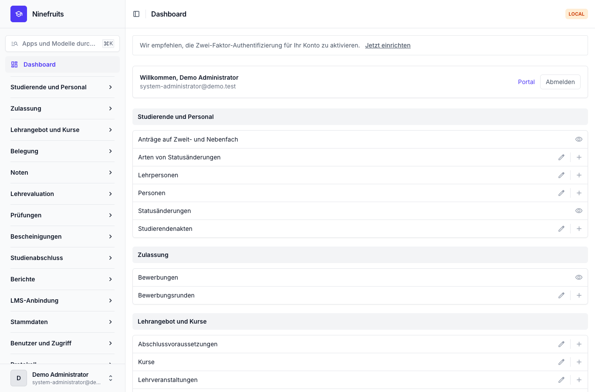
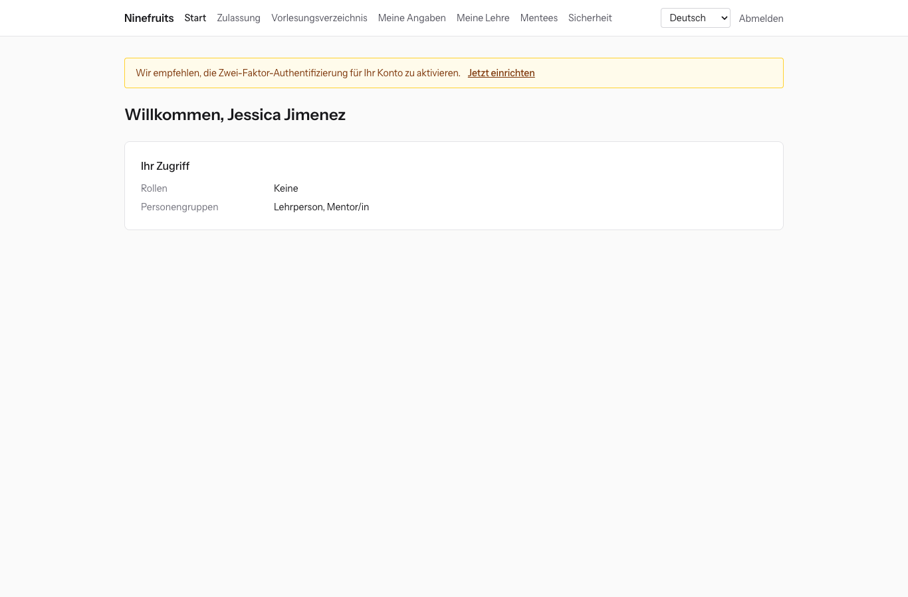
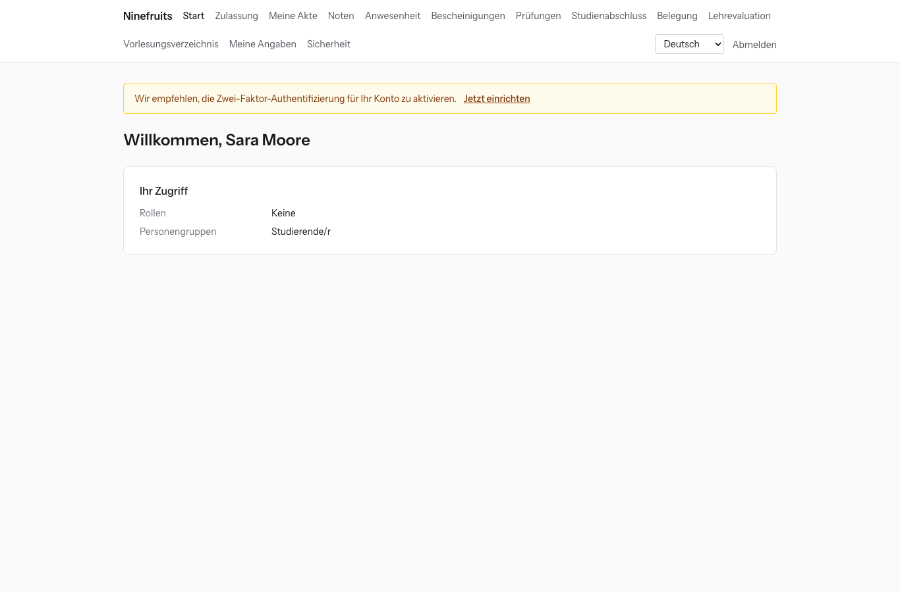

# Ninefruits — Studierendenverwaltungssystem (Django)

**Sprachen / Languages / 언어 / 语言 / ພາສາ**

| Sprache | README | Handbuch |
|---|---|---|
| English | [README.md](README.md) | [docs/manual/en/](docs/manual/en/README.md) |
| 한국어 | [README.ko.md](README.ko.md) | [docs/manual/ko/](docs/manual/ko/README.md) |
| 简体中文 | [README.zh_Hans.md](README.zh_Hans.md) | [docs/manual/zh_Hans/](docs/manual/zh_Hans/README.md) |
| ລາວ | [README.lo.md](README.lo.md) | [docs/manual/lo/](docs/manual/lo/README.md) |
| Deutsch | [README.de.md](README.de.md) (diese Datei) | [docs/manual/de/](docs/manual/de/README.md) |
| Filipino | [README.fil.md](README.fil.md) | [docs/manual/fil/](docs/manual/fil/README.md) |
| Français | [README.fr.md](README.fr.md) | [docs/manual/fr/](docs/manual/fr/README.md) |
| 日本語 | [README.ja.md](README.ja.md) | [docs/manual/ja/](docs/manual/ja/README.md) |
| Монгол | [README.mn.md](README.mn.md) | [docs/manual/mn/](docs/manual/mn/README.md) |
| Bahasa Melayu | [README.ms.md](README.ms.md) | [docs/manual/ms/](docs/manual/ms/README.md) |
| नेपाली | [README.ne.md](README.ne.md) | [docs/manual/ne/](docs/manual/ne/README.md) |
| Русский | [README.ru.md](README.ru.md) | [docs/manual/ru/](docs/manual/ru/README.md) |
| ไทย | [README.th.md](README.th.md) | [docs/manual/th/](docs/manual/th/README.md) |
| Türkçe | [README.tr.md](README.tr.md) | [docs/manual/tr/](docs/manual/tr/README.md) |
| Oʻzbek | [README.uz.md](README.uz.md) | [docs/manual/uz/](docs/manual/uz/README.md) |
| Tiếng Việt | [README.vi.md](README.vi.md) | [docs/manual/vi/](docs/manual/vi/README.md) |

Wie Sie eine weitere Sprache hinzufügen, steht unter [Eine Sprache hinzufügen](docs/development/adding-a-language.md) ([한국어](docs/development/adding-a-language.ko.md)).

Ninefruits ist ein Studierendenverwaltungssystem, das jede Universität installieren und betreiben kann. Es deckt den Kern der akademischen Verwaltung ab, von Bewerbungen über Studierendenakten, Lehrangebot und Kurse, Belegung, Noten, Lehrevaluation, Bescheinigungen, Sprach- und Abschlussprüfungen, Anwesenheit und Prüfung der Abschlussvoraussetzungen bis zu Berichten und einer Grundlage für die LMS-Anbindung. Oberflächen und Dokumentation gibt es in den 16 Sprachen der Tabelle oben.

Dieses Repository ist die Portierung von [Ninefruits für Laravel](https://github.com/humble92/ninefruits-laravel) v1.0.0 (Laravel 13, Filament, Livewire) auf Python 3.14 / Django 6.1 / PostgreSQL 18. Die Portierung behält das Verhalten des Originals und sein Datenbankschema unverändert bei: Die Django-Migrationen spielen das DDL des Originals nach, und das Schema wird Objekt für Objekt mit dem `pg_dump` des Originals verglichen (`tests/db/test_schema_equivalence.py`, `tools/schema_dump_diff.py`). Eine Installation der einen Version lässt sich daher mit den Standardwerkzeugen von PostgreSQL auf die andere übertragen. Wie und warum portiert wurde, ist in [porting/](porting/README.md) festgehalten (Plan, Phasenberichte, Designentscheidungen, Testzuordnung).

## Auf einen Blick

Die ersten Bildschirme nach der Anmeldung mit drei Rollen (Demodaten).

| Systemadministration (Verwaltungsoberfläche) | Lehrperson (Portal) | Studierende (Portal) |
|---|---|---|
|  |  |  |

- **Verwaltungsoberfläche** `/admin/`: Die Mitarbeitenden bearbeiten Studierendenakten, Studienangelegenheiten, Zulassung, Bescheinigungen, Prüfungen, Studienabschluss und Berichte (Django-Admin mit django-unfold). Berechtigungen ergeben sich aus Rollenvorlagen (Studierendensekretariat, Lehrplanung, Bescheinigungsstelle, Institutssekretariat, Zulassungsstelle, Systemadministration), deren Geltungsbereich auf Organisationseinheiten und Studiengänge beschränkt ist.
- **Portal** `/portal/`: Studierende sehen Belegung, Noten, Anwesenheit, Prüfungsanmeldungen, Abschlussvoraussetzungen und Bescheinigungen; Lehrpersonen sehen Teilnehmerliste, Anwesenheit, Noteneingabe und Evaluationsergebnisse ihrer Kurse; Bewerbende bewerben sich um Zulassung (Django-Templates mit HTMX, Alpine.js und Tailwind CSS). Ein Konto kann mehrere Rollen haben (zum Beispiel eine Studentin, die auch Tutorin ist).
- Beide verwenden dieselbe Anmeldung (`/accounts/login/`, django-allauth) und dieselbe Zwei-Faktor-Richtlinie. Integrationen verwenden die REST-API unter `/api/v1/` (OpenAPI unter `/api/docs/`).

## Funktionen

| Bereich | Inhalt |
|---|---|
| Benutzer und Sicherheit | Gemeinsame Anmeldung, Zwei-Faktor-Authentifizierung (App, E-Mail), SSO (OIDC), Anmeldung mit Matrikelnummer, Rollen, Berechtigungen und Geltungsbereiche, Protokollierung von Daten und Aktivitäten mit Hash-Kette, Row Level Security (RLS), Verschlüsselung personenbezogener Daten |
| Personen und Studierendenakten | Trennung von Person und Studierendenakte, Regeln für Matrikelnummern, Statusänderungen (Beurlaubung, Rückkehr, Exmatrikulation auf Antrag, Exmatrikulation von Amts wegen, Wiederaufnahme, Studienabschluss) mit Antrag und Genehmigung, Mentor/innen, Zweitfächer und Nebenfächer |
| Zulassung | Bewerbungsrunden, Online-Bewerbungen und Unterlagen, Begutachtung und Bekanntgabe der Ergebnisse, Studierendenakten für zugelassene Bewerbende |
| Lehrangebot | Versionen von Lehrveranstaltungen, Voraussetzungen und äquivalente Lehrveranstaltungen, Abschlussvoraussetzungen je Studienordnungsjahr, Kurse, Stundenpläne, Kurspläne |
| Belegung | Regelwerke, Leistungspunkte-Obergrenzen, Kapazitäten und Wartelisten, Sperren und Regelausnahmen, ausgelegt für die Belegungsspitze |
| Noten | Absolute und relative Bewertung, Notenobergrenzen, Einreichung und Freigabe, Genehmigung von Notenänderungen, Notendurchschnitt und Wiederholungen, Semesterabschluss (Studienwarnung, Auszeichnungen), Notenspiegel |
| Lehrevaluation | Anonyme Antworten, Evaluationsbögen und Fragen, Mindest-Rücklaufquote, Veröffentlichung der Ergebnisse, Noteneinsicht erst nach abgeschlossener Evaluation |
| Bescheinigungen | Bescheinigungsarten und Vorlagen je Sprache, Bescheinigungsnummern, gespeicherte PDFs, öffentliche Prüfseite (QR) |
| Prüfungen | Prüfungsarten, Bereiche und Bestehensgrenzen, Prüfungstermine und Anmeldungen, Ergebniseingabe, CSV und Veröffentlichung, Korrekturanträge, externe Ergebnisse |
| Anwesenheit | Kurstermine aus dem Stundenplan, Erfassung der Anwesenheit, Anwesenheitsliste als PDF, Teilnehmerliste als CSV |
| Studienabschluss | Prüfung der Abschlussvoraussetzungen, gespeicherte Prüfungen, Erlass von Anforderungen (Vier-Augen-Prinzip), Bearbeitung von Studienabschlüssen und Abschlussnummern |
| Berichte | Sieben Standardberichte mit CSV, `reporting`-Views für BI-Werkzeuge |
| LMS-Anbindung | Plattformen, Kursverknüpfungen und Synchronisationsprotokolle, ereignisgesteuerte Synchronisation, nächtlicher Abgleich, LMS-Punkte als Entwurf, REST-API mit Tokens |

## Technologie

Python 3.14, Django 6.1, django-unfold (Verwaltungsoberfläche), HTMX 2, Alpine.js 3, Tailwind CSS 4 und Vite (Portal, django-vite), PostgreSQL 18 (Row Level Security, Protokollierung per Trigger), Redis, Celery und Flower (Queue), Gotenberg (PDF), django-allauth (Anmeldung, Zwei-Faktor-Authentifizierung, SSO), Django REST framework (API). Die Abhängigkeiten sind mit [uv](https://docs.astral.sh/uv/) (`uv.lock`) und npm (`package-lock.json`) festgeschrieben.

## Schnellstart (Demoseite)

### Mit uv

PostgreSQL 18, Redis 8, Gotenberg 8 und Mailpit müssen lokal laufen (oder starten Sie nur diese Dienste mit Docker Compose: `docker compose up -d pgsql redis gotenberg mailpit`).

```bash
uv sync                                         # .venv with the development tools
npm ci && npm run build                         # static/dist/ (or `npm run dev` with VITE_DEV_MODE=true)
cp .env.example .env
uv run manage.py pii_generate_key               # put the two values into .env
# Database roles and database (once, as the superuser): docs/manual/en/operations/installation.md section 2
uv run manage.py setup_install --profile=korean-university --grade-scale=4.5   # migrations, essential data, institution, first administrator
uv run manage.py setup_demo --size=small --seed=42                             # demo university and demo accounts
uv run manage.py compilemessages --ignore=.venv
uv run manage.py runserver
uv run celery -A config worker --loglevel=INFO  # in a second terminal (term close, waitlists, imports)
```

- Portal: http://localhost:8000/portal/ · Verwaltungsoberfläche: http://localhost:8000/admin/ (dieselbe Anmeldung)
- Mail (Mailpit): http://localhost:8025

### Mit Docker Compose

Auf dem Host wird nur Docker benötigt.

```bash
cp .env.example .env
docker compose up -d                            # app, worker, beat, flower, pgsql, redis, mailpit, gotenberg
docker compose exec app uv run manage.py pii_generate_key        # put the two values into .env, then: docker compose up -d
docker compose exec app uv run manage.py setup_install --profile=korean-university --grade-scale=4.5
docker compose exec app uv run manage.py setup_demo --size=small --seed=42
docker compose exec app uv run manage.py compilemessages --ignore=.venv
docker compose --profile vite up -d vite        # optional: Vite dev server (HMR), VITE_DEV_MODE=true in .env
```

Der Container `pgsql` legt beim ersten Start die Datenbankrollen an (`app_migrator`, `app_runtime`, `app_reporting`) und bereitet die Entwicklungs- und Testdatenbanken vor (`docker/pgsql/`). Queue-Monitor (Flower): http://localhost:5555

### Demokonten

Alle Passwörter lauten `demo-password` (`ninefruits/setup/conf.py`). Die Zwei-Faktor-Authentifizierung ist nicht eingerichtet.

| Konto | Rolle / Personengruppe | Startseite |
|---|---|---|
| system-administrator@demo.test | Systemadministration (alle Berechtigungen) | /admin/ |
| registrar@demo.test | Studierendensekretariat (Studierendenakten, Belegungsänderungen, Notenfreigabe, Bescheinigungen, Prüfungen, Studienabschluss, Berichte) | /admin/ |
| academic-affairs@demo.test | Lehrplanung (Lehrveranstaltungen, Kurse, Stundenpläne, Bewertungsregeln, Lehrevaluation, Kurstermine) | /admin/ |
| certificate-officer@demo.test | Bescheinigungsstelle | /admin/ |
| department-assistant@demo.test | Institutssekretariat (Ansichten im Geltungsbereich des Instituts, Mentor/innen, Berichte) | /admin/ |
| admissions-officer@demo.test | Zulassungsstelle | /admin/ |
| instructor@demo.test | Lehrperson und Mentor/in (eigene Kurse, Anwesenheit, Noteneingabe, Mentees) | /portal/ |
| student@demo.test | Eingeschriebene/r Studierende/r | /portal/ |
| alumni@demo.test | Absolvent/in | /portal/ |
| readmitted@demo.test | Erneut aufgenommene/r Absolvent/in (zwei Studierendenakten) | /portal/ |
| applicant@demo.test | Bewerber/in | /portal/ |
| admitted@demo.test | Zugelassene/r Bewerber/in | /portal/ |

Die Demodaten sind eine fiktive Universität (Profil für koreanische Universitäten) mit Studierenden, Lehrpersonen, Lehrveranstaltungen, Kursen, Belegungen, Noten, Lehrevaluationen, Bescheinigungen, Prüfungen, Anwesenheit, Prüfungen der Abschlussvoraussetzungen und LMS-Verknüpfungen. Spielen Sie sie nie in der Produktion ein (`setup_demo` verweigert die Ausführung, wenn `DJANGO_ENV=production` gesetzt ist).

Für eine Produktionsinstallation (gunicorn, Nginx, Celery beat, Umgebungsvariablen, Sicherungen) folgen Sie dem [Installationshandbuch](docs/manual/de/operations/installation.md) und der [Deployment-Checkliste](docs/manual/de/operations/deployment-checklist.md).

## Dokumentation

- [Administrationshandbuch](docs/manual/de/admin/README.md): 28 Kapitel, von der Reihenfolge der Ersteinrichtung bis zu allen Bereichen (koreanisches Original: [docs/manual/ko/](docs/manual/ko/README.md))
- [Betriebshandbuch](docs/manual/de/README.md#betrieb): [Installation](docs/manual/de/operations/installation.md), [Deployment-Checkliste](docs/manual/de/operations/deployment-checklist.md), [Befehle](docs/manual/de/operations/commands.md), [zeitgesteuerte Jobs](docs/manual/de/operations/scheduled-jobs.md), [Sicherung und Wiederherstellung](docs/manual/de/operations/backup-restore.md), [Sicherheitsschlüssel](docs/manual/de/operations/security-keys.md), [Protokoll und Wartung](docs/manual/de/operations/audit-and-maintenance.md), [Lasttest](docs/manual/de/operations/load-testing.md), [Fehlerbehebung](docs/manual/de/operations/troubleshooting.md)
- [Leitfaden zur LMS-Anbindung](docs/lms-integration-guide.md)
- [Entwicklung](docs/README.md): [Benennungsregeln](docs/development/naming.md), [Checkliste für Reviews](docs/development/review-checklist.md), [Eine Sprache hinzufügen](docs/development/adding-a-language.md)
- Portierungsverlauf und Designentscheidungen: [porting/](porting/README.md)

## Alltägliche Befehle

| Befehl | Wirkung |
|---|---|
| `uv run pytest -n auto -m "not concurrency"` | Tests (die Nebenläufigkeitstests separat mit `-m concurrency` ausführen) |
| `uv run ruff format && uv run ruff check` | Codestil und Lint |
| `uv run mypy ninefruits config tools/checks` | Typprüfung |
| `uv run tools/checks/raw_sql.py` | Prüfung von Raw SQL (kein aus Zeichenketten zusammengesetztes SQL) |
| `uv run manage.py naming_check` | Prüfung der Benennung (DB-Tabellen und -Spalten, Migrationen, Befehle, Übersetzungen) |
| `uv run manage.py i18n_missing --strict` | Fehlende Übersetzungen (`i18n_export` / `i18n_import` für den Austausch mit Übersetzenden) |
| `uv run manage.py migrate` | Migrationen (verwendet automatisch die Verbindung `app_migrator`) |
| `uv run manage.py setup_install`, `setup_demo` | Installation oder Update, Demodaten |
| `uv run manage.py security_sync_permissions` | Berechtigungskatalog aus dem Code in die Datenbank übertragen |
| `pre-commit install` | ruff, mypy und die Prüfung von Raw SQL vor jedem Commit |

Die vollständige Liste steht in der [Befehlsreferenz](docs/manual/de/operations/commands.md). Die CI (`.github/workflows/ci.yml`) führt dieselben Prüfungen in zwei Jobs aus: Qualität und Tests.

## Lizenz

[MIT-Lizenz](LICENSE). Freie Nutzung, Änderung und Weitergabe; Urheberrechtsvermerk und Lizenztext müssen erhalten bleiben.

---

**Danksagung**

Unser Dank gilt YUSTIC, dem akademischen Verwaltungssystem der Yanbian University of Science and Technology, das dieses System erst möglich gemacht hat. YUSTIC war das Werk eines kleinen Entwicklerteams, das über viele Jahre gemeinsam geträumt, geschwitzt und gebaut hat. Mit diesem System möchten wir zum Ausdruck bringen, wie sehr wir die Kolleginnen und Kollegen, mit denen wir gearbeitet haben, vermissen, respektieren und ihnen danken.
