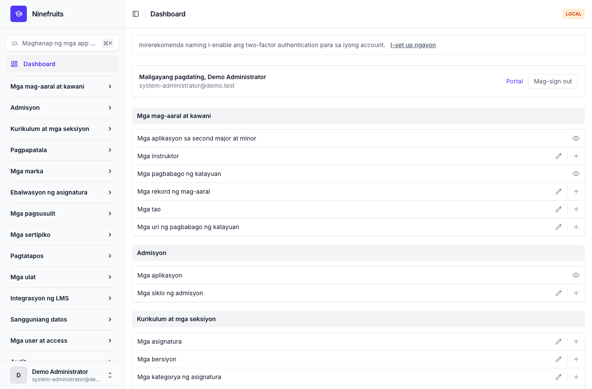
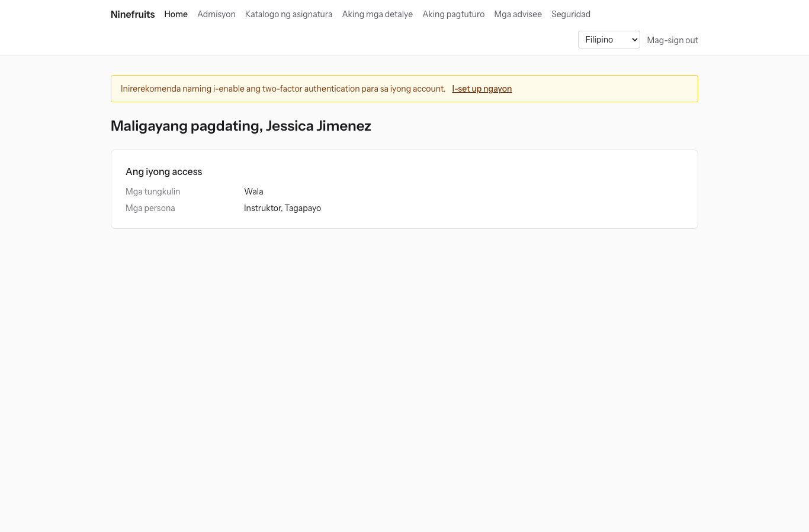
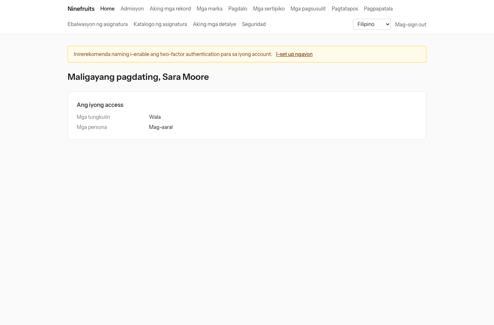

# Ninefruits — Student Information System (Django)

**Mga wika / Languages**

| Wika | README | Manwal |
|---|---|---|
| English | [README.md](README.md) | [docs/manual/en/](docs/manual/en/README.md) |
| 한국어 | [README.ko.md](README.ko.md) | [docs/manual/ko/](docs/manual/ko/README.md) |
| 简体中文 | [README.zh_Hans.md](README.zh_Hans.md) | [docs/manual/zh_Hans/](docs/manual/zh_Hans/README.md) |
| ລາວ | [README.lo.md](README.lo.md) | [docs/manual/lo/](docs/manual/lo/README.md) |
| Deutsch | [README.de.md](README.de.md) | [docs/manual/de/](docs/manual/de/README.md) |
| Filipino | [README.fil.md](README.fil.md) (ang file na ito) | [docs/manual/fil/](docs/manual/fil/README.md) |
| Français | [README.fr.md](README.fr.md) | [docs/manual/fr/](docs/manual/fr/README.md) |
| 日本語 | [README.ja.md](README.ja.md) | [docs/manual/ja/](docs/manual/ja/README.md) |
| Монгол | [README.mn.md](README.mn.md) | [docs/manual/mn/](docs/manual/mn/README.md) |
| Bahasa Melayu | [README.ms.md](README.ms.md) | [docs/manual/ms/](docs/manual/ms/README.md) |
| नेपाली | [README.ne.md](README.ne.md) | [docs/manual/ne/](docs/manual/ne/README.md) |
| Русский | [README.ru.md](README.ru.md) | [docs/manual/ru/](docs/manual/ru/README.md) |
| ไทย | [README.th.md](README.th.md) | [docs/manual/th/](docs/manual/th/README.md) |
| Türkçe | [README.tr.md](README.tr.md) | [docs/manual/tr/](docs/manual/tr/README.md) |
| Oʻzbek | [README.uz.md](README.uz.md) | [docs/manual/uz/](docs/manual/uz/README.md) |
| Tiếng Việt | [README.vi.md](README.vi.md) | [docs/manual/vi/](docs/manual/vi/README.md) |

Upang magdagdag ng isa pang wika, tingnan ang [Pagdaragdag ng wika](docs/development/adding-a-language.md) ([한국어](docs/development/adding-a-language.ko.md)).

Ang Ninefruits ay isang student information system na maaaring i-install at patakbuhin ng anumang unibersidad. Saklaw nito ang ubod ng akademikong administrasyon, mula sa mga aplikasyon sa admisyon hanggang sa mga rekord ng mag-aaral, kurikulum at mga seksiyon, pagpapatala, mga marka, ebalwasyon ng asignatura, mga sertipiko, mga pagsusulit sa wika at comprehensive examination, pagdalo, pagsusuri sa pagtatapos, mga ulat at ang batayan para sa integrasyon ng LMS. Makukuha ang mga screen at dokumentasyon sa 16 na wika ng talahanayan sa itaas.

Ang repository na ito ay ang port sa Python 3.14 / Django 6.1 / PostgreSQL 18 ng [Ninefruits para sa Laravel](https://github.com/humble92/ninefruits-laravel) v1.0.0 (Laravel 13, Filament, Livewire). Pinapanatili ng port ang pag-uugali ng orihinal at ang schema ng database nito nang walang pagbabago: muling pinatatakbo ng mga migration ng Django ang DDL ng orihinal, at inihahambing ang schema, object sa object, sa `pg_dump` ng orihinal (`tests/db/test_schema_equivalence.py`, `tools/schema_dump_diff.py`). Kaya maaaring ilipat ang installation ng alinmang bersiyon sa isa pa gamit ang karaniwang mga tool ng PostgreSQL. Nakatala sa [porting/](porting/README.md) kung paano at bakit ito na-port (plano, mga ulat bawat phase, mga desisyon sa disenyo, pagmamapa ng mga test).

## Sa isang sulyap

Ang mga unang screen matapos mag-sign in gamit ang tatlong tungkulin (demo data).

| Administrator ng sistema (panel ng administrasyon) | Instruktor (portal) | Mag-aaral (portal) |
|---|---|---|
|  |  |  |

- **Panel ng administrasyon** `/admin/`: hinahawakan ng mga kawani ang mga rekord ng mag-aaral, akademikong gawain, admisyon, mga sertipiko, mga pagsusulit, pagtatapos at mga ulat (Django admin na may django-unfold). Nagmumula ang mga pahintulot sa mga template ng tungkulin (Registrar, Academic Affairs, Tagapangasiwa ng Sertipiko, Katuwang ng Departamento, Admissions Officer, Administrator ng Sistema) na may saklaw na mga yunit ng organisasyon at programa.
- **Portal** `/portal/`: nakikita ng mga mag-aaral ang pagpapatala, mga marka, pagdalo, mga aplikasyon sa pagsusulit, mga kinakailangan sa pagtatapos at mga sertipiko; nakikita ng mga instruktor ang roster, pagdalo, pagpasok ng marka at mga resulta ng ebalwasyon ng kanilang mga seksiyon; nag-a-apply para sa admisyon ang mga aplikante (mga template ng Django na may HTMX, Alpine.js at Tailwind CSS). Maaaring magkaroon ng ilang tungkulin ang iisang account (halimbawa, mag-aaral na teaching assistant din).
- Pareho silang gumagamit ng iisang pag-sign in (`/accounts/login/`, django-allauth) at iisang patakaran sa two-factor. Gumagamit ang mga integrasyon ng REST API sa ilalim ng `/api/v1/` (OpenAPI sa `/api/docs/`).

## Mga tampok

| Larangan | Nilalaman |
|---|---|
| Mga user at seguridad | Iisang pag-sign in, two-factor authentication (app, email), SSO (OIDC), pag-sign in gamit ang student number, mga tungkulin, pahintulot at saklaw ng organisasyon, audit ng datos at aktibidad na may hash chain, row level security (RLS), naka-encrypt na personal na datos |
| Mga tao at rekord ng mag-aaral | Paghihiwalay ng tao at rekord ng mag-aaral, mga panuntunan sa student number, mga pagbabago ng katayuan (leave, pagbalik, pag-withdraw, pagkatanggal, muling pagtanggap, pagtatapos) na may kahilingan at pag-apruba, mga tagapayo, second major at minor |
| Admisyon | Mga siklo ng admisyon, online na aplikasyon at mga dokumento, pagsusuri at paglalabas ng resulta, mga rekord ng mag-aaral para sa mga natanggap na aplikante |
| Kurikulum | Mga bersiyon ng asignatura, prerequisite at katumbas na asignatura, mga kinakailangan sa pagtatapos bawat taon ng kurikulum, mga seksiyon, talaorasan, syllabus |
| Pagpapatala | Mga set ng panuntunan, limitasyon ng units, kapasidad at waitlist, hold at override, idinisenyo para sa rurok ng pagpapatala |
| Mga marka | Absolute at relative na pagmamarka, mga limitasyon sa distribusyon ng marka, pagsusumite at paggawang pinal, pag-apruba ng pagbabago ng marka, GPA at retake, pagsasara ng termino (academic probation, karangalan), Transcript of Records |
| Ebalwasyon ng asignatura | Anonimong tugon, mga form at tanong, pinakamababang antas ng pagtugon, paglalathala ng resulta, pagpigil sa pagtingin ng marka hangga't hindi tapos ang ebalwasyon |
| Mga sertipiko | Mga uri at template bawat wika, mga numero ng sertipiko, naka-imbak na PDF, pampublikong pahina ng beripikasyon (QR) |
| Mga pagsusulit | Mga uri ng pagsusulit, mga bahagi at iskor na pasado, mga sesyon at aplikasyon, pagpasok ng resulta, CSV at paglalathala, mga kahilingan sa pagwawasto, panlabas na iskor |
| Pagdalo | Mga pagkikita ng klase mula sa talaorasan, pagpasok ng pagdalo, PDF ng attendance sheet, CSV ng roster |
| Pagtatapos | Audit ng kinakailangan, naka-save na pagsusuri, waiver ng kinakailangan (dalawang tagapag-apruba), pagproseso ng pagtatapos at mga numero ng degree |
| Mga ulat | Pitong karaniwang ulat na may CSV, mga view na `reporting` para sa mga BI tool |
| Integrasyon ng LMS | Mga platform, link ng asignatura at rekord ng sync, sync na pinapagana ng event, gabi-gabing reconciliation, mga iskor sa LMS bilang draft, REST API na may mga token |

## Teknolohiya

Python 3.14, Django 6.1, django-unfold (panel ng administrasyon), HTMX 2, Alpine.js 3, Tailwind CSS 4 at Vite (portal, django-vite), PostgreSQL 18 (row level security, audit sa pamamagitan ng trigger), Redis, Celery at Flower (queue), Gotenberg (PDF), django-allauth (pag-sign in, two-factor, SSO), Django REST framework (API). Naka-lock ang mga dependency gamit ang [uv](https://docs.astral.sh/uv/) (`uv.lock`) at npm (`package-lock.json`).

## Mabilisang pagsisimula (demo site)

### Gamit ang uv

Dapat tumatakbo nang lokal ang PostgreSQL 18, Redis 8, Gotenberg 8 at Mailpit (o simulan lamang ang mga service na iyon gamit ang Docker Compose: `docker compose up -d pgsql redis gotenberg mailpit`).

```bash
uv sync                                         # .venv with the development tools
npm ci && npm run build                         # static/dist/ (or `npm run dev` with VITE_DEV_MODE=true)
cp .env.example .env
uv run manage.py pii_generate_key               # put the two values into .env
# Database roles and database (once, as the superuser): docs/manual/en/operations/installation.md section 2
uv run manage.py setup_install --profile=korean-university --grade-scale=4.5   # migrations, essential data, institution, first administrator
uv run manage.py setup_demo --size=small --seed=42                             # demo university and demo accounts
uv run manage.py compilemessages --ignore=.venv
uv run manage.py runserver
uv run celery -A config worker --loglevel=INFO  # in a second terminal (term close, waitlists, imports)
```

- Portal: http://localhost:8000/portal/ · Panel ng administrasyon: http://localhost:8000/admin/ (parehong pag-sign in)
- Mail (Mailpit): http://localhost:8025

### Gamit ang Docker Compose

Docker lamang ang kailangan sa host.

```bash
cp .env.example .env
docker compose up -d                            # app, worker, beat, flower, pgsql, redis, mailpit, gotenberg
docker compose exec app uv run manage.py pii_generate_key        # put the two values into .env, then: docker compose up -d
docker compose exec app uv run manage.py setup_install --profile=korean-university --grade-scale=4.5
docker compose exec app uv run manage.py setup_demo --size=small --seed=42
docker compose exec app uv run manage.py compilemessages --ignore=.venv
docker compose --profile vite up -d vite        # optional: Vite dev server (HMR), VITE_DEV_MODE=true in .env
```

Ginagawa ng container na `pgsql` ang mga role ng database (`app_migrator`, `app_runtime`, `app_reporting`) at inihahanda ang mga database para sa development at test sa unang pagsisimula nito (`docker/pgsql/`). Queue monitor (Flower): http://localhost:5555

### Mga demo account

Ang bawat password ay `demo-password` (`ninefruits/setup/conf.py`). Hindi naka-enroll ang two-factor authentication.

| Account | Tungkulin / persona | Unang screen |
|---|---|---|
| system-administrator@demo.test | Administrator ng Sistema (lahat ng pahintulot) | /admin/ |
| registrar@demo.test | Registrar (mga rekord ng mag-aaral, mga pagbabago sa pagpapatala, paggawang pinal ng marka, mga sertipiko, mga pagsusulit, pagtatapos, mga ulat) | /admin/ |
| academic-affairs@demo.test | Academic Affairs (mga asignatura, seksiyon, talaorasan, patakaran sa pagmamarka, ebalwasyon ng asignatura, mga pagkikita ng klase) | /admin/ |
| certificate-officer@demo.test | Tagapangasiwa ng Sertipiko | /admin/ |
| department-assistant@demo.test | Katuwang ng Departamento (pagtingin na may saklaw na departamento, mga tagapayo, mga ulat) | /admin/ |
| admissions-officer@demo.test | Admissions Officer | /admin/ |
| instructor@demo.test | Instruktor at tagapayo (sariling mga seksiyon, pagdalo, pagpasok ng marka, mga advisee) | /portal/ |
| student@demo.test | Kasalukuyang mag-aaral | /portal/ |
| alumni@demo.test | Nagtapos | /portal/ |
| readmitted@demo.test | Nagtapos na muling tinanggap (dalawang rekord ng mag-aaral) | /portal/ |
| applicant@demo.test | Aplikante | /portal/ |
| admitted@demo.test | Natanggap na aplikante | /portal/ |

Ang demo data ay isang kathang-isip na unibersidad (profile ng unibersidad sa Korea) na may mga mag-aaral, instruktor, asignatura, seksiyon, pagpapatala, marka, ebalwasyon ng asignatura, sertipiko, pagsusulit, pagdalo, pagsusuri sa pagtatapos at mga link sa LMS. Huwag itong i-load kailanman sa production (tumatangging tumakbo ang `setup_demo` kapag `DJANGO_ENV=production`).

Para sa installation sa production (gunicorn, Nginx, Celery beat, mga environment variable, mga backup), sundin ang [manwal ng pag-install](docs/manual/fil/operations/installation.md) at ang [checklist sa deployment](docs/manual/fil/operations/deployment-checklist.md).

## Dokumentasyon

- [Manwal ng administrator](docs/manual/fil/admin/README.md): 28 kabanata, mula sa pagkakasunod-sunod ng unang pag-set up hanggang sa bawat larangan (orihinal na Korean: [docs/manual/ko/](docs/manual/ko/README.md))
- [Manwal ng operasyon](docs/manual/fil/README.md#operasyon): [pag-install](docs/manual/fil/operations/installation.md), [checklist sa deployment](docs/manual/fil/operations/deployment-checklist.md), [mga command](docs/manual/fil/operations/commands.md), [mga naka-iskedyul na job](docs/manual/fil/operations/scheduled-jobs.md), [backup at restore](docs/manual/fil/operations/backup-restore.md), [mga security key](docs/manual/fil/operations/security-keys.md), [audit at maintenance](docs/manual/fil/operations/audit-and-maintenance.md), [load testing](docs/manual/fil/operations/load-testing.md), [pag-troubleshoot](docs/manual/fil/operations/troubleshooting.md)
- [Gabay sa integrasyon ng LMS](docs/lms-integration-guide.md)
- [Development](docs/README.md): [mga panuntunan sa pagpapangalan](docs/development/naming.md), [checklist sa pagsusuri](docs/development/review-checklist.md), [pagdaragdag ng wika](docs/development/adding-a-language.md)
- Kasaysayan ng porting at mga desisyon sa disenyo: [porting/](porting/README.md)

## Mga karaniwang command

| Command | Layunin |
|---|---|
| `uv run pytest -n auto -m "not concurrency"` | Mga test (patakbuhin nang hiwalay ang mga concurrency test gamit ang `-m concurrency`) |
| `uv run ruff format && uv run ruff check` | Estilo ng code at lint |
| `uv run mypy ninefruits config tools/checks` | Pagsusuri ng type |
| `uv run tools/checks/raw_sql.py` | Pagsusuri ng raw SQL (walang SQL na binuo mula sa string) |
| `uv run manage.py naming_check` | Pagsusuri ng pagpapangalan (mga table at column ng DB, migration, command, salin) |
| `uv run manage.py i18n_missing --strict` | Mga kulang na salin (`i18n_export` / `i18n_import` para makipagpalitan sa mga tagasalin) |
| `uv run manage.py migrate` | Mga migration (awtomatikong gumagamit ng koneksiyong `app_migrator`) |
| `uv run manage.py setup_install`, `setup_demo` | Pag-install o update, demo data |
| `uv run manage.py security_sync_permissions` | Dalhin sa database ang katalogo ng pahintulot ng code |
| `pre-commit install` | ruff, mypy at ang pagsusuri ng raw SQL bago ang bawat commit |

Nasa [sanggunian ng mga command](docs/manual/fil/operations/commands.md) ang buong listahan. Pinatatakbo ng CI (`.github/workflows/ci.yml`) ang parehong mga pagsusuri sa dalawang job: kalidad at mga test.

## Lisensiya

[MIT License](LICENSE). Malayang magagamit, mababago at maipamamahagi ito ng sinuman, basta't pinapanatili ang paunawa sa copyright at ang teksto ng lisensiya.

---

**Pasasalamat**

Taos-puso kaming nagpapasalamat sa YUSTIC, ang sistema ng akademikong administrasyon ng Yanbian University of Science and Technology, na naging daan upang mabuo ang sistemang ito. Ang YUSTIC ay bunga ng isang maliit na pangkat ng mga developer na sama-samang nangarap, nagpagal at bumuo sa loob ng maraming taon. Ang sistemang ito ang aming paraan upang ipahayag kung gaano namin nami-miss, iginagalang at pinasasalamatan ang mga kasamahang aming nakatrabaho.
