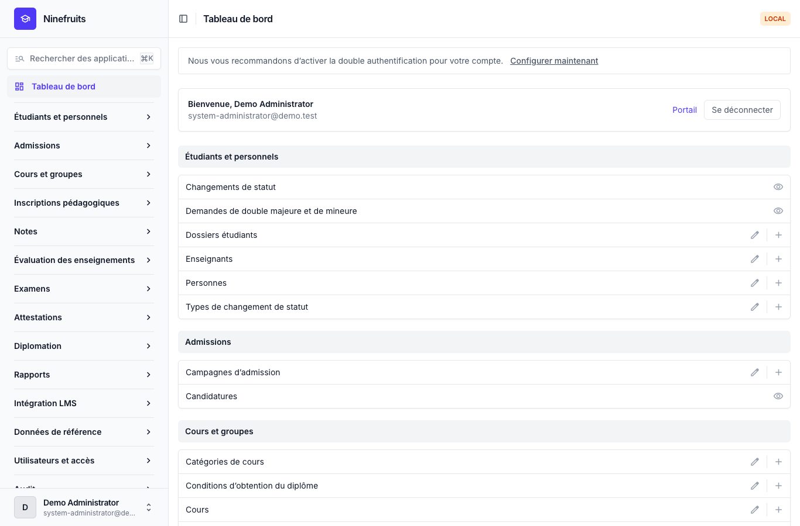
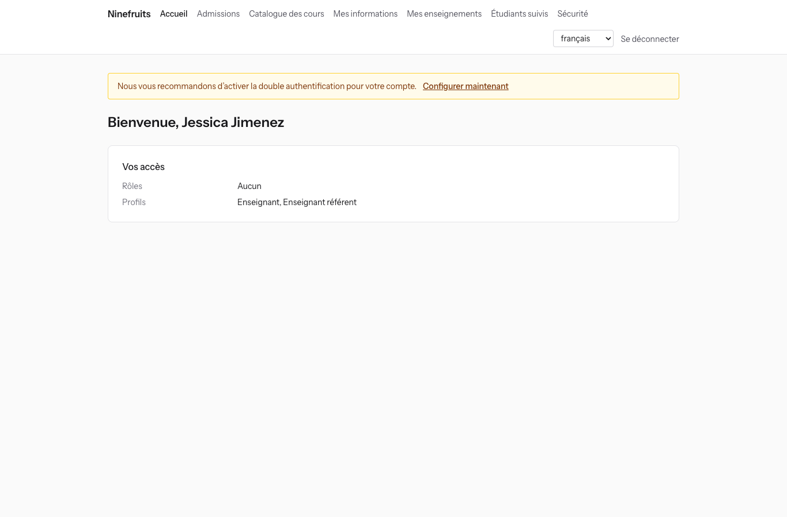
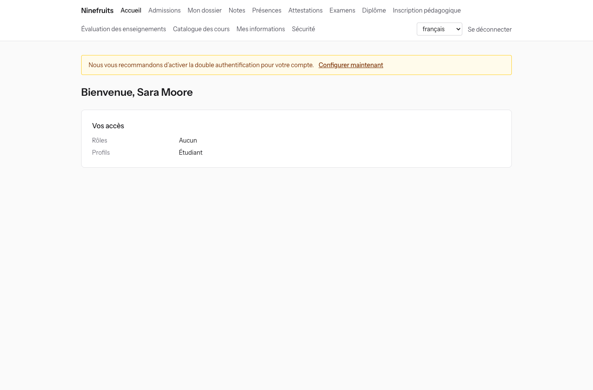

# Ninefruits — Système d’information étudiant (Django)

**Langues / Languages / 언어**

| Langue | README | Manuel |
|---|---|---|
| English | [README.md](README.md) | [docs/manual/en/](docs/manual/en/README.md) |
| 한국어 | [README.ko.md](README.ko.md) | [docs/manual/ko/](docs/manual/ko/README.md) |
| 简体中文 | [README.zh_Hans.md](README.zh_Hans.md) | [docs/manual/zh_Hans/](docs/manual/zh_Hans/README.md) |
| ລາວ | [README.lo.md](README.lo.md) | [docs/manual/lo/](docs/manual/lo/README.md) |
| Deutsch | [README.de.md](README.de.md) | [docs/manual/de/](docs/manual/de/README.md) |
| Filipino | [README.fil.md](README.fil.md) | [docs/manual/fil/](docs/manual/fil/README.md) |
| Français | [README.fr.md](README.fr.md) (ce fichier) | [docs/manual/fr/](docs/manual/fr/README.md) |
| 日本語 | [README.ja.md](README.ja.md) | [docs/manual/ja/](docs/manual/ja/README.md) |
| Монгол | [README.mn.md](README.mn.md) | [docs/manual/mn/](docs/manual/mn/README.md) |
| Bahasa Melayu | [README.ms.md](README.ms.md) | [docs/manual/ms/](docs/manual/ms/README.md) |
| नेपाली | [README.ne.md](README.ne.md) | [docs/manual/ne/](docs/manual/ne/README.md) |
| Русский | [README.ru.md](README.ru.md) | [docs/manual/ru/](docs/manual/ru/README.md) |
| ไทย | [README.th.md](README.th.md) | [docs/manual/th/](docs/manual/th/README.md) |
| Türkçe | [README.tr.md](README.tr.md) | [docs/manual/tr/](docs/manual/tr/README.md) |
| Oʻzbek | [README.uz.md](README.uz.md) | [docs/manual/uz/](docs/manual/uz/README.md) |
| Tiếng Việt | [README.vi.md](README.vi.md) | [docs/manual/vi/](docs/manual/vi/README.md) |

Pour ajouter une autre langue, voir [Ajouter une langue](docs/development/adding-a-language.md) ([한국어](docs/development/adding-a-language.ko.md)).

Ninefruits est un système d’information étudiant que toute université peut installer et exploiter. Il couvre le cœur de la gestion académique, des candidatures aux dossiers étudiants, aux cursus et aux groupes, à l’inscription pédagogique, aux notes, à l’évaluation des enseignements, aux attestations, aux examens de langue et aux examens généraux, à l’assiduité, à la vérification du diplôme, aux rapports et au socle d’intégration LMS. Les écrans et la documentation sont disponibles dans les 16 langues du tableau ci-dessus.

Ce dépôt est le portage en Python 3.14 / Django 6.1 / PostgreSQL 18 de [Ninefruits pour Laravel](https://github.com/humble92/ninefruits-laravel) v1.0.0 (Laravel 13, Filament, Livewire). Le portage conserve sans changement le comportement de l’original et son schéma de base de données : les migrations Django rejouent le DDL de l’original, et le schéma est comparé objet par objet avec le `pg_dump` de l’original (`tests/db/test_schema_equivalence.py`, `tools/schema_dump_diff.py`). Une installation de l’une ou l’autre version peut donc être transférée vers l’autre avec les outils standard de PostgreSQL. Le comment et le pourquoi du portage sont consignés dans [porting/](porting/README.md) (plan, rapports de phase, décisions de conception, correspondance des tests).

## En bref

Les premiers écrans après connexion avec trois rôles (données de démonstration).

| Administrateur système (panneau d’administration) | Enseignant (portail) | Étudiant (portail) |
|---|---|---|
|  |  |  |

- **Panneau d’administration** `/admin/` : le personnel gère les dossiers étudiants, les affaires pédagogiques, les admissions, les attestations, les examens, la diplomation et les rapports (administration Django avec django-unfold). Les autorisations proviennent de modèles de rôles (Scolarité, Affaires pédagogiques, Responsable des attestations, Gestionnaire de département, Chargé des admissions, Administrateur système) dont le périmètre porte sur des unités organisationnelles ou des formations.
- **Portail** `/portal/` : les étudiants consultent l’inscription pédagogique, les notes, l’assiduité, les inscriptions aux examens, les conditions d’obtention du diplôme et les attestations ; les enseignants consultent la liste des étudiants, l’assiduité, la saisie des notes et les résultats d’évaluation de leurs groupes ; les candidats déposent leur candidature (gabarits Django avec HTMX, Alpine.js et Tailwind CSS). Un même compte peut réunir plusieurs rôles (par exemple un étudiant qui est aussi assistant d’enseignement).
- Les deux utilisent la même connexion (`/accounts/login/`, django-allauth) et la même politique de double authentification. Les intégrations utilisent l’API REST sous `/api/v1/` (OpenAPI sur `/api/docs/`).

## Fonctionnalités

| Domaine | Contenu |
|---|---|
| Utilisateurs et sécurité | Connexion commune, double authentification (application, e-mail), SSO (OIDC), connexion par numéro d’étudiant, rôles, autorisations et périmètres organisationnels, audit des données et des opérations avec chaîne de hachage, sécurité au niveau des lignes (RLS), chiffrement des données personnelles |
| Personnes et dossiers étudiants | Séparation personne/dossier étudiant, règles de numérotation des étudiants, changements de statut (congé, reprise d’études, abandon, exclusion, réadmission, diplomation) avec demandes et approbation, enseignants référents, doubles majeures et mineures |
| Admissions | Campagnes d’admission, candidatures en ligne avec pièces, examen et communication des résultats, dossiers étudiants des candidats admis |
| Cursus | Versions de cours, prérequis et cours équivalents, conditions d’obtention du diplôme par année de catalogue, groupes, emplois du temps, syllabus |
| Inscription pédagogique | Ensembles de règles, plafonds de crédits, capacité et listes d’attente, blocages et dérogations, conçue pour le pic d’inscription |
| Notes | Évaluation absolue et relative, plafonds de notes, soumission et validation, approbation des modifications de notes, moyenne et reprises, clôture du semestre (avertissements académiques, tableau d’honneur), relevés de notes |
| Évaluation des enseignements | Réponses anonymes, questionnaires et questions, taux de réponse minimum, publication des résultats, consultation des notes bloquée tant que l’évaluation n’est pas faite |
| Attestations | Types et modèles par langue, numéros d’attestation, PDF archivés, page publique de vérification (QR) |
| Examens | Types d’examen, épreuves et notes de réussite, sessions et inscriptions, saisie des résultats, CSV et publication, demandes de correction, résultats externes |
| Assiduité | Séances générées à partir de l’emploi du temps, saisie des présences, feuille d’émargement PDF, liste des étudiants CSV |
| Diplomation | Vérification des conditions, vérifications enregistrées, dispenses de condition (deux approbateurs), traitement des diplomations et numéros de diplôme |
| Rapports | Sept rapports standard avec CSV, vues `reporting` pour les outils de BI |
| Intégration LMS | Plateformes, liens de cours et journaux de synchronisation, synchronisation déclenchée par événements, rapprochement nocturne, scores LMS comme brouillon, API REST avec jetons |

## Pile technique

Python 3.14, Django 6.1, django-unfold (panneau d’administration), HTMX 2, Alpine.js 3, Tailwind CSS 4 et Vite (portail, django-vite), PostgreSQL 18 (sécurité au niveau des lignes, audit par déclencheurs), Redis, Celery et Flower (files d’attente), Gotenberg (PDF), django-allauth (connexion, double authentification, SSO), Django REST framework (API). Les dépendances sont verrouillées avec [uv](https://docs.astral.sh/uv/) (`uv.lock`) et npm (`package-lock.json`).

## Démarrage rapide (site de démonstration)

### Avec uv

PostgreSQL 18, Redis 8, Gotenberg 8 et Mailpit doivent tourner en local (ou ne démarrez que ces services avec Docker Compose : `docker compose up -d pgsql redis gotenberg mailpit`).

```bash
uv sync                                         # .venv with the development tools
npm ci && npm run build                         # static/dist/ (or `npm run dev` with VITE_DEV_MODE=true)
cp .env.example .env
uv run manage.py pii_generate_key               # put the two values into .env
# Database roles and database (once, as the superuser): docs/manual/en/operations/installation.md section 2
uv run manage.py setup_install --profile=korean-university --grade-scale=4.5   # migrations, essential data, institution, first administrator
uv run manage.py setup_demo --size=small --seed=42                             # demo university and demo accounts
uv run manage.py compilemessages --ignore=.venv
uv run manage.py runserver
uv run celery -A config worker --loglevel=INFO  # in a second terminal (term close, waitlists, imports)
```

- Portail : http://localhost:8000/portal/ · Panneau d’administration : http://localhost:8000/admin/ (même connexion)
- Messagerie (Mailpit) : http://localhost:8025

### Avec Docker Compose

Seul Docker est nécessaire sur l’hôte.

```bash
cp .env.example .env
docker compose up -d                            # app, worker, beat, flower, pgsql, redis, mailpit, gotenberg
docker compose exec app uv run manage.py pii_generate_key        # put the two values into .env, then: docker compose up -d
docker compose exec app uv run manage.py setup_install --profile=korean-university --grade-scale=4.5
docker compose exec app uv run manage.py setup_demo --size=small --seed=42
docker compose exec app uv run manage.py compilemessages --ignore=.venv
docker compose --profile vite up -d vite        # optional: Vite dev server (HMR), VITE_DEV_MODE=true in .env
```

Le conteneur `pgsql` crée les rôles de base de données (`app_migrator`, `app_runtime`, `app_reporting`) et prépare les bases de développement et de test lors de son premier démarrage (`docker/pgsql/`). Moniteur de files d’attente (Flower) : http://localhost:5555

### Comptes de démonstration

Tous les mots de passe sont `demo-password` (`ninefruits/setup/conf.py`). La double authentification n’est pas activée.

| Compte | Rôle / profil | Premier écran |
|---|---|---|
| system-administrator@demo.test | Administrateur système (toutes les autorisations) | /admin/ |
| registrar@demo.test | Scolarité (dossiers étudiants, ajustements d’inscription, validation des notes, attestations, examens, diplomation, rapports) | /admin/ |
| academic-affairs@demo.test | Affaires pédagogiques (cours, groupes, emplois du temps, règles de notation, évaluation des enseignements, séances) | /admin/ |
| certificate-officer@demo.test | Responsable des attestations | /admin/ |
| department-assistant@demo.test | Gestionnaire de département (consultation limitée au département, enseignants référents, rapports) | /admin/ |
| admissions-officer@demo.test | Chargé des admissions | /admin/ |
| instructor@demo.test | Enseignant et enseignant référent (ses groupes, assiduité, saisie des notes, étudiants suivis) | /portal/ |
| student@demo.test | Étudiant inscrit | /portal/ |
| alumni@demo.test | Diplômé | /portal/ |
| readmitted@demo.test | Diplômé admis de nouveau (deux dossiers étudiants) | /portal/ |
| applicant@demo.test | Candidat | /portal/ |
| admitted@demo.test | Candidat admis | /portal/ |

Les données de démonstration représentent une université fictive (profil université coréenne) avec des étudiants, des enseignants, des cours, des groupes, des inscriptions, des notes, des évaluations des enseignements, des attestations, des examens, l’assiduité, des vérifications du diplôme et des liens LMS. Ne les chargez jamais en production (`setup_demo` refuse de s’exécuter lorsque `DJANGO_ENV=production`).

Pour une installation de production (gunicorn, Nginx, Celery beat, variables d’environnement, sauvegardes), suivez le [manuel d’installation](docs/manual/fr/operations/installation.md) et la [liste de contrôle du déploiement](docs/manual/fr/operations/deployment-checklist.md).

## Documentation

- [Manuel d’administration](docs/manual/fr/admin/README.md) : 28 chapitres, de l’ordre de configuration initiale à chaque domaine
- [Manuel d’exploitation](docs/manual/fr/README.md#exploitation) : [installation](docs/manual/fr/operations/installation.md), [liste de contrôle du déploiement](docs/manual/fr/operations/deployment-checklist.md), [commandes](docs/manual/fr/operations/commands.md), [tâches planifiées](docs/manual/fr/operations/scheduled-jobs.md), [sauvegarde et restauration](docs/manual/fr/operations/backup-restore.md), [clés de sécurité](docs/manual/fr/operations/security-keys.md), [audit et maintenance](docs/manual/fr/operations/audit-and-maintenance.md), [test de charge](docs/manual/fr/operations/load-testing.md), [dépannage](docs/manual/fr/operations/troubleshooting.md)
- [Guide d’intégration LMS](docs/lms-integration-guide.md)
- [Développement](docs/README.md) : [règles de nommage](docs/development/naming.md), [liste de contrôle de revue](docs/development/review-checklist.md), [ajouter une langue](docs/development/adding-a-language.md)
- Historique du portage et décisions de conception : [porting/](porting/README.md)

## Commandes courantes

| Commande | Rôle |
|---|---|
| `uv run pytest -n auto -m "not concurrency"` | Tests (exécutez séparément les tests de concurrence avec `-m concurrency`) |
| `uv run ruff format && uv run ruff check` | Style de code et lint |
| `uv run mypy ninefruits config tools/checks` | Vérification des types |
| `uv run tools/checks/raw_sql.py` | Contrôle du SQL brut (pas de SQL construit par chaînes) |
| `uv run manage.py naming_check` | Contrôle du nommage (tables et colonnes de la base, migrations, commandes, traductions) |
| `uv run manage.py i18n_missing --strict` | Traductions manquantes (`i18n_export` / `i18n_import` pour travailler avec les traducteurs) |
| `uv run manage.py migrate` | Migrations (utilise automatiquement la connexion `app_migrator`) |
| `uv run manage.py setup_install`, `setup_demo` | Installation ou mise à jour, données de démonstration |
| `uv run manage.py security_sync_permissions` | Synchronise le catalogue d’autorisations du code vers la base de données |
| `pre-commit install` | ruff, mypy et le contrôle du SQL brut avant chaque commit |

La liste complète figure dans la [référence des commandes](docs/manual/fr/operations/commands.md). La CI (`.github/workflows/ci.yml`) exécute les mêmes contrôles en deux tâches : qualité et tests.

## Licence

[Licence MIT](LICENSE). Utilisation, modification et distribution libres, à condition de conserver la mention de droit d’auteur et le texte de la licence.

---

**Remerciements**

Nous remercions YUSTIC, le système de gestion académique de l’Université des sciences et technologies de Yanbian, qui a rendu ce système possible. YUSTIC est l’œuvre d’une petite équipe de développeurs qui ont rêvé, peiné et construit ensemble pendant de nombreuses années. Ce système est notre façon de dire combien nos anciens collègues nous manquent, et tout le respect et la gratitude que nous leur portons.
