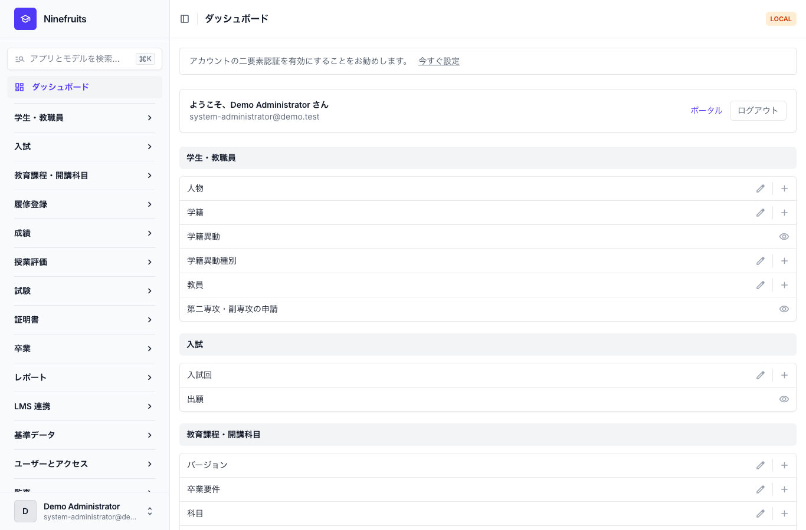
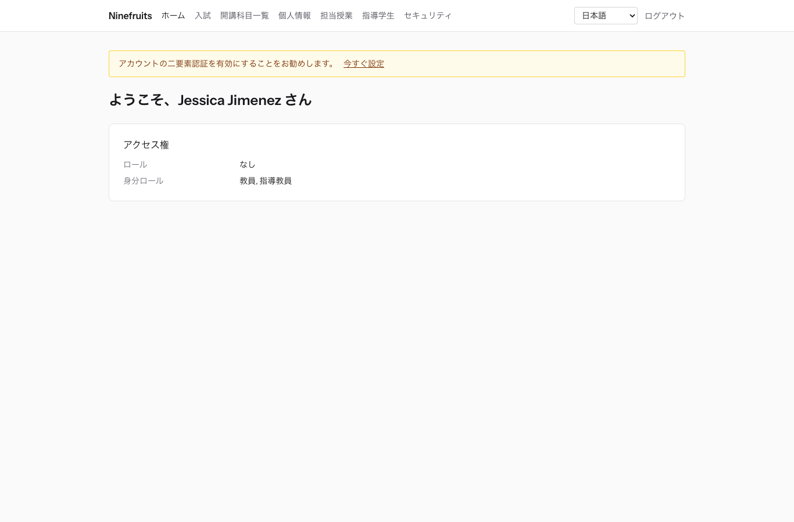
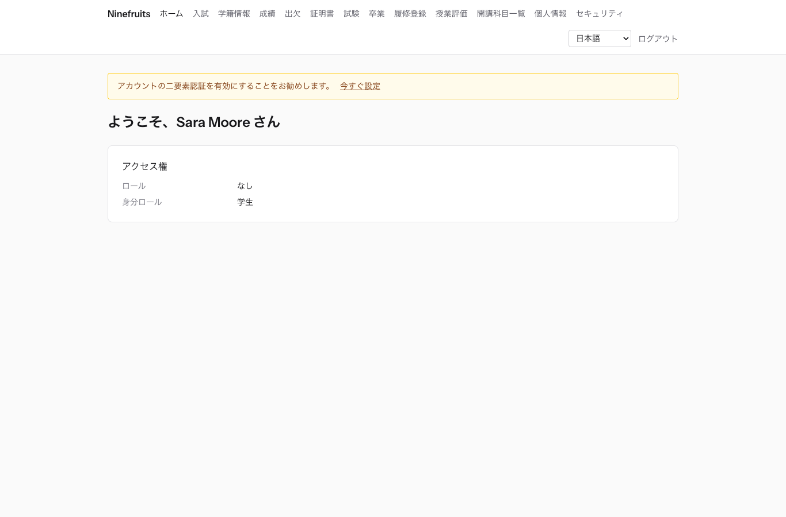

# Ninefruits — 学生情報システム (Django)

**Languages / 言語**

| 言語 | README | マニュアル |
|---|---|---|
| English | [README.md](README.md) | [docs/manual/en/](docs/manual/en/README.md) |
| 한국어 | [README.ko.md](README.ko.md) | [docs/manual/ko/](docs/manual/ko/README.md) |
| 简体中文 | [README.zh_Hans.md](README.zh_Hans.md) | [docs/manual/zh_Hans/](docs/manual/zh_Hans/README.md) |
| ລາວ | [README.lo.md](README.lo.md) | [docs/manual/lo/](docs/manual/lo/README.md) |
| Deutsch | [README.de.md](README.de.md) | [docs/manual/de/](docs/manual/de/README.md) |
| Filipino | [README.fil.md](README.fil.md) | [docs/manual/fil/](docs/manual/fil/README.md) |
| Français | [README.fr.md](README.fr.md) | [docs/manual/fr/](docs/manual/fr/README.md) |
| 日本語 | [README.ja.md](README.ja.md) (このファイル) | [docs/manual/ja/](docs/manual/ja/README.md) |
| Монгол | [README.mn.md](README.mn.md) | [docs/manual/mn/](docs/manual/mn/README.md) |
| Bahasa Melayu | [README.ms.md](README.ms.md) | [docs/manual/ms/](docs/manual/ms/README.md) |
| नेपाली | [README.ne.md](README.ne.md) | [docs/manual/ne/](docs/manual/ne/README.md) |
| Русский | [README.ru.md](README.ru.md) | [docs/manual/ru/](docs/manual/ru/README.md) |
| ไทย | [README.th.md](README.th.md) | [docs/manual/th/](docs/manual/th/README.md) |
| Türkçe | [README.tr.md](README.tr.md) | [docs/manual/tr/](docs/manual/tr/README.md) |
| Oʻzbek | [README.uz.md](README.uz.md) | [docs/manual/uz/](docs/manual/uz/README.md) |
| Tiếng Việt | [README.vi.md](README.vi.md) | [docs/manual/vi/](docs/manual/vi/README.md) |

言語を追加するには、[言語の追加](docs/development/adding-a-language.md)([한국어](docs/development/adding-a-language.ko.md))を参照してください。

Ninefruits は、どの大学でもインストールして運用できる学生情報システムです。入試の出願から学籍、教育課程と開講科目、履修登録、成績、授業評価、証明書、語学・総合試験、出欠、卒業判定、レポート、LMS 連携基盤まで、教務の中核を扱います。画面と文書は上記の表の 16 言語に対応しています。

このリポジトリは、[Ninefruits for Laravel](https://github.com/humble92/ninefruits-laravel) v1.0.0(Laravel 13、Filament、Livewire)を Python 3.14 / Django 6.1 / PostgreSQL 18 に移植したものです。移植版は元の動作とデータベーススキーマをそのまま維持しています。Django のマイグレーションは元の DDL を再生し、スキーマは元の `pg_dump` とオブジェクト単位で比較されます(`tests/db/test_schema_equivalence.py`、`tools/schema_dump_diff.py`)。そのため、どちらのバージョンのインストールも、標準の PostgreSQL ツールでもう一方へ移行できます。移植の方法と理由は [porting/](porting/README.md) に記録されています(計画、フェーズ報告、設計判断、テスト対応表)。

## 概要

3 つのロールでログインした後の最初の画面(デモデータ)。

| システム管理者(管理画面) | 教員(ポータル) | 学生(ポータル) |
|---|---|---|
|  |  |  |

- **管理画面** `/admin/`: 職員が学籍、教務、入試、証明書、試験、卒業、レポートを扱います(django-unfold を使った Django admin)。権限は、組織単位やプログラムを範囲とするロールテンプレート(学籍担当、教務担当、証明書担当、学科助手、入試担当、システム管理者)から付与されます。
- **ポータル** `/portal/`: 学生は履修登録、成績、出欠、試験の申込、卒業要件、証明書を確認します。教員は担当開講科目の履修者名簿、出欠、成績入力、評価結果を扱います。志願者は出願します(HTMX、Alpine.js、Tailwind CSS を使った Django テンプレート)。1 つのアカウントで複数のロールを持てます(例: ティーチングアシスタントを兼ねる学生)。
- どちらも同じログイン(`/accounts/login/`、django-allauth)と同じ二要素認証ポリシーを使います。外部連携には `/api/v1/` 以下の REST API を使います(OpenAPI は `/api/docs/`)。

## 機能

| 領域 | 内容 |
|---|---|
| ユーザーとセキュリティ | 共通ログイン、二要素認証(アプリ、メール)、SSO(OIDC)、学籍番号でのログイン、ロール・権限・組織範囲、ハッシュチェーンによるデータと業務の監査、行レベルセキュリティ(RLS)、個人情報の暗号化 |
| 人物と学籍 | 人物と学籍の分離、学籍番号のルール、申請と承認を伴う学籍異動(休学、復学、退学、除籍、再入学、卒業)、指導教員、第二専攻と副専攻 |
| 入試 | 入試回、書類付きのオンライン出願、審査と合否発表、合格者の学籍作成 |
| 教育課程 | 科目バージョン、先修科目と代替科目、教育課程年度ごとの卒業要件、開講科目、時間割、シラバス |
| 履修登録 | ルールセット、履修単位上限、定員とキャンセル待ち、制限措置とルール例外、履修登録のピークを想定した設計 |
| 成績 | 絶対評価と相対評価、成績分布上限、提出と確定、成績訂正の承認、GPA と再履修、成績締め(学業警告、成績優秀者)、成績証明書 |
| 授業評価 | 匿名回答、評価票と設問、最小回答率、結果の公開、評価完了までの成績閲覧制限 |
| 証明書 | 種別と言語ごとのテンプレート、発行番号、保存された PDF、公開検証ページ(QR) |
| 試験 | 試験種別、領域と合格点、試験実施回と申込、結果入力、CSV と公開、訂正申請、外部試験の点数 |
| 出欠 | 時間割からの授業回、出欠入力、出席簿 PDF、履修者名簿 CSV |
| 卒業 | 卒業要件の判定、保存された判定、要件免除(2 名による承認)、卒業処理と学位記番号 |
| レポート | CSV 付きの 7 つの標準レポート、BI ツール向けの `reporting` ビュー |
| LMS 連携 | プラットフォーム、コース連携と同期ログ、イベント駆動の同期、夜間の照合、LMS の点数を成績の下書きとして取り込み、トークン認証の REST API |

## 技術スタック

Python 3.14、Django 6.1、django-unfold(管理画面)、HTMX 2、Alpine.js 3、Tailwind CSS 4 と Vite(ポータル、django-vite)、PostgreSQL 18(行レベルセキュリティ、トリガーによる監査)、Redis、Celery と Flower(キュー)、Gotenberg(PDF)、django-allauth(ログイン、二要素認証、SSO)、Django REST framework(API)。依存関係は [uv](https://docs.astral.sh/uv/)(`uv.lock`)と npm(`package-lock.json`)で固定しています。

## クイックスタート(デモサイト)

### uv で実行する

PostgreSQL 18、Redis 8、Gotenberg 8、Mailpit がローカルで動作している必要があります(または Docker Compose でこれらのサービスだけを起動します: `docker compose up -d pgsql redis gotenberg mailpit`)。

```bash
uv sync                                         # .venv with the development tools
npm ci && npm run build                         # static/dist/ (or `npm run dev` with VITE_DEV_MODE=true)
cp .env.example .env
uv run manage.py pii_generate_key               # put the two values into .env
# Database roles and database (once, as the superuser): docs/manual/ja/operations/installation.md section 2
uv run manage.py setup_install --profile=korean-university --grade-scale=4.5   # migrations, essential data, institution, first administrator
uv run manage.py setup_demo --size=small --seed=42                             # demo university and demo accounts
uv run manage.py compilemessages --ignore=.venv
uv run manage.py runserver
uv run celery -A config worker --loglevel=INFO  # in a second terminal (term close, waitlists, imports)
```

- ポータル: http://localhost:8000/portal/ · 管理画面: http://localhost:8000/admin/(同じログイン)
- メール(Mailpit): http://localhost:8025

### Docker Compose で実行する

ホストに必要なのは Docker だけです。

```bash
cp .env.example .env
docker compose up -d                            # app, worker, beat, flower, pgsql, redis, mailpit, gotenberg
docker compose exec app uv run manage.py pii_generate_key        # put the two values into .env, then: docker compose up -d
docker compose exec app uv run manage.py setup_install --profile=korean-university --grade-scale=4.5
docker compose exec app uv run manage.py setup_demo --size=small --seed=42
docker compose exec app uv run manage.py compilemessages --ignore=.venv
docker compose --profile vite up -d vite        # optional: Vite dev server (HMR), VITE_DEV_MODE=true in .env
```

`pgsql` コンテナは、初回起動時にデータベースのロール(`app_migrator`、`app_runtime`、`app_reporting`)を作成し、開発用とテスト用のデータベースを準備します(`docker/pgsql/`)。キュー監視(Flower): http://localhost:5555

### デモアカウント

パスワードはすべて `demo-password` です(`ninefruits/setup/conf.py`)。二要素認証は登録されていません。

| アカウント | ロール / 身分 | 最初の画面 |
|---|---|---|
| system-administrator@demo.test | システム管理者(すべての権限) | /admin/ |
| registrar@demo.test | 学籍担当(学籍、履修変更、成績の確定、証明書、試験、卒業、レポート) | /admin/ |
| academic-affairs@demo.test | 教務担当(科目、開講科目、時間割、成績ポリシー、授業評価、授業回) | /admin/ |
| certificate-officer@demo.test | 証明書担当 | /admin/ |
| department-assistant@demo.test | 学科助手(学科を範囲とする閲覧、指導教員、レポート) | /admin/ |
| admissions-officer@demo.test | 入試担当 | /admin/ |
| instructor@demo.test | 教員兼指導教員(担当開講科目、出欠、成績入力、指導学生) | /portal/ |
| student@demo.test | 在学生 | /portal/ |
| alumni@demo.test | 卒業生 | /portal/ |
| readmitted@demo.test | 卒業後に再入学した学生(学籍 2 件) | /portal/ |
| applicant@demo.test | 志願者 | /portal/ |
| admitted@demo.test | 合格した志願者 | /portal/ |

デモデータは架空の大学 1 校(韓国の大学プロファイル)で、学生、教員、科目、開講科目、履修、成績、授業評価、証明書、試験、出欠、卒業判定、LMS 連携を含みます。本番環境には決して読み込まないでください(`DJANGO_ENV=production` のとき `setup_demo` は実行を拒否します)。

本番環境へのインストール(gunicorn、Nginx、Celery beat、環境変数、バックアップ)は、[インストールマニュアル](docs/manual/ja/operations/installation.md)と[デプロイチェックリスト](docs/manual/ja/operations/deployment-checklist.md)に従ってください。

## ドキュメント

- [管理者マニュアル](docs/manual/ja/admin/README.md): 初期設定の順序から各領域まで全 28 章
- [運用マニュアル](docs/manual/ja/README.md#運用): [インストール](docs/manual/ja/operations/installation.md)、[デプロイチェックリスト](docs/manual/ja/operations/deployment-checklist.md)、[コマンド](docs/manual/ja/operations/commands.md)、[スケジュールジョブ](docs/manual/ja/operations/scheduled-jobs.md)、[バックアップと復元](docs/manual/ja/operations/backup-restore.md)、[セキュリティキー](docs/manual/ja/operations/security-keys.md)、[監査とメンテナンス](docs/manual/ja/operations/audit-and-maintenance.md)、[負荷テスト](docs/manual/ja/operations/load-testing.md)、[トラブルシューティング](docs/manual/ja/operations/troubleshooting.md)
- [LMS 連携ガイド](docs/lms-integration-guide.md)
- [開発](docs/README.md): [命名規則](docs/development/naming.md)、[レビューチェックリスト](docs/development/review-checklist.md)、[言語の追加](docs/development/adding-a-language.md)
- 移植の経緯と設計判断: [porting/](porting/README.md)

## よく使うコマンド

| コマンド | 内容 |
|---|---|
| `uv run pytest -n auto -m "not concurrency"` | テスト(並行性テストは `-m concurrency` で別途実行) |
| `uv run ruff format && uv run ruff check` | コードスタイルと lint |
| `uv run mypy ninefruits config tools/checks` | 型チェック |
| `uv run tools/checks/raw_sql.py` | 生 SQL チェック(文字列で組み立てた SQL の禁止) |
| `uv run manage.py naming_check` | 命名チェック(DB のテーブルと列、マイグレーション、コマンド、翻訳) |
| `uv run manage.py i18n_missing --strict` | 翻訳漏れ(翻訳者との作業には `i18n_export` / `i18n_import`) |
| `uv run manage.py migrate` | マイグレーション(自動的に `app_migrator` の接続を使用) |
| `uv run manage.py setup_install`, `setup_demo` | インストール/更新、デモデータ |
| `uv run manage.py security_sync_permissions` | コードの権限カタログをデータベースに同期 |
| `pre-commit install` | コミットのたびに ruff、mypy、生 SQL チェックを実行 |

全一覧は[コマンドリファレンス](docs/manual/ja/operations/commands.md)にあります。CI(`.github/workflows/ci.yml`)は、品質チェックとテストの 2 つのジョブで同じチェックを実行します。

## ライセンス

[MIT License](LICENSE)。著作権表示とライセンス本文を残す限り、誰でも自由に使用、改変、配布できます。

---

**謝辞**

このシステムを可能にしてくれた、延辺科学技術大学の教務システム YUSTIC に感謝します。YUSTIC は、長年にわたって共に夢を見、汗を流し、作り上げてきた少数の開発者チームの成果でした。このシステムは、共に働いた同僚たちへの懐かしさと敬意、そして感謝を伝える私たちなりの方法です。
