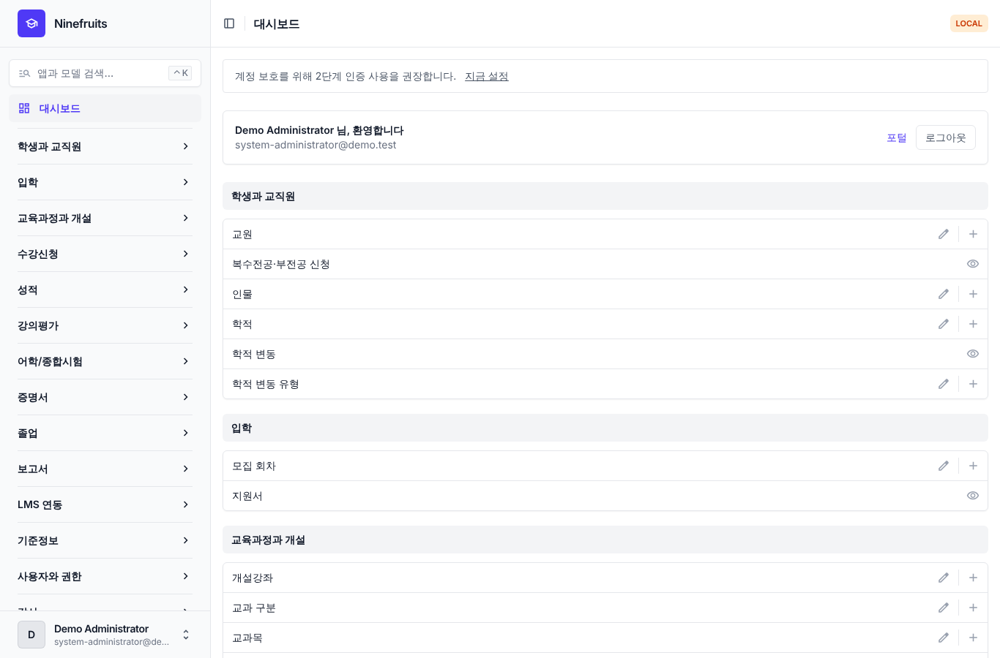
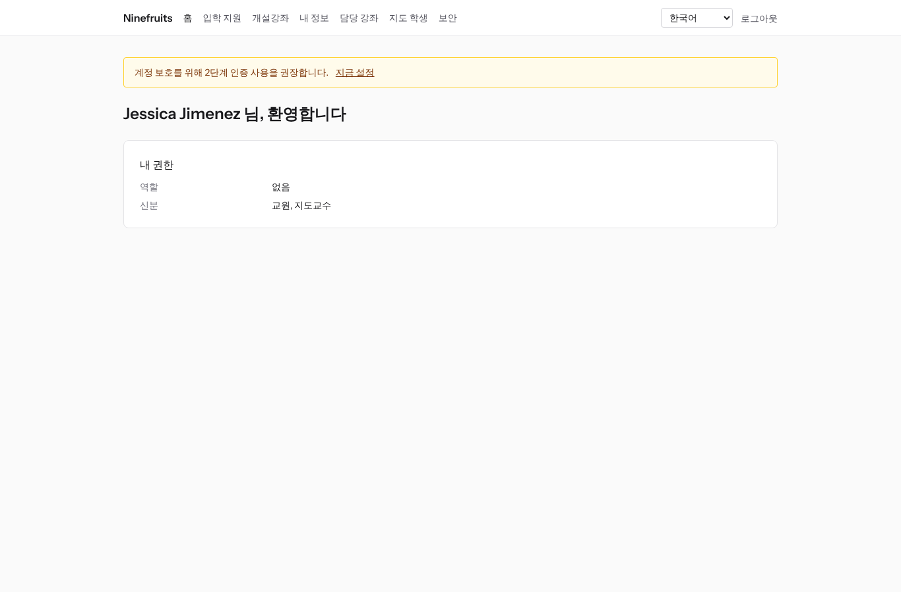
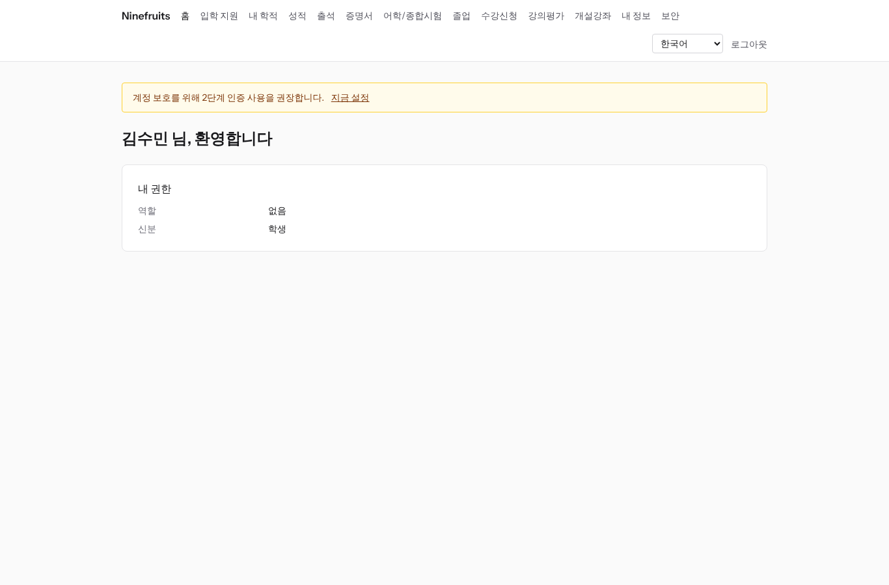

# Ninefruits — 대학 학사 행정 시스템 (Django)

**언어 / Languages / 语言 / ພາສາ**

| 언어 | README | 매뉴얼 |
|---|---|---|
| English | [README.md](README.md) | [docs/manual/en/](docs/manual/en/README.md) |
| 한국어 | [README.ko.md](README.ko.md) (이 문서) | [docs/manual/ko/](docs/manual/ko/README.md) |
| 简体中文 | [README.zh_Hans.md](README.zh_Hans.md) | [docs/manual/zh_Hans/](docs/manual/zh_Hans/README.md) |
| ລາວ | [README.lo.md](README.lo.md) | [docs/manual/lo/](docs/manual/lo/README.md) |

다른 언어를 추가하려면 [언어 추가 가이드](docs/development/adding-a-language.ko.md)([English](docs/development/adding-a-language.md))를 보세요.

Ninefruits는 여러 대학에 설치해 쓸 수 있는 학사 행정 시스템(Student Information System)입니다. 입학 지원부터 학적, 교육과정과 개설강좌, 수강신청, 성적, 강의평가, 증명서, 어학·종합시험, 출석, 졸업 사정, 보고서, LMS 연동 기반까지 학사 업무의 핵심을 다루며, 화면과 문서는 한국어·영어·중국어·라오스어를 지원합니다.

이 저장소는 [Ninefruits Laravel판](https://github.com/humble92/ninefruits-laravel) v1.0.0(Laravel 13, Filament, Livewire)을 Python 3.14 / Django 6.1 / PostgreSQL 18로 옮긴 것입니다. 원본의 동작과 DB 스키마를 그대로 유지합니다. Django 마이그레이션이 원본의 DDL을 그대로 재생하고, 스키마는 원본 `pg_dump`와 객체 단위로 비교합니다(`tests/db/test_schema_equivalence.py`, `tools/schema_dump_diff.py`). 그래서 어느 쪽 설치본이든 표준 PostgreSQL 도구로 다른 쪽에 옮길 수 있습니다. 이식 과정과 이유는 [porting/](porting/README.md)(계획, 단계별 보고, 설계 결정, 테스트 대응표)에 있습니다.

## 한눈에 보기

세 가지 역할로 로그인한 첫 화면입니다(데모 데이터).

| 최고관리자 (관리 화면) | 교수 (포털) | 학생 (포털) |
|---|---|---|
|  |  |  |

- **관리 화면** `/admin/`: 교직원이 학적·교무·입학·증명서·시험·졸업·보고서를 처리합니다(Django admin + django-unfold). 권한은 역할 템플릿(학적 담당, 교무 담당, 증명서 담당, 학과 조교, 입학 담당, 시스템 관리자)과 조직·과정 범위로 정합니다.
- **포털** `/portal/`: 학생은 수강신청, 성적, 출석, 시험 접수, 졸업 요건, 증명서를, 교수는 담당 강좌의 명단·출석·성적 입력·강의평가 결과를, 지원자는 입학 지원을 봅니다(Django 템플릿 + HTMX + Alpine.js + Tailwind CSS). 한 계정이 여러 신분(학생이자 조교 등)을 가질 수 있습니다.
- 두 화면은 같은 로그인(`/accounts/login/`, django-allauth)과 2단계 인증 정책을 씁니다. 외부 연동은 `/api/v1/` REST API를 씁니다(OpenAPI 문서 `/api/docs/`).

## 주요 기능

| 영역 | 내용 |
|---|---|
| 사용자와 보안 | 공용 로그인, 2단계 인증(앱·이메일), 학교 통합 로그인(OIDC), 학번 로그인, 역할·권한·조직 범위, 해시 체인이 있는 데이터·업무 감사, 행 수준 보안(RLS), 개인정보 암호화 |
| 인물과 학적 | 인물·학적 분리, 학번 규칙, 학적 변동(휴학·복학·자퇴·제적·재입학·졸업) 신청과 승인, 지도교수, 복수전공·부전공 |
| 입학 | 모집 회차, 온라인 지원서와 서류, 심사와 결과 발표, 합격자 학적 생성 |
| 교육과정 | 교과목 버전, 선수·대체과목, 교육과정 연도별 졸업 요건, 개설강좌·시간표·강의계획서 |
| 수강신청 | 규칙 세트, 학점 상한, 정원·대기자, 수강 제한과 예외, 피크 대비 설계 |
| 성적 | 절대·상대평가, 등급 비율 상한, 제출·확정, 정정 승인, 평점·재수강, 학기 마감(학사경고·성적우수), 성적표 |
| 강의평가 | 익명 응답, 양식·문항, 최소 응답 기준, 결과 공개, 미완료 시 성적 조회 제한 |
| 증명서 | 종류·언어별 서식, 발급번호, PDF 보관, 진위 확인(QR) 공개 페이지 |
| 어학/종합시험 | 시험 종류·영역·합격 기준, 회차 접수, 결과 입력·CSV·공개, 정정 요청, 외부 성적 |
| 출석 | 강의 시간 기준 수업 회차, 출석 입력, 출석부 PDF, 명단 CSV |
| 졸업 | 요건 판정, 점검 저장, 요건 면제(2인 승인), 졸업 처리와 학위번호 |
| 보고서 | 표준 보고서 7종과 CSV, BI용 `reporting` 뷰 |
| LMS 연동 기반 | 플랫폼·강좌 연결·동기화 기록, 이벤트 기반 동기화, 야간 대조, LMS 점수 초안, 토큰 인증 REST API |

## 기술 스택

Python 3.14, Django 6.1, django-unfold(관리 화면), HTMX 2·Alpine.js 3·Tailwind CSS 4·Vite(포털, django-vite), PostgreSQL 18(행 단위 보안, 트리거 감사), Redis·Celery·Flower(큐), Gotenberg(PDF), django-allauth(로그인·2단계 인증·SSO), Django REST framework(API). 의존성은 [uv](https://docs.astral.sh/uv/)(`uv.lock`)와 npm(`package-lock.json`)으로 고정합니다.

## 설치 (데모 사이트)

### uv로 직접 실행

PostgreSQL 18, Redis 8, Gotenberg 8, Mailpit이 로컬에 있어야 합니다(없으면 Docker Compose로 서비스만 띄웁니다: `docker compose up -d pgsql redis gotenberg mailpit`).

```bash
uv sync                                         # .venv, 개발 도구 포함
npm ci && npm run build                         # static/dist/ (또는 개발 중 `npm run dev` + VITE_DEV_MODE=true)
cp .env.example .env
uv run manage.py pii_generate_key               # 출력된 두 값을 .env에 넣는다
# DB 역할과 DB 준비(슈퍼유저 1회): docs/manual/ko/operations/installation.md 2절
uv run manage.py setup_install --profile=korean-university --grade-scale=4.5   # 마이그레이션, 필수 데이터, 기관 설정, 첫 관리자
uv run manage.py setup_demo --size=small --seed=42                             # 데모 대학과 데모 계정
uv run manage.py compilemessages --ignore=.venv
uv run manage.py runserver
uv run celery -A config worker --loglevel=INFO  # 다른 터미널에서(학기 마감, 대기자, 가져오기)
```

- 포털: http://localhost:8000/portal/ · 관리 화면: http://localhost:8000/admin/ (같은 로그인)
- 메일 확인(Mailpit): http://localhost:8025

### Docker Compose

호스트에는 Docker만 있으면 됩니다.

```bash
cp .env.example .env
docker compose up -d                            # app, worker, beat, flower, pgsql, redis, mailpit, gotenberg
docker compose exec app uv run manage.py pii_generate_key        # 두 값을 .env에 넣고 docker compose up -d
docker compose exec app uv run manage.py setup_install --profile=korean-university --grade-scale=4.5
docker compose exec app uv run manage.py setup_demo --size=small --seed=42
docker compose exec app uv run manage.py compilemessages --ignore=.venv
docker compose --profile vite up -d vite        # 선택: Vite 개발 서버(HMR), .env에 VITE_DEV_MODE=true
```

`pgsql` 컨테이너는 처음 시작할 때 DB 역할(`app_migrator`, `app_runtime`, `app_reporting`)을 만들고 개발 DB와 테스트 DB를 준비합니다(`docker/pgsql/`). 큐 모니터(Flower): http://localhost:5555

### 데모 계정

비밀번호는 모두 `demo-password`입니다(`ninefruits/setup/conf.py`). 2단계 인증은 등록되어 있지 않습니다.

| 계정 | 역할 / 신분 | 첫 화면 |
|---|---|---|
| system-administrator@demo.test | 시스템 관리자(모든 권한) | /admin/ |
| registrar@demo.test | 학적 담당(학적, 수강 조정, 성적 확정, 증명서, 시험, 졸업, 보고서) | /admin/ |
| academic-affairs@demo.test | 교무 담당(교과목·개설·시간표, 성적 정책, 강의평가, 출석 회차) | /admin/ |
| certificate-officer@demo.test | 증명서 담당 | /admin/ |
| department-assistant@demo.test | 학과 조교(학과 범위 조회, 지도교수, 보고서) | /admin/ |
| admissions-officer@demo.test | 입학 담당 | /admin/ |
| instructor@demo.test | 교원·지도교수(담당 강좌, 출석, 성적 입력, 지도 학생) | /portal/ |
| student@demo.test | 재학생 | /portal/ |
| alumni@demo.test | 졸업생 | /portal/ |
| readmitted@demo.test | 재입학한 졸업생(학적 2개) | /portal/ |
| applicant@demo.test | 입학 지원자 | /portal/ |
| admitted@demo.test | 합격자 | /portal/ |

데모 데이터는 가상 대학 1곳(한국 대학 프로파일)으로, 학생·교원·교과목·개설강좌·수강·성적·강의평가·증명서·시험·출석·졸업 점검·LMS 연결이 들어 있습니다. 운영 환경에는 절대 넣지 마세요(`DJANGO_ENV=production`이면 `setup_demo`가 거부합니다).

운영 설치(gunicorn, Nginx, Celery beat, 환경 변수, 백업)는 [설치 매뉴얼](docs/manual/ko/operations/installation.md)과 [배포 체크리스트](docs/manual/ko/operations/deployment-checklist.md)를 따르세요.

## 문서

- [관리자 매뉴얼](docs/manual/ko/admin/README.md): 처음 설정 순서부터 영역별 사용법까지 28장
- [운영 매뉴얼](docs/manual/ko/README.md#운영-매뉴얼): [설치](docs/manual/ko/operations/installation.md), [배포 체크리스트](docs/manual/ko/operations/deployment-checklist.md), [운영 명령](docs/manual/ko/operations/commands.md), [예약 작업](docs/manual/ko/operations/scheduled-jobs.md), [백업·복구](docs/manual/ko/operations/backup-restore.md), [보안 키](docs/manual/ko/operations/security-keys.md), [감사와 정리](docs/manual/ko/operations/audit-and-maintenance.md), [부하 테스트](docs/manual/ko/operations/load-testing.md), [장애 대응](docs/manual/ko/operations/troubleshooting.md)
- [LMS 연동 가이드](docs/lms-integration-guide.md)
- [개발 문서](docs/README.md): [명명 규칙](docs/development/naming.md), [리뷰 체크리스트](docs/development/review-checklist.md), [언어 추가 가이드](docs/development/adding-a-language.ko.md)
- 이식 이력과 설계 결정(참고): [porting/](porting/README.md)

## 자주 쓰는 명령

| 명령 | 내용 |
|---|---|
| `uv run pytest -n auto -m "not concurrency"` | 테스트(동시성 테스트는 `-m concurrency`로 따로) |
| `uv run ruff format && uv run ruff check` | 코드 스타일, 정적 검사 |
| `uv run mypy ninefruits config tools/checks` | 타입 검사 |
| `uv run tools/checks/raw_sql.py` | 원시 SQL 검사(문자열로 만든 SQL 금지) |
| `uv run manage.py naming_check` | 명명 검사(DB 테이블·컬럼, 마이그레이션, 명령, 번역) |
| `uv run manage.py i18n_missing --strict` | 번역 누락 확인(`i18n_export`/`i18n_import`로 번역가와 주고받기) |
| `uv run manage.py migrate` | 마이그레이션(자동으로 `app_migrator` 연결 사용) |
| `uv run manage.py setup_install`, `setup_demo` | 설치/업데이트, 데모 데이터 |
| `uv run manage.py security_sync_permissions` | 코드의 권한 카탈로그를 DB에 반영 |
| `pre-commit install` | 커밋 전 ruff, mypy, 원시 SQL 검사 |

전체 목록은 [운영 명령 레퍼런스](docs/manual/ko/operations/commands.md)에 있습니다. CI(`.github/workflows/ci.yml`)는 품질 검사와 테스트 두 job으로 같은 검사를 실행합니다.

## 라이선스

[MIT 라이선스](LICENSE). 누구나 자유롭게 사용·수정·배포할 수 있으며, 저작권 표시와 라이선스 문구를 함께 유지하면 됩니다.

---

**감사의 말**

이 시스템을 가능하게 한 YUSTIC(연변과기대 학사행정망 시스템)에 감사를 드립니다. YUSTIC은 수 명의 개발팀이 수 년 동안 함께 땀흘리며 꿈을 꾸고 수고로 이루어 낸 결과물입니다. 함께 했던 동료들에게 그리움과 존경과 감사의 말을 이 시스템개발로 대신합니다.
