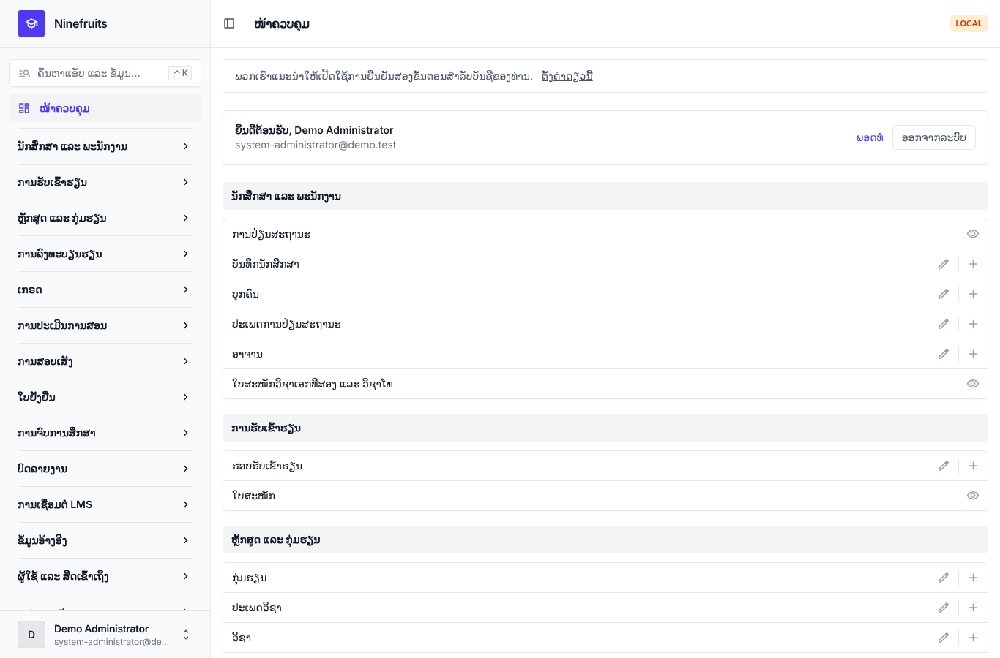
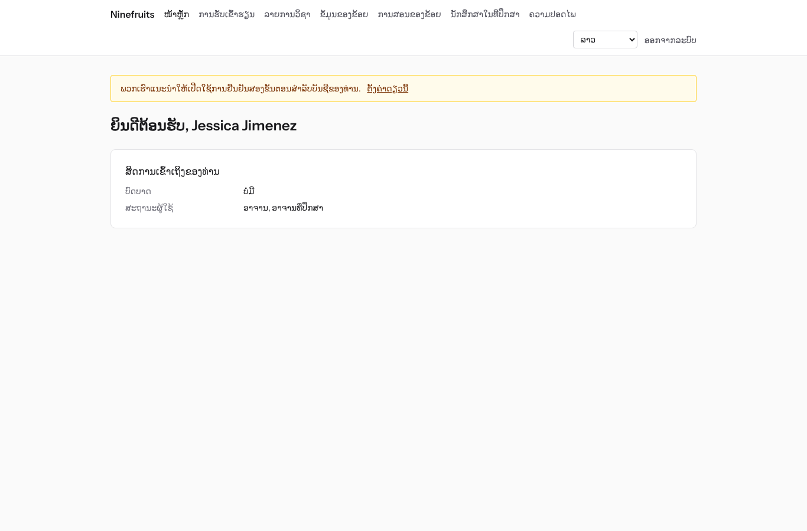
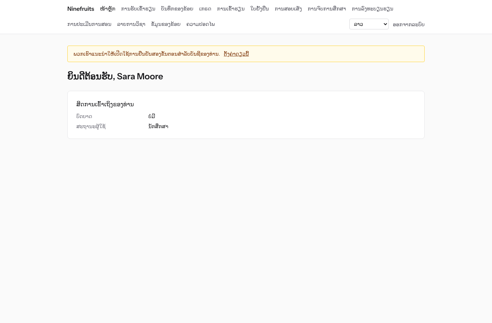

# Ninefruits — ລະບົບບໍລິຫານການສຶກສາຂອງມະຫາວິທະຍາໄລ (Django)

**언어 / Languages / 语言 / ພາສາ**

| ພາສາ | README | ຄູ່ມື |
|---|---|---|
| English | [README.md](README.md) | [docs/manual/en/](docs/manual/en/README.md) |
| 한국어 | [README.ko.md](README.ko.md) | [docs/manual/ko/](docs/manual/ko/README.md) |
| 简体中文 | [README.zh_Hans.md](README.zh_Hans.md) | [docs/manual/zh_Hans/](docs/manual/zh_Hans/README.md) |
| ລາວ | [README.lo.md](README.lo.md) (ເອກະສານນີ້) | [docs/manual/lo/](docs/manual/lo/README.md) |

ຖ້າຕ້ອງການເພີ່ມພາສາອື່ນ ໃຫ້ເບິ່ງ [ຄູ່ມືການເພີ່ມພາສາ](docs/development/adding-a-language.md) (English, [한국어](docs/development/adding-a-language.ko.md)).

Ninefruits ແມ່ນລະບົບບໍລິຫານການສຶກສາ (Student Information System) ທີ່ສາມາດຕິດຕັ້ງ ແລະ ໃຊ້ໄດ້ໃນຫຼາຍມະຫາວິທະຍາໄລ. ມັນຄວບຄຸມແກ່ນຂອງວຽກງານບໍລິຫານການສຶກສາ ຕັ້ງແຕ່ການສະໝັກເຂົ້າຮຽນ, ບັນທຶກນັກສຶກສາ, ຫຼັກສູດ ແລະ ກຸ່ມຮຽນ, ການລົງທະບຽນຮຽນ, ເກຣດ, ການປະເມີນການສອນ, ໃບຢັ້ງຢືນ, ການສອບເສັງພາສາ ແລະ ການສອບເສັງລວມ, ການເຂົ້າຮຽນ, ການພິຈາລະນາຈົບການສຶກສາ, ບົດລາຍງານ ຈົນເຖິງພື້ນຖານການເຊື່ອມຕໍ່ LMS ແລະ ໜ້າຈໍກັບເອກະສານຮອງຮັບພາສາເກົາຫຼີ, ອັງກິດ, ຈີນ ແລະ ລາວ.

ບ່ອນເກັບໂຄດນີ້ແມ່ນການຍ້າຍ [Ninefruits ສະບັບ Laravel](https://github.com/humble92/ninefruits-laravel) v1.0.0 (Laravel 13, Filament, Livewire) ມາເປັນ Python 3.14 / Django 6.1 / PostgreSQL 18. ການຍ້າຍນີ້ຮັກສາພຶດຕິກຳ ແລະ ໂຄງສ້າງຖານຂໍ້ມູນຂອງຕົ້ນສະບັບໄວ້ທັງໝົດ: migration ຂອງ Django ແລ່ນ DDL ຂອງຕົ້ນສະບັບຄືນຕາມເດີມ ແລະ ໂຄງສ້າງຖືກປຽບທຽບກັບ `pg_dump` ຂອງຕົ້ນສະບັບເທື່ອລະວັດຖຸ (`tests/db/test_schema_equivalence.py`, `tools/schema_dump_diff.py`). ດັ່ງນັ້ນ ການຕິດຕັ້ງຂອງສະບັບໃດກໍ່ສາມາດຍ້າຍໄປອີກສະບັບໜຶ່ງໄດ້ດ້ວຍເຄື່ອງມືມາດຕະຖານຂອງ PostgreSQL. ຂັ້ນຕອນ ແລະ ເຫດຜົນຂອງການຍ້າຍຖືກບັນທຶກໄວ້ໃນ [porting/](porting/README.md) (ແຜນ, ບົດລາຍງານແຕ່ລະໄລຍະ, ການຕັດສິນໃຈດ້ານການອອກແບບ, ຕາຕະລາງທຽບການທົດສອບ).

## ເບິ່ງໂດຍຫຍໍ້

ໜ້າຈໍທຳອິດຫຼັງເຂົ້າສູ່ລະບົບດ້ວຍສາມບົດບາດ (ຂໍ້ມູນເດໂມ).

| ຜູ້ບໍລິຫານສູງສຸດ (ໜ້າບໍລິຫານ) | ອາຈານ (ພອດທໍ) | ນັກສຶກສາ (ພອດທໍ) |
|---|---|---|
|  |  |  |

- **ໜ້າບໍລິຫານ** `/admin/`: ພະນັກງານດຳເນີນວຽກບັນທຶກນັກສຶກສາ, ວິຊາການ, ການຮັບເຂົ້າຮຽນ, ໃບຢັ້ງຢືນ, ການສອບເສັງ, ການຈົບການສຶກສາ ແລະ ບົດລາຍງານ (Django admin + django-unfold). ສິດກຳນົດດ້ວຍແມ່ແບບບົດບາດ (ຜູ້ຮັບຜິດຊອບບັນທຶກນັກສຶກສາ, ຜູ້ຮັບຜິດຊອບວິຊາການ, ຜູ້ຮັບຜິດຊອບໃບຢັ້ງຢືນ, ຜູ້ຊ່ວຍພາກວິຊາ, ຜູ້ຮັບຜິດຊອບການຮັບເຂົ້າຮຽນ, ຜູ້ບໍລິຫານລະບົບ) ແລະ ຂອບເຂດໜ່ວຍງານ ຫຼື ຫຼັກສູດ.
- **ພອດທໍ** `/portal/`: ນັກສຶກສາເບິ່ງການລົງທະບຽນຮຽນ, ເກຣດ, ການເຂົ້າຮຽນ, ການລົງທະບຽນສອບ, ເງື່ອນໄຂການຈົບການສຶກສາ ແລະ ໃບຢັ້ງຢືນ; ອາຈານເບິ່ງລາຍຊື່, ການເຂົ້າຮຽນ, ການປ້ອນເກຣດ ແລະ ຜົນການປະເມີນການສອນຂອງກຸ່ມຮຽນທີ່ຮັບຜິດຊອບ; ຜູ້ສະໝັກເບິ່ງການສະໝັກເຂົ້າຮຽນ (Django template + HTMX + Alpine.js + Tailwind CSS). ບັນຊີດຽວສາມາດມີຫຼາຍສະຖານະພາບ (ເຊັ່ນ ເປັນທັງນັກສຶກສາ ແລະ ຜູ້ຊ່ວຍ).
- ທັງສອງໃຊ້ການເຂົ້າສູ່ລະບົບດຽວກັນ (`/accounts/login/`, django-allauth) ແລະ ນະໂຍບາຍການຢືນຢັນສອງຂັ້ນຕອນດຽວກັນ. ການເຊື່ອມຕໍ່ກັບລະບົບພາຍນອກໃຊ້ REST API ທີ່ `/api/v1/` (ເອກະສານ OpenAPI ທີ່ `/api/docs/`).

## ໜ້າທີ່ຫຼັກ

| ຂົງເຂດ | ເນື້ອໃນ |
|---|---|
| ຜູ້ໃຊ້ ແລະ ຄວາມປອດໄພ | ການເຂົ້າສູ່ລະບົບຮ່ວມ, ການຢືນຢັນສອງຂັ້ນຕອນ (ແອັບ, ອີເມວ), ການເຂົ້າສູ່ລະບົບລວມຂອງໂຮງຮຽນ (OIDC), ການເຂົ້າສູ່ລະບົບດ້ວຍລະຫັດນັກສຶກສາ, ບົດບາດ ສິດ ແລະ ຂອບເຂດໜ່ວຍງານ, ການກວດສອບຂໍ້ມູນ ແລະ ທຸລະກິດພ້ອມຕ່ອງໂສ້ແຮດຊ໌, ຄວາມປອດໄພລະດັບແຖວ (RLS), ການເຂົ້າລະຫັດຂໍ້ມູນສ່ວນບຸກຄົນ |
| ບຸກຄົນ ແລະ ບັນທຶກນັກສຶກສາ | ແຍກບຸກຄົນກັບບັນທຶກນັກສຶກສາ, ກົດລະຫັດນັກສຶກສາ, ການຮ້ອງຂໍ ແລະ ອະນຸມັດການປ່ຽນສະຖານະ (ພັກການຮຽນ, ກັບຄືນ, ລາອອກ, ໃຫ້ອອກ, ເຂົ້າຮຽນໃໝ່, ຈົບການສຶກສາ), ອາຈານທີ່ປຶກສາ, ວິຊາເອກທີສອງ ແລະ ວິຊາໂທ |
| ການຮັບເຂົ້າຮຽນ | ຮອບຮັບສະໝັກ, ໃບສະໝັກອອນລາຍ ແລະ ເອກະສານ, ການພິຈາລະນາ ແລະ ປະກາດຜົນ, ການສ້າງບັນທຶກນັກສຶກສາຂອງຜູ້ຖືກຮັບ |
| ຫຼັກສູດ | ເວີຊັນວິຊາ, ວິຊາບັງຄັບກ່ອນ ແລະ ວິຊາທົດແທນ, ເງື່ອນໄຂການຈົບການສຶກສາຕາມປີຫຼັກສູດ, ກຸ່ມຮຽນ ຕາຕະລາງຮຽນ ແລະ ແຜນການສອນ |
| ການລົງທະບຽນຮຽນ | ຊຸດກົດລະບຽບ, ເພດານໜ່ວຍກິດ, ຈຳນວນຮັບ ແລະ ລາຍຊື່ລໍຖ້າ, ການຈຳກັດ ແລະ ຂໍ້ຍົກເວັ້ນ, ການອອກແບບຮອງຮັບຊ່ວງສູງສຸດ |
| ເກຣດ | ການປະເມີນແບບອີງເກນ ແລະ ອີງກຸ່ມ, ເພດານອັດຕາສ່ວນເກຣດ, ການສົ່ງ ແລະ ຢືນຢັນ, ການອະນຸມັດການແກ້ໄຂ, GPA ແລະ ການຮຽນຊ້ຳ, ການປິດພາກຮຽນ (ເຕືອນທາງວິຊາການ, ນັກສຶກສາດີເດັ່ນ), ໃບຄະແນນ |
| ການປະເມີນການສອນ | ການຕອບແບບບໍ່ລະບຸຊື່, ແບບຟອມ ແລະ ຄຳຖາມ, ເກນຄຳຕອບຂັ້ນຕ່ຳ, ການເປີດເຜີຍຜົນ, ການຈຳກັດການເບິ່ງເກຣດຖ້າຍັງບໍ່ປະເມີນ |
| ໃບຢັ້ງຢືນ | ແບບຟອມຕາມປະເພດ ແລະ ພາສາ, ເລກທີອອກ, ການເກັບ PDF, ໜ້າສາທາລະນະກວດຄວາມແທ້ (QR) |
| ການສອບເສັງພາສາ/ລວມ | ປະເພດ ຂົງເຂດ ແລະ ເກນຜ່ານ, ການລົງທະບຽນສອບຕໍ່ຮອບ, ການປ້ອນຜົນ CSV ແລະ ການເປີດເຜີຍ, ການຮ້ອງຂໍແກ້ໄຂ, ຜົນຈາກພາຍນອກ |
| ການເຂົ້າຮຽນ | ຄາບຮຽນຕາມເວລາສອນ, ການປ້ອນການເຂົ້າຮຽນ, PDF ບັນຊີການເຂົ້າຮຽນ, CSV ລາຍຊື່ |
| ການຈົບການສຶກສາ | ການຕັດສິນເງື່ອນໄຂ, ການບັນທຶກການກວດ, ການຍົກເວັ້ນເງື່ອນໄຂ (ອະນຸມັດ 2 ຄົນ), ການດຳເນີນການຈົບການສຶກສາ ແລະ ເລກທີປະລິນຍາ |
| ບົດລາຍງານ | ບົດລາຍງານມາດຕະຖານ 7 ປະເພດ ແລະ CSV, view `reporting` ສຳລັບ BI |
| ພື້ນຖານການເຊື່ອມຕໍ່ LMS | ແພລັດຟອມ, ການເຊື່ອມຕໍ່ຫ້ອງຮຽນ ແລະ ບັນທຶກການຊິງ, ການຊິງຕາມເຫດການ, ການກວດທຽບຕອນກາງຄືນ, ຮ່າງຄະແນນຈາກ LMS, REST API ທີ່ຢືນຢັນດ້ວຍ token |

## ເທັກໂນໂລຊີ

Python 3.14, Django 6.1, django-unfold (ໜ້າບໍລິຫານ), HTMX 2, Alpine.js 3, Tailwind CSS 4 ແລະ Vite (ພອດທໍ, django-vite), PostgreSQL 18 (ຄວາມປອດໄພລະດັບແຖວ, ການກວດສອບດ້ວຍ trigger), Redis, Celery ແລະ Flower (ຄິວ), Gotenberg (PDF), django-allauth (ການເຂົ້າສູ່ລະບົບ, ການຢືນຢັນສອງຂັ້ນຕອນ, SSO), Django REST framework (API). dependency ຖືກລັອກດ້ວຍ [uv](https://docs.astral.sh/uv/) (`uv.lock`) ແລະ npm (`package-lock.json`).

## ການຕິດຕັ້ງ (ເວັບໄຊເດໂມ)

### ແລ່ນໂດຍກົງດ້ວຍ uv

ຕ້ອງມີ PostgreSQL 18, Redis 8, Gotenberg 8 ແລະ Mailpit ຢູ່ໃນເຄື່ອງ (ຖ້າບໍ່ມີ ໃຫ້ເປີດສະເພາະບໍລິການເຫຼົ່ານັ້ນດ້ວຍ Docker Compose: `docker compose up -d pgsql redis gotenberg mailpit`).

```bash
uv sync                                         # .venv ພ້ອມເຄື່ອງມືພັດທະນາ
npm ci && npm run build                         # static/dist/ (ຫຼື `npm run dev` + VITE_DEV_MODE=true ໃນເວລາພັດທະນາ)
cp .env.example .env
uv run manage.py pii_generate_key               # ໃສ່ສອງຄ່າທີ່ສະແດງລົງໃນ .env
# ກຽມບົດບາດ DB ແລະ DB (superuser ແລ່ນຄັ້ງດຽວ): docs/manual/lo/operations/installation.md ພາກທີ 2
uv run manage.py setup_install --profile=korean-university --grade-scale=4.5   # migration, ຂໍ້ມູນຈຳເປັນ, ການຕັ້ງຄ່າສະຖາບັນ, ຜູ້ບໍລິຫານຄົນທຳອິດ
uv run manage.py setup_demo --size=small --seed=42                             # ມະຫາວິທະຍາໄລເດໂມ ແລະ ບັນຊີເດໂມ
uv run manage.py compilemessages --ignore=.venv
uv run manage.py runserver
uv run celery -A config worker --loglevel=INFO  # ໃນ terminal ອື່ນ (ການປິດພາກຮຽນ, ລາຍຊື່ລໍຖ້າ, ການນຳເຂົ້າ)
```

- ພອດທໍ: http://localhost:8000/portal/ · ໜ້າບໍລິຫານ: http://localhost:8000/admin/ (ເຂົ້າສູ່ລະບົບດຽວກັນ)
- ກວດເມວ (Mailpit): http://localhost:8025

### Docker Compose

ເຄື່ອງ host ຕ້ອງການພຽງ Docker.

```bash
cp .env.example .env
docker compose up -d                            # app, worker, beat, flower, pgsql, redis, mailpit, gotenberg
docker compose exec app uv run manage.py pii_generate_key        # ໃສ່ສອງຄ່າລົງໃນ .env ແລ້ວແລ່ນ docker compose up -d
docker compose exec app uv run manage.py setup_install --profile=korean-university --grade-scale=4.5
docker compose exec app uv run manage.py setup_demo --size=small --seed=42
docker compose exec app uv run manage.py compilemessages --ignore=.venv
docker compose --profile vite up -d vite        # ທາງເລືອກ: Vite dev server (HMR), VITE_DEV_MODE=true ໃນ .env
```

container `pgsql` ຈະສ້າງບົດບາດ DB (`app_migrator`, `app_runtime`, `app_reporting`) ແລະ ກຽມ DB ພັດທະນາ ແລະ DB ທົດສອບເມື່ອເລີ່ມຄັ້ງທຳອິດ (`docker/pgsql/`). ຕິດຕາມຄິວ (Flower): http://localhost:5555

### ບັນຊີເດໂມ

ລະຫັດຜ່ານທັງໝົດແມ່ນ `demo-password` (`ninefruits/setup/conf.py`). ບໍ່ໄດ້ລົງທະບຽນການຢືນຢັນສອງຂັ້ນຕອນ.

| ບັນຊີ | ບົດບາດ / ສະຖານະພາບ | ໜ້າຈໍທຳອິດ |
|---|---|---|
| system-administrator@demo.test | ຜູ້ບໍລິຫານລະບົບ (ທຸກສິດ) | /admin/ |
| registrar@demo.test | ຜູ້ຮັບຜິດຊອບບັນທຶກນັກສຶກສາ (ບັນທຶກນັກສຶກສາ, ການປັບການລົງທະບຽນຮຽນ, ການຢືນຢັນເກຣດ, ໃບຢັ້ງຢືນ, ການສອບເສັງ, ການຈົບການສຶກສາ, ບົດລາຍງານ) | /admin/ |
| academic-affairs@demo.test | ຜູ້ຮັບຜິດຊອບວິຊາການ (ວິຊາ ກຸ່ມຮຽນ ແລະ ຕາຕະລາງຮຽນ, ນະໂຍບາຍເກຣດ, ການປະເມີນການສອນ, ຄາບຮຽນ) | /admin/ |
| certificate-officer@demo.test | ຜູ້ຮັບຜິດຊອບໃບຢັ້ງຢືນ | /admin/ |
| department-assistant@demo.test | ຜູ້ຊ່ວຍພາກວິຊາ (ການເບິ່ງໃນຂອບເຂດພາກວິຊາ, ອາຈານທີ່ປຶກສາ, ບົດລາຍງານ) | /admin/ |
| admissions-officer@demo.test | ຜູ້ຮັບຜິດຊອບການຮັບເຂົ້າຮຽນ | /admin/ |
| instructor@demo.test | ອາຈານ ແລະ ອາຈານທີ່ປຶກສາ (ກຸ່ມຮຽນທີ່ຮັບຜິດຊອບ, ການເຂົ້າຮຽນ, ການປ້ອນເກຣດ, ນັກສຶກສາທີ່ປຶກສາ) | /portal/ |
| student@demo.test | ນັກສຶກສາປັດຈຸບັນ | /portal/ |
| alumni@demo.test | ຜູ້ຈົບການສຶກສາ | /portal/ |
| readmitted@demo.test | ຜູ້ຈົບການສຶກສາທີ່ເຂົ້າຮຽນໃໝ່ (ບັນທຶກນັກສຶກສາ 2 ລາຍການ) | /portal/ |
| applicant@demo.test | ຜູ້ສະໝັກເຂົ້າຮຽນ | /portal/ |
| admitted@demo.test | ຜູ້ຖືກຮັບເຂົ້າຮຽນ | /portal/ |

ຂໍ້ມູນເດໂມແມ່ນມະຫາວິທະຍາໄລສົມມຸດ 1 ແຫ່ງ (ໂປຣໄຟລ໌ມະຫາວິທະຍາໄລເກົາຫຼີ) ປະກອບດ້ວຍນັກສຶກສາ, ອາຈານ, ວິຊາ, ກຸ່ມຮຽນ, ການລົງທະບຽນຮຽນ, ເກຣດ, ການປະເມີນການສອນ, ໃບຢັ້ງຢືນ, ການສອບເສັງ, ການເຂົ້າຮຽນ, ການກວດເງື່ອນໄຂການຈົບການສຶກສາ ແລະ ການເຊື່ອມຕໍ່ LMS. ຢ່າໃສ່ໃນສະພາບແວດລ້ອມນຳໃຊ້ຈິງເດັດຂາດ (`setup_demo` ຈະປະຕິເສດເມື່ອ `DJANGO_ENV=production`).

ສຳລັບການຕິດຕັ້ງນຳໃຊ້ຈິງ (gunicorn, Nginx, Celery beat, ຕົວແປສະພາບແວດລ້ອມ, ການສຳຮອງ) ໃຫ້ປະຕິບັດຕາມ [ຄູ່ມືການຕິດຕັ້ງ](docs/manual/lo/operations/installation.md) ແລະ [ລາຍການກວດສອບການນຳໃຊ້ລະບົບ](docs/manual/lo/operations/deployment-checklist.md).

## ເອກະສານ

- [ຄູ່ມືຜູ້ບໍລິຫານ](docs/manual/lo/admin/README.md): 28 ບົດ ແຕ່ລຳດັບການຕັ້ງຄ່າເບື້ອງຕົ້ນຈົນເຖິງວິທີໃຊ້ແຕ່ລະຂົງເຂດ
- [ຄູ່ມືການດຳເນີນງານ](docs/manual/lo/README.md): [ການຕິດຕັ້ງ](docs/manual/lo/operations/installation.md), [ລາຍການກວດສອບການນຳໃຊ້ລະບົບ](docs/manual/lo/operations/deployment-checklist.md), [ຄຳສັ່ງດຳເນີນງານ](docs/manual/lo/operations/commands.md), [ວຽກຕາມກຳນົດເວລາ](docs/manual/lo/operations/scheduled-jobs.md), [ການສຳຮອງ ແລະ ກູ້ຄືນຂໍ້ມູນ](docs/manual/lo/operations/backup-restore.md), [ກະແຈຄວາມປອດໄພ](docs/manual/lo/operations/security-keys.md), [ການກວດສອບ ແລະ ບຳລຸງຮັກສາ](docs/manual/lo/operations/audit-and-maintenance.md), [ການທົດສອບພາລະ](docs/manual/lo/operations/load-testing.md), [ການແກ້ໄຂບັນຫາ](docs/manual/lo/operations/troubleshooting.md)
- [ຄູ່ມືການເຊື່ອມຕໍ່ LMS](docs/lms-integration-guide.md)
- [ເອກະສານການພັດທະນາ](docs/README.md): [ກົດການຕັ້ງຊື່](docs/development/naming.md), [ລາຍການກວດທົບທວນໂຄດ](docs/development/review-checklist.md), [ການເພີ່ມພາສາ](docs/development/adding-a-language.md)
- ປະຫວັດການຍ້າຍລະບົບ ແລະ ການຕັດສິນໃຈດ້ານການອອກແບບ (ອ້າງອີງ): [porting/](porting/README.md)

## ຄຳສັ່ງທີ່ໃຊ້ເລື້ອຍ

| ຄຳສັ່ງ | ເນື້ອໃນ |
|---|---|
| `uv run pytest -n auto -m "not concurrency"` | ການທົດສອບ (ການທົດສອບພ້ອມກັນ ແລ່ນແຍກດ້ວຍ `-m concurrency`) |
| `uv run ruff format && uv run ruff check` | ຮູບແບບໂຄດ ແລະ ການກວດແບບສະຖິດ |
| `uv run mypy ninefruits config tools/checks` | ການກວດປະເພດ |
| `uv run tools/checks/raw_sql.py` | ການກວດ SQL ດິບ (ຫ້າມສ້າງ SQL ດ້ວຍການຕໍ່ string) |
| `uv run manage.py naming_check` | ການກວດການຕັ້ງຊື່ (ຕາຕະລາງ ແລະ ຖັນ DB, migration, ຄຳສັ່ງ, ຄຳແປ) |
| `uv run manage.py i18n_missing --strict` | ກວດຄຳແປທີ່ຂາດ (ແລກປ່ຽນກັບນັກແປດ້ວຍ `i18n_export`/`i18n_import`) |
| `uv run manage.py migrate` | migration (ໃຊ້ການເຊື່ອມຕໍ່ `app_migrator` ອັດຕະໂນມັດ) |
| `uv run manage.py setup_install`, `setup_demo` | ຕິດຕັ້ງ/ອັບເດດ, ຂໍ້ມູນເດໂມ |
| `uv run manage.py security_sync_permissions` | ນຳລາຍການສິດຈາກໂຄດເຂົ້າ DB |
| `pre-commit install` | ແລ່ນ ruff, mypy ແລະ ການກວດ SQL ດິບກ່ອນ commit |

ລາຍການທັງໝົດຢູ່ທີ່ [ເອກະສານອ້າງອີງຄຳສັ່ງດຳເນີນງານ](docs/manual/lo/operations/commands.md). CI (`.github/workflows/ci.yml`) ແລ່ນການກວດດຽວກັນໃນສອງ job: ການກວດຄຸນນະພາບ ແລະ ການທົດສອບ.

## ໃບອະນຸຍາດ

[ໃບອະນຸຍາດ MIT](LICENSE). ສາມາດນຳໃຊ້, ດັດແກ້ ແລະ ແຈກຢາຍໄດ້ຢ່າງເສລີ ໂດຍຮັກສາຂໍ້ຄວາມລິຂະສິດ ແລະ ຂໍ້ຄວາມໃບອະນຸຍາດໄວ້.

---

**ຄຳຂອບໃຈ**

ຂໍສະແດງຄວາມຂອບໃຈຕໍ່ YUSTIC (ລະບົບເຄືອຂ່າຍບໍລິຫານການສຶກສາຂອງມະຫາວິທະຍາໄລວິທະຍາສາດ ແລະ ເທັກໂນໂລຊີ Yanbian) ທີ່ເຮັດໃຫ້ລະບົບນີ້ເປັນໄປໄດ້. YUSTIC ແມ່ນຜົນງານທີ່ທີມພັດທະນາຈຳນວນບໍ່ຫຼາຍຄົນໄດ້ຮ່ວມກັນຫຼັ່ງເຫື່ອ, ຝັນ ແລະ ທຸ່ມເທສ້າງຂຶ້ນມາຕະຫຼອດຫຼາຍປີ. ການພັດທະນາລະບົບນີ້ແມ່ນການສະແດງຄວາມຄິດຮອດ, ຄວາມເຄົາລົບ ແລະ ຄວາມຂອບໃຈຕໍ່ເພື່ອນຮ່ວມງານທີ່ເຄີຍຮ່ວມເຮັດວຽກນຳກັນ.
