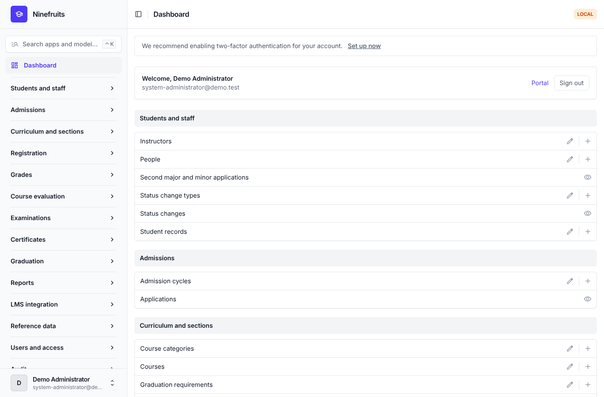
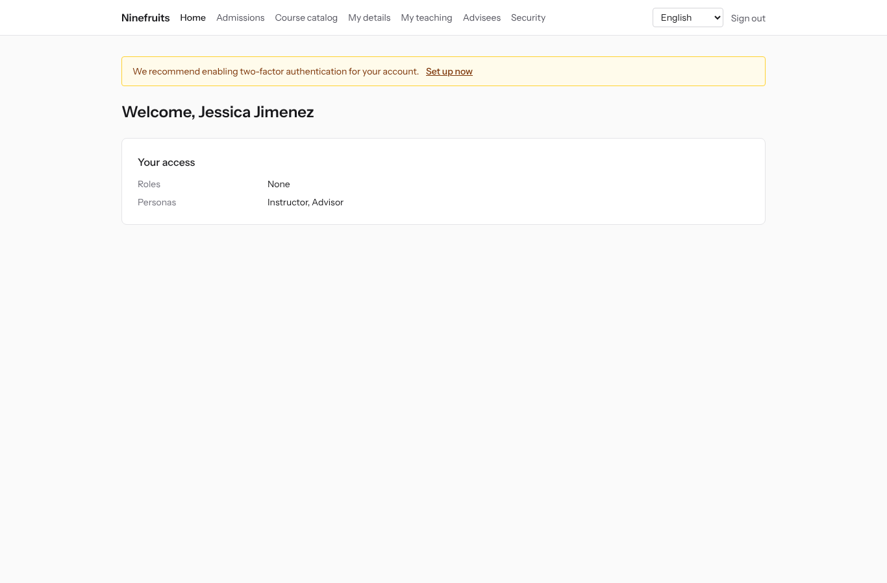
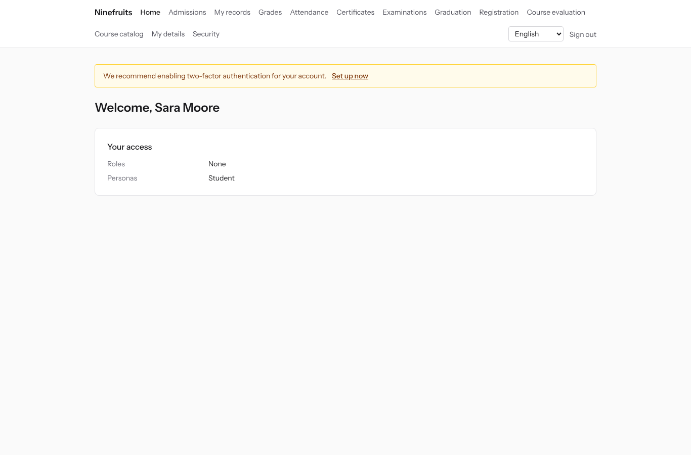

# Ninefruits — Student Information System (Django)

**Languages / 언어 / 语言 / ພາສາ**

| Language | README | Manual |
|---|---|---|
| English | [README.md](README.md) (this file) | [docs/manual/en/](docs/manual/en/README.md) |
| 한국어 | [README.ko.md](README.ko.md) | [docs/manual/ko/](docs/manual/ko/README.md) |
| 简体中文 | [README.zh_Hans.md](README.zh_Hans.md) | [docs/manual/zh_Hans/](docs/manual/zh_Hans/README.md) |
| ລາວ | [README.lo.md](README.lo.md) | [docs/manual/lo/](docs/manual/lo/README.md) |

To add another language, see [Adding a language](docs/development/adding-a-language.md) ([한국어](docs/development/adding-a-language.ko.md)).

Ninefruits is a student information system that any university can install and run. It covers the core of academic administration, from admission applications to student records, curricula and course sections, registration, grades, course evaluation, certificates, language and comprehensive examinations, attendance, graduation review, reports and the groundwork for LMS integration. Screens and documentation are available in Korean, English, Chinese and Lao.

This repository is the Python 3.14 / Django 6.1 / PostgreSQL 18 port of [Ninefruits for Laravel](https://github.com/humble92/ninefruits-laravel) v1.0.0 (Laravel 13, Filament, Livewire). The port keeps the original's behaviour and its database schema unchanged: the Django migrations replay the original's DDL, and the schema is compared object by object with the original's `pg_dump` (`tests/db/test_schema_equivalence.py`, `tools/schema_dump_diff.py`). An installation of either version can therefore be moved to the other with standard PostgreSQL tools. How and why it was ported is recorded in [porting/](porting/README.md) (plan, phase reports, design decisions, test mapping).

## At a glance

First screens after signing in with three roles (demo data).

| System administrator (admin panel) | Instructor (portal) | Student (portal) |
|---|---|---|
|  |  |  |

- **Admin panel** `/admin/`: staff handle student records, academic affairs, admissions, certificates, examinations, graduation and reports (Django admin with django-unfold). Permissions come from role templates (registrar, academic affairs, certificate officer, department assistant, admissions officer, system administrator) scoped to org units and programs.
- **Portal** `/portal/`: students see registration, grades, attendance, examination applications, graduation requirements and certificates; instructors see the roster, attendance, grade entry and evaluation results of their sections; applicants apply for admission (Django templates with HTMX, Alpine.js and Tailwind CSS). One account can hold several roles (a student who is also a teaching assistant, for example).
- Both use the same sign-in (`/accounts/login/`, django-allauth) and the same two-factor policy. Integrations use the REST API under `/api/v1/` (OpenAPI at `/api/docs/`).

## Features

| Area | What it covers |
|---|---|
| Users and security | Shared sign-in, two-factor authentication (app, email), SSO (OIDC), student number sign-in, roles, permissions and org scopes, data and activity audit with a hash chain, row level security (RLS), personal data encryption |
| People and student records | People separate from student records, student number rules, status changes (leave, return, withdrawal, dismissal, readmission, graduation) with requests and approval, advisors, second majors and minors |
| Admissions | Admission rounds, online applications and documents, review and result release, student records for admitted applicants |
| Curriculum | Course versions, prerequisites and equivalents, graduation requirements by curriculum year, course sections, timetables, syllabi |
| Registration | Rule sets, credit limits, capacity and waitlists, holds and overrides, designed for the registration peak |
| Grades | Absolute and relative grading, grade distribution caps, submission and finalization, grade change approval, GPA and repeats, term close (academic probation, honors), transcripts |
| Course evaluation | Anonymous responses, forms and questions, minimum response rate, result release, grade viewing held until the evaluation is done |
| Certificates | Kinds and per-language templates, certificate numbers, stored PDFs, a public verification page (QR) |
| Examinations | Examination kinds, sections and pass marks, sittings and applications, result entry, CSV and release, correction requests, external scores |
| Attendance | Class meetings from the timetable, attendance entry, attendance sheet PDF, roster CSV |
| Graduation | Requirement audit, saved checks, requirement waivers (two approvers), graduation processing and degree numbers |
| Reports | Seven standard reports with CSV, `reporting` views for BI tools |
| LMS integration | Platforms, course links and sync records, event driven sync, nightly reconciliation, LMS score drafts, REST API with tokens |

## Technology

Python 3.14, Django 6.1, django-unfold (admin panel), HTMX 2, Alpine.js 3, Tailwind CSS 4 and Vite (portal, django-vite), PostgreSQL 18 (row level security, trigger audit), Redis, Celery and Flower (queue), Gotenberg (PDF), django-allauth (sign-in, two-factor, SSO), Django REST framework (API). Dependencies are locked with [uv](https://docs.astral.sh/uv/) (`uv.lock`) and npm (`package-lock.json`).

## Quick start (demo site)

### With uv

PostgreSQL 18, Redis 8, Gotenberg 8 and Mailpit must run locally (or start only those services with Docker Compose: `docker compose up -d pgsql redis gotenberg mailpit`).

```bash
uv sync                                         # .venv with the development tools
npm ci && npm run build                         # static/dist/ (or `npm run dev` with VITE_DEV_MODE=true)
cp .env.example .env
uv run manage.py pii_generate_key               # put the two values into .env
# Database roles and database (once, as the superuser): docs/manual/en/operations/installation.md section 2
uv run manage.py setup_install --profile=korean-university --grade-scale=4.5   # migrations, essential data, institution, first administrator
uv run manage.py setup_demo --size=small --seed=42                             # demo university and demo accounts
uv run manage.py compilemessages --ignore=.venv
uv run manage.py runserver
uv run celery -A config worker --loglevel=INFO  # in a second terminal (term close, waitlists, imports)
```

- Portal: http://localhost:8000/portal/ · Admin panel: http://localhost:8000/admin/ (same sign-in)
- Mail (Mailpit): http://localhost:8025

### With Docker Compose

Only Docker is needed on the host.

```bash
cp .env.example .env
docker compose up -d                            # app, worker, beat, flower, pgsql, redis, mailpit, gotenberg
docker compose exec app uv run manage.py pii_generate_key        # put the two values into .env, then: docker compose up -d
docker compose exec app uv run manage.py setup_install --profile=korean-university --grade-scale=4.5
docker compose exec app uv run manage.py setup_demo --size=small --seed=42
docker compose exec app uv run manage.py compilemessages --ignore=.venv
docker compose --profile vite up -d vite        # optional: Vite dev server (HMR), VITE_DEV_MODE=true in .env
```

The `pgsql` container creates the database roles (`app_migrator`, `app_runtime`, `app_reporting`) and prepares the development and test databases the first time it starts (`docker/pgsql/`). Queue monitor (Flower): http://localhost:5555

### Demo accounts

Every password is `demo-password` (`ninefruits/setup/conf.py`). Two-factor authentication is not enrolled.

| Account | Role / persona | First screen |
|---|---|---|
| system-administrator@demo.test | System administrator (every permission) | /admin/ |
| registrar@demo.test | Registrar (student records, registration changes, grade finalization, certificates, examinations, graduation, reports) | /admin/ |
| academic-affairs@demo.test | Academic affairs (courses, sections, timetables, grading policy, course evaluation, class meetings) | /admin/ |
| certificate-officer@demo.test | Certificate officer | /admin/ |
| department-assistant@demo.test | Department assistant (department scoped viewing, advisors, reports) | /admin/ |
| admissions-officer@demo.test | Admissions officer | /admin/ |
| instructor@demo.test | Instructor and advisor (own sections, attendance, grade entry, advisees) | /portal/ |
| student@demo.test | Current student | /portal/ |
| alumni@demo.test | Graduate | /portal/ |
| readmitted@demo.test | Graduate admitted again (two student records) | /portal/ |
| applicant@demo.test | Applicant | /portal/ |
| admitted@demo.test | Admitted applicant | /portal/ |

The demo data is one fictional university (Korean university profile) with students, instructors, courses, sections, enrollments, grades, course evaluations, certificates, examinations, attendance, graduation checks and LMS links. Never load it into production (`setup_demo` refuses to run when `DJANGO_ENV=production`).

For a production installation (gunicorn, Nginx, Celery beat, environment variables, backups), follow the [installation manual](docs/manual/en/operations/installation.md) and the [deployment checklist](docs/manual/en/operations/deployment-checklist.md).

## Documentation

- [Administrator manual](docs/manual/en/admin/README.md): 28 chapters, from the initial setup order to every area
- [Operations manual](docs/manual/en/README.md#operations): [installation](docs/manual/en/operations/installation.md), [deployment checklist](docs/manual/en/operations/deployment-checklist.md), [commands](docs/manual/en/operations/commands.md), [scheduled jobs](docs/manual/en/operations/scheduled-jobs.md), [backup and restore](docs/manual/en/operations/backup-restore.md), [security keys](docs/manual/en/operations/security-keys.md), [audit and maintenance](docs/manual/en/operations/audit-and-maintenance.md), [load testing](docs/manual/en/operations/load-testing.md), [troubleshooting](docs/manual/en/operations/troubleshooting.md)
- [LMS integration guide](docs/lms-integration-guide.md)
- [Development](docs/README.md): [naming rules](docs/development/naming.md), [review checklist](docs/development/review-checklist.md), [adding a language](docs/development/adding-a-language.md)
- Porting history and design decisions: [porting/](porting/README.md)

## Common commands

| Command | Purpose |
|---|---|
| `uv run pytest -n auto -m "not concurrency"` | Tests (run the concurrency tests separately with `-m concurrency`) |
| `uv run ruff format && uv run ruff check` | Code style and lint |
| `uv run mypy ninefruits config tools/checks` | Type checks |
| `uv run tools/checks/raw_sql.py` | Raw SQL check (no string-built SQL) |
| `uv run manage.py naming_check` | Naming check (DB tables and columns, migrations, commands, translations) |
| `uv run manage.py i18n_missing --strict` | Missing translations (`i18n_export` / `i18n_import` to exchange with translators) |
| `uv run manage.py migrate` | Migrations (uses the `app_migrator` connection automatically) |
| `uv run manage.py setup_install`, `setup_demo` | Install or update, demo data |
| `uv run manage.py security_sync_permissions` | Bring the code's permission catalog into the database |
| `pre-commit install` | ruff, mypy and the raw SQL check before each commit |

The full list is in the [command reference](docs/manual/en/operations/commands.md). CI (`.github/workflows/ci.yml`) runs the same checks in two jobs: quality and tests.

## License

[MIT License](LICENSE). Anyone may use, modify and distribute it freely, as long as the copyright notice and the license text are kept.

---

**Acknowledgement**

Our thanks go to YUSTIC, the academic administration system of Yanbian University of Science and Technology, which made this system possible. YUSTIC was the work of a small team of developers who dreamed, sweated and built together over many years. This system is our way of saying how much we miss, respect and thank the colleagues we worked with.
