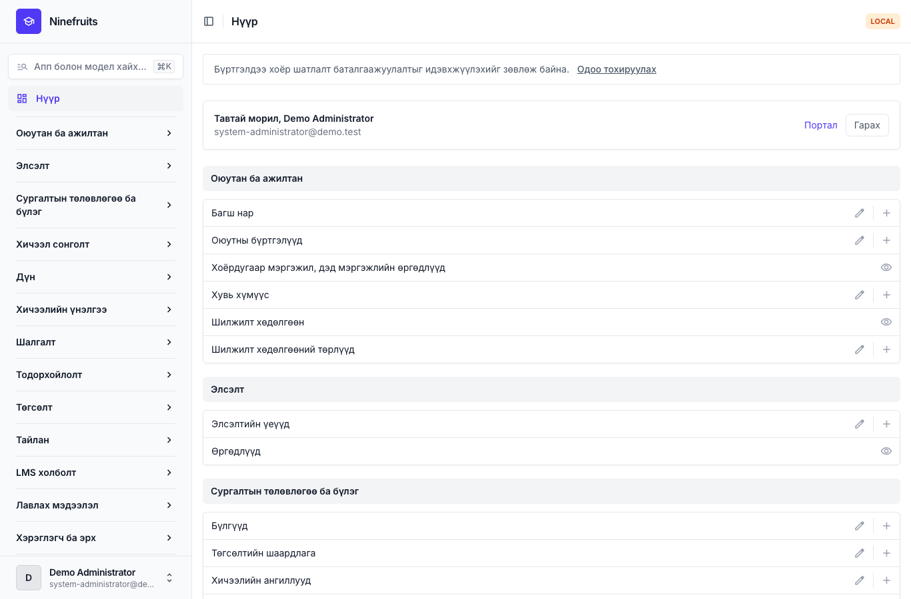
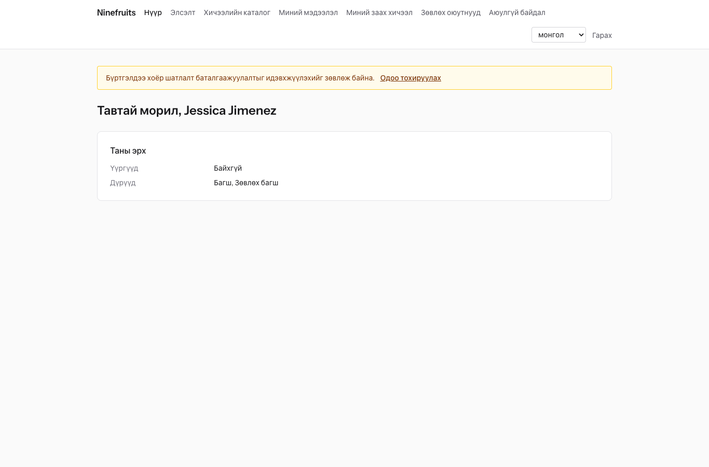
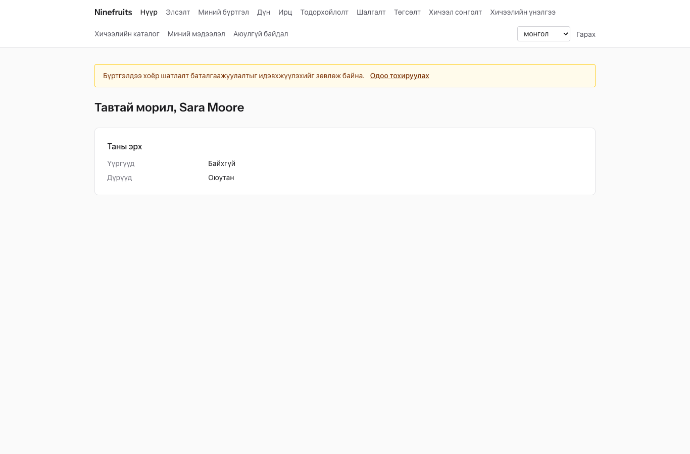

# Ninefruits — Оюутны мэдээллийн систем (Django)

**Хэл / Languages**

| Хэл | README | Гарын авлага |
|---|---|---|
| English | [README.md](README.md) | [docs/manual/en/](docs/manual/en/README.md) |
| 한국어 | [README.ko.md](README.ko.md) | [docs/manual/ko/](docs/manual/ko/README.md) |
| 简体中文 | [README.zh_Hans.md](README.zh_Hans.md) | [docs/manual/zh_Hans/](docs/manual/zh_Hans/README.md) |
| ລາວ | [README.lo.md](README.lo.md) | [docs/manual/lo/](docs/manual/lo/README.md) |
| Deutsch | [README.de.md](README.de.md) | [docs/manual/de/](docs/manual/de/README.md) |
| Filipino | [README.fil.md](README.fil.md) | [docs/manual/fil/](docs/manual/fil/README.md) |
| Français | [README.fr.md](README.fr.md) | [docs/manual/fr/](docs/manual/fr/README.md) |
| 日本語 | [README.ja.md](README.ja.md) | [docs/manual/ja/](docs/manual/ja/README.md) |
| Монгол | [README.mn.md](README.mn.md) (энэ файл) | [docs/manual/mn/](docs/manual/mn/README.md) |
| Bahasa Melayu | [README.ms.md](README.ms.md) | [docs/manual/ms/](docs/manual/ms/README.md) |
| नेपाली | [README.ne.md](README.ne.md) | [docs/manual/ne/](docs/manual/ne/README.md) |
| Русский | [README.ru.md](README.ru.md) | [docs/manual/ru/](docs/manual/ru/README.md) |
| ไทย | [README.th.md](README.th.md) | [docs/manual/th/](docs/manual/th/README.md) |
| Türkçe | [README.tr.md](README.tr.md) | [docs/manual/tr/](docs/manual/tr/README.md) |
| Oʻzbek | [README.uz.md](README.uz.md) | [docs/manual/uz/](docs/manual/uz/README.md) |
| Tiếng Việt | [README.vi.md](README.vi.md) | [docs/manual/vi/](docs/manual/vi/README.md) |

Өөр хэл нэмэхийн тулд [Хэл нэмэх](docs/development/adding-a-language.md)-ийг үзнэ үү.

Ninefruits нь аль ч их сургууль суулгаж ажиллуулж болох оюутны мэдээллийн систем юм. Элсэлтийн өргөдлөөс эхлээд оюутны бүртгэл, сургалтын төлөвлөгөө ба бүлэг, хичээл сонголт, дүн, хичээлийн үнэлгээ, тодорхойлолт, хэлний болон иж бүрэн шалгалт, ирц, төгсөлтийн шалгалт, тайлан болон LMS холболтын суурь хүртэл сургалтын удирдлагын үндсэн хэсгүүдийг хамардаг. Дэлгэц болон баримт бичиг нь дээрх хүснэгтийн 16 хэл дээр бэлэн.

Энэ репозитори нь [Laravel-д зориулсан Ninefruits](https://github.com/humble92/ninefruits-laravel) v1.0.0-ийн (Laravel 13, Filament, Livewire) Python 3.14 / Django 6.1 / PostgreSQL 18 руу шилжүүлсэн хувилбар юм. Шилжүүлэг нь анхны системийн үйлдэл болон өгөгдлийн сангийн схемийг өөрчлөлтгүй хадгална: Django-гийн миграц анхны системийн DDL-ийг дахин гүйцэтгэх бөгөөд схемийг анхны системийн `pg_dump`-тай объект тус бүрээр харьцуулдаг (`tests/db/test_schema_equivalence.py`, `tools/schema_dump_diff.py`). Тиймээс аль ч хувилбарын суулгалтыг PostgreSQL-ийн стандарт хэрэгслээр нөгөө рүү шилжүүлж болно. Хэрхэн, яагаад шилжүүлснийг [porting/](porting/README.md)-д (төлөвлөгөө, үе шатны тайлан, дизайны шийдвэр, тестийн харгалзаа) тэмдэглэсэн.

## Товч танилцуулга

Гурван үүргээр нэвтэрсний дараах эхний дэлгэцүүд (демо өгөгдөл).

| Системийн админ (удирдлагын самбар) | Багш (портал) | Оюутан (портал) |
|---|---|---|
|  |  |  |

- **Удирдлагын самбар** `/admin/`: ажилтнууд оюутны бүртгэл, сургалтын үйл ажиллагаа, элсэлт, тодорхойлолт, шалгалт, төгсөлт болон тайланг хариуцна (django-unfold-тэй Django admin). Эрхүүд нь бүтцийн нэгж болон хөтөлбөрөөр хамрах хүрээ тогтоосон үүргийн загвараас (оюутны бүртгэл хариуцсан ажилтан, сургалтын албаны ажилтан, тодорхойлолт хариуцсан ажилтан, тэнхимийн туслах ажилтан, элсэлт хариуцсан ажилтан, системийн админ) ирдэг.
- **Портал** `/portal/`: оюутнууд хичээл сонголт, дүн, ирц, шалгалтын бүртгэл, төгсөлтийн шаардлага, тодорхойлолтоо харна; багш нар өөрийн бүлгийн нэрсийн жагсаалт, ирц, дүн оруулах, үнэлгээний үр дүнг харна; өргөдөл гаргагчид элсэлтэд өргөдөл гаргана (HTMX, Alpine.js, Tailwind CSS-тэй Django template). Нэг бүртгэл хэд хэдэн үүрэгтэй байж болно (жишээ нь багшийн туслах болох оюутан).
- Хоёулаа ижил нэвтрэлт (`/accounts/login/`, django-allauth) болон ижил хоёр шатлалт баталгаажуулалтын бодлогыг ашиглана. Холболтууд `/api/v1/` доорх REST API-г ашиглана (OpenAPI нь `/api/docs/`-д).

## Боломжууд

| Чиглэл | Агуулга |
|---|---|
| Хэрэглэгч ба аюулгүй байдал | Нийтлэг нэвтрэлт, хоёр шатлалт баталгаажуулалт (апп, и-мэйл), SSO (OIDC), оюутны кодоор нэвтрэх, үүрэг, эрх ба бүтцийн хамрах хүрээ, хэш гинжтэй өгөгдлийн болон үйлдлийн аудит, мөрийн түвшний хамгаалалт (RLS), хувийн мэдээллийн шифрлэлт |
| Хувь хүн ба оюутны бүртгэл | Хувь хүнийг оюутны бүртгэлээс тусгаарлах, оюутны кодын дүрэм, хүсэлт ба батлалттай шилжилт хөдөлгөөн (чөлөө, чөлөөнөөс эргэн орох, сургуулиас гарах, сургуулиас хасах, дахин элсэх, төгсөлт), зөвлөх багш, хоёрдугаар мэргэжил ба дэд мэргэжил |
| Элсэлт | Элсэлтийн үе, онлайн өргөдөл ба баримт, хяналт ба шийдвэр мэдэгдэх, тэнцсэн өргөдөл гаргагчдад оюутны бүртгэл үүсгэх |
| Сургалтын төлөвлөгөө | Хичээлийн хувилбар, холбоо хичээл ба дүйцэх хичээл, сургалтын төлөвлөгөөний жил тус бүрийн төгсөлтийн шаардлага, бүлэг, хичээлийн хуваарь, хичээлийн хөтөлбөр |
| Хичээл сонголт | Дүрмийн багц, кредитийн хязгаар, суудлын тоо ба хүлээлгийн жагсаалт, хориг ба онцгой зөвшөөрөл, хичээл сонголтын оргил үед зориулсан дизайн |
| Дүн | Үнэмлэхүй ба харьцангуй үнэлгээ, дүнгийн тархалтын дээд хязгаар, илгээх ба баталгаажуулах, дүнгийн өөрчлөлтийн батлалт, голч дүн ба давтан судлах, улирал хаах (академик сануулга, онц сурлага), дүнгийн хуудас |
| Хичээлийн үнэлгээ | Нэргүй хариулт, маягт ба асуулт, хариултын доод хувь, үр дүн нийтлэх, үнэлгээ дуустал дүн харахыг саатуулах |
| Тодорхойлолт | Төрөл ба хэл тус бүрийн загвар, тодорхойлолтын дугаар, хадгалсан PDF, нийтийн баталгаажуулах хуудас (QR) |
| Шалгалт | Шалгалтын төрөл, хэсэг ба тэнцэх оноо, шалгалтын хуваарь ба бүртгэл, дүн оруулах, CSV ба нийтлэх, засварын хүсэлт, гадны дүн |
| Ирц | Хичээлийн хуваариас хичээлийн цаг үүсгэх, ирц оруулах, ирцийн хуудас PDF, нэрсийн жагсаалт CSV |
| Төгсөлт | Шаардлагын шалгалт, хадгалсан шалгалт, шаардлагаас чөлөөлөх (хоёр батлагч), төгсөлтийн боловсруулалт ба дипломын дугаар |
| Тайлан | CSV-тэй долоон стандарт тайлан, BI хэрэгсэлд зориулсан `reporting` view-үүд |
| LMS холболт | Платформ, хичээлийн холбоос ба синхрончлолын бүртгэл, үйл явдалд суурилсан синхрончлол, шөнийн тулгалт, LMS-ийн онооны ноорог, токентой REST API |

## Технологи

Python 3.14, Django 6.1, django-unfold (удирдлагын самбар), HTMX 2, Alpine.js 3, Tailwind CSS 4 ба Vite (портал, django-vite), PostgreSQL 18 (мөрийн түвшний хамгаалалт, trigger аудит), Redis, Celery ба Flower (дараалал), Gotenberg (PDF), django-allauth (нэвтрэлт, хоёр шатлалт баталгаажуулалт, SSO), Django REST framework (API). Хамаарлуудыг [uv](https://docs.astral.sh/uv/) (`uv.lock`) болон npm (`package-lock.json`)-ээр түгжинэ.

## Түргэн эхлэл (демо сайт)

### uv-ээр

PostgreSQL 18, Redis 8, Gotenberg 8 болон Mailpit локалд ажиллаж байх ёстой (эсвэл зөвхөн эдгээр үйлчилгээг Docker Compose-оор эхлүүлнэ: `docker compose up -d pgsql redis gotenberg mailpit`).

```bash
uv sync                                         # .venv with the development tools
npm ci && npm run build                         # static/dist/ (or `npm run dev` with VITE_DEV_MODE=true)
cp .env.example .env
uv run manage.py pii_generate_key               # put the two values into .env
# Database roles and database (once, as the superuser): docs/manual/en/operations/installation.md section 2
uv run manage.py setup_install --profile=korean-university --grade-scale=4.5   # migrations, essential data, institution, first administrator
uv run manage.py setup_demo --size=small --seed=42                             # demo university and demo accounts
uv run manage.py compilemessages --ignore=.venv
uv run manage.py runserver
uv run celery -A config worker --loglevel=INFO  # in a second terminal (term close, waitlists, imports)
```

- Портал: http://localhost:8000/portal/ · Удирдлагын самбар: http://localhost:8000/admin/ (ижил нэвтрэлт)
- Мэйл (Mailpit): http://localhost:8025

### Docker Compose-оор

Хост дээр зөвхөн Docker хэрэгтэй.

```bash
cp .env.example .env
docker compose up -d                            # app, worker, beat, flower, pgsql, redis, mailpit, gotenberg
docker compose exec app uv run manage.py pii_generate_key        # put the two values into .env, then: docker compose up -d
docker compose exec app uv run manage.py setup_install --profile=korean-university --grade-scale=4.5
docker compose exec app uv run manage.py setup_demo --size=small --seed=42
docker compose exec app uv run manage.py compilemessages --ignore=.venv
docker compose --profile vite up -d vite        # optional: Vite dev server (HMR), VITE_DEV_MODE=true in .env
```

`pgsql` контейнер анх эхлэхдээ өгөгдлийн сангийн ролиудыг (`app_migrator`, `app_runtime`, `app_reporting`) үүсгэж, хөгжүүлэлтийн болон тестийн өгөгдлийн сангуудыг бэлтгэнэ (`docker/pgsql/`). Дарааллын монитор (Flower): http://localhost:5555

### Демо бүртгэлүүд

Бүх нууц үг `demo-password` (`ninefruits/setup/conf.py`). Хоёр шатлалт баталгаажуулалт бүртгүүлээгүй.

| Бүртгэл | Үүрэг / дүр | Эхний дэлгэц |
|---|---|---|
| system-administrator@demo.test | Системийн админ (бүх эрх) | /admin/ |
| registrar@demo.test | Оюутны бүртгэл хариуцсан ажилтан (оюутны бүртгэл, хичээл сонголтын өөрчлөлт, дүн баталгаажуулах, тодорхойлолт, шалгалт, төгсөлт, тайлан) | /admin/ |
| academic-affairs@demo.test | Сургалтын албаны ажилтан (хичээл, бүлэг, хичээлийн хуваарь, дүнгийн бодлого, хичээлийн үнэлгээ, хичээлийн цаг) | /admin/ |
| certificate-officer@demo.test | Тодорхойлолт хариуцсан ажилтан | /admin/ |
| department-assistant@demo.test | Тэнхимийн туслах ажилтан (тэнхимийн хүрээн дэх харагдац, зөвлөх багш, тайлан) | /admin/ |
| admissions-officer@demo.test | Элсэлт хариуцсан ажилтан | /admin/ |
| instructor@demo.test | Багш ба зөвлөх багш (өөрийн бүлэг, ирц, дүн оруулах, зөвлөх оюутнууд) | /portal/ |
| student@demo.test | Одоо суралцаж буй оюутан | /portal/ |
| alumni@demo.test | Төгсөгч | /portal/ |
| readmitted@demo.test | Дахин элссэн төгсөгч (хоёр оюутны бүртгэлтэй) | /portal/ |
| applicant@demo.test | Өргөдөл гаргагч | /portal/ |
| admitted@demo.test | Тэнцсэн өргөдөл гаргагч | /portal/ |

Демо өгөгдөл нь оюутан, багш, хичээл, бүлэг, хичээлийн бүртгэл, дүн, хичээлийн үнэлгээ, тодорхойлолт, шалгалт, ирц, төгсөлтийн шалгалт болон LMS холбоостой нэг зохиомол их сургууль (Солонгосын их сургуулийн профайл) юм. Production-д хэзээ ч бүү ачаал (`DJANGO_ENV=production` үед `setup_demo` ажиллахаас татгалзана).

Production суулгалтын хувьд (gunicorn, Nginx, Celery beat, орчны хувьсагч, нөөцлөлт) [суулгалтын гарын авлага](docs/manual/mn/operations/installation.md) болон [байршуулалтын хяналтын хуудас](docs/manual/mn/operations/deployment-checklist.md)-ыг дагана.

## Баримт бичиг

- [Админы гарын авлага](docs/manual/mn/admin/README.md): анхны тохиргооны дарааллаас эхлээд бүх чиглэлийг хамарсан 28 бүлэг
- [Ашиглалтын гарын авлага](docs/manual/mn/README.md#ашиглалт): [суулгалт](docs/manual/mn/operations/installation.md), [байршуулалтын хяналтын хуудас](docs/manual/mn/operations/deployment-checklist.md), [командууд](docs/manual/mn/operations/commands.md), [төлөвлөгдсөн ажлууд](docs/manual/mn/operations/scheduled-jobs.md), [нөөцлөлт ба сэргээлт](docs/manual/mn/operations/backup-restore.md), [аюулгүй байдлын түлхүүр](docs/manual/mn/operations/security-keys.md), [аудит ба засвар үйлчилгээ](docs/manual/mn/operations/audit-and-maintenance.md), [ачааллын тест](docs/manual/mn/operations/load-testing.md), [алдааг олж засварлах](docs/manual/mn/operations/troubleshooting.md)
- [LMS холболтын гарын авлага](docs/lms-integration-guide.md)
- [Хөгжүүлэлт](docs/README.md): [нэршлийн дүрэм](docs/development/naming.md), [хяналтын жагсаалт](docs/development/review-checklist.md), [хэл нэмэх](docs/development/adding-a-language.md)
- Шилжүүлгийн түүх ба дизайны шийдвэрүүд: [porting/](porting/README.md)

## Түгээмэл командууд

| Команд | Зориулалт |
|---|---|
| `uv run pytest -n auto -m "not concurrency"` | Тест (зэрэгцээ ажиллагааны тестийг `-m concurrency`-ээр тусад нь ажиллуулна) |
| `uv run ruff format && uv run ruff check` | Кодын хэв маяг ба lint |
| `uv run mypy ninefruits config tools/checks` | Төрлийн шалгалт |
| `uv run tools/checks/raw_sql.py` | Түүхий SQL-ийн шалгалт (тэмдэгт мөрөөр угсарсан SQL байхгүй) |
| `uv run manage.py naming_check` | Нэршлийн шалгалт (DB-ийн хүснэгт ба багана, миграц, команд, орчуулга) |
| `uv run manage.py i18n_missing --strict` | Дутуу орчуулга (орчуулагчидтай солилцохдоо `i18n_export` / `i18n_import`) |
| `uv run manage.py migrate` | Миграц (автоматаар `app_migrator` холболтыг ашиглана) |
| `uv run manage.py setup_install`, `setup_demo` | Суулгах эсвэл шинэчлэх, демо өгөгдөл |
| `uv run manage.py security_sync_permissions` | Кодын эрхийн каталогийг өгөгдлийн санд тусгах |
| `pre-commit install` | Commit бүрийн өмнө ruff, mypy болон түүхий SQL-ийн шалгалт |

Бүрэн жагсаалт [командын лавлах](docs/manual/mn/operations/commands.md)-д байна. CI (`.github/workflows/ci.yml`) ижил шалгалтуудыг хоёр ажилд ажиллуулна: чанар ба тест.

## Лиценз

[MIT License](LICENSE). Зохиогчийн эрхийн мэдэгдэл болон лицензийн текстийг хадгалж байгаа тохиолдолд хэн ч чөлөөтэй ашиглах, өөрчлөх, түгээх боломжтой.

---

**Талархал**

Энэ системийг бий болгох боломж олгосон Яньбяний Шинжлэх Ухаан, Технологийн Их Сургуулийн сургалтын удирдлагын систем YUSTIC-д талархал илэрхийлье. YUSTIC бол олон жилийн турш хамтдаа мөрөөдөж, хөлсөө урсган бүтээсэн цөөн тооны хөгжүүлэгчдийн багийн бүтээл юм. Энэ систем нь хамтран ажилласан хамт олноо хэчнээн их санаж, хүндэлж, талархаж байгаагаа илэрхийлэх бидний арга юм.
