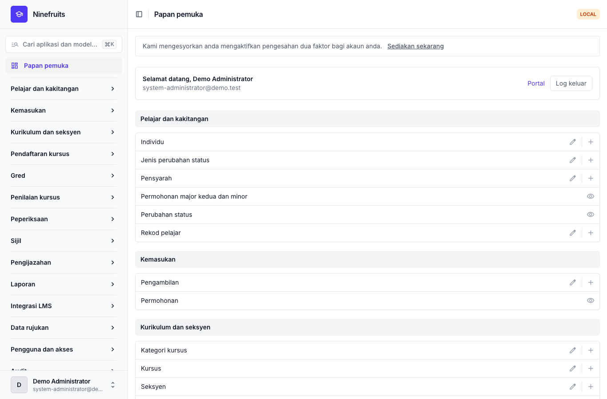
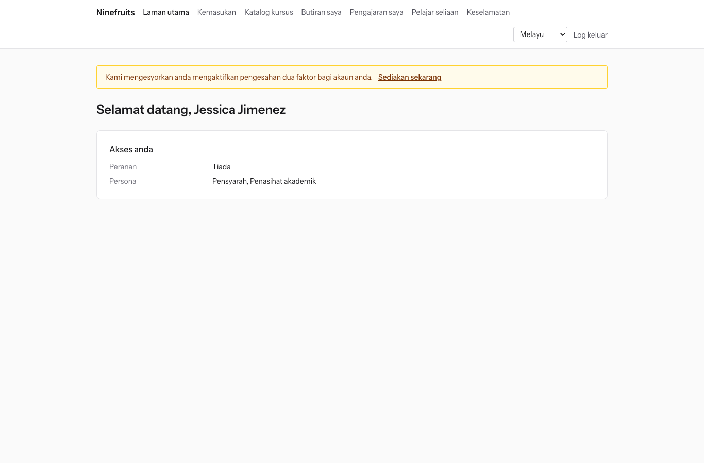
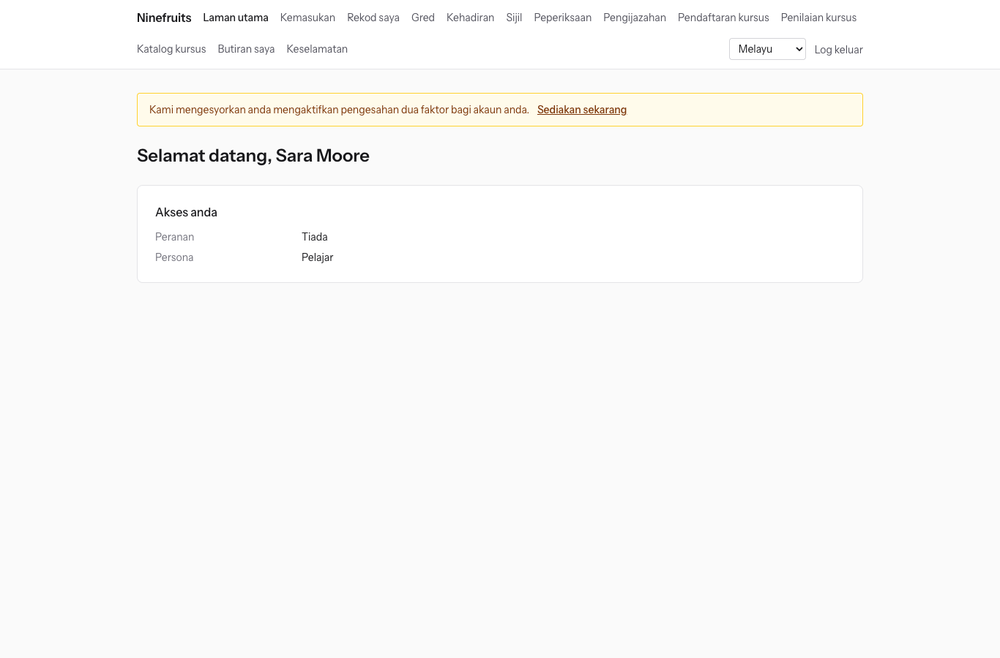

# Ninefruits — Sistem Maklumat Pelajar (Django)

**Bahasa / Languages / 언어**

| Bahasa | README | Manual |
|---|---|---|
| English | [README.md](README.md) | [docs/manual/en/](docs/manual/en/README.md) |
| 한국어 | [README.ko.md](README.ko.md) | [docs/manual/ko/](docs/manual/ko/README.md) |
| 简体中文 | [README.zh_Hans.md](README.zh_Hans.md) | [docs/manual/zh_Hans/](docs/manual/zh_Hans/README.md) |
| ລາວ | [README.lo.md](README.lo.md) | [docs/manual/lo/](docs/manual/lo/README.md) |
| Deutsch | [README.de.md](README.de.md) | [docs/manual/de/](docs/manual/de/README.md) |
| Filipino | [README.fil.md](README.fil.md) | [docs/manual/fil/](docs/manual/fil/README.md) |
| Français | [README.fr.md](README.fr.md) | [docs/manual/fr/](docs/manual/fr/README.md) |
| 日本語 | [README.ja.md](README.ja.md) | [docs/manual/ja/](docs/manual/ja/README.md) |
| Монгол | [README.mn.md](README.mn.md) | [docs/manual/mn/](docs/manual/mn/README.md) |
| Bahasa Melayu | [README.ms.md](README.ms.md) (fail ini) | [docs/manual/ms/](docs/manual/ms/README.md) |
| नेपाली | [README.ne.md](README.ne.md) | [docs/manual/ne/](docs/manual/ne/README.md) |
| Русский | [README.ru.md](README.ru.md) | [docs/manual/ru/](docs/manual/ru/README.md) |
| ไทย | [README.th.md](README.th.md) | [docs/manual/th/](docs/manual/th/README.md) |
| Türkçe | [README.tr.md](README.tr.md) | [docs/manual/tr/](docs/manual/tr/README.md) |
| Oʻzbek | [README.uz.md](README.uz.md) | [docs/manual/uz/](docs/manual/uz/README.md) |
| Tiếng Việt | [README.vi.md](README.vi.md) | [docs/manual/vi/](docs/manual/vi/README.md) |

Untuk menambah bahasa lain, lihat [Menambah bahasa](docs/development/adding-a-language.md).

Ninefruits ialah sistem maklumat pelajar yang boleh dipasang dan dikendalikan oleh mana-mana universiti. Ia meliputi teras pentadbiran akademik — daripada permohonan kemasukan hingga rekod pelajar, kurikulum dan seksyen, pendaftaran kursus, gred, penilaian kursus, sijil, peperiksaan bahasa dan peperiksaan komprehensif, kehadiran, semakan bergraduat, laporan dan asas integrasi LMS. Skrin dan dokumen tersedia dalam 16 bahasa yang disenaraikan dalam jadual di atas.

Repositori ini ialah port Python 3.14 / Django 6.1 / PostgreSQL 18 bagi [Ninefruits untuk Laravel](https://github.com/humble92/ninefruits-laravel) v1.0.0 (Laravel 13, Filament, Livewire). Port ini mengekalkan tingkah laku versi asal dan skema pangkalan datanya tanpa perubahan: migrasi Django memainkan semula DDL versi asal, dan skema dibandingkan objek demi objek dengan `pg_dump` versi asal (`tests/db/test_schema_equivalence.py`, `tools/schema_dump_diff.py`). Oleh itu, pemasangan mana-mana versi boleh dipindahkan ke versi yang lain dengan alat PostgreSQL standard. Cara dan sebab port ini dibuat direkodkan dalam [porting/](porting/README.md) (pelan, laporan fasa, keputusan reka bentuk, pemetaan ujian).

## Sekilas pandang

Skrin pertama selepas log masuk bagi tiga peranan (data demo).

| Pentadbir sistem (panel pentadbiran) | Pensyarah (portal) | Pelajar (portal) |
|---|---|---|
|  |  |  |

- **Panel pentadbiran** `/admin/`: kakitangan mengurus rekod pelajar, hal ehwal akademik, kemasukan, sijil, peperiksaan, pengijazahan dan laporan (Django admin dengan django-unfold). Kebenaran datang daripada templat peranan (Pegawai Pendaftar, Pegawai Hal Ehwal Akademik, Pegawai Sijil, Pembantu Jabatan, Pegawai Kemasukan, Pentadbir Sistem) yang berskop kepada unit organisasi dan program.
- **Portal** `/portal/`: pelajar melihat pendaftaran kursus, gred, kehadiran, permohonan peperiksaan, syarat bergraduat dan sijil; pensyarah melihat senarai pelajar, kehadiran, kemasukan gred dan keputusan penilaian bagi seksyen mereka; pemohon memohon kemasukan (templat Django dengan HTMX, Alpine.js dan Tailwind CSS). Satu akaun boleh memegang beberapa peranan (contohnya pelajar yang juga pembantu pengajar).
- Kedua-duanya menggunakan log masuk yang sama (`/accounts/login/`, django-allauth) dan dasar dua faktor yang sama. Integrasi menggunakan REST API di bawah `/api/v1/` (OpenAPI di `/api/docs/`).

## Ciri-ciri

| Bidang | Kandungan |
|---|---|
| Pengguna dan keselamatan | Log masuk bersama, pengesahan dua faktor (aplikasi, e-mel), SSO (OIDC), log masuk dengan nombor pelajar, peranan, kebenaran dan skop organisasi, audit data dan aktiviti dengan rantaian cincang, keselamatan peringkat baris (RLS), penyulitan data peribadi |
| Individu dan rekod pelajar | Individu diasingkan daripada rekod pelajar, peraturan nombor pelajar, perubahan status (penangguhan pengajian, sambung semula pengajian, tarik diri, pemberhentian, kemasukan semula, pengijazahan) dengan permohonan dan kelulusan, penasihat akademik, major kedua dan minor |
| Kemasukan | Pengambilan, permohonan dan dokumen dalam talian, semakan dan pengumuman keputusan, rekod pelajar bagi pemohon yang diterima masuk |
| Kurikulum | Versi kursus, prasyarat dan kursus setara, syarat bergraduat mengikut tahun kurikulum, seksyen, jadual waktu, rangka kursus |
| Pendaftaran kursus | Set peraturan, had kredit, kapasiti dan senarai menunggu, sekatan dan kelulusan khas, direka untuk puncak pendaftaran kursus |
| Gred | Penilaian mutlak dan relatif, had taburan gred, penghantaran dan pemuktamadan, kelulusan pindaan gred, PNGK dan ulang kursus, tutup semester (amaran akademik, Senarai Dekan), transkrip |
| Penilaian kursus | Respons tanpa nama, borang dan soalan, kadar respons minimum, pengumuman keputusan, paparan gred ditahan sehingga penilaian selesai |
| Sijil | Jenis dan templat mengikut bahasa, nombor sijil, PDF yang disimpan, halaman pengesahan awam (QR) |
| Peperiksaan | Jenis peperiksaan, bahagian dan markah lulus, sesi dan permohonan, kemasukan keputusan, CSV dan pengumuman, permohonan pembetulan, markah luar |
| Kehadiran | Sesi kelas daripada jadual waktu, kemasukan kehadiran, PDF borang kehadiran, CSV senarai pelajar |
| Pengijazahan | Semakan syarat, semakan yang disimpan, pengecualian syarat (dua pelulus), pemprosesan pengijazahan dan nombor ijazah |
| Laporan | Tujuh laporan standard dengan CSV, paparan `reporting` untuk alat BI |
| Integrasi LMS | Platform, pautan kursus dan rekod penyegerakan, penyegerakan dipacu peristiwa, penyelarasan setiap malam, draf markah LMS, REST API dengan token |

## Teknologi

Python 3.14, Django 6.1, django-unfold (panel pentadbiran), HTMX 2, Alpine.js 3, Tailwind CSS 4 dan Vite (portal, django-vite), PostgreSQL 18 (keselamatan peringkat baris, audit pencetus), Redis, Celery dan Flower (baris gilir), Gotenberg (PDF), django-allauth (log masuk, dua faktor, SSO), Django REST framework (API). Kebergantungan dikunci dengan [uv](https://docs.astral.sh/uv/) (`uv.lock`) dan npm (`package-lock.json`).

## Mula pantas (laman demo)

### Dengan uv

PostgreSQL 18, Redis 8, Gotenberg 8 dan Mailpit mesti berjalan secara setempat (atau mulakan hanya perkhidmatan tersebut dengan Docker Compose: `docker compose up -d pgsql redis gotenberg mailpit`).

```bash
uv sync                                         # .venv with the development tools
npm ci && npm run build                         # static/dist/ (or `npm run dev` with VITE_DEV_MODE=true)
cp .env.example .env
uv run manage.py pii_generate_key               # put the two values into .env
# Database roles and database (once, as the superuser): docs/manual/en/operations/installation.md section 2
uv run manage.py setup_install --profile=korean-university --grade-scale=4.5   # migrations, essential data, institution, first administrator
uv run manage.py setup_demo --size=small --seed=42                             # demo university and demo accounts
uv run manage.py compilemessages --ignore=.venv
uv run manage.py runserver
uv run celery -A config worker --loglevel=INFO  # in a second terminal (term close, waitlists, imports)
```

- Portal: http://localhost:8000/portal/ · Panel pentadbiran: http://localhost:8000/admin/ (log masuk yang sama)
- E-mel (Mailpit): http://localhost:8025

### Dengan Docker Compose

Hanya Docker diperlukan pada hos.

```bash
cp .env.example .env
docker compose up -d                            # app, worker, beat, flower, pgsql, redis, mailpit, gotenberg
docker compose exec app uv run manage.py pii_generate_key        # put the two values into .env, then: docker compose up -d
docker compose exec app uv run manage.py setup_install --profile=korean-university --grade-scale=4.5
docker compose exec app uv run manage.py setup_demo --size=small --seed=42
docker compose exec app uv run manage.py compilemessages --ignore=.venv
docker compose --profile vite up -d vite        # optional: Vite dev server (HMR), VITE_DEV_MODE=true in .env
```

Kontena `pgsql` mencipta peranan pangkalan data (`app_migrator`, `app_runtime`, `app_reporting`) dan menyediakan pangkalan data pembangunan dan ujian pada kali pertama ia dimulakan (`docker/pgsql/`). Pemantau baris gilir (Flower): http://localhost:5555

### Akaun demo

Setiap kata laluan ialah `demo-password` (`ninefruits/setup/conf.py`). Pengesahan dua faktor belum didaftarkan.

| Akaun | Peranan / persona | Skrin pertama |
|---|---|---|
| system-administrator@demo.test | Pentadbir Sistem (setiap kebenaran) | /admin/ |
| registrar@demo.test | Pegawai Pendaftar (rekod pelajar, perubahan pendaftaran kursus, pemuktamadan gred, sijil, peperiksaan, pengijazahan, laporan) | /admin/ |
| academic-affairs@demo.test | Pegawai Hal Ehwal Akademik (kursus, seksyen, jadual waktu, dasar penggredan, penilaian kursus, sesi kelas) | /admin/ |
| certificate-officer@demo.test | Pegawai Sijil | /admin/ |
| department-assistant@demo.test | Pembantu Jabatan (paparan berskop jabatan, penasihat akademik, laporan) | /admin/ |
| admissions-officer@demo.test | Pegawai Kemasukan | /admin/ |
| instructor@demo.test | Pensyarah dan penasihat akademik (seksyen sendiri, kehadiran, kemasukan gred, pelajar seliaan) | /portal/ |
| student@demo.test | Pelajar semasa | /portal/ |
| alumni@demo.test | Graduan | /portal/ |
| readmitted@demo.test | Graduan yang diterima masuk semula (dua rekod pelajar) | /portal/ |
| applicant@demo.test | Pemohon | /portal/ |
| admitted@demo.test | Pemohon yang diterima masuk | /portal/ |

Data demo ialah sebuah universiti rekaan (profil universiti Korea) dengan pelajar, pensyarah, kursus, seksyen, pendaftaran kursus, gred, penilaian kursus, sijil, peperiksaan, kehadiran, semakan bergraduat dan pautan LMS. Jangan sekali-kali memuatkannya ke dalam produksi (`setup_demo` enggan berjalan apabila `DJANGO_ENV=production`).

Untuk pemasangan produksi (gunicorn, Nginx, Celery beat, pemboleh ubah persekitaran, sandaran), ikuti [manual pemasangan](docs/manual/ms/operations/installation.md) dan [senarai semak pelaksanaan](docs/manual/ms/operations/deployment-checklist.md).

## Dokumentasi

- [Manual pentadbir](docs/manual/ms/admin/README.md): 28 bab, daripada urutan persediaan awal hingga setiap bidang
- [Manual operasi](docs/manual/ms/README.md#operasi): [pemasangan](docs/manual/ms/operations/installation.md), [senarai semak pelaksanaan](docs/manual/ms/operations/deployment-checklist.md), [arahan](docs/manual/ms/operations/commands.md), [tugas berjadual](docs/manual/ms/operations/scheduled-jobs.md), [sandaran dan pemulihan](docs/manual/ms/operations/backup-restore.md), [kunci keselamatan](docs/manual/ms/operations/security-keys.md), [audit dan penyelenggaraan](docs/manual/ms/operations/audit-and-maintenance.md), [ujian beban](docs/manual/ms/operations/load-testing.md), [penyelesaian masalah](docs/manual/ms/operations/troubleshooting.md)
- [Panduan integrasi LMS](docs/lms-integration-guide.md)
- [Pembangunan](docs/README.md): [peraturan penamaan](docs/development/naming.md), [senarai semak semakan kod](docs/development/review-checklist.md), [menambah bahasa](docs/development/adding-a-language.md)
- Sejarah porting dan keputusan reka bentuk: [porting/](porting/README.md)

## Arahan biasa

| Arahan | Fungsi |
|---|---|
| `uv run pytest -n auto -m "not concurrency"` | Ujian (jalankan ujian keserentakan secara berasingan dengan `-m concurrency`) |
| `uv run ruff format && uv run ruff check` | Gaya kod dan lint |
| `uv run mypy ninefruits config tools/checks` | Semakan jenis |
| `uv run tools/checks/raw_sql.py` | Semakan SQL mentah (tiada SQL yang dibina daripada rentetan) |
| `uv run manage.py naming_check` | Semakan penamaan (jadual dan lajur pangkalan data, migrasi, arahan, terjemahan) |
| `uv run manage.py i18n_missing --strict` | Terjemahan yang tiada (`i18n_export` / `i18n_import` untuk bertukar fail dengan penterjemah) |
| `uv run manage.py migrate` | Migrasi (menggunakan sambungan `app_migrator` secara automatik) |
| `uv run manage.py setup_install`, `setup_demo` | Pasang atau kemas kini, data demo |
| `uv run manage.py security_sync_permissions` | Menyegerakkan katalog kebenaran daripada kod ke pangkalan data |
| `pre-commit install` | ruff, mypy dan semakan SQL mentah sebelum setiap komit |

Senarai penuh terdapat dalam [rujukan arahan](docs/manual/ms/operations/commands.md). CI (`.github/workflows/ci.yml`) menjalankan semakan yang sama dalam dua tugas: kualiti dan ujian.

## Lesen

[Lesen MIT](LICENSE). Sesiapa sahaja boleh menggunakan, mengubah suai dan mengedarkannya secara bebas, asalkan notis hak cipta dan teks lesen dikekalkan.

---

**Penghargaan**

Terima kasih kami kepada YUSTIC, sistem pentadbiran akademik Yanbian University of Science and Technology, yang telah memungkinkan sistem ini. YUSTIC ialah hasil kerja sekumpulan kecil pembangun yang bermimpi, berpenat lelah dan membina bersama selama bertahun-tahun. Sistem ini ialah cara kami menyatakan betapa kami merindui, menghormati dan berterima kasih kepada rakan sekerja yang pernah bekerja bersama kami.
