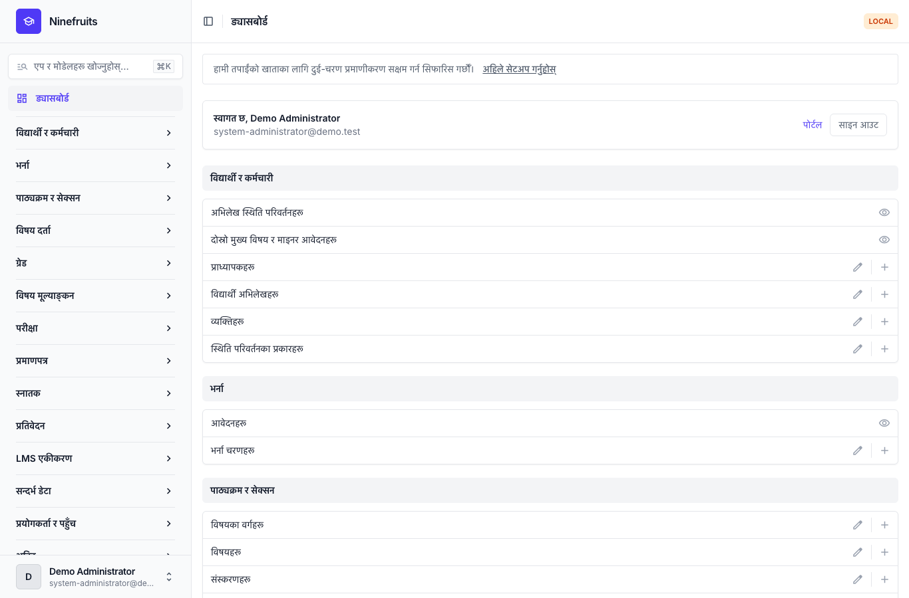
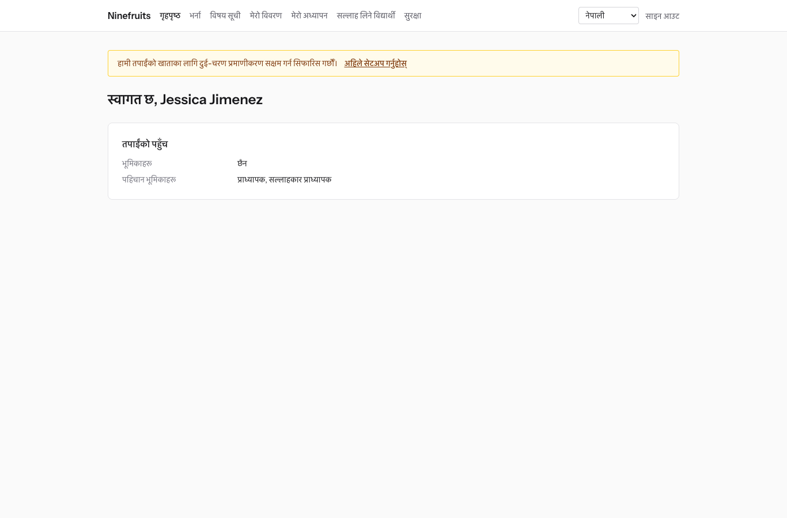
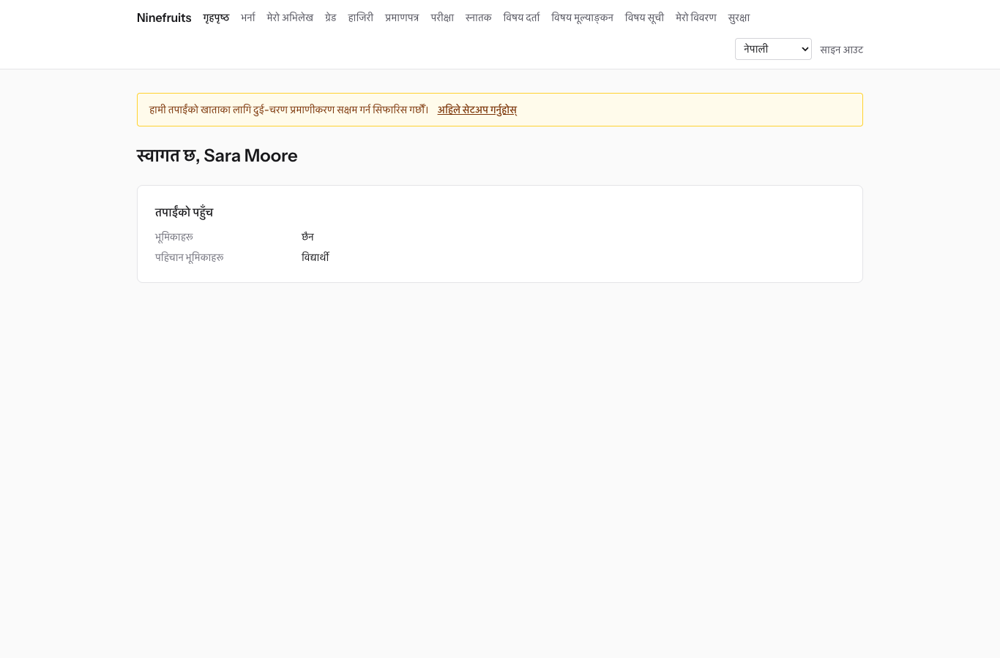

# Ninefruits — विद्यार्थी सूचना प्रणाली (Django)

**Languages / 언어 / 语言 / ພາສາ**

| भाषा | README | पुस्तिका |
|---|---|---|
| English | [README.md](README.md) | [docs/manual/en/](docs/manual/en/README.md) |
| 한국어 | [README.ko.md](README.ko.md) | [docs/manual/ko/](docs/manual/ko/README.md) |
| 简体中文 | [README.zh_Hans.md](README.zh_Hans.md) | [docs/manual/zh_Hans/](docs/manual/zh_Hans/README.md) |
| ລາວ | [README.lo.md](README.lo.md) | [docs/manual/lo/](docs/manual/lo/README.md) |
| Deutsch | [README.de.md](README.de.md) | [docs/manual/de/](docs/manual/de/README.md) |
| Filipino | [README.fil.md](README.fil.md) | [docs/manual/fil/](docs/manual/fil/README.md) |
| Français | [README.fr.md](README.fr.md) | [docs/manual/fr/](docs/manual/fr/README.md) |
| 日本語 | [README.ja.md](README.ja.md) | [docs/manual/ja/](docs/manual/ja/README.md) |
| Монгол | [README.mn.md](README.mn.md) | [docs/manual/mn/](docs/manual/mn/README.md) |
| Bahasa Melayu | [README.ms.md](README.ms.md) | [docs/manual/ms/](docs/manual/ms/README.md) |
| नेपाली | [README.ne.md](README.ne.md) (यो फाइल) | [docs/manual/ne/](docs/manual/ne/README.md) |
| Русский | [README.ru.md](README.ru.md) | [docs/manual/ru/](docs/manual/ru/README.md) |
| ไทย | [README.th.md](README.th.md) | [docs/manual/th/](docs/manual/th/README.md) |
| Türkçe | [README.tr.md](README.tr.md) | [docs/manual/tr/](docs/manual/tr/README.md) |
| Oʻzbek | [README.uz.md](README.uz.md) | [docs/manual/uz/](docs/manual/uz/README.md) |
| Tiếng Việt | [README.vi.md](README.vi.md) | [docs/manual/vi/](docs/manual/vi/README.md) |

अर्को भाषा थप्न [भाषा थप्ने तरिका](docs/development/adding-a-language.md) ([한국어](docs/development/adding-a-language.ko.md)) हेर्नुहोस्।

Ninefruits कुनै पनि विश्वविद्यालयले स्थापना गरेर चलाउन सक्ने विद्यार्थी सूचना प्रणाली हो। यसले शैक्षिक प्रशासनका मुख्य पक्षहरू — भर्ना आवेदनदेखि विद्यार्थी अभिलेख, पाठ्यक्रम र सेक्सन, विषय दर्ता, ग्रेड, विषय मूल्याङ्कन, प्रमाणपत्र, भाषा तथा व्यापक परीक्षा, हाजिरी, स्नातक योग्यता जाँच, प्रतिवेदन र LMS एकीकरणको आधारसम्म — समेट्छ। स्क्रिन र कागजातहरू माथिको तालिकाका 16 भाषामा उपलब्ध छन्।

यो रिपोजिटरी [Ninefruits for Laravel](https://github.com/humble92/ninefruits-laravel) v1.0.0 (Laravel 13, Filament, Livewire) को Python 3.14 / Django 6.1 / PostgreSQL 18 पोर्ट हो। पोर्टले मूल प्रणालीको व्यवहार र डेटाबेस स्किमा अपरिवर्तित राख्छ: Django migration हरूले मूल प्रणालीको DDL दोहोर्‍याउँछन्, र स्किमालाई मूल प्रणालीको `pg_dump` सँग वस्तुअनुसार दाँजिन्छ (`tests/db/test_schema_equivalence.py`, `tools/schema_dump_diff.py`)। त्यसैले कुनै पनि संस्करणको स्थापनालाई मानक PostgreSQL उपकरणहरूबाट अर्कोमा सार्न सकिन्छ। कसरी र किन पोर्ट गरियो भन्ने कुरा [porting/](porting/README.md) मा अभिलेख गरिएको छ (योजना, चरण प्रतिवेदन, डिजाइन निर्णय, परीक्षण म्यापिङ)।

## एक नजरमा

तीन भूमिकाले साइन इन गरेपछिका पहिलो स्क्रिन (डेमो डेटा)।

| प्रणाली प्रशासक (प्रशासन प्यानल) | प्राध्यापक (पोर्टल) | विद्यार्थी (पोर्टल) |
|---|---|---|
|  |  |  |

- **प्रशासन प्यानल** `/admin/`: कर्मचारीहरूले विद्यार्थी अभिलेख, शैक्षिक प्रशासन, भर्ना, प्रमाणपत्र, परीक्षा, स्नातक र प्रतिवेदन सम्हाल्छन् (django-unfold सहितको Django admin)। अनुमतिहरू संगठन एकाइ र कार्यक्रमको दायरासहितका भूमिका टेम्प्लेटहरू (रजिस्ट्रार, शैक्षिक प्रशासन, प्रमाणपत्र अधिकृत, विभागीय सहायक, भर्ना अधिकृत, प्रणाली प्रशासक) बाट आउँछन्।
- **पोर्टल** `/portal/`: विद्यार्थीहरूले विषय दर्ता, ग्रेड, हाजिरी, परीक्षा आवेदन, स्नातक आवश्यकता र प्रमाणपत्र हेर्छन्; प्राध्यापकहरूले आफ्ना सेक्सनका विद्यार्थी सूची, हाजिरी, ग्रेड प्रविष्टि र मूल्याङ्कन नतिजा हेर्छन्; आवेदकहरूले भर्नाका लागि आवेदन दिन्छन् (HTMX, Alpine.js र Tailwind CSS सहितका Django टेम्प्लेट)। एउटै खातासँग धेरै भूमिका हुन सक्छन् (उदाहरणका लागि शिक्षण सहायक पनि भएको विद्यार्थी)।
- दुवैले एउटै साइन इन (`/accounts/login/`, django-allauth) र एउटै दुई-चरण नीति प्रयोग गर्छन्। एकीकरणहरूले `/api/v1/` अन्तर्गतको REST API प्रयोग गर्छन् (OpenAPI `/api/docs/` मा)।

## सुविधाहरू

| क्षेत्र | विषयवस्तु |
|---|---|
| प्रयोगकर्ता र सुरक्षा | साझा साइन इन, दुई-चरण प्रमाणीकरण (एप, इमेल), SSO (OIDC), विद्यार्थी नम्बरबाट साइन इन, भूमिका, अनुमति र संगठन दायरा, ह्यास चेनसहितको डेटा र गतिविधि अडिट, row level security (RLS), व्यक्तिगत डेटा इन्क्रिप्सन |
| व्यक्ति र विद्यार्थी अभिलेख | विद्यार्थी अभिलेखबाट छुट्टै व्यक्ति, विद्यार्थी नम्बरका नियम, अनुरोध र स्वीकृतिसहितको स्थिति परिवर्तन (अध्ययन बिदा, अध्ययनमा पुनरागमन, अध्ययन परित्याग, निष्कासन, पुनर्भर्ना, स्नातक), सल्लाहकार प्राध्यापक, दोस्रो मुख्य विषय र माइनर |
| भर्ना | भर्ना चरणहरू, कागजातसहित अनलाइन आवेदन, समीक्षा र नतिजा प्रकाशन, भर्ना स्वीकृत आवेदकका लागि विद्यार्थी अभिलेख |
| पाठ्यक्रम | विषय संस्करणहरू, पूर्वआवश्यक र समकक्ष विषयहरू, पाठ्यक्रम वर्षअनुसार स्नातक आवश्यकता, सेक्सनहरू, समय तालिका, पाठ्यविवरण |
| विषय दर्ता | नियम सेटहरू, क्रेडिट सीमा, क्षमता र प्रतीक्षा सूची, रोक र नियम छुट, दर्ताको उच्च चापका लागि डिजाइन गरिएको |
| ग्रेड | निरपेक्ष र सापेक्ष मूल्याङ्कन, ग्रेड वितरण सीमा, पेस गर्ने र अन्तिम गर्ने, ग्रेड परिवर्तन स्वीकृति, GPA र पुनः लिएका विषय, सेमेस्टर बन्द (शैक्षिक चेतावनी, सम्मान), ट्रान्सक्रिप्ट |
| विषय मूल्याङ्कन | गुमनाम प्रतिक्रिया, फारम र प्रश्नहरू, न्यूनतम प्रतिक्रिया दर, नतिजा प्रकाशन, मूल्याङ्कन पूरा नगरेसम्म ग्रेड हेर्न रोक |
| प्रमाणपत्र | प्रकार र भाषाअनुसार टेम्प्लेट, प्रमाणपत्र नम्बर, भण्डारण गरिएका PDF, सार्वजनिक प्रमाणीकरण पृष्ठ (QR) |
| परीक्षा | परीक्षाका प्रकार, क्षेत्र र उत्तीर्णाङ्क, सत्र र आवेदन, नतिजा प्रविष्टि, CSV र प्रकाशन, सच्याइ अनुरोध, बाह्य अङ्क |
| हाजिरी | समय तालिकाबाट कक्षाहरू, हाजिरी प्रविष्टि, हाजिरी पाना PDF, विद्यार्थी सूची CSV |
| स्नातक | आवश्यकता जाँच, सुरक्षित गरिएका जाँच, आवश्यकता छुट (दुई स्वीकृतकर्ता), स्नातक प्रक्रिया र उपाधि नम्बर |
| प्रतिवेदन | CSV सहित सात मानक प्रतिवेदन, BI उपकरणका लागि `reporting` भ्युहरू |
| LMS एकीकरण | प्लेटफर्महरू, विषय लिङ्क र सिङ्क अभिलेख, घटनामा आधारित सिङ्क, रात्रिकालीन मिलान, LMS अङ्कको मस्यौदा, टोकनसहितको REST API |

## प्रविधि

Python 3.14, Django 6.1, django-unfold (प्रशासन प्यानल), HTMX 2, Alpine.js 3, Tailwind CSS 4 र Vite (पोर्टल, django-vite), PostgreSQL 18 (row level security, trigger अडिट), Redis, Celery र Flower (क्यु), Gotenberg (PDF), django-allauth (साइन इन, दुई-चरण, SSO), Django REST framework (API)। निर्भरताहरू [uv](https://docs.astral.sh/uv/) (`uv.lock`) र npm (`package-lock.json`) बाट लक गरिएका छन्।

## छिटो सुरुवात (डेमो साइट)

### uv सँग

PostgreSQL 18, Redis 8, Gotenberg 8 र Mailpit स्थानीय रूपमा चलिरहेका हुनुपर्छ (वा Docker Compose बाट ती सेवा मात्र सुरु गर्नुहोस्: `docker compose up -d pgsql redis gotenberg mailpit`)।

```bash
uv sync                                         # .venv with the development tools
npm ci && npm run build                         # static/dist/ (or `npm run dev` with VITE_DEV_MODE=true)
cp .env.example .env
uv run manage.py pii_generate_key               # put the two values into .env
# Database roles and database (once, as the superuser): docs/manual/en/operations/installation.md section 2
uv run manage.py setup_install --profile=korean-university --grade-scale=4.5   # migrations, essential data, institution, first administrator
uv run manage.py setup_demo --size=small --seed=42                             # demo university and demo accounts
uv run manage.py compilemessages --ignore=.venv
uv run manage.py runserver
uv run celery -A config worker --loglevel=INFO  # in a second terminal (term close, waitlists, imports)
```

- पोर्टल: http://localhost:8000/portal/ · प्रशासन प्यानल: http://localhost:8000/admin/ (एउटै साइन इन)
- मेल (Mailpit): http://localhost:8025

### Docker Compose सँग

होस्टमा Docker मात्र चाहिन्छ।

```bash
cp .env.example .env
docker compose up -d                            # app, worker, beat, flower, pgsql, redis, mailpit, gotenberg
docker compose exec app uv run manage.py pii_generate_key        # put the two values into .env, then: docker compose up -d
docker compose exec app uv run manage.py setup_install --profile=korean-university --grade-scale=4.5
docker compose exec app uv run manage.py setup_demo --size=small --seed=42
docker compose exec app uv run manage.py compilemessages --ignore=.venv
docker compose --profile vite up -d vite        # optional: Vite dev server (HMR), VITE_DEV_MODE=true in .env
```

`pgsql` कन्टेनरले पहिलो पटक सुरु हुँदा डेटाबेस भूमिकाहरू (`app_migrator`, `app_runtime`, `app_reporting`) बनाउँछ र विकास तथा परीक्षण डेटाबेस तयार गर्छ (`docker/pgsql/`)। क्यु मनिटर (Flower): http://localhost:5555

### डेमो खाताहरू

सबै पासवर्ड `demo-password` हुन् (`ninefruits/setup/conf.py`)। दुई-चरण प्रमाणीकरण दर्ता गरिएको छैन।

| खाता | भूमिका / पहिचान भूमिका | पहिलो स्क्रिन |
|---|---|---|
| system-administrator@demo.test | प्रणाली प्रशासक (सबै अनुमति) | /admin/ |
| registrar@demo.test | रजिस्ट्रार (विद्यार्थी अभिलेख, विषय दर्ता परिवर्तन, ग्रेड अन्तिम गर्ने, प्रमाणपत्र, परीक्षा, स्नातक, प्रतिवेदन) | /admin/ |
| academic-affairs@demo.test | शैक्षिक प्रशासन (विषयहरू, सेक्सनहरू, समय तालिका, ग्रेडिङ नीति, विषय मूल्याङ्कन, कक्षाहरू) | /admin/ |
| certificate-officer@demo.test | प्रमाणपत्र अधिकृत | /admin/ |
| department-assistant@demo.test | विभागीय सहायक (विभागको दायराभित्र हेर्ने, सल्लाहकार प्राध्यापक, प्रतिवेदन) | /admin/ |
| admissions-officer@demo.test | भर्ना अधिकृत | /admin/ |
| instructor@demo.test | प्राध्यापक र सल्लाहकार प्राध्यापक (आफ्ना सेक्सन, हाजिरी, ग्रेड प्रविष्टि, सल्लाह पाउने विद्यार्थी) | /portal/ |
| student@demo.test | अध्ययनरत विद्यार्थी | /portal/ |
| alumni@demo.test | स्नातक भइसकेका | /portal/ |
| readmitted@demo.test | फेरि भर्ना भएका स्नातक (दुई विद्यार्थी अभिलेख) | /portal/ |
| applicant@demo.test | आवेदक | /portal/ |
| admitted@demo.test | भर्ना स्वीकृत आवेदक | /portal/ |

डेमो डेटा एउटा काल्पनिक विश्वविद्यालय (कोरियाली विश्वविद्यालय प्रोफाइल) हो, जसमा विद्यार्थी, प्राध्यापक, विषय, सेक्सन, विषय दर्ता, ग्रेड, विषय मूल्याङ्कन, प्रमाणपत्र, परीक्षा, हाजिरी, स्नातक योग्यता जाँच र LMS लिङ्कहरू छन्। उत्पादनमा यसलाई कहिल्यै लोड नगर्नुहोस् (`DJANGO_ENV=production` हुँदा `setup_demo` चल्न अस्वीकार गर्छ)।

उत्पादन स्थापना (gunicorn, Nginx, Celery beat, वातावरण चरहरू, ब्याकअप) का लागि [स्थापना पुस्तिका](docs/manual/ne/operations/installation.md) र [डिप्लोय जाँचसूची](docs/manual/ne/operations/deployment-checklist.md) पालना गर्नुहोस्।

## कागजात

- [प्रशासक पुस्तिका](docs/manual/ne/admin/README.md): प्रारम्भिक सेटअपको क्रमदेखि हरेक क्षेत्रसम्म 28 अध्याय (कोरियाली मूल: [docs/manual/ko/](docs/manual/ko/README.md))
- [सञ्चालन पुस्तिका](docs/manual/ne/README.md#सञ्चालन): [स्थापना](docs/manual/ne/operations/installation.md), [डिप्लोय जाँचसूची](docs/manual/ne/operations/deployment-checklist.md), [कमान्डहरू](docs/manual/ne/operations/commands.md), [निर्धारित कार्यहरू](docs/manual/ne/operations/scheduled-jobs.md), [ब्याकअप र पुनर्स्थापना](docs/manual/ne/operations/backup-restore.md), [सुरक्षा कुञ्जीहरू](docs/manual/ne/operations/security-keys.md), [अडिट र मर्मतसम्भार](docs/manual/ne/operations/audit-and-maintenance.md), [लोड परीक्षण](docs/manual/ne/operations/load-testing.md), [समस्या समाधान](docs/manual/ne/operations/troubleshooting.md)
- [LMS एकीकरण गाइड](docs/lms-integration-guide.md)
- [विकास](docs/README.md): [नामकरण नियमहरू](docs/development/naming.md), [समीक्षा जाँचसूची](docs/development/review-checklist.md), [भाषा थप्ने तरिका](docs/development/adding-a-language.md)
- पोर्टिङ इतिहास र डिजाइन निर्णयहरू: [porting/](porting/README.md)

## दैनिक कमान्डहरू

| कमान्ड | के गर्छ |
|---|---|
| `uv run pytest -n auto -m "not concurrency"` | परीक्षणहरू (एकैसाथ चल्ने परीक्षणहरू `-m concurrency` सहित छुट्टै चलाउनुहोस्) |
| `uv run ruff format && uv run ruff check` | कोड शैली र lint |
| `uv run mypy ninefruits config tools/checks` | प्रकार जाँच |
| `uv run tools/checks/raw_sql.py` | Raw SQL जाँच (स्ट्रिङ जोडेर बनाइएको SQL नहोस्) |
| `uv run manage.py naming_check` | नामकरण जाँच (DB तालिका र स्तम्भ, migration, कमान्ड, अनुवाद) |
| `uv run manage.py i18n_missing --strict` | छुटेका अनुवाद (अनुवादकहरूसँग आदानप्रदान गर्न `i18n_export` / `i18n_import`) |
| `uv run manage.py migrate` | Migration (स्वतः `app_migrator` जडान प्रयोग गर्छ) |
| `uv run manage.py setup_install`, `setup_demo` | स्थापना वा अद्यावधिक, डेमो डेटा |
| `uv run manage.py security_sync_permissions` | कोडको अनुमति क्याटलग डेटाबेसमा ल्याउँछ |
| `pre-commit install` | हरेक commit अघि ruff, mypy र raw SQL जाँच |

पूर्ण सूची [कमान्ड सन्दर्भ](docs/manual/ne/operations/commands.md) मा छ। CI (`.github/workflows/ci.yml`) ले उही जाँचहरू दुई job मा चलाउँछ: गुणस्तर र परीक्षण।

## इजाजतपत्र

[MIT License](LICENSE)। प्रतिलिपि अधिकार सूचना र इजाजतपत्रको पाठ राखेसम्म जोसुकैले यसलाई स्वतन्त्र रूपमा प्रयोग, परिमार्जन र वितरण गर्न सक्छ।

---

**आभार**

यो प्रणाली सम्भव बनाउने Yanbian University of Science and Technology को शैक्षिक प्रशासन प्रणाली YUSTIC प्रति हामी आभार व्यक्त गर्छौँ। YUSTIC धेरै वर्षसम्म सँगै सपना देखेका, पसिना बगाएका र निर्माण गरेका विकासकर्ताहरूको सानो टोलीको काम थियो। यो प्रणाली हामीसँग काम गरेका सहकर्मीहरूलाई हामी कति सम्झन्छौँ, सम्मान गर्छौँ र धन्यवाद दिन्छौँ भन्ने व्यक्त गर्ने हाम्रो तरिका हो।
