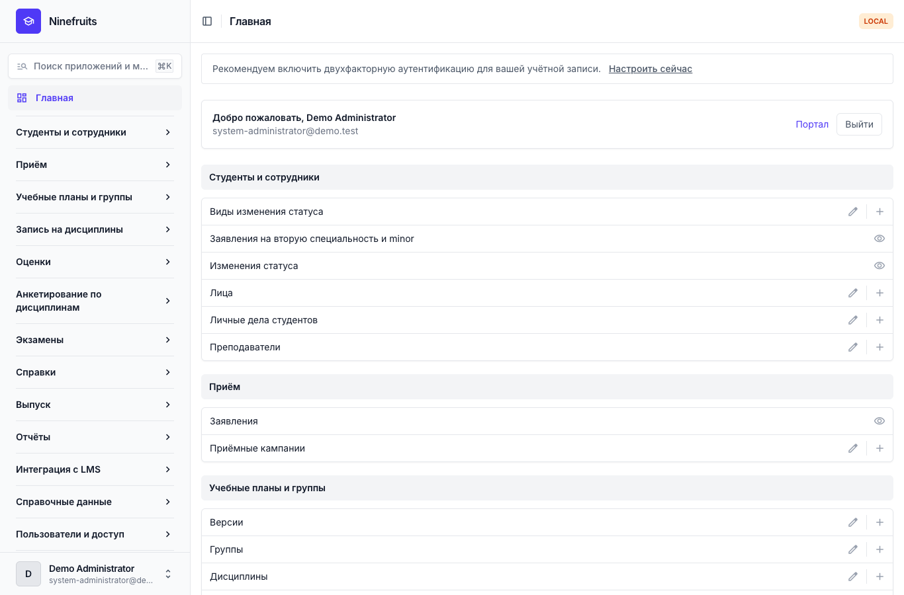
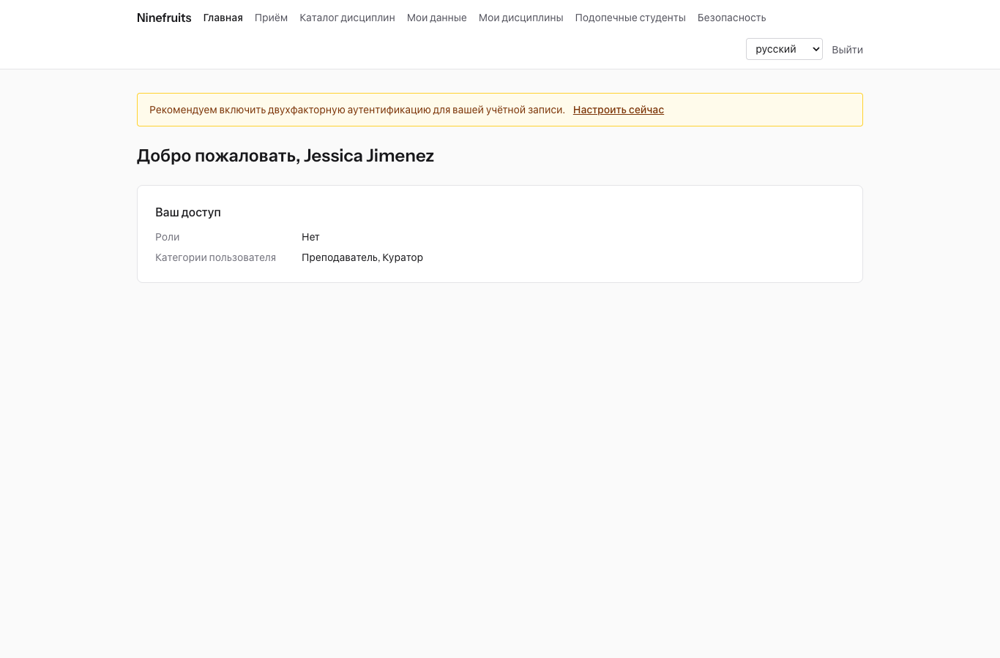
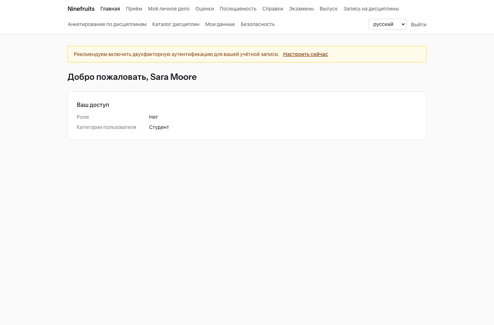

# Ninefruits — система управления учебным процессом (Django)

**Языки / Languages / 언어**

| Язык | README | Руководство |
|---|---|---|
| English | [README.md](README.md) | [docs/manual/en/](docs/manual/en/README.md) |
| 한국어 | [README.ko.md](README.ko.md) | [docs/manual/ko/](docs/manual/ko/README.md) |
| 简体中文 | [README.zh_Hans.md](README.zh_Hans.md) | [docs/manual/zh_Hans/](docs/manual/zh_Hans/README.md) |
| ລາວ | [README.lo.md](README.lo.md) | [docs/manual/lo/](docs/manual/lo/README.md) |
| Deutsch | [README.de.md](README.de.md) | [docs/manual/de/](docs/manual/de/README.md) |
| Filipino | [README.fil.md](README.fil.md) | [docs/manual/fil/](docs/manual/fil/README.md) |
| Français | [README.fr.md](README.fr.md) | [docs/manual/fr/](docs/manual/fr/README.md) |
| 日本語 | [README.ja.md](README.ja.md) | [docs/manual/ja/](docs/manual/ja/README.md) |
| Монгол | [README.mn.md](README.mn.md) | [docs/manual/mn/](docs/manual/mn/README.md) |
| Bahasa Melayu | [README.ms.md](README.ms.md) | [docs/manual/ms/](docs/manual/ms/README.md) |
| नेपाली | [README.ne.md](README.ne.md) | [docs/manual/ne/](docs/manual/ne/README.md) |
| Русский | [README.ru.md](README.ru.md) (этот файл) | [docs/manual/ru/](docs/manual/ru/README.md) |
| ไทย | [README.th.md](README.th.md) | [docs/manual/th/](docs/manual/th/README.md) |
| Türkçe | [README.tr.md](README.tr.md) | [docs/manual/tr/](docs/manual/tr/README.md) |
| Oʻzbek | [README.uz.md](README.uz.md) | [docs/manual/uz/](docs/manual/uz/README.md) |
| Tiếng Việt | [README.vi.md](README.vi.md) | [docs/manual/vi/](docs/manual/vi/README.md) |

О добавлении нового языка см. [Добавление языка](docs/development/adding-a-language.md).

Ninefruits — система управления учебным процессом, которую может установить и эксплуатировать любой университет. Она охватывает основу академического администрирования — от заявлений о приёме до личных дел студентов, учебных планов и групп, записи на дисциплины, оценок, анкетирования по дисциплинам, справок, языковых и комплексных экзаменов, посещаемости, проверки требований к выпуску, отчётов и основы интеграции с LMS. Экраны и документация доступны на 16 языках из таблицы выше.

Этот репозиторий — перенос [Ninefruits для Laravel](https://github.com/humble92/ninefruits-laravel) v1.0.0 (Laravel 13, Filament, Livewire) на Python 3.14 / Django 6.1 / PostgreSQL 18. Перенос сохраняет поведение исходной системы и её схему базы данных без изменений: миграции Django воспроизводят DDL исходной системы, а схема сравнивается объект за объектом с `pg_dump` исходной системы (`tests/db/test_schema_equivalence.py`, `tools/schema_dump_diff.py`). Поэтому установку любой из версий можно перенести на другую стандартными средствами PostgreSQL. Как и почему выполнялся перенос, описано в [porting/](porting/README.md) (план, отчёты по этапам, проектные решения, соответствие тестов).

## Коротко

Первые экраны после входа под тремя ролями (демонстрационные данные).

| Системный администратор (панель администрирования) | Преподаватель (портал) | Студент (портал) |
|---|---|---|
|  |  |  |

- **Панель администрирования** `/admin/`: сотрудники работают с личными делами студентов, учебной частью, приёмом, справками, экзаменами, выпуском и отчётами (Django admin с django-unfold). Разрешения задаются шаблонами ролей (сотрудник учебного отдела, сотрудник учебного управления, ответственный за справки, методист кафедры, сотрудник приёмной комиссии, системный администратор) с областью действия по подразделениям и программам.
- **Портал** `/portal/`: студенты видят запись на дисциплины, оценки, посещаемость, регистрацию на экзамены, требования к выпуску и справки; преподаватели — списки групп, посещаемость, ввод оценок и результаты анкетирования по своим группам; абитуриенты подают заявления о приёме (шаблоны Django с HTMX, Alpine.js и Tailwind CSS). Одна учётная запись может иметь несколько ролей (например, студент, который также является ассистентом преподавателя).
- Оба используют общий вход (`/accounts/login/`, django-allauth) и одну политику двухфакторной аутентификации. Интеграции используют REST API в `/api/v1/` (OpenAPI — `/api/docs/`).

## Возможности

| Область | Содержание |
|---|---|
| Пользователи и безопасность | Общий вход, двухфакторная аутентификация (приложение, эл. почта), SSO (OIDC), вход по студенческому номеру, роли, разрешения и области действия по подразделениям, аудит данных и действий с цепочкой хешей, защита на уровне строк (RLS), шифрование персональных данных |
| Лица и личные дела студентов | Разделение лица и личного дела, правила студенческих номеров, изменения статуса (академический отпуск, выход из академического отпуска, отчисление по собственному желанию, отчисление, восстановление, выпуск) с запросами и согласованием, кураторы, вторые специальности и minor |
| Приём | Приёмные кампании, онлайн-заявления с документами, рассмотрение и объявление решений, личные дела для принятых абитуриентов |
| Учебные планы | Версии дисциплин, пререквизиты и эквивалентные дисциплины, требования к выпуску по году учебного плана, группы, расписания, рабочие программы |
| Запись на дисциплины | Наборы правил, лимиты кредитов, число мест и листы ожидания, ограничения и исключения из правил, рассчитано на пик записи |
| Оценки | Абсолютное и относительное оценивание, квоты оценок, отправка и утверждение, согласование изменений оценок, средний балл и повторное изучение, закрытие семестра (академическое предупреждение, отличие), ведомости оценок |
| Анкетирование по дисциплинам | Анонимные ответы, анкеты и вопросы, минимальная доля ответивших, публикация результатов, скрытие оценок до завершения анкетирования |
| Справки | Виды и шаблоны по языкам, регистрационные номера, сохранённые PDF, общедоступная страница проверки (QR) |
| Экзамены | Виды экзаменов, разделы и проходные баллы, сессии и регистрация, ввод результатов, CSV и публикация, запросы на исправление, внешние результаты |
| Посещаемость | Занятия по расписанию, отметка посещаемости, PDF журнала посещаемости, CSV списка группы |
| Выпуск | Проверка требований, сохранённые проверки, освобождения от требований (два согласующих), обработка выпуска и номера дипломов |
| Отчёты | Семь стандартных отчётов с CSV, представления `reporting` для BI-инструментов |
| Интеграция с LMS | Платформы, связи с курсами и журналы синхронизации, синхронизация по событиям, ночная сверка, баллы LMS как черновик оценок, REST API с токенами |

## Технологии

Python 3.14, Django 6.1, django-unfold (панель администрирования), HTMX 2, Alpine.js 3, Tailwind CSS 4 и Vite (портал, django-vite), PostgreSQL 18 (защита на уровне строк, аудит триггерами), Redis, Celery и Flower (очередь), Gotenberg (PDF), django-allauth (вход, двухфакторная аутентификация, SSO), Django REST framework (API). Зависимости зафиксированы с помощью [uv](https://docs.astral.sh/uv/) (`uv.lock`) и npm (`package-lock.json`).

## Быстрый старт (демонстрационный сайт)

### С uv

Локально должны работать PostgreSQL 18, Redis 8, Gotenberg 8 и Mailpit (или запустите только эти службы через Docker Compose: `docker compose up -d pgsql redis gotenberg mailpit`).

```bash
uv sync                                         # .venv with the development tools
npm ci && npm run build                         # static/dist/ (or `npm run dev` with VITE_DEV_MODE=true)
cp .env.example .env
uv run manage.py pii_generate_key               # put the two values into .env
# Database roles and database (once, as the superuser): docs/manual/en/operations/installation.md section 2
uv run manage.py setup_install --profile=korean-university --grade-scale=4.5   # migrations, essential data, institution, first administrator
uv run manage.py setup_demo --size=small --seed=42                             # demo university and demo accounts
uv run manage.py compilemessages --ignore=.venv
uv run manage.py runserver
uv run celery -A config worker --loglevel=INFO  # in a second terminal (term close, waitlists, imports)
```

- Портал: http://localhost:8000/portal/ · Панель администрирования: http://localhost:8000/admin/ (единый вход)
- Почта (Mailpit): http://localhost:8025

### С Docker Compose

На хосте нужен только Docker.

```bash
cp .env.example .env
docker compose up -d                            # app, worker, beat, flower, pgsql, redis, mailpit, gotenberg
docker compose exec app uv run manage.py pii_generate_key        # put the two values into .env, then: docker compose up -d
docker compose exec app uv run manage.py setup_install --profile=korean-university --grade-scale=4.5
docker compose exec app uv run manage.py setup_demo --size=small --seed=42
docker compose exec app uv run manage.py compilemessages --ignore=.venv
docker compose --profile vite up -d vite        # optional: Vite dev server (HMR), VITE_DEV_MODE=true in .env
```

Контейнер `pgsql` при первом запуске создаёт роли базы данных (`app_migrator`, `app_runtime`, `app_reporting`) и подготавливает базы данных для разработки и тестов (`docker/pgsql/`). Монитор очереди (Flower): http://localhost:5555

### Демонстрационные учётные записи

У всех учётных записей пароль `demo-password` (`ninefruits/setup/conf.py`). Двухфакторная аутентификация не подключена.

| Учётная запись | Роль / категория пользователя | Первый экран |
|---|---|---|
| system-administrator@demo.test | Системный администратор (все разрешения) | /admin/ |
| registrar@demo.test | Сотрудник учебного отдела (личные дела студентов, изменения записи на дисциплины, утверждение оценок, справки, экзамены, выпуск, отчёты) | /admin/ |
| academic-affairs@demo.test | Сотрудник учебного управления (дисциплины, группы, расписания, правила оценивания, анкетирование по дисциплинам, занятия) | /admin/ |
| certificate-officer@demo.test | Ответственный за справки | /admin/ |
| department-assistant@demo.test | Методист кафедры (просмотр в пределах кафедры, кураторы, отчёты) | /admin/ |
| admissions-officer@demo.test | Сотрудник приёмной комиссии | /admin/ |
| instructor@demo.test | Преподаватель и куратор (свои группы, посещаемость, ввод оценок, подопечные студенты) | /portal/ |
| student@demo.test | Обучающийся студент | /portal/ |
| alumni@demo.test | Выпускник | /portal/ |
| readmitted@demo.test | Выпускник, поступивший повторно (два личных дела) | /portal/ |
| applicant@demo.test | Абитуриент | /portal/ |
| admitted@demo.test | Принятый абитуриент | /portal/ |

Демонстрационные данные — это один вымышленный университет (профиль корейского университета) со студентами, преподавателями, дисциплинами, группами, записями на дисциплины, оценками, анкетированием по дисциплинам, справками, экзаменами, посещаемостью, проверками требований к выпуску и связями с LMS. Никогда не загружайте их в рабочую среду (`setup_demo` отказывается выполняться при `DJANGO_ENV=production`).

Для рабочей установки (gunicorn, Nginx, Celery beat, переменные окружения, резервное копирование) следуйте [руководству по установке](docs/manual/ru/operations/installation.md) и [контрольному списку развёртывания](docs/manual/ru/operations/deployment-checklist.md).

## Документация

- [Руководство администратора](docs/manual/ru/admin/README.md): 28 глав, от порядка начальной настройки до всех областей
- [Руководство по эксплуатации](docs/manual/ru/README.md#эксплуатация): [установка](docs/manual/ru/operations/installation.md), [контрольный список развёртывания](docs/manual/ru/operations/deployment-checklist.md), [команды](docs/manual/ru/operations/commands.md), [задания по расписанию](docs/manual/ru/operations/scheduled-jobs.md), [резервное копирование и восстановление](docs/manual/ru/operations/backup-restore.md), [ключи безопасности](docs/manual/ru/operations/security-keys.md), [аудит и обслуживание](docs/manual/ru/operations/audit-and-maintenance.md), [нагрузочное тестирование](docs/manual/ru/operations/load-testing.md), [устранение неполадок](docs/manual/ru/operations/troubleshooting.md)
- [Руководство по интеграции с LMS](docs/lms-integration-guide.md)
- [Разработка](docs/README.md): [правила именования](docs/development/naming.md), [контрольный список проверки](docs/development/review-checklist.md), [добавление языка](docs/development/adding-a-language.md)
- История переноса и проектные решения: [porting/](porting/README.md)

## Повседневные команды

| Команда | Назначение |
|---|---|
| `uv run pytest -n auto -m "not concurrency"` | Тесты (тесты параллелизма запускайте отдельно с `-m concurrency`) |
| `uv run ruff format && uv run ruff check` | Стиль кода и линтер |
| `uv run mypy ninefruits config tools/checks` | Проверка типов |
| `uv run tools/checks/raw_sql.py` | Проверка необработанного SQL (без SQL, собранного из строк) |
| `uv run manage.py naming_check` | Проверка именования (таблицы и столбцы БД, миграции, команды, переводы) |
| `uv run manage.py i18n_missing --strict` | Отсутствующие переводы (`i18n_export` / `i18n_import` для обмена с переводчиками) |
| `uv run manage.py migrate` | Миграции (автоматически используют подключение `app_migrator`) |
| `uv run manage.py setup_install`, `setup_demo` | Установка или обновление, демонстрационные данные |
| `uv run manage.py security_sync_permissions` | Перенос каталога разрешений из кода в базу данных |
| `pre-commit install` | ruff, mypy и проверка необработанного SQL перед каждым commit |

Полный список — в [справочнике команд](docs/manual/ru/operations/commands.md). CI (`.github/workflows/ci.yml`) выполняет те же проверки в двух заданиях: качество и тесты.

## Лицензия

[Лицензия MIT](LICENSE). Любой может свободно использовать, изменять и распространять систему при условии сохранения уведомления об авторских правах и текста лицензии.

---

**Благодарность**

Мы благодарим YUSTIC — систему академического администрирования Яньбяньского университета науки и технологий, благодаря которой стала возможной эта система. YUSTIC была создана небольшой командой разработчиков, которые много лет вместе мечтали, трудились и строили. Эта система — наш способ сказать, как сильно мы скучаем по коллегам, с которыми работали, как уважаем их и как им благодарны.
