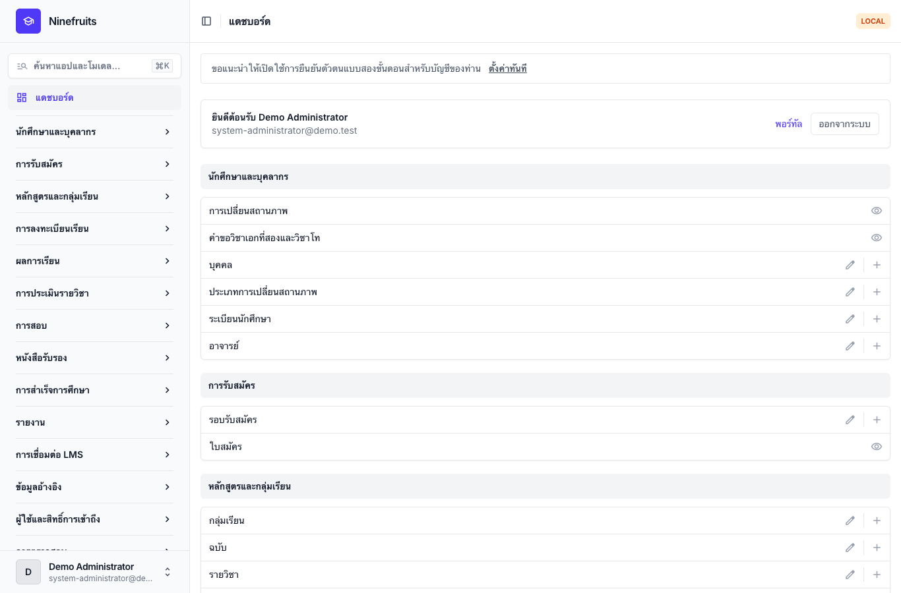
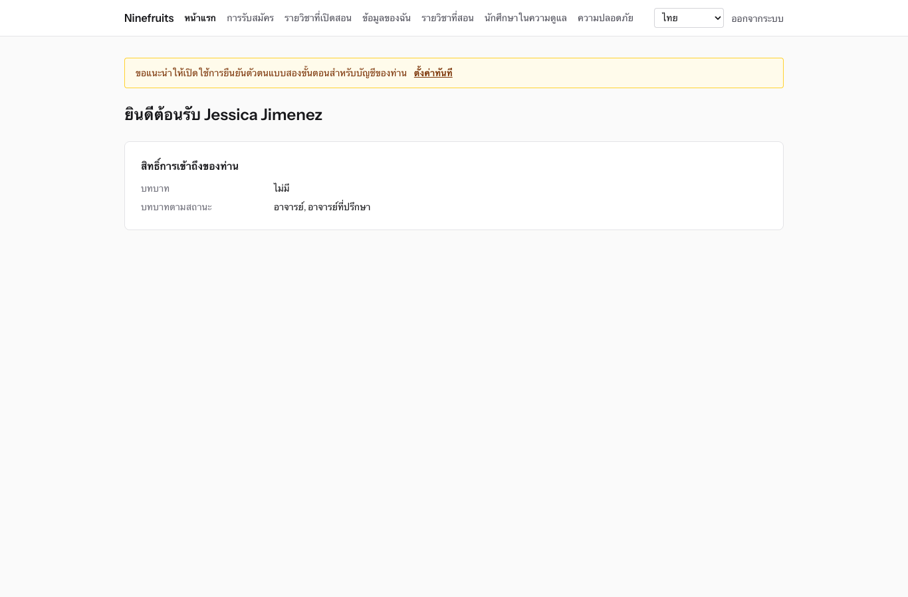
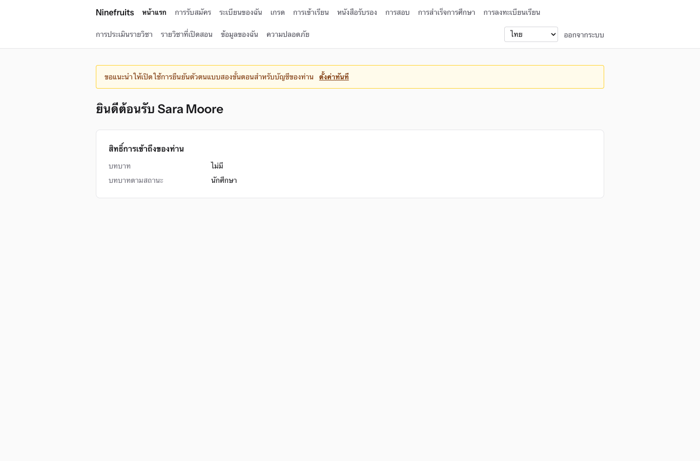

# Ninefruits — ระบบสารสนเทศนักศึกษา (Django)

**Languages / 언어 / 语言 / ພາສາ / ภาษา**

| ภาษา | README | คู่มือ |
|---|---|---|
| English | [README.md](README.md) | [docs/manual/en/](docs/manual/en/README.md) |
| 한국어 | [README.ko.md](README.ko.md) | [docs/manual/ko/](docs/manual/ko/README.md) |
| 简体中文 | [README.zh_Hans.md](README.zh_Hans.md) | [docs/manual/zh_Hans/](docs/manual/zh_Hans/README.md) |
| ລາວ | [README.lo.md](README.lo.md) | [docs/manual/lo/](docs/manual/lo/README.md) |
| Deutsch | [README.de.md](README.de.md) | [docs/manual/de/](docs/manual/de/README.md) |
| Filipino | [README.fil.md](README.fil.md) | [docs/manual/fil/](docs/manual/fil/README.md) |
| Français | [README.fr.md](README.fr.md) | [docs/manual/fr/](docs/manual/fr/README.md) |
| 日本語 | [README.ja.md](README.ja.md) | [docs/manual/ja/](docs/manual/ja/README.md) |
| Монгол | [README.mn.md](README.mn.md) | [docs/manual/mn/](docs/manual/mn/README.md) |
| Bahasa Melayu | [README.ms.md](README.ms.md) | [docs/manual/ms/](docs/manual/ms/README.md) |
| नेपाली | [README.ne.md](README.ne.md) | [docs/manual/ne/](docs/manual/ne/README.md) |
| Русский | [README.ru.md](README.ru.md) | [docs/manual/ru/](docs/manual/ru/README.md) |
| ไทย | [README.th.md](README.th.md) (ไฟล์นี้) | [docs/manual/th/](docs/manual/th/README.md) |
| Türkçe | [README.tr.md](README.tr.md) | [docs/manual/tr/](docs/manual/tr/README.md) |
| Oʻzbek | [README.uz.md](README.uz.md) | [docs/manual/uz/](docs/manual/uz/README.md) |
| Tiếng Việt | [README.vi.md](README.vi.md) | [docs/manual/vi/](docs/manual/vi/README.md) |

หากต้องการเพิ่มภาษาอื่น ดูที่ [การเพิ่มภาษา](docs/development/adding-a-language.md) ([한국어](docs/development/adding-a-language.ko.md))

Ninefruits คือระบบสารสนเทศนักศึกษาที่มหาวิทยาลัยใดก็ติดตั้งใช้งานได้ ครอบคลุมงานหลักของการบริหารงานวิชาการ ตั้งแต่ใบสมัครเข้าศึกษาไปจนถึงระเบียนนักศึกษา หลักสูตรและกลุ่มเรียน การลงทะเบียนเรียน ผลการเรียน การประเมินรายวิชา หนังสือรับรอง การสอบวัดความรู้ภาษาและการสอบประมวลความรู้ การเข้าเรียน การตรวจสอบการสำเร็จการศึกษา รายงาน และพื้นฐานสำหรับการเชื่อมต่อ LMS โดยมีหน้าจอและเอกสารใน 16 ภาษาตามตารางด้านบน

รีโพซิทอรีนี้คือการพอร์ต [Ninefruits สำหรับ Laravel](https://github.com/humble92/ninefruits-laravel) v1.0.0 (Laravel 13, Filament, Livewire) ไปยัง Python 3.14 / Django 6.1 / PostgreSQL 18 การพอร์ตคงพฤติกรรมและสคีมาฐานข้อมูลของต้นฉบับไว้โดยไม่เปลี่ยนแปลง: ไมเกรชันของ Django เล่นซ้ำ DDL ของต้นฉบับ และสคีมาถูกเปรียบเทียบทีละออบเจ็กต์กับ `pg_dump` ของต้นฉบับ (`tests/db/test_schema_equivalence.py`, `tools/schema_dump_diff.py`) การติดตั้งของเวอร์ชันใดเวอร์ชันหนึ่งจึงย้ายไปยังอีกเวอร์ชันได้ด้วยเครื่องมือมาตรฐานของ PostgreSQL วิธีการและเหตุผลของการพอร์ตบันทึกไว้ใน [porting/](porting/README.md) (แผน รายงานแต่ละระยะ การตัดสินใจด้านการออกแบบ การจับคู่การทดสอบ)

## ภาพรวม

หน้าจอแรกหลังเข้าสู่ระบบของสามบทบาท (ข้อมูลสาธิต)

| ผู้ดูแลระบบ (แผงผู้ดูแลระบบ) | อาจารย์ (พอร์ทัล) | นักศึกษา (พอร์ทัล) |
|---|---|---|
|  |  |  |

- **แผงผู้ดูแลระบบ** `/admin/`: เจ้าหน้าที่ดูแลระเบียนนักศึกษา งานวิชาการ การรับสมัคร หนังสือรับรอง การสอบ การสำเร็จการศึกษา และรายงาน (Django admin ร่วมกับ django-unfold) สิทธิ์มาจากแม่แบบบทบาท (เจ้าหน้าที่ทะเบียน เจ้าหน้าที่ฝ่ายวิชาการ เจ้าหน้าที่ออกหนังสือรับรอง เจ้าหน้าที่ภาควิชา เจ้าหน้าที่รับสมัคร ผู้ดูแลระบบ) ซึ่งกำหนดขอบเขตตามหน่วยงานและหลักสูตร
- **พอร์ทัล** `/portal/`: นักศึกษาดูการลงทะเบียนเรียน ผลการเรียน การเข้าเรียน การสมัครสอบ เกณฑ์การสำเร็จการศึกษา และหนังสือรับรอง อาจารย์ดูรายชื่อนักศึกษา การเข้าเรียน การกรอกเกรด และผลการประเมินของกลุ่มเรียนของตน ผู้สมัครยื่นใบสมัครเข้าศึกษา (เทมเพลต Django ร่วมกับ HTMX, Alpine.js และ Tailwind CSS) บัญชีเดียวมีได้หลายบทบาท (เช่น นักศึกษาที่เป็นผู้ช่วยสอนด้วย)
- ทั้งสองใช้การเข้าสู่ระบบเดียวกัน (`/accounts/login/`, django-allauth) และนโยบายการยืนยันตัวตนแบบสองขั้นตอนเดียวกัน การเชื่อมต่อกับระบบอื่นใช้ REST API ภายใต้ `/api/v1/` (OpenAPI ที่ `/api/docs/`)

## ความสามารถ

| ด้าน | เนื้อหา |
|---|---|
| ผู้ใช้และความปลอดภัย | การเข้าสู่ระบบร่วมกัน การยืนยันตัวตนแบบสองขั้นตอน (แอป อีเมล) SSO (OIDC) การเข้าสู่ระบบด้วยรหัสนักศึกษา บทบาท สิทธิ์และขอบเขตตามหน่วยงาน การตรวจสอบข้อมูลและการดำเนินงานพร้อมห่วงโซ่แฮช ความปลอดภัยระดับแถว (RLS) การเข้ารหัสข้อมูลส่วนบุคคล |
| บุคคลและระเบียนนักศึกษา | การแยกบุคคลกับระเบียนนักศึกษา กฎการกำหนดรหัสนักศึกษา การเปลี่ยนสถานภาพ (ลาพักการศึกษา กลับเข้าศึกษา ลาออก พ้นสภาพ คืนสภาพนักศึกษา สำเร็จการศึกษา) พร้อมคำร้องและการอนุมัติ อาจารย์ที่ปรึกษา วิชาเอกที่สองและวิชาโท |
| การรับสมัคร | รอบรับสมัคร ใบสมัครออนไลน์พร้อมเอกสาร การพิจารณาและการประกาศผล การสร้างระเบียนนักศึกษาให้ผู้ได้รับคัดเลือก |
| หลักสูตร | ฉบับรายวิชา วิชาบังคับก่อนและรายวิชาเทียบเท่า เกณฑ์การสำเร็จการศึกษาตามปีหลักสูตร กลุ่มเรียน ตารางเรียน ประมวลรายวิชา |
| การลงทะเบียนเรียน | ชุดกฎ เกณฑ์หน่วยกิต จำนวนรับและรายชื่อสำรอง การระงับและการอนุญาตพิเศษ ออกแบบมาสำหรับช่วงลงทะเบียนเรียนหนาแน่น |
| ผลการเรียน | การวัดผลแบบอิงเกณฑ์และแบบอิงกลุ่ม สัดส่วนสูงสุดของเกรด การส่งและการยืนยันเกรด การอนุมัติการแก้ไขเกรด เกรดเฉลี่ยและการเรียนซ้ำ การปิดภาคการศึกษา (รอพินิจ เกียรตินิยม) ใบแสดงผลการเรียน |
| การประเมินรายวิชา | การตอบแบบไม่ระบุตัวตน แบบประเมินและคำถาม อัตราการตอบขั้นต่ำ การประกาศผล การระงับการดูเกรดจนกว่าจะประเมินเสร็จ |
| หนังสือรับรอง | ประเภทและแม่แบบตามภาษา เลขที่เอกสาร ไฟล์ PDF ที่จัดเก็บไว้ หน้าตรวจสอบสาธารณะ (QR) |
| การสอบ | ประเภทการสอบ ส่วนการสอบและคะแนนผ่าน รอบสอบและการสมัครสอบ การกรอกผลสอบ CSV และการประกาศผล คำขอแก้ไขผล ผลสอบจากภายนอก |
| การเข้าเรียน | ครั้งเรียนจากตารางเรียน การบันทึกการเข้าเรียน ใบลงชื่อเข้าเรียน PDF รายชื่อนักศึกษา CSV |
| การสำเร็จการศึกษา | การตรวจสอบเกณฑ์ ผลการตรวจสอบที่จัดเก็บไว้ การยกเว้นเกณฑ์ (ผู้อนุมัติสองคน) การอนุมัติสำเร็จการศึกษาและเลขที่ปริญญาบัตร |
| รายงาน | รายงานมาตรฐานเจ็ดรายการพร้อม CSV วิว `reporting` สำหรับเครื่องมือ BI |
| การเชื่อมต่อ LMS | แพลตฟอร์ม การเชื่อมโยงรายวิชาและบันทึกการซิงค์ การซิงค์ตามเหตุการณ์ การกระทบยอดทุกคืน คะแนนจาก LMS เป็นฉบับร่าง REST API พร้อมโทเค็น |

## เทคโนโลยีที่ใช้

Python 3.14, Django 6.1, django-unfold (แผงผู้ดูแลระบบ), HTMX 2, Alpine.js 3, Tailwind CSS 4 และ Vite (พอร์ทัล, django-vite), PostgreSQL 18 (ความปลอดภัยระดับแถว การตรวจสอบด้วยทริกเกอร์), Redis, Celery และ Flower (คิว), Gotenberg (PDF), django-allauth (การเข้าสู่ระบบ การยืนยันตัวตนแบบสองขั้นตอน SSO), Django REST framework (API) dependency ถูกล็อกด้วย [uv](https://docs.astral.sh/uv/) (`uv.lock`) และ npm (`package-lock.json`)

## เริ่มต้นอย่างรวดเร็ว (เว็บไซต์สาธิต)

### ด้วย uv

PostgreSQL 18, Redis 8, Gotenberg 8 และ Mailpit ต้องทำงานอยู่บนเครื่อง (หรือเริ่มเฉพาะบริการเหล่านั้นด้วย Docker Compose: `docker compose up -d pgsql redis gotenberg mailpit`)

```bash
uv sync                                         # .venv with the development tools
npm ci && npm run build                         # static/dist/ (or `npm run dev` with VITE_DEV_MODE=true)
cp .env.example .env
uv run manage.py pii_generate_key               # put the two values into .env
# Database roles and database (once, as the superuser): docs/manual/th/operations/installation.md section 2
uv run manage.py setup_install --profile=korean-university --grade-scale=4.5   # migrations, essential data, institution, first administrator
uv run manage.py setup_demo --size=small --seed=42                             # demo university and demo accounts
uv run manage.py compilemessages --ignore=.venv
uv run manage.py runserver
uv run celery -A config worker --loglevel=INFO  # in a second terminal (term close, waitlists, imports)
```

- พอร์ทัล: http://localhost:8000/portal/ · แผงผู้ดูแลระบบ: http://localhost:8000/admin/ (เข้าสู่ระบบด้วยบัญชีเดียวกัน)
- อีเมล (Mailpit): http://localhost:8025

### ด้วย Docker Compose

เครื่องโฮสต์ต้องมีเพียง Docker เท่านั้น

```bash
cp .env.example .env
docker compose up -d                            # app, worker, beat, flower, pgsql, redis, mailpit, gotenberg
docker compose exec app uv run manage.py pii_generate_key        # put the two values into .env, then: docker compose up -d
docker compose exec app uv run manage.py setup_install --profile=korean-university --grade-scale=4.5
docker compose exec app uv run manage.py setup_demo --size=small --seed=42
docker compose exec app uv run manage.py compilemessages --ignore=.venv
docker compose --profile vite up -d vite        # optional: Vite dev server (HMR), VITE_DEV_MODE=true in .env
```

คอนเทนเนอร์ `pgsql` จะสร้างบทบาทของฐานข้อมูล (`app_migrator`, `app_runtime`, `app_reporting`) และเตรียมฐานข้อมูลสำหรับพัฒนาและทดสอบเมื่อเริ่มทำงานครั้งแรก (`docker/pgsql/`) ตัวติดตามคิว (Flower): http://localhost:5555

### บัญชีสาธิต

รหัสผ่านทุกบัญชีคือ `demo-password` (`ninefruits/setup/conf.py`) ยังไม่ได้ลงทะเบียนการยืนยันตัวตนแบบสองขั้นตอน

| บัญชี | บทบาท / บทบาทตามสถานะ | หน้าจอแรก |
|---|---|---|
| system-administrator@demo.test | ผู้ดูแลระบบ (สิทธิ์ทุกรายการ) | /admin/ |
| registrar@demo.test | เจ้าหน้าที่ทะเบียน (ระเบียนนักศึกษา การปรับการลงทะเบียน การยืนยันเกรด หนังสือรับรอง การสอบ การสำเร็จการศึกษา รายงาน) | /admin/ |
| academic-affairs@demo.test | เจ้าหน้าที่ฝ่ายวิชาการ (รายวิชา กลุ่มเรียน ตารางเรียน นโยบายการวัดผล การประเมินรายวิชา ครั้งเรียน) | /admin/ |
| certificate-officer@demo.test | เจ้าหน้าที่ออกหนังสือรับรอง | /admin/ |
| department-assistant@demo.test | เจ้าหน้าที่ภาควิชา (การดูข้อมูลภายในขอบเขตภาควิชา อาจารย์ที่ปรึกษา รายงาน) | /admin/ |
| admissions-officer@demo.test | เจ้าหน้าที่รับสมัคร | /admin/ |
| instructor@demo.test | อาจารย์และอาจารย์ที่ปรึกษา (กลุ่มเรียนของตน การเข้าเรียน การกรอกเกรด นักศึกษาในความดูแล) | /portal/ |
| student@demo.test | นักศึกษาปัจจุบัน | /portal/ |
| alumni@demo.test | ผู้สำเร็จการศึกษา | /portal/ |
| readmitted@demo.test | ผู้สำเร็จการศึกษาที่รับเข้าศึกษาอีกครั้ง (สองระเบียนนักศึกษา) | /portal/ |
| applicant@demo.test | ผู้สมัคร | /portal/ |
| admitted@demo.test | ผู้สมัครที่ได้รับคัดเลือก | /portal/ |

ข้อมูลสาธิตเป็นมหาวิทยาลัยสมมติหนึ่งแห่ง (โปรไฟล์มหาวิทยาลัยเกาหลี) ประกอบด้วยนักศึกษา อาจารย์ รายวิชา กลุ่มเรียน รายการลงทะเบียน เกรด การประเมินรายวิชา หนังสือรับรอง การสอบ การเข้าเรียน การตรวจสอบการสำเร็จการศึกษา และการเชื่อมโยง LMS ห้ามโหลดข้อมูลนี้ในระบบใช้งานจริงโดยเด็ดขาด (`setup_demo` จะปฏิเสธเมื่อ `DJANGO_ENV=production`)

สำหรับการติดตั้งในระบบใช้งานจริง (gunicorn, Nginx, Celery beat ตัวแปรสภาพแวดล้อม การสำรองข้อมูล) ให้ปฏิบัติตาม [คู่มือการติดตั้ง](docs/manual/th/operations/installation.md) และ [รายการตรวจสอบการนำขึ้นใช้งาน](docs/manual/th/operations/deployment-checklist.md)

## เอกสาร

- [คู่มือผู้ดูแลระบบ](docs/manual/th/admin/README.md): 28 บท ตั้งแต่ลำดับการตั้งค่าเริ่มต้นไปจนถึงทุกด้านของงาน
- [คู่มือการดูแลระบบ](docs/manual/th/README.md#การดูแลระบบ): [การติดตั้ง](docs/manual/th/operations/installation.md), [รายการตรวจสอบการนำขึ้นใช้งาน](docs/manual/th/operations/deployment-checklist.md), [คำสั่ง](docs/manual/th/operations/commands.md), [งานตามกำหนดเวลา](docs/manual/th/operations/scheduled-jobs.md), [การสำรองและกู้คืนข้อมูล](docs/manual/th/operations/backup-restore.md), [คีย์ความปลอดภัย](docs/manual/th/operations/security-keys.md), [การตรวจสอบและการบำรุงรักษา](docs/manual/th/operations/audit-and-maintenance.md), [การทดสอบโหลด](docs/manual/th/operations/load-testing.md), [การแก้ไขปัญหา](docs/manual/th/operations/troubleshooting.md)
- [คู่มือการเชื่อมต่อ LMS](docs/lms-integration-guide.md)
- [การพัฒนา](docs/README.md): [กฎการตั้งชื่อ](docs/development/naming.md), [รายการตรวจทาน](docs/development/review-checklist.md), [การเพิ่มภาษา](docs/development/adding-a-language.md)
- ประวัติการพอร์ตและการตัดสินใจด้านการออกแบบ: [porting/](porting/README.md)

## คำสั่งที่ใช้ประจำ

| คำสั่ง | หน้าที่ |
|---|---|
| `uv run pytest -n auto -m "not concurrency"` | การทดสอบ (รันการทดสอบการทำงานพร้อมกันแยกด้วย `-m concurrency`) |
| `uv run ruff format && uv run ruff check` | รูปแบบโค้ดและ lint |
| `uv run mypy ninefruits config tools/checks` | การตรวจสอบชนิดข้อมูล |
| `uv run tools/checks/raw_sql.py` | การตรวจสอบ SQL ดิบ (ไม่มี SQL ที่สร้างจากการต่อสตริง) |
| `uv run manage.py naming_check` | การตรวจสอบการตั้งชื่อ (ตารางและคอลัมน์ของฐานข้อมูล ไมเกรชัน คำสั่ง คำแปล) |
| `uv run manage.py i18n_missing --strict` | คำแปลที่ขาดหาย (`i18n_export` / `i18n_import` สำหรับแลกเปลี่ยนกับผู้แปล) |
| `uv run manage.py migrate` | ไมเกรชัน (ใช้การเชื่อมต่อ `app_migrator` โดยอัตโนมัติ) |
| `uv run manage.py setup_install`, `setup_demo` | การติดตั้งหรืออัปเดต ข้อมูลสาธิต |
| `uv run manage.py security_sync_permissions` | นำแคตตาล็อกสิทธิ์ในโค้ดเข้าสู่ฐานข้อมูล |
| `pre-commit install` | ruff, mypy และการตรวจสอบ SQL ดิบก่อนการ commit แต่ละครั้ง |

รายการทั้งหมดอยู่ใน [ข้อมูลอ้างอิงคำสั่ง](docs/manual/th/operations/commands.md) CI (`.github/workflows/ci.yml`) รันการตรวจสอบเดียวกันในสองงาน: คุณภาพและการทดสอบ

## สัญญาอนุญาต

[สัญญาอนุญาต MIT](LICENSE) ทุกคนใช้งาน แก้ไข และเผยแพร่ได้อย่างอิสระ โดยคงประกาศลิขสิทธิ์และข้อความสัญญาอนุญาตไว้

---

**กิตติกรรมประกาศ**

ขอขอบคุณ YUSTIC ระบบบริหารงานวิชาการของมหาวิทยาลัยวิทยาศาสตร์และเทคโนโลยีเหยียนเปียน (Yanbian University of Science and Technology) ซึ่งทำให้ระบบนี้เกิดขึ้นได้ YUSTIC เป็นผลงานของทีมนักพัฒนากลุ่มเล็ก ๆ ที่ร่วมกันฝัน ทุ่มเทแรงกาย และสร้างสรรค์ด้วยกันมาหลายปี ระบบนี้คือวิธีที่เราใช้บอกว่าเราคิดถึง เคารพ และขอบคุณเพื่อนร่วมงานที่เราได้ทำงานด้วยมากเพียงใด
