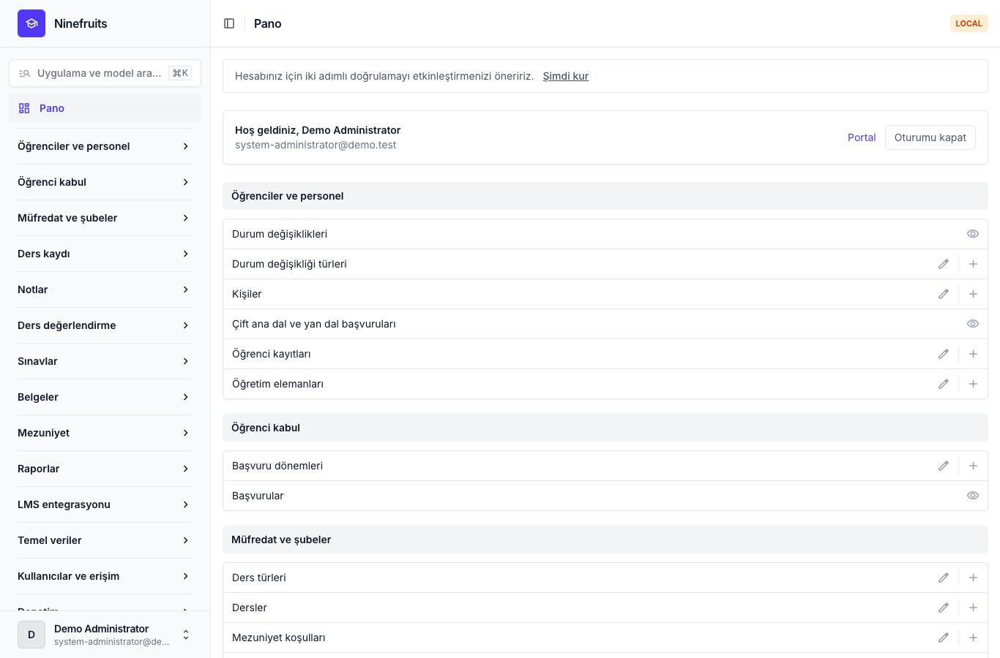
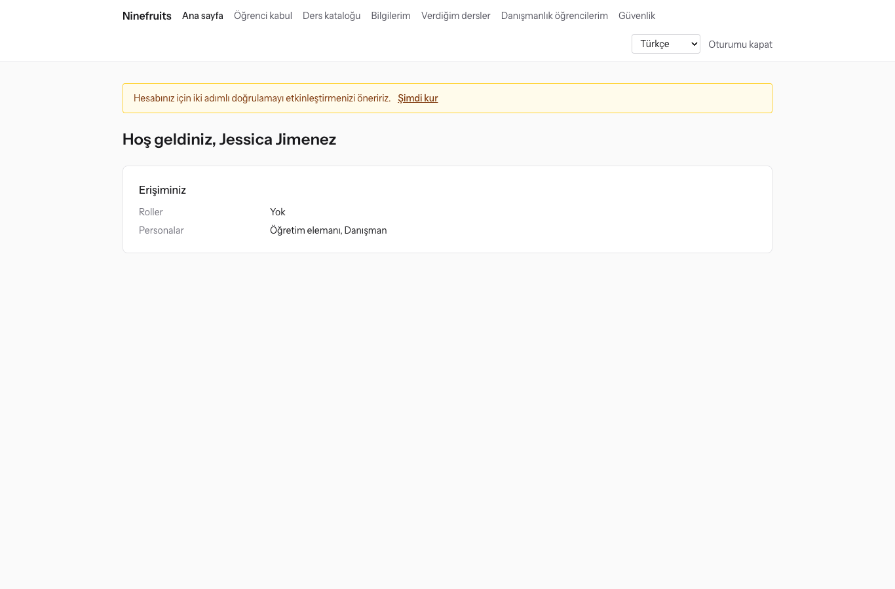
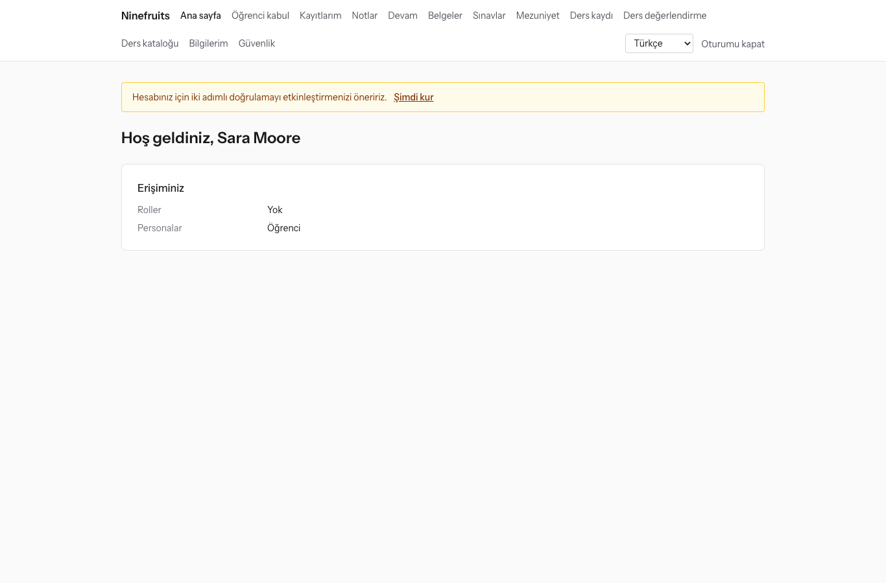

# Ninefruits — Öğrenci Bilgi Sistemi (Django)

**Diller / Languages**

| Dil | README | Kılavuz |
|---|---|---|
| English | [README.md](README.md) | [docs/manual/en/](docs/manual/en/README.md) |
| 한국어 | [README.ko.md](README.ko.md) | [docs/manual/ko/](docs/manual/ko/README.md) |
| 简体中文 | [README.zh_Hans.md](README.zh_Hans.md) | [docs/manual/zh_Hans/](docs/manual/zh_Hans/README.md) |
| ລາວ | [README.lo.md](README.lo.md) | [docs/manual/lo/](docs/manual/lo/README.md) |
| Deutsch | [README.de.md](README.de.md) | [docs/manual/de/](docs/manual/de/README.md) |
| Filipino | [README.fil.md](README.fil.md) | [docs/manual/fil/](docs/manual/fil/README.md) |
| Français | [README.fr.md](README.fr.md) | [docs/manual/fr/](docs/manual/fr/README.md) |
| 日本語 | [README.ja.md](README.ja.md) | [docs/manual/ja/](docs/manual/ja/README.md) |
| Монгол | [README.mn.md](README.mn.md) | [docs/manual/mn/](docs/manual/mn/README.md) |
| Bahasa Melayu | [README.ms.md](README.ms.md) | [docs/manual/ms/](docs/manual/ms/README.md) |
| नेपाली | [README.ne.md](README.ne.md) | [docs/manual/ne/](docs/manual/ne/README.md) |
| Русский | [README.ru.md](README.ru.md) | [docs/manual/ru/](docs/manual/ru/README.md) |
| ไทย | [README.th.md](README.th.md) | [docs/manual/th/](docs/manual/th/README.md) |
| Türkçe | [README.tr.md](README.tr.md) (bu dosya) | [docs/manual/tr/](docs/manual/tr/README.md) |
| Oʻzbek | [README.uz.md](README.uz.md) | [docs/manual/uz/](docs/manual/uz/README.md) |
| Tiếng Việt | [README.vi.md](README.vi.md) | [docs/manual/vi/](docs/manual/vi/README.md) |

Başka bir dil eklemek için [Dil ekleme](docs/development/adding-a-language.md) belgesine bakın ([한국어](docs/development/adding-a-language.ko.md)).

Ninefruits, her üniversitenin kurup işletebileceği bir öğrenci bilgi sistemidir. Akademik yönetimin çekirdeğini kapsar: başvurulardan öğrenci kayıtlarına, müfredat ve şubelere, ders kaydına, notlara, ders değerlendirmeye, belgelere, dil ve yeterlik sınavlarına, devama, mezuniyet incelemesine, raporlara ve LMS entegrasyon altyapısına kadar. Ekranlar ve belgeler yukarıdaki tablodaki 16 dilde sunulur.

Bu depo, [Laravel için Ninefruits](https://github.com/humble92/ninefruits-laravel) v1.0.0 sürümünün (Laravel 13, Filament, Livewire) Python 3.14 / Django 6.1 / PostgreSQL 18 uyarlamasıdır. Uyarlama, özgün sistemin davranışını ve veritabanı şemasını değiştirmeden korur: Django migration'ları özgün sistemin DDL'ini yeniden oynatır ve şema, özgün sistemin `pg_dump` çıktısıyla nesne nesne karşılaştırılır (`tests/db/test_schema_equivalence.py`, `tools/schema_dump_diff.py`). Bu nedenle iki sürümden birinin kurulumu standart PostgreSQL araçlarıyla diğerine taşınabilir. Uyarlamanın nasıl ve neden yapıldığı [porting/](porting/README.md) içinde kayıtlıdır (plan, aşama raporları, tasarım kararları, test eşlemesi).

## Bir bakışta

Üç rolle oturum açtıktan sonraki ilk ekranlar (demo verileri).

| Sistem yöneticisi (yönetim paneli) | Öğretim elemanı (portal) | Öğrenci (portal) |
|---|---|---|
|  |  |  |

- **Yönetim paneli** `/admin/`: personel öğrenci kayıtlarını, akademik işleri, öğrenci kabulü, belgeleri, sınavları, mezuniyeti ve raporları yönetir (django-unfold ile Django admin). Yetkiler, birimlere ve programlara kapsamlandırılmış rol şablonlarından gelir (Öğrenci İşleri, Akademik İşler, Belge Sorumlusu, Bölüm Sekreteri, Öğrenci Kabul Sorumlusu, Sistem Yöneticisi).
- **Portal** `/portal/`: öğrenciler ders kaydını, notları, devamı, sınav başvurularını, mezuniyet koşullarını ve belgeleri görür; öğretim elemanları şubelerinin sınıf listesini, devamını, not girişini ve değerlendirme sonuçlarını görür; adaylar başvuru yapar (HTMX, Alpine.js ve Tailwind CSS ile Django şablonları). Bir hesap birden fazla role sahip olabilir (örneğin aynı zamanda asistan olan bir öğrenci).
- İkisi de aynı oturum açmayı (`/accounts/login/`, django-allauth) ve aynı iki adımlı doğrulama politikasını kullanır. Entegrasyonlar `/api/v1/` altındaki REST API'yi kullanır (OpenAPI: `/api/docs/`).

## Özellikler

| Alan | İçerik |
|---|---|
| Kullanıcılar ve güvenlik | Ortak oturum açma, iki adımlı doğrulama (uygulama, e-posta), SSO (OIDC), öğrenci numarasıyla oturum açma, roller, yetkiler ve birim kapsamları, karma zincirli veri ve iş denetimi, satır düzeyi güvenlik (RLS), kişisel veri şifreleme |
| Kişiler ve öğrenci kayıtları | Öğrenci kayıtlarından ayrı kişiler, öğrenci numarası kuralları, talep ve onaylı durum değişiklikleri (kayıt dondurma, dönüş, kendi isteğiyle ayrılma, ilişik kesme, yeniden kayıt, mezuniyet), danışmanlar, ikinci ana dallar ve yan dallar |
| Öğrenci kabul | Başvuru dönemleri, çevrim içi başvurular ve evraklar, inceleme ve sonuç açıklama, kabul edilen adaylar için öğrenci kayıtları |
| Müfredat | Ders sürümleri, ön koşullar ve eşdeğer dersler, müfredat yılına göre mezuniyet koşulları, şubeler, ders programları, ders izlenceleri |
| Ders kaydı | Kural setleri, kredi sınırları, kontenjan ve bekleme listeleri, kısıtlamalar ve kural istisnaları, ders kaydı yoğunluğu için tasarlanmış |
| Notlar | Mutlak ve bağıl değerlendirme, not dağılımı üst sınırları, gönderme ve kesinleştirme, not değişikliği onayı, not ortalaması ve ders tekrarı, dönem kapatma (akademik uyarı, onur derecesi), not dökümleri |
| Ders değerlendirme | Anonim yanıtlar, formlar ve sorular, en düşük yanıt oranı, sonuçların yayımlanması, değerlendirme tamamlanana kadar not görüntülemenin bekletilmesi |
| Belgeler | Türler ve dile göre şablonlar, belge numaraları, saklanan PDF'ler, herkese açık doğrulama sayfası (QR) |
| Sınavlar | Sınav türleri, bölümler ve geçme puanları, oturumlar ve başvurular, sonuç girişi, CSV ve yayımlama, düzeltme talepleri, dış sonuçlar |
| Devam | Ders programından ders oturumları, devam girişi, yoklama çizelgesi PDF'i, sınıf listesi CSV'si |
| Mezuniyet | Koşul denetimi, kaydedilen denetimler, koşul muafiyetleri (iki onaylayan), mezuniyet işlemi ve diploma numaraları |
| Raporlar | CSV destekli yedi standart rapor, BI araçları için `reporting` görünümleri |
| LMS entegrasyonu | Platformlar, ders bağlantıları ve eşitleme kayıtları, olay güdümlü eşitleme, gece mutabakatı, LMS puan taslakları, belirteçli REST API |

## Teknoloji

Python 3.14, Django 6.1, django-unfold (yönetim paneli), HTMX 2, Alpine.js 3, Tailwind CSS 4 ve Vite (portal, django-vite), PostgreSQL 18 (satır düzeyi güvenlik, tetikleyicili denetim), Redis, Celery ve Flower (kuyruk), Gotenberg (PDF), django-allauth (oturum açma, iki adımlı doğrulama, SSO), Django REST framework (API). Bağımlılıklar [uv](https://docs.astral.sh/uv/) (`uv.lock`) ve npm (`package-lock.json`) ile kilitlenir.

## Hızlı başlangıç (demo sitesi)

### uv ile

PostgreSQL 18, Redis 8, Gotenberg 8 ve Mailpit yerelde çalışıyor olmalıdır (veya yalnızca bu hizmetleri Docker Compose ile başlatın: `docker compose up -d pgsql redis gotenberg mailpit`).

```bash
uv sync                                         # .venv with the development tools
npm ci && npm run build                         # static/dist/ (or `npm run dev` with VITE_DEV_MODE=true)
cp .env.example .env
uv run manage.py pii_generate_key               # put the two values into .env
# Database roles and database (once, as the superuser): docs/manual/en/operations/installation.md section 2
uv run manage.py setup_install --profile=korean-university --grade-scale=4.5   # migrations, essential data, institution, first administrator
uv run manage.py setup_demo --size=small --seed=42                             # demo university and demo accounts
uv run manage.py compilemessages --ignore=.venv
uv run manage.py runserver
uv run celery -A config worker --loglevel=INFO  # in a second terminal (term close, waitlists, imports)
```

- Portal: http://localhost:8000/portal/ · Yönetim paneli: http://localhost:8000/admin/ (aynı oturum açma)
- E-posta (Mailpit): http://localhost:8025

### Docker Compose ile

Ana makinede yalnızca Docker gerekir.

```bash
cp .env.example .env
docker compose up -d                            # app, worker, beat, flower, pgsql, redis, mailpit, gotenberg
docker compose exec app uv run manage.py pii_generate_key        # put the two values into .env, then: docker compose up -d
docker compose exec app uv run manage.py setup_install --profile=korean-university --grade-scale=4.5
docker compose exec app uv run manage.py setup_demo --size=small --seed=42
docker compose exec app uv run manage.py compilemessages --ignore=.venv
docker compose --profile vite up -d vite        # optional: Vite dev server (HMR), VITE_DEV_MODE=true in .env
```

`pgsql` konteyneri ilk başladığında veritabanı rollerini (`app_migrator`, `app_runtime`, `app_reporting`) oluşturur ve geliştirme ile test veritabanlarını hazırlar (`docker/pgsql/`). Kuyruk izleme (Flower): http://localhost:5555

### Demo hesapları

Tüm parolalar `demo-password` şeklindedir (`ninefruits/setup/conf.py`). İki adımlı doğrulama kurulmamıştır.

| Hesap | Rol / persona | İlk ekran |
|---|---|---|
| system-administrator@demo.test | Sistem yöneticisi (tüm yetkiler) | /admin/ |
| registrar@demo.test | Öğrenci İşleri (öğrenci kayıtları, ders kaydı değişiklikleri, not kesinleştirme, belgeler, sınavlar, mezuniyet, raporlar) | /admin/ |
| academic-affairs@demo.test | Akademik İşler (dersler, şubeler, ders programları, notlandırma politikası, ders değerlendirme, ders oturumları) | /admin/ |
| certificate-officer@demo.test | Belge Sorumlusu | /admin/ |
| department-assistant@demo.test | Bölüm Sekreteri (bölüm kapsamında görüntüleme, danışmanlar, raporlar) | /admin/ |
| admissions-officer@demo.test | Öğrenci Kabul Sorumlusu | /admin/ |
| instructor@demo.test | Öğretim elemanı ve danışman (kendi şubeleri, devam, not girişi, danışmanlık öğrencileri) | /portal/ |
| student@demo.test | Kayıtlı öğrenci | /portal/ |
| alumni@demo.test | Mezun | /portal/ |
| readmitted@demo.test | Yeniden kabul edilen mezun (iki öğrenci kaydı) | /portal/ |
| applicant@demo.test | Aday | /portal/ |
| admitted@demo.test | Kabul edilen aday | /portal/ |

Demo verileri; öğrencileri, öğretim elemanları, dersleri, şubeleri, ders kayıtları, notları, ders değerlendirmeleri, belgeleri, sınavları, devamı, mezuniyet denetimleri ve LMS bağlantılarıyla hayalî bir üniversitedir (Kore üniversite profili). Bunu asla üretime yüklemeyin (`setup_demo`, `DJANGO_ENV=production` olduğunda çalışmayı reddeder).

Bir üretim kurulumu (gunicorn, Nginx, Celery beat, ortam değişkenleri, yedekler) için [kurulum kılavuzunu](docs/manual/tr/operations/installation.md) ve [dağıtım kontrol listesini](docs/manual/tr/operations/deployment-checklist.md) izleyin.

## Belgeler

- [Yönetici kılavuzu](docs/manual/tr/admin/README.md): ilk ayar sırasından her alana kadar 28 bölüm
- [İşletim kılavuzu](docs/manual/tr/README.md): [kurulum](docs/manual/tr/operations/installation.md), [dağıtım kontrol listesi](docs/manual/tr/operations/deployment-checklist.md), [komutlar](docs/manual/tr/operations/commands.md), [zamanlanmış işler](docs/manual/tr/operations/scheduled-jobs.md), [yedekleme ve geri yükleme](docs/manual/tr/operations/backup-restore.md), [güvenlik anahtarları](docs/manual/tr/operations/security-keys.md), [denetim ve bakım](docs/manual/tr/operations/audit-and-maintenance.md), [yük testi](docs/manual/tr/operations/load-testing.md), [sorun giderme](docs/manual/tr/operations/troubleshooting.md)
- [LMS entegrasyon kılavuzu](docs/lms-integration-guide.md)
- [Geliştirme](docs/README.md): [adlandırma kuralları](docs/development/naming.md), [inceleme kontrol listesi](docs/development/review-checklist.md), [dil ekleme](docs/development/adding-a-language.md)
- Uyarlama geçmişi ve tasarım kararları: [porting/](porting/README.md)

## Sık kullanılan komutlar

| Komut | Amaç |
|---|---|
| `uv run pytest -n auto -m "not concurrency"` | Testler (eşzamanlılık testlerini `-m concurrency` ile ayrıca çalıştırın) |
| `uv run ruff format && uv run ruff check` | Kod biçimi ve lint |
| `uv run mypy ninefruits config tools/checks` | Tür denetimleri |
| `uv run tools/checks/raw_sql.py` | Ham SQL kontrolü (dizeyle oluşturulmuş SQL yok) |
| `uv run manage.py naming_check` | Adlandırma kontrolü (DB tabloları ve sütunları, migration'lar, komutlar, çeviriler) |
| `uv run manage.py i18n_missing --strict` | Eksik çeviriler (çevirmenlerle alışveriş için `i18n_export` / `i18n_import`) |
| `uv run manage.py migrate` | Migration'lar (otomatik olarak `app_migrator` bağlantısını kullanır) |
| `uv run manage.py setup_install`, `setup_demo` | Kurulum veya güncelleme, demo verileri |
| `uv run manage.py security_sync_permissions` | Koddaki yetki kataloğunu veritabanına aktarır |
| `pre-commit install` | Her commit'ten önce ruff, mypy ve ham SQL kontrolü |

Tam liste [komut başvurusunda](docs/manual/tr/operations/commands.md) bulunur. CI (`.github/workflows/ci.yml`) aynı kontrolleri iki işte çalıştırır: kalite ve testler.

## Lisans

[MIT Lisansı](LICENSE). Telif hakkı bildirimi ve lisans metni korunduğu sürece herkes özgürce kullanabilir, değiştirebilir ve dağıtabilir.

---

**Teşekkür**

Bu sistemi mümkün kılan, Yanbian Bilim ve Teknoloji Üniversitesi'nin akademik yönetim sistemi YUSTIC'e teşekkür ederiz. YUSTIC, uzun yıllar boyunca birlikte hayal kuran, emek veren ve inşa eden küçük bir geliştirici ekibinin eseriydi. Bu sistem, birlikte çalıştığımız meslektaşlarımızı ne kadar özlediğimizi, onlara ne kadar saygı duyduğumuzu ve ne kadar minnettar olduğumuzu ifade etme biçimimizdir.
