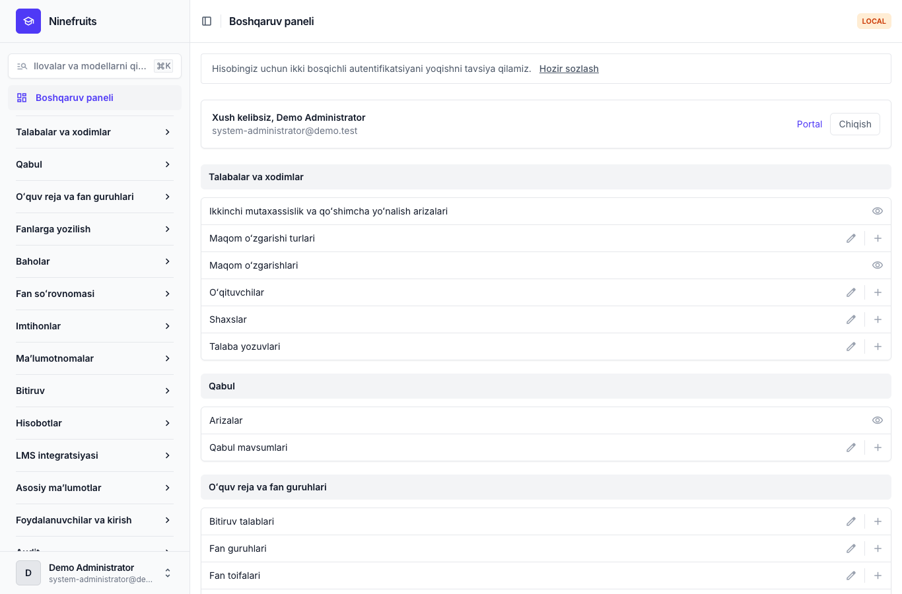
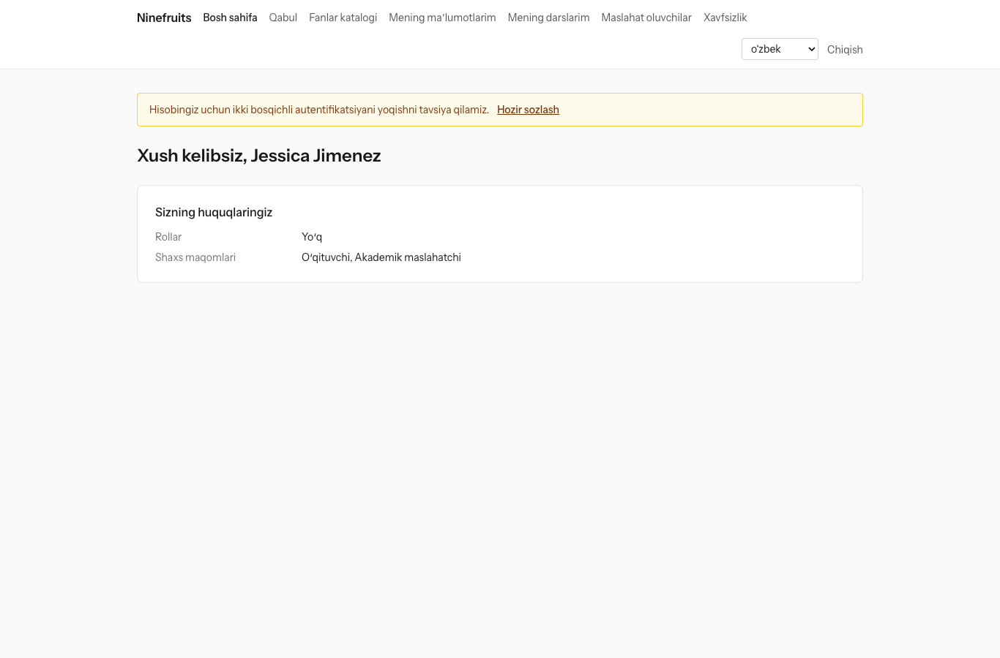
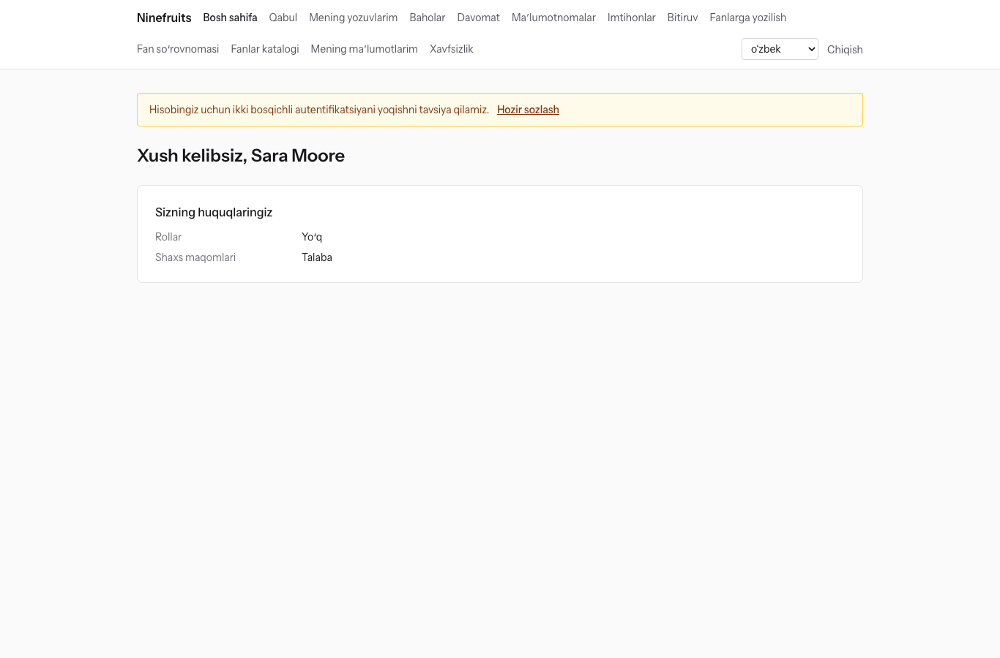

# Ninefruits — talabalar axborot tizimi (Django)

**Tillar / Languages**

| Til | README | Qoʻllanma |
|---|---|---|
| English | [README.md](README.md) | [docs/manual/en/](docs/manual/en/README.md) |
| 한국어 | [README.ko.md](README.ko.md) | [docs/manual/ko/](docs/manual/ko/README.md) |
| 简体中文 | [README.zh_Hans.md](README.zh_Hans.md) | [docs/manual/zh_Hans/](docs/manual/zh_Hans/README.md) |
| ລາວ | [README.lo.md](README.lo.md) | [docs/manual/lo/](docs/manual/lo/README.md) |
| Deutsch | [README.de.md](README.de.md) | [docs/manual/de/](docs/manual/de/README.md) |
| Filipino | [README.fil.md](README.fil.md) | [docs/manual/fil/](docs/manual/fil/README.md) |
| Français | [README.fr.md](README.fr.md) | [docs/manual/fr/](docs/manual/fr/README.md) |
| 日本語 | [README.ja.md](README.ja.md) | [docs/manual/ja/](docs/manual/ja/README.md) |
| Монгол | [README.mn.md](README.mn.md) | [docs/manual/mn/](docs/manual/mn/README.md) |
| Bahasa Melayu | [README.ms.md](README.ms.md) | [docs/manual/ms/](docs/manual/ms/README.md) |
| नेपाली | [README.ne.md](README.ne.md) | [docs/manual/ne/](docs/manual/ne/README.md) |
| Русский | [README.ru.md](README.ru.md) | [docs/manual/ru/](docs/manual/ru/README.md) |
| ไทย | [README.th.md](README.th.md) | [docs/manual/th/](docs/manual/th/README.md) |
| Türkçe | [README.tr.md](README.tr.md) | [docs/manual/tr/](docs/manual/tr/README.md) |
| Oʻzbek | [README.uz.md](README.uz.md) (shu fayl) | [docs/manual/uz/](docs/manual/uz/README.md) |
| Tiếng Việt | [README.vi.md](README.vi.md) | [docs/manual/vi/](docs/manual/vi/README.md) |

Boshqa til qoʻshish uchun [Til qoʻshish](docs/development/adding-a-language.md) ga qarang.

Ninefruits — istalgan universitet oʻrnatishi va ishlatishi mumkin boʻlgan talabalar axborot tizimi. U oʻquv jarayonini boshqarishning asosiy qismini — qabul arizalaridan tortib talaba yozuvlari, oʻquv reja va fan guruhlari, fanlarga yozilish, baholar, fan soʻrovnomasi, maʼlumotnomalar, til va kompleks imtihonlar, davomat, bitiruv talablarini tekshirish, hisobotlar va LMS integratsiyasi asosigacha qamrab oladi. Ekranlar va hujjatlar yuqoridagi jadvaldagi 16 tilda mavjud.

Ushbu repozitoriy [Laravel uchun Ninefruits](https://github.com/humble92/ninefruits-laravel) v1.0.0 (Laravel 13, Filament, Livewire) ning Python 3.14 / Django 6.1 / PostgreSQL 18 ga koʻchirilgan versiyasidir. Koʻchirish asl tizimning ishlashini va maʼlumotlar bazasi sxemasini oʻzgarishsiz saqlaydi: Django migratsiyalari asl tizimning DDL ini qayta bajaradi, sxema esa asl tizimning `pg_dump` i bilan obyektma-obyekt solishtiriladi (`tests/db/test_schema_equivalence.py`, `tools/schema_dump_diff.py`). Shu sababli istalgan versiyaning oʻrnatmasini standart PostgreSQL vositalari bilan ikkinchisiga koʻchirish mumkin. Qanday va nima uchun koʻchirilgani [porting/](porting/README.md) da qayd etilgan (reja, bosqichlar hisobotlari, loyiha qarorlari, testlar moslashuvi).

## Bir qarashda

Uchta rol bilan tizimga kirgandan keyingi birinchi ekranlar (demo maʼlumotlar).

| Tizim administratori (boshqaruv paneli) | Oʻqituvchi (portal) | Talaba (portal) |
|---|---|---|
|  |  |  |

- **Boshqaruv paneli** `/admin/`: xodimlar talaba yozuvlari, oʻquv ishlari, qabul, maʼlumotnomalar, imtihonlar, bitiruv va hisobotlar bilan ishlaydi (django-unfold bilan Django admin). Ruxsatlar tashkiliy birliklar va taʼlim dasturlari bilan cheklangan rol shablonlaridan (Registrator, Oʻquv-uslubiy boshqarma, Maʼlumotnomalar masʼuli, Kafedra yordamchisi, Qabul komissiyasi xodimi, Tizim administratori) olinadi.
- **Portal** `/portal/`: talabalar fanlarga yozilish, baholar, davomat, imtihonlarga arizalar, bitiruv talablari va maʼlumotnomalarni koʻradi; oʻqituvchilar oʻz fan guruhlarining talabalar roʻyxati, davomati, baho kiritish va soʻrovnoma natijalarini koʻradi; abituriyentlar qabulga ariza topshiradi (HTMX, Alpine.js va Tailwind CSS bilan Django shablonlari). Bitta hisob bir nechta rolga ega boʻlishi mumkin (masalan, bir vaqtda assistent ham boʻlgan talaba).
- Ikkalasi ham bir xil kirish (`/accounts/login/`, django-allauth) va bir xil ikki bosqichli autentifikatsiya siyosatidan foydalanadi. Integratsiyalar `/api/v1/` ostidagi REST API dan foydalanadi (OpenAPI `/api/docs/` da).

## Imkoniyatlar

| Soha | Mazmuni |
|---|---|
| Foydalanuvchilar va xavfsizlik | Umumiy kirish, ikki bosqichli autentifikatsiya (ilova, e-pochta), SSO (OIDC), talaba raqami bilan kirish, rollar, ruxsatlar va tashkiliy qamrovlar, xesh zanjiri bilan maʼlumotlar va faoliyat auditi, qatorlar darajasidagi xavfsizlik (RLS), shaxsiy maʼlumotlarni shifrlash |
| Shaxslar va talaba yozuvlari | Shaxsning talaba yozuvlaridan ajratilishi, talaba raqami qoidalari, soʻrov va tasdiqlash bilan maqom oʻzgarishlari (akademik taʼtil, qaytish, oʻqishdan chiqish, oʻqishdan chetlashtirish, oʻqishga qayta tiklash, bitirish), akademik maslahatchilar, ikkinchi mutaxassisliklar va qoʻshimcha yoʻnalishlar |
| Qabul | Qabul mavsumlari, onlayn arizalar va hujjatlar, koʻrib chiqish va natijalarni eʼlon qilish, qabul qilingan abituriyentlar uchun talaba yozuvlari |
| Oʻquv reja | Fan versiyalari, prerekvizitlar va muqobil fanlar, oʻquv reja yili boʻyicha bitiruv talablari, fan guruhlari, dars jadvallari, sillabuslar |
| Fanlarga yozilish | Qoidalar toʻplamlari, kredit chegaralari, sigʻim va kutish roʻyxatlari, cheklovlar va qoidalardan istisnolar, fanlarga yozilish choʻqqisiga moʻljallangan loyiha |
| Baholar | Mutlaq va nisbiy baholash, baholar taqsimoti chegaralari, topshirish va yakunlash, bahoni oʻzgartirishni tasdiqlash, GPA va qayta oʻqish, semestrni yopish (akademik ogohlantirish, imtiyozlar), akademik maʼlumotnomalar |
| Fan soʻrovnomasi | Anonim javoblar, shakllar va savollar, minimal javob berish ulushi, natijalarni eʼlon qilish, soʻrovnoma toʻldirilmaguncha baholarni koʻrishni toʻxtatib turish |
| Maʼlumotnomalar | Turlar va tillar boʻyicha shablonlar, maʼlumotnoma raqamlari, saqlanadigan PDF fayllar, ochiq tekshirish sahifasi (QR) |
| Imtihonlar | Imtihon turlari, boʻlimlar va oʻtish ballari, sessiyalar va arizalar, natijalarni kiritish, CSV va eʼlon qilish, tuzatish soʻrovlari, tashqi natijalar |
| Davomat | Dars jadvalidan darslar, davomatni kiritish, davomat jurnali PDF, talabalar roʻyxati CSV |
| Bitiruv | Talablarni tekshirish, saqlangan tekshiruvlar, talablardan ozod qilish (ikki tasdiqlovchi), bitiruvni rasmiylashtirish va diplom raqamlari |
| Hisobotlar | CSV bilan yettita standart hisobot, BI vositalari uchun `reporting` koʻrinishlari |
| LMS integratsiyasi | Platformalar, kurs bogʻlanishlari va sinxronlash yozuvlari, hodisalarga asoslangan sinxronlash, tungi solishtirish, LMS ball qoralamalari, tokenli REST API |

## Texnologiyalar

Python 3.14, Django 6.1, django-unfold (boshqaruv paneli), HTMX 2, Alpine.js 3, Tailwind CSS 4 va Vite (portal, django-vite), PostgreSQL 18 (qatorlar darajasidagi xavfsizlik, trigger auditi), Redis, Celery va Flower (navbat), Gotenberg (PDF), django-allauth (kirish, ikki bosqichli autentifikatsiya, SSO), Django REST framework (API). Bogʻliqliklar [uv](https://docs.astral.sh/uv/) (`uv.lock`) va npm (`package-lock.json`) bilan qotirilgan.

## Tezkor boshlash (demo sayt)

### uv bilan

PostgreSQL 18, Redis 8, Gotenberg 8 va Mailpit mahalliy ravishda ishlab turishi kerak (yoki faqat shu xizmatlarni Docker Compose bilan ishga tushiring: `docker compose up -d pgsql redis gotenberg mailpit`).

```bash
uv sync                                         # .venv with the development tools
npm ci && npm run build                         # static/dist/ (or `npm run dev` with VITE_DEV_MODE=true)
cp .env.example .env
uv run manage.py pii_generate_key               # put the two values into .env
# Database roles and database (once, as the superuser): docs/manual/en/operations/installation.md section 2
uv run manage.py setup_install --profile=korean-university --grade-scale=4.5   # migrations, essential data, institution, first administrator
uv run manage.py setup_demo --size=small --seed=42                             # demo university and demo accounts
uv run manage.py compilemessages --ignore=.venv
uv run manage.py runserver
uv run celery -A config worker --loglevel=INFO  # in a second terminal (term close, waitlists, imports)
```

- Portal: http://localhost:8000/portal/ · Boshqaruv paneli: http://localhost:8000/admin/ (bir xil kirish)
- Pochta (Mailpit): http://localhost:8025

### Docker Compose bilan

Xost kompyuterda faqat Docker kerak.

```bash
cp .env.example .env
docker compose up -d                            # app, worker, beat, flower, pgsql, redis, mailpit, gotenberg
docker compose exec app uv run manage.py pii_generate_key        # put the two values into .env, then: docker compose up -d
docker compose exec app uv run manage.py setup_install --profile=korean-university --grade-scale=4.5
docker compose exec app uv run manage.py setup_demo --size=small --seed=42
docker compose exec app uv run manage.py compilemessages --ignore=.venv
docker compose --profile vite up -d vite        # optional: Vite dev server (HMR), VITE_DEV_MODE=true in .env
```

`pgsql` konteyneri birinchi marta ishga tushganda maʼlumotlar bazasi rollarini (`app_migrator`, `app_runtime`, `app_reporting`) yaratadi va ishlab chiqish hamda test bazalarini tayyorlaydi (`docker/pgsql/`). Navbat monitori (Flower): http://localhost:5555

### Demo hisoblar

Barcha parollar `demo-password` (`ninefruits/setup/conf.py`). Ikki bosqichli autentifikatsiya ulanmagan.

| Hisob | Rol / shaxs maqomi | Birinchi ekran |
|---|---|---|
| system-administrator@demo.test | Tizim administratori (barcha ruxsatlar) | /admin/ |
| registrar@demo.test | Registrator (talaba yozuvlari, fanlarga yozilishni tuzatish, baholarni yakunlash, maʼlumotnomalar, imtihonlar, bitiruv, hisobotlar) | /admin/ |
| academic-affairs@demo.test | Oʻquv-uslubiy boshqarma (fanlar, fan guruhlari, dars jadvallari, baholash siyosati, fan soʻrovnomasi, darslar) | /admin/ |
| certificate-officer@demo.test | Maʼlumotnomalar masʼuli | /admin/ |
| department-assistant@demo.test | Kafedra yordamchisi (kafedra doirasidagi koʻrish, akademik maslahatchilar, hisobotlar) | /admin/ |
| admissions-officer@demo.test | Qabul komissiyasi xodimi | /admin/ |
| instructor@demo.test | Oʻqituvchi va akademik maslahatchi (oʻz fan guruhlari, davomat, baho kiritish, maslahat oluvchilar) | /portal/ |
| student@demo.test | Hozirgi talaba | /portal/ |
| alumni@demo.test | Bitiruvchi | /portal/ |
| readmitted@demo.test | Qayta qabul qilingan bitiruvchi (ikkita talaba yozuvi) | /portal/ |
| applicant@demo.test | Abituriyent | /portal/ |
| admitted@demo.test | Qabul qilingan abituriyent | /portal/ |

Demo maʼlumotlar — talabalar, oʻqituvchilar, fanlar, fan guruhlari, fanlarga yozilishlar, baholar, fan soʻrovnomalari, maʼlumotnomalar, imtihonlar, davomat, bitiruv talablari tekshiruvlari va LMS bogʻlanishlariga ega bitta xayoliy universitet (Koreya universiteti profili). Uni hech qachon production ga yuklamang (`DJANGO_ENV=production` boʻlganda `setup_demo` ishlashni rad etadi).

Production oʻrnatmasi uchun (gunicorn, Nginx, Celery beat, muhit oʻzgaruvchilari, zaxiralash) [oʻrnatish qoʻllanmasi](docs/manual/uz/operations/installation.md) va [joriy etish nazorat roʻyxati](docs/manual/uz/operations/deployment-checklist.md) ga amal qiling.

## Hujjatlar

- [Administrator qoʻllanmasi](docs/manual/uz/admin/README.md): dastlabki sozlash tartibidan barcha sohalargacha 28 bob
- [Ekspluatatsiya qoʻllanmasi](docs/manual/uz/README.md#ekspluatatsiya): [oʻrnatish](docs/manual/uz/operations/installation.md), [joriy etish nazorat roʻyxati](docs/manual/uz/operations/deployment-checklist.md), [buyruqlar](docs/manual/uz/operations/commands.md), [rejalashtirilgan vazifalar](docs/manual/uz/operations/scheduled-jobs.md), [zaxiralash va tiklash](docs/manual/uz/operations/backup-restore.md), [xavfsizlik kalitlari](docs/manual/uz/operations/security-keys.md), [audit va texnik xizmat](docs/manual/uz/operations/audit-and-maintenance.md), [yuklama testi](docs/manual/uz/operations/load-testing.md), [nosozliklarni bartaraf etish](docs/manual/uz/operations/troubleshooting.md)
- [LMS integratsiyasi qoʻllanmasi](docs/lms-integration-guide.md)
- [Ishlab chiqish](docs/README.md): [nomlash qoidalari](docs/development/naming.md), [koʻrib chiqish roʻyxati](docs/development/review-checklist.md), [til qoʻshish](docs/development/adding-a-language.md)
- Koʻchirish tarixi va loyiha qarorlari: [porting/](porting/README.md)

## Kundalik buyruqlar

| Buyruq | Vazifasi |
|---|---|
| `uv run pytest -n auto -m "not concurrency"` | Testlar (parallellik testlarini `-m concurrency` bilan alohida bajaring) |
| `uv run ruff format && uv run ruff check` | Kod uslubi va lint |
| `uv run mypy ninefruits config tools/checks` | Turlarni tekshirish |
| `uv run tools/checks/raw_sql.py` | Xom SQL tekshiruvi (satrlardan yigʻilgan SQL yoʻq) |
| `uv run manage.py naming_check` | Nomlash tekshiruvi (MB jadvallari va ustunlari, migratsiyalar, buyruqlar, tarjimalar) |
| `uv run manage.py i18n_missing --strict` | Yetishmayotgan tarjimalar (tarjimonlar bilan almashish uchun `i18n_export` / `i18n_import`) |
| `uv run manage.py migrate` | Migratsiyalar (avtomatik ravishda `app_migrator` ulanishidan foydalanadi) |
| `uv run manage.py setup_install`, `setup_demo` | Oʻrnatish yoki yangilash, demo maʼlumotlar |
| `uv run manage.py security_sync_permissions` | Koddagi ruxsatlar katalogini maʼlumotlar bazasiga olib kirish |
| `pre-commit install` | Har bir commit dan oldin ruff, mypy va xom SQL tekshiruvi |

Toʻliq roʻyxat [buyruqlar maʼlumotnomasi](docs/manual/uz/operations/commands.md) da. CI (`.github/workflows/ci.yml`) xuddi shu tekshiruvlarni ikki ishda bajaradi: sifat va testlar.

## Litsenziya

[MIT litsenziyasi](LICENSE). Mualliflik huquqi belgisi va litsenziya matni saqlangan holda har kim undan erkin foydalanishi, uni oʻzgartirishi va tarqatishi mumkin.

---

**Minnatdorchilik**

Ushbu tizimni yaratishga imkon bergan Yanbian fan va texnologiyalar universitetining oʻquv jarayonini boshqarish tizimi YUSTIC ga minnatdorchilik bildiramiz. YUSTIC koʻp yillar davomida birga orzu qilgan, mehnat qilgan va yaratgan kichik dasturchilar jamoasining mehnati edi. Bu tizim biz birga ishlagan hamkasblarimizni qanchalik sogʻinishimiz, hurmat qilishimiz va ularga minnatdor ekanimizni bildirish usulimizdir.
