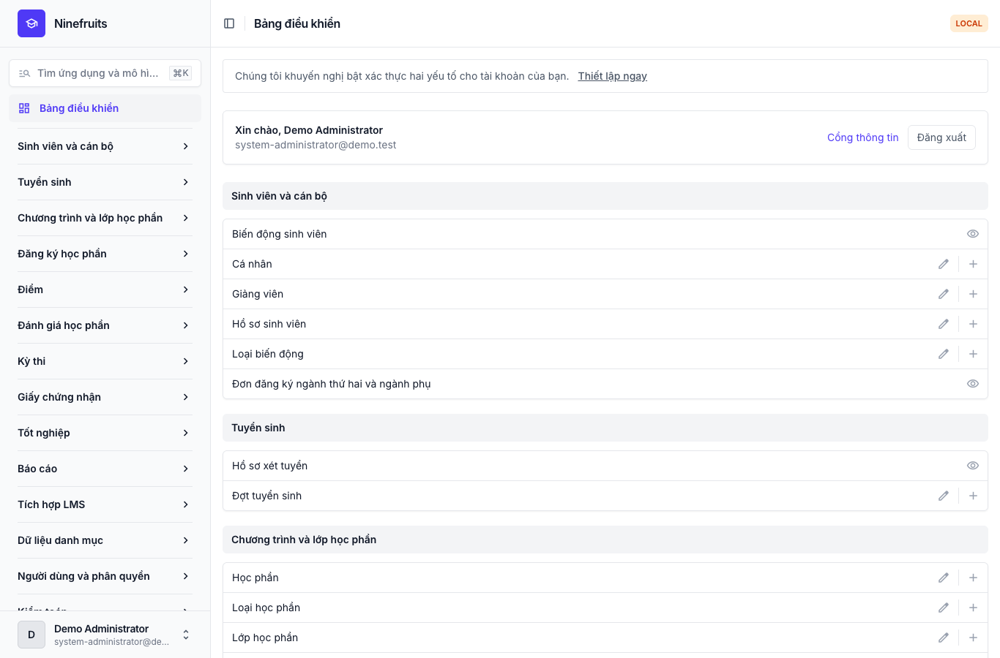
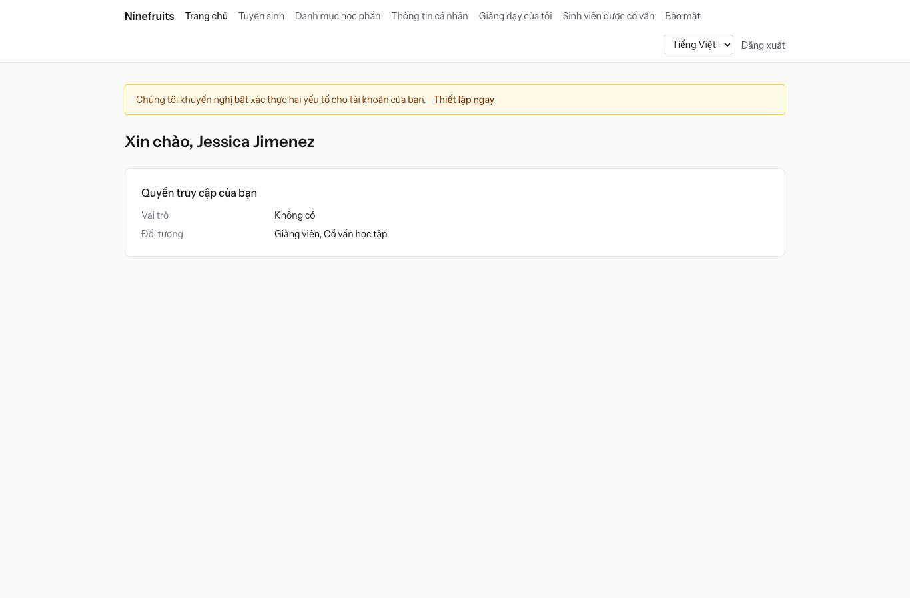
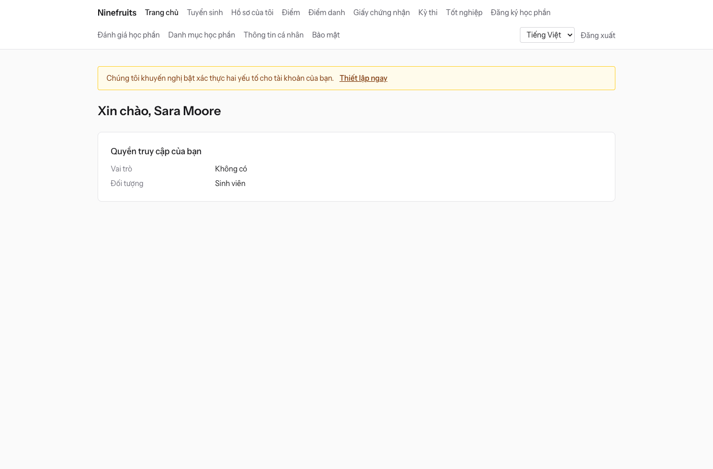

# Ninefruits — Hệ thống thông tin sinh viên (Django)

**Ngôn ngữ / Languages / 언어 / 语言 / ພາສາ**

| Ngôn ngữ | README | Hướng dẫn sử dụng |
|---|---|---|
| English | [README.md](README.md) | [docs/manual/en/](docs/manual/en/README.md) |
| 한국어 | [README.ko.md](README.ko.md) | [docs/manual/ko/](docs/manual/ko/README.md) |
| 简体中文 | [README.zh_Hans.md](README.zh_Hans.md) | [docs/manual/zh_Hans/](docs/manual/zh_Hans/README.md) |
| ລາວ | [README.lo.md](README.lo.md) | [docs/manual/lo/](docs/manual/lo/README.md) |
| Deutsch | [README.de.md](README.de.md) | [docs/manual/de/](docs/manual/de/README.md) |
| Filipino | [README.fil.md](README.fil.md) | [docs/manual/fil/](docs/manual/fil/README.md) |
| Français | [README.fr.md](README.fr.md) | [docs/manual/fr/](docs/manual/fr/README.md) |
| 日本語 | [README.ja.md](README.ja.md) | [docs/manual/ja/](docs/manual/ja/README.md) |
| Монгол | [README.mn.md](README.mn.md) | [docs/manual/mn/](docs/manual/mn/README.md) |
| Bahasa Melayu | [README.ms.md](README.ms.md) | [docs/manual/ms/](docs/manual/ms/README.md) |
| नेपाली | [README.ne.md](README.ne.md) | [docs/manual/ne/](docs/manual/ne/README.md) |
| Русский | [README.ru.md](README.ru.md) | [docs/manual/ru/](docs/manual/ru/README.md) |
| ไทย | [README.th.md](README.th.md) | [docs/manual/th/](docs/manual/th/README.md) |
| Türkçe | [README.tr.md](README.tr.md) | [docs/manual/tr/](docs/manual/tr/README.md) |
| Oʻzbek | [README.uz.md](README.uz.md) | [docs/manual/uz/](docs/manual/uz/README.md) |
| Tiếng Việt | [README.vi.md](README.vi.md) (tệp này) | [docs/manual/vi/](docs/manual/vi/README.md) |

Để thêm một ngôn ngữ khác, xem [Thêm ngôn ngữ](docs/development/adding-a-language.md).

Ninefruits là hệ thống thông tin sinh viên mà bất kỳ trường đại học nào cũng có thể cài đặt và vận hành. Hệ thống bao quát phần cốt lõi của công tác quản lý đào tạo, từ hồ sơ xét tuyển đến hồ sơ sinh viên, chương trình và lớp học phần, đăng ký học phần, điểm, đánh giá học phần, giấy chứng nhận, kỳ thi ngoại ngữ và kỳ thi tổng hợp, điểm danh, xét tốt nghiệp, báo cáo và nền tảng tích hợp LMS. Giao diện và tài liệu có sẵn bằng 16 ngôn ngữ trong bảng ở trên.

Repository này là bản chuyển đổi sang Python 3.14 / Django 6.1 / PostgreSQL 18 của [Ninefruits cho Laravel](https://github.com/humble92/ninefruits-laravel) v1.0.0 (Laravel 13, Filament, Livewire). Bản chuyển đổi giữ nguyên hành vi và schema cơ sở dữ liệu của bản gốc: các migration của Django tái hiện DDL của bản gốc, và schema được so sánh từng đối tượng với `pg_dump` của bản gốc (`tests/db/test_schema_equivalence.py`, `tools/schema_dump_diff.py`). Vì vậy, một bản cài đặt của phiên bản này có thể được chuyển sang phiên bản kia bằng các công cụ PostgreSQL tiêu chuẩn. Cách thức và lý do chuyển đổi được ghi lại trong [porting/](porting/README.md) (kế hoạch, báo cáo từng giai đoạn, quyết định thiết kế, đối chiếu kiểm thử).

## Tổng quan nhanh

Màn hình đầu tiên sau khi đăng nhập với ba vai trò (dữ liệu demo).

| Quản trị hệ thống (trang quản trị) | Giảng viên (cổng thông tin) | Sinh viên (cổng thông tin) |
|---|---|---|
|  |  |  |

- **Trang quản trị** `/admin/`: cán bộ xử lý hồ sơ sinh viên, công tác đào tạo, tuyển sinh, giấy chứng nhận, kỳ thi, tốt nghiệp và báo cáo (Django admin với django-unfold). Quyền đến từ các mẫu vai trò (cán bộ quản lý sinh viên, cán bộ đào tạo, cán bộ cấp giấy chứng nhận, giáo vụ khoa, cán bộ tuyển sinh, quản trị hệ thống) với phạm vi theo đơn vị tổ chức và chương trình đào tạo.
- **Cổng thông tin** `/portal/`: sinh viên xem đăng ký học phần, điểm, điểm danh, đăng ký dự thi, điều kiện tốt nghiệp và giấy chứng nhận; giảng viên xem danh sách lớp, điểm danh, nhập điểm và kết quả đánh giá của các lớp học phần mình phụ trách; thí sinh nộp hồ sơ xét tuyển (template Django với HTMX, Alpine.js và Tailwind CSS). Một tài khoản có thể mang nhiều vai trò (ví dụ một sinh viên đồng thời là trợ giảng).
- Cả hai dùng chung màn hình đăng nhập (`/accounts/login/`, django-allauth) và cùng chính sách xác thực hai yếu tố. Các hệ thống tích hợp dùng REST API dưới `/api/v1/` (OpenAPI tại `/api/docs/`).

## Tính năng

| Lĩnh vực | Nội dung |
|---|---|
| Người dùng và bảo mật | Đăng nhập dùng chung, xác thực hai yếu tố (ứng dụng, email), SSO (OIDC), đăng nhập bằng mã số sinh viên, vai trò, quyền và phạm vi theo đơn vị, kiểm toán dữ liệu và hoạt động với chuỗi băm, bảo mật mức dòng (RLS), mã hóa dữ liệu cá nhân |
| Cá nhân và hồ sơ sinh viên | Tách biệt cá nhân và hồ sơ sinh viên, quy tắc mã số sinh viên, biến động sinh viên (bảo lưu, trở lại học, thôi học, buộc thôi học, nhập học lại, tốt nghiệp) có đề nghị và phê duyệt, cố vấn học tập, ngành thứ hai và ngành phụ |
| Tuyển sinh | Đợt tuyển sinh, nộp hồ sơ trực tuyến kèm tài liệu, xét duyệt và công bố kết quả, tạo hồ sơ sinh viên cho thí sinh trúng tuyển |
| Chương trình đào tạo | Phiên bản học phần, học phần tiên quyết và tương đương, điều kiện tốt nghiệp theo khóa chương trình đào tạo, lớp học phần, thời khóa biểu, đề cương học phần |
| Đăng ký học phần | Bộ quy tắc, giới hạn tín chỉ, sĩ số và danh sách chờ, chặn đăng ký và ngoại lệ, thiết kế cho cao điểm đăng ký |
| Điểm | Đánh giá tuyệt đối và tương đối, mức trần phân bố điểm, nộp điểm và chốt điểm, phê duyệt sửa điểm, điểm TB và học lại, khóa điểm học kỳ (cảnh báo học vụ, khen thưởng), bảng điểm |
| Đánh giá học phần | Phản hồi ẩn danh, phiếu đánh giá và câu hỏi, tỷ lệ phản hồi tối thiểu, công bố kết quả, tạm ẩn điểm cho đến khi hoàn thành đánh giá |
| Giấy chứng nhận | Loại giấy và mẫu theo từng ngôn ngữ, số hiệu giấy chứng nhận, lưu trữ PDF, trang xác minh công khai (QR) |
| Kỳ thi | Loại kỳ thi, phần thi và điểm đạt, đợt thi và đăng ký dự thi, nhập kết quả, CSV và công bố, yêu cầu đính chính, kết quả bên ngoài |
| Điểm danh | Buổi học tạo từ thời khóa biểu, nhập điểm danh, bảng điểm danh PDF, danh sách lớp CSV |
| Tốt nghiệp | Xét điều kiện tốt nghiệp, lưu kết quả xét, miễn điều kiện (hai người phê duyệt), xử lý tốt nghiệp và số hiệu văn bằng |
| Báo cáo | Bảy báo cáo chuẩn kèm CSV, view `reporting` cho công cụ BI |
| Tích hợp LMS | Nền tảng, liên kết khóa học và nhật ký đồng bộ, đồng bộ theo sự kiện, đối soát hằng đêm, điểm LMS làm bản nháp, REST API với token |

## Công nghệ

Python 3.14, Django 6.1, django-unfold (trang quản trị), HTMX 2, Alpine.js 3, Tailwind CSS 4 và Vite (cổng thông tin, django-vite), PostgreSQL 18 (bảo mật mức dòng, kiểm toán bằng trigger), Redis, Celery và Flower (hàng đợi), Gotenberg (PDF), django-allauth (đăng nhập, xác thực hai yếu tố, SSO), Django REST framework (API). Các phụ thuộc được khóa bằng [uv](https://docs.astral.sh/uv/) (`uv.lock`) và npm (`package-lock.json`).

## Khởi động nhanh (trang demo)

### Với uv

PostgreSQL 18, Redis 8, Gotenberg 8 và Mailpit phải chạy cục bộ (hoặc chỉ khởi động các dịch vụ đó bằng Docker Compose: `docker compose up -d pgsql redis gotenberg mailpit`).

```bash
uv sync                                         # .venv with the development tools
npm ci && npm run build                         # static/dist/ (or `npm run dev` with VITE_DEV_MODE=true)
cp .env.example .env
uv run manage.py pii_generate_key               # put the two values into .env
# Database roles and database (once, as the superuser): docs/manual/en/operations/installation.md section 2
uv run manage.py setup_install --profile=korean-university --grade-scale=4.5   # migrations, essential data, institution, first administrator
uv run manage.py setup_demo --size=small --seed=42                             # demo university and demo accounts
uv run manage.py compilemessages --ignore=.venv
uv run manage.py runserver
uv run celery -A config worker --loglevel=INFO  # in a second terminal (term close, waitlists, imports)
```

- Cổng thông tin: http://localhost:8000/portal/ · Trang quản trị: http://localhost:8000/admin/ (cùng thông tin đăng nhập)
- Thư (Mailpit): http://localhost:8025

### Với Docker Compose

Máy chủ chỉ cần Docker.

```bash
cp .env.example .env
docker compose up -d                            # app, worker, beat, flower, pgsql, redis, mailpit, gotenberg
docker compose exec app uv run manage.py pii_generate_key        # put the two values into .env, then: docker compose up -d
docker compose exec app uv run manage.py setup_install --profile=korean-university --grade-scale=4.5
docker compose exec app uv run manage.py setup_demo --size=small --seed=42
docker compose exec app uv run manage.py compilemessages --ignore=.venv
docker compose --profile vite up -d vite        # optional: Vite dev server (HMR), VITE_DEV_MODE=true in .env
```

Container `pgsql` tạo các vai trò cơ sở dữ liệu (`app_migrator`, `app_runtime`, `app_reporting`) và chuẩn bị cơ sở dữ liệu phát triển và kiểm thử ở lần khởi động đầu tiên (`docker/pgsql/`). Giám sát hàng đợi (Flower): http://localhost:5555

### Tài khoản demo

Mọi mật khẩu đều là `demo-password` (`ninefruits/setup/conf.py`). Xác thực hai yếu tố chưa được đăng ký.

| Tài khoản | Vai trò / đối tượng | Màn hình đầu tiên |
|---|---|---|
| system-administrator@demo.test | Quản trị hệ thống (mọi quyền) | /admin/ |
| registrar@demo.test | Cán bộ quản lý sinh viên (hồ sơ sinh viên, điều chỉnh đăng ký học phần, chốt điểm, giấy chứng nhận, kỳ thi, tốt nghiệp, báo cáo) | /admin/ |
| academic-affairs@demo.test | Cán bộ đào tạo (học phần, lớp học phần, thời khóa biểu, quy chế đánh giá, đánh giá học phần, buổi học) | /admin/ |
| certificate-officer@demo.test | Cán bộ cấp giấy chứng nhận | /admin/ |
| department-assistant@demo.test | Giáo vụ khoa (xem theo phạm vi khoa, cố vấn học tập, báo cáo) | /admin/ |
| admissions-officer@demo.test | Cán bộ tuyển sinh | /admin/ |
| instructor@demo.test | Giảng viên và cố vấn học tập (lớp học phần của mình, điểm danh, nhập điểm, sinh viên được cố vấn) | /portal/ |
| student@demo.test | Sinh viên đang học | /portal/ |
| alumni@demo.test | Người đã tốt nghiệp | /portal/ |
| readmitted@demo.test | Người đã tốt nghiệp và được nhận vào học lại (hai hồ sơ sinh viên) | /portal/ |
| applicant@demo.test | Thí sinh | /portal/ |
| admitted@demo.test | Thí sinh trúng tuyển | /portal/ |

Dữ liệu demo là một trường đại học giả định (hồ sơ trường đại học Hàn Quốc) với sinh viên, giảng viên, học phần, lớp học phần, lượt đăng ký, điểm, đánh giá học phần, giấy chứng nhận, kỳ thi, điểm danh, xét tốt nghiệp và liên kết LMS. Không bao giờ nạp dữ liệu này trên môi trường production (`setup_demo` từ chối chạy khi `DJANGO_ENV=production`).

Với bản cài đặt production (gunicorn, Nginx, Celery beat, biến môi trường, sao lưu), hãy làm theo [hướng dẫn cài đặt](docs/manual/vi/operations/installation.md) và [danh sách kiểm tra triển khai](docs/manual/vi/operations/deployment-checklist.md).

## Tài liệu

- [Hướng dẫn dành cho quản trị viên](docs/manual/vi/admin/README.md): 28 chương, từ thứ tự thiết lập ban đầu đến mọi lĩnh vực
- [Hướng dẫn vận hành](docs/manual/vi/README.md#vận-hành): [cài đặt](docs/manual/vi/operations/installation.md), [danh sách kiểm tra triển khai](docs/manual/vi/operations/deployment-checklist.md), [lệnh](docs/manual/vi/operations/commands.md), [tác vụ định kỳ](docs/manual/vi/operations/scheduled-jobs.md), [sao lưu và khôi phục](docs/manual/vi/operations/backup-restore.md), [khóa bảo mật](docs/manual/vi/operations/security-keys.md), [kiểm toán và bảo trì](docs/manual/vi/operations/audit-and-maintenance.md), [kiểm thử tải](docs/manual/vi/operations/load-testing.md), [xử lý sự cố](docs/manual/vi/operations/troubleshooting.md)
- [Hướng dẫn tích hợp LMS](docs/lms-integration-guide.md)
- [Phát triển](docs/README.md): [quy tắc đặt tên](docs/development/naming.md), [danh sách kiểm tra khi rà soát](docs/development/review-checklist.md), [thêm ngôn ngữ](docs/development/adding-a-language.md)
- Lịch sử chuyển đổi và các quyết định thiết kế: [porting/](porting/README.md)

## Các lệnh thường dùng

| Lệnh | Chức năng |
|---|---|
| `uv run pytest -n auto -m "not concurrency"` | Kiểm thử (chạy riêng các bài kiểm thử đồng thời bằng `-m concurrency`) |
| `uv run ruff format && uv run ruff check` | Định dạng mã và lint |
| `uv run mypy ninefruits config tools/checks` | Kiểm tra kiểu |
| `uv run tools/checks/raw_sql.py` | Kiểm tra SQL thô (không ghép SQL bằng chuỗi) |
| `uv run manage.py naming_check` | Kiểm tra đặt tên (bảng và cột cơ sở dữ liệu, migration, lệnh, bản dịch) |
| `uv run manage.py i18n_missing --strict` | Bản dịch còn thiếu (`i18n_export` / `i18n_import` để làm việc với người dịch) |
| `uv run manage.py migrate` | Migration (tự động dùng kết nối `app_migrator`) |
| `uv run manage.py setup_install`, `setup_demo` | Cài đặt hoặc cập nhật, dữ liệu demo |
| `uv run manage.py security_sync_permissions` | Đưa danh mục quyền trong mã nguồn vào cơ sở dữ liệu |
| `pre-commit install` | ruff, mypy và kiểm tra SQL thô trước mỗi lần commit |

Danh sách đầy đủ có trong [tham chiếu lệnh](docs/manual/vi/operations/commands.md). CI (`.github/workflows/ci.yml`) chạy cùng các kiểm tra này trong hai job: chất lượng và kiểm thử.

## Giấy phép

[Giấy phép MIT](LICENSE). Bất kỳ ai cũng có thể tự do sử dụng, sửa đổi và phân phối, miễn là giữ nguyên thông báo bản quyền và văn bản giấy phép.

---

**Lời cảm ơn**

Chúng tôi xin gửi lời cảm ơn đến YUSTIC, hệ thống quản lý đào tạo của Đại học Khoa học và Công nghệ Diên Biên (Yanbian University of Science and Technology), nền tảng đã giúp hệ thống này ra đời. YUSTIC là thành quả của một nhóm nhỏ các nhà phát triển đã cùng nhau mơ ước, đổ mồ hôi và xây dựng trong nhiều năm. Hệ thống này là cách chúng tôi bày tỏ nỗi nhớ, sự kính trọng và lòng biết ơn đối với những đồng nghiệp đã từng cùng làm việc.
