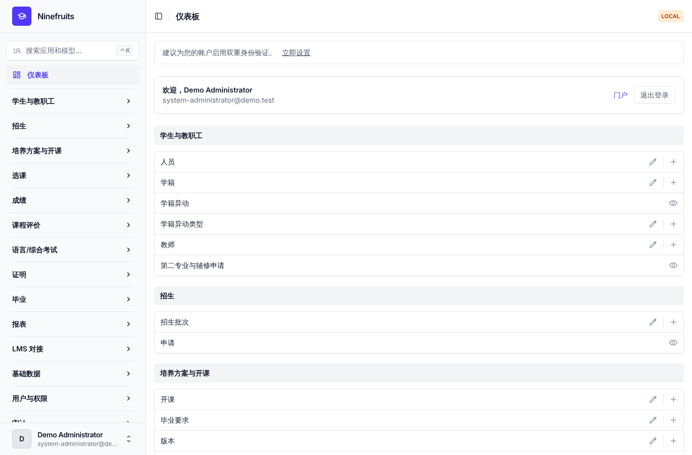
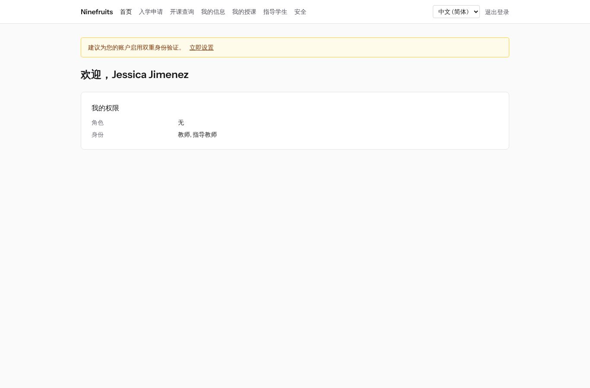
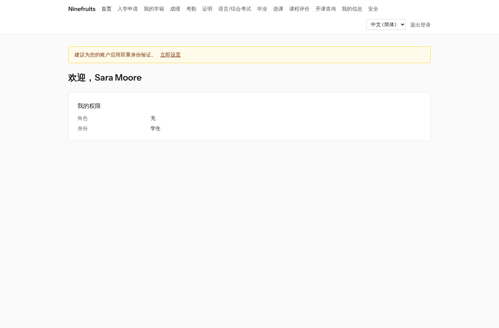

# Ninefruits — 高校教务管理系统（Django）

**언어 / Languages / 语言 / ພາສາ**

| 语言 | README | 手册 |
|---|---|---|
| English | [README.md](README.md) | [docs/manual/en/](docs/manual/en/README.md) |
| 한국어 | [README.ko.md](README.ko.md) | [docs/manual/ko/](docs/manual/ko/README.md) |
| 简体中文 | [README.zh_Hans.md](README.zh_Hans.md)（本文） | [docs/manual/zh_Hans/](docs/manual/zh_Hans/README.md) |
| ລາວ | [README.lo.md](README.lo.md) | [docs/manual/lo/](docs/manual/lo/README.md) |

要添加其他语言，请参阅[添加语言指南](docs/development/adding-a-language.md)（英文，[한국어](docs/development/adding-a-language.ko.md)）。

Ninefruits 是一套可在多所高校部署的教务管理系统（Student Information System）。它覆盖教务工作的核心——招生、学籍、培养方案与开课、选课、成绩、课程评价、证明、语言/综合考试、考勤、毕业资格审核、报表以及 LMS 对接基础——界面和文档支持韩语、英语、简体中文和老挝语。

本仓库是 [Ninefruits Laravel 版](https://github.com/humble92/ninefruits-laravel) v1.0.0（Laravel 13、Filament、Livewire）移植到 Python 3.14 / Django 6.1 / PostgreSQL 18 的版本。移植完整保留了原版的行为和数据库结构：Django 迁移原样重放原版的 DDL，并与原版的 `pg_dump` 逐个对象比较（`tests/db/test_schema_equivalence.py`、`tools/schema_dump_diff.py`）。因此任一版本的安装都可以用标准 PostgreSQL 工具迁移到另一版本。移植的过程和原因记录在 [porting/](porting/README.md)（计划、各阶段报告、设计决策、测试对照表）。

## 一览

三种角色登录后的首屏（演示数据）。

| 系统管理员（管理后台） | 教师（门户） | 学生（门户） |
|---|---|---|
|  |  |  |

- **管理后台** `/admin/`：教职员处理学籍、教务、招生、证明、考试、毕业和报表（Django admin + django-unfold）。权限来自角色模板（学籍管理员、教务管理员、证明书管理员、院系助理、招生管理员、系统管理员），并可限定院系或专业范围。
- **门户** `/portal/`：学生选课、查看成绩、考勤、考试报名、毕业要求和证明；教师管理所授课程的名单、考勤、成绩录入和课程评价结果；申请人提交入学申请（Django 模板 + HTMX + Alpine.js + Tailwind CSS）。一个账号可以拥有多种身份（例如既是学生又是助教）。
- 两者使用同一登录（`/accounts/login/`，django-allauth）和同一双因素认证策略。外部系统通过 `/api/v1/` REST API 对接（OpenAPI 文档 `/api/docs/`）。

## 主要功能

| 领域 | 内容 |
|---|---|
| 用户与安全 | 统一登录、双因素认证（应用、邮件）、学校统一身份认证（OIDC）、学号登录、带院系/专业范围的角色权限、带哈希链的数据与业务审计、行级安全（RLS）、个人信息加密 |
| 人员与学籍 | 人员与学籍分离、学号规则、学籍异动（休学、复学、退学、开除、重新入学、毕业）申请与审批、导师、第二专业与辅修 |
| 招生 | 招生批次、在线申请与材料、审核与录取、录取者学籍生成 |
| 培养方案 | 课程版本、先修与替代课程、按培养方案年份的毕业要求、教学班、课表、教学大纲 |
| 选课 | 规则集、学分上限、容量与候补、限制与例外，面向选课高峰设计 |
| 成绩 | 绝对/相对评价、等级比例上限、提交与确认、更正审批、绩点与重修、学期结算（学业警告、优秀）、成绩单 |
| 课程评价 | 匿名回答、问卷与题目、最低回答数、结果公布、未完成则限制查成绩 |
| 证明 | 种类与各语言模板、编号、PDF 保存、带二维码的公开验证页 |
| 语言/综合考试 | 考试种类、领域与合格标准，场次报名，成绩录入、CSV、公布，更正申请，外部成绩 |
| 考勤 | 按上课时间生成课次、考勤录入、考勤表 PDF、名单 CSV |
| 毕业 | 资格审核、审核存档、要求豁免（双人审批）、毕业办理与学位编号 |
| 报表 | 七种标准报表与 CSV，供 BI 使用的 `reporting` 视图 |
| LMS 对接基础 | 平台、课程关联、同步日志、事件驱动同步、每夜核对、LMS 分数草稿、令牌认证的 REST API |

## 技术栈

Python 3.14、Django 6.1、django-unfold（管理后台）、HTMX 2·Alpine.js 3·Tailwind CSS 4·Vite（门户，django-vite）、PostgreSQL 18（行级安全、触发器审计）、Redis·Celery·Flower（队列）、Gotenberg（PDF）、django-allauth（登录、双因素认证、SSO）、Django REST framework（API）。依赖用 [uv](https://docs.astral.sh/uv/)（`uv.lock`）和 npm（`package-lock.json`）锁定。

## 安装（演示站点）

### 使用 uv 直接运行

本机需要 PostgreSQL 18、Redis 8、Gotenberg 8 和 Mailpit（没有的话，可以只用 Docker Compose 启动这些服务：`docker compose up -d pgsql redis gotenberg mailpit`）。

```bash
uv sync                                         # .venv，含开发工具
npm ci && npm run build                         # static/dist/（或开发时 `npm run dev` + VITE_DEV_MODE=true）
cp .env.example .env
uv run manage.py pii_generate_key               # 将输出的两个值写入 .env
# 数据库角色与数据库准备（超级用户执行一次）：docs/manual/zh_Hans/operations/installation.md 第 2 节
uv run manage.py setup_install --profile=korean-university --grade-scale=4.5   # 迁移、必需数据、机构设置、首位管理员
uv run manage.py setup_demo --size=small --seed=42                             # 演示大学与演示账号
uv run manage.py compilemessages --ignore=.venv
uv run manage.py runserver
uv run celery -A config worker --loglevel=INFO  # 在另一个终端中（学期结算、候补、导入）
```

- 门户：http://localhost:8000/portal/ · 管理后台：http://localhost:8000/admin/（同一登录）
- 邮件（Mailpit）：http://localhost:8025

### Docker Compose

主机只需 Docker。

```bash
cp .env.example .env
docker compose up -d                            # app、worker、beat、flower、pgsql、redis、mailpit、gotenberg
docker compose exec app uv run manage.py pii_generate_key        # 把两个值写入 .env，再执行 docker compose up -d
docker compose exec app uv run manage.py setup_install --profile=korean-university --grade-scale=4.5
docker compose exec app uv run manage.py setup_demo --size=small --seed=42
docker compose exec app uv run manage.py compilemessages --ignore=.venv
docker compose --profile vite up -d vite        # 可选：Vite 开发服务器（HMR），.env 中设 VITE_DEV_MODE=true
```

`pgsql` 容器首次启动时创建数据库角色（`app_migrator`、`app_runtime`、`app_reporting`），并准备开发和测试数据库（`docker/pgsql/`）。队列监控（Flower）：http://localhost:5555

### 演示账号

所有密码均为 `demo-password`（`ninefruits/setup/conf.py`）。未登记双因素认证。

| 账号 | 角色 / 身份 | 首屏 |
|---|---|---|
| system-administrator@demo.test | 系统管理员（全部权限） | /admin/ |
| registrar@demo.test | 学籍管理员（学籍、选课调整、成绩确认、证明、考试、毕业、报表） | /admin/ |
| academic-affairs@demo.test | 教务管理员（课程、开课、课表、成绩政策、课程评价、课次） | /admin/ |
| certificate-officer@demo.test | 证明书管理员 | /admin/ |
| department-assistant@demo.test | 院系助理（院系范围查询、导师、报表） | /admin/ |
| admissions-officer@demo.test | 招生管理员 | /admin/ |
| instructor@demo.test | 教师兼导师（所授课程、考勤、成绩录入、指导学生） | /portal/ |
| student@demo.test | 在校生 | /portal/ |
| alumni@demo.test | 毕业生 | /portal/ |
| readmitted@demo.test | 重新入学的毕业生（两条学籍） | /portal/ |
| applicant@demo.test | 入学申请人 | /portal/ |
| admitted@demo.test | 录取者 | /portal/ |

演示数据是一所虚构大学（韩国大学配置），包含学生、教师、课程、教学班、选课、成绩、课程评价、证明、考试、考勤、毕业审核和 LMS 关联。切勿导入生产环境（`DJANGO_ENV=production` 时 `setup_demo` 会拒绝执行）。

生产环境安装（gunicorn、Nginx、Celery beat、环境变量、备份）请按照[安装手册](docs/manual/zh_Hans/operations/installation.md)和[部署检查清单](docs/manual/zh_Hans/operations/deployment-checklist.md)进行。

## 文档

- [管理员手册](docs/manual/zh_Hans/admin/README.md)：从初始设置顺序到各领域用法，共 28 章
- [运维手册](docs/manual/zh_Hans/README.md#运维手册)：[安装](docs/manual/zh_Hans/operations/installation.md)、[部署检查清单](docs/manual/zh_Hans/operations/deployment-checklist.md)、[运维命令](docs/manual/zh_Hans/operations/commands.md)、[定时任务](docs/manual/zh_Hans/operations/scheduled-jobs.md)、[备份与恢复](docs/manual/zh_Hans/operations/backup-restore.md)、[安全密钥](docs/manual/zh_Hans/operations/security-keys.md)、[审计与维护](docs/manual/zh_Hans/operations/audit-and-maintenance.md)、[负载测试](docs/manual/zh_Hans/operations/load-testing.md)、[故障处理](docs/manual/zh_Hans/operations/troubleshooting.md)
- [LMS 对接指南](docs/lms-integration-guide.md)
- [开发文档](docs/README.md)：[命名规则](docs/development/naming.md)、[评审检查清单](docs/development/review-checklist.md)、[添加语言](docs/development/adding-a-language.md)
- 移植历史与设计决策（参考）：[porting/](porting/README.md)

## 常用命令

| 命令 | 内容 |
|---|---|
| `uv run pytest -n auto -m "not concurrency"` | 测试（并发测试用 `-m concurrency` 单独运行） |
| `uv run ruff format && uv run ruff check` | 代码风格与静态检查 |
| `uv run mypy ninefruits config tools/checks` | 类型检查 |
| `uv run tools/checks/raw_sql.py` | 原始 SQL 检查（禁止用字符串拼接 SQL） |
| `uv run manage.py naming_check` | 命名检查（数据库表与列、迁移、命令、翻译） |
| `uv run manage.py i18n_missing --strict` | 检查缺失翻译（用 `i18n_export`/`i18n_import` 与译者交换） |
| `uv run manage.py migrate` | 迁移（自动使用 `app_migrator` 连接） |
| `uv run manage.py setup_install`、`setup_demo` | 安装/更新、演示数据 |
| `uv run manage.py security_sync_permissions` | 把代码中的权限目录同步到数据库 |
| `pre-commit install` | 提交前运行 ruff、mypy、原始 SQL 检查 |

完整列表见[运维命令参考](docs/manual/zh_Hans/operations/commands.md)。CI（`.github/workflows/ci.yml`）以质量检查和测试两个 job 执行同样的检查。

## 许可证

[MIT 许可证](LICENSE)。可自由使用、修改和分发，保留版权声明和许可证文本即可。

---

**致谢**

感谢使本系统成为可能的 YUSTIC（延边科技大学教务行政网络系统）。YUSTIC 是一支数人组成的开发团队多年来共同挥洒汗水、怀抱梦想、辛勤付出的成果。谨以本系统的开发，向曾经并肩的同事们致以思念、敬意与感谢。
