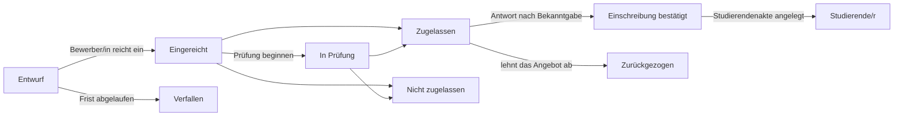

# 16. Zulassung

Menü: **Zulassung > Bewerbungsrunden**, **Bewerbungen**, **Einstellungen > Zulassung**

Die Zulassung wird getrennt von den Semestern verwaltet. Bewerbende legen ein Konto mit einer privaten E-Mail-Adresse an und bewerben sich damit; nach der Zulassung bleibt dasselbe Konto in Gebrauch, sobald die Studierendenakte existiert (als Studierende/r, als Absolvent/in und für eine Bewerbung zur Wiederaufnahme).

Bewerbende können ihre Bewerbung jederzeit bis zum Anlegen der Studierendenakte mit **Bewerbung zurückziehen** zurückziehen (zugelassene Bewerbende antworten auf das Angebot mit **Ablehnen**). Bevor die Entscheidung bekanntgegeben wird, sehen Bewerbende nicht, ob sie zugelassen wurden; die Bewerbung wird als **In Prüfung** angezeigt.

| Berechtigung | Was sie erlaubt |
|---|---|
| `Bewerbungsrunden und Zulassungseinstellungen verwalten` | Bewerbungsrunden anlegen und bearbeiten, Einstellungen > Zulassung |
| `Bewerbungen anzeigen` | Bewerbungen, Angaben zu Bewerbenden und eingereichte Unterlagen einsehen |
| `Bewerbungen prüfen und entscheiden` | Prüfung beginnen, zulassen/ablehnen, Entscheidungen bekanntgeben, eine Antwort auf das Angebot für Bewerbende erfassen |
| `Studierendenakten für zugelassene Bewerbende anlegen` | Studierendenakten für Bewerbende anlegen, die ihre Einschreibung bestätigt haben |

Berechtigungen für Bewerbungen können auch mit einem Geltungsbereich Organisationseinheit oder Studiengang zugewiesen werden (zum Beispiel für ein Institutssekretariat, das nur die Bewerbungen des eigenen Instituts einsehen darf). Die Rollenvorlage Zulassungsstelle enthält alle vier Berechtigungen; die Vorlage Studierendensekretariat enthält das Anzeigen und das Anlegen von Studierendenakten.

## Die Seite der Bewerbenden

1. Auf dem Anmeldebildschirm öffnen Bewerbende **Offene Bewerbungsrunden ansehen** (Adresse `/admissions`), sehen die Bewerbungsrunden, die Bewerbungen annehmen, und legen mit **Konto anlegen und bewerben** (Adresse `/accounts/signup/`) ein Konto an. Sie geben ihren Namen (in lateinischen Buchstaben), ihre private E-Mail-Adresse und ein Passwort ein.
2. Bevor sie sich bewerben können, müssen sie die E-Mail-Adresse über den zugesandten Link bestätigen.
3. Im Portal unter **Zulassung** wählen sie die Bewerbungsrunde und den Studiengang und beginnen die Bewerbung. Sie geben persönliche Angaben, die bisherige Schule und ein Motivationsschreiben ein, laden Unterlagen hoch und klicken auf **Bewerbung einreichen**. Beim Einreichen erhält die Bewerbung eine Bewerbungsnummer (`CYCLECODE-00001`), und eine Bestätigungs-E-Mail wird versandt. Nach dem Einreichen kann die Bewerbung nicht mehr geändert werden.
4. Wenn die Entscheidung bekanntgegeben wird, erhalten Bewerbende eine E-Mail und sehen die Entscheidung im Portal. Zugelassene Bewerbende wählen **Angebot annehmen** oder **Ablehnen**.
5. Sobald die Studierendenakte angelegt ist, zeigt das Portal die Matrikelnummer an, und dasselbe Konto hat nun den Zugang für Studierende.

Personen, die bereits eine Studierendenakte haben (aktuell Studierende, Absolvent/innen), melden sich mit ihrem bestehenden Konto an und bewerben sich auf demselben Bildschirm. In diesem Fall sind Name und Geburtsdatum die vom Studierendensekretariat geführten Werte und können in der Bewerbung nicht geändert werden.

Legt ein/e Absolvent/in, die/der eine Studierendenakte, aber kein Konto hat (zum Beispiel per CSV übernommene Absolvent/innen), ein neues Konto an, entstehen zwei Personen. Tritt ein solcher Fall auf, senden Sie der bestehenden Person eine [Kontoeinladung](14-merge-and-invitations.md#kontoeinladungen), damit sie sich mit diesem Konto bewirbt; hat sie sich bereits beworben, führen Sie die beiden mit [Doppelte Personen zusammenführen](14-merge-and-invitations.md) zusammen.

## Bewerbungsrunden

| Feld | Beschreibung |
|---|---|
| Code | Erster Teil der Bewerbungsnummer, z. B. `2027-SPRING` |
| Name, Beschreibung | Pro Sprache. Wird auf der öffentlichen Zulassungsseite angezeigt |
| Beginn, Ende | Lassen Sie das Ende für **Laufend (ohne Frist)** leer |
| Veröffentlicht | Muss eingeschaltet sein, damit Bewerbende die Bewerbungsrunde sehen. Während der Vorbereitung ausgeschaltet lassen |
| Entscheidungen sofort bekanntgeben | Wenn eingeschaltet, werden Bewerbende benachrichtigt, sobald eine Zulassungs- oder Ablehnungsentscheidung gespeichert wird (geeignet für laufende Zulassung). Wenn ausgeschaltet, werden Entscheidungen gemeinsam mit **Entscheidungen bekanntgeben** bekanntgegeben |
| Tage zur Annahme des Angebots | Wie lange zugelassene Bewerbende nach der Bekanntgabe Zeit haben, auf das Angebot zu antworten. Nach Ablauf der Frist können Bewerbende nicht mehr antworten; Mitarbeitende können die Antwort mit Begründung für sie erfassen |
| Angebotene Studiengänge, Kapazität | Studiengänge, für die man sich bewerben kann. Die Kapazität dient der Orientierung und verhindert nicht, dass weitere Bewerbende zugelassen werden |
| Unterlagen | Ausgewählt aus der Codeliste **Bewerbungsunterlage**. Eine Bewerbung ohne die erforderlichen Unterlagen kann nicht eingereicht werden. Dateien können PDF, JPEG oder PNG sein (Höchstgröße unter Einstellungen > Zulassung) |

Das Profil für koreanische Universitäten legt Unterlagenarten (Abschlusszeugnis oder Bescheinigung über den voraussichtlichen Abschluss, Notenspiegel, Kopie des Personalausweises oder Reisepasses, Ergebnis eines Sprachtests) und Zulassungsarten (Zulassung zum ersten Fachsemester, Zulassung zum höheren Fachsemester, Wiedereinschreibung, Zulassung internationaler Studierender) an. Sie können auf dem Bildschirm für Codelisten ergänzt oder umbenannt werden.

## Bewerbungen prüfen und entscheiden

**Zulassung > Bewerbungen** listet nur eingereichte Bewerbungen auf (Entwürfe sieht nur die/der Bewerbende selbst). Die Liste ist nach dem Zeitpunkt der Einreichung sortiert; der Filter **Status** zeigt nur die Bewerbungen, die auf eine Entscheidung warten (Eingereicht, In Prüfung). Suchen Sie nach Bewerbungsnummer oder Name der/des Bewerbenden und filtern Sie nach Bewerbungsrunde.

1. Öffnen Sie die Bewerbung und prüfen Sie den Inhalt der Bewerbung, die Angaben zur/zum Bewerbenden, frühere Studierendenakten (bei Bewerbungen zur Wiederaufnahme) und die eingereichten Unterlagen. Klicken Sie auf den Namen einer Unterlage, um sie herunterzuladen.
2. Markieren Sie die Bewerbung bei Bedarf mit **Prüfung beginnen** als in Prüfung.
3. Klicken Sie auf **Zulassen** oder **Ablehnen** (für eine Ablehnung ist eine Anmerkung zur Entscheidung erforderlich). Die Entscheidung kann bis zur Bekanntgabe geändert werden.
4. **Entscheidung bekanntgeben**: über die Schaltfläche auf dem Bewerbungsbildschirm (eine Bewerbung), in der Bewerbungsliste durch Ankreuzen mehrerer Bewerbungen und Ausführen von **Entscheidungen bekanntgeben** aus der Aktionsliste (Sammelaktion) oder mit **Entscheidungen bekanntgeben** im Zeilenmenü der Liste der Bewerbungsrunden (auch oben auf dem Bildschirm der Bewerbungsrunde) (alle noch nicht bekanntgegebenen Entscheidungen dieser Runde). Bei der Bekanntgabe erhalten Bewerbende eine E-Mail, und die Entscheidung kann nicht mehr geändert werden.

Jeder Schritt (Prüfung beginnen, Entscheidung, Bekanntgabe, Antwort auf das Angebot, Anlegen der Studierendenakte) wird im Aktivitätsprotokoll erfasst.

## Studierendenakten anlegen

Studierendenakten für Bewerbende, die ihre Einschreibung bestätigt haben, werden vor Semesterbeginn angelegt.

- Eine Bewerbung: **Studierendenakte anlegen** auf dem Bewerbungsbildschirm, unter Auswahl des Aufnahmesemesters.
- Mehrere: Kreuzen Sie die bestätigten Bewerbungen in der Liste an und führen Sie **Studierendenakte anlegen** aus der Aktionsliste aus. Der nächste Bildschirm fragt nach dem Zulassungssemester. Bewerbungen, die nicht bestätigt sind, bereits eine Studierendenakte haben oder außerhalb Ihres Geltungsbereichs liegen, werden übersprungen.
- Eine ganze Bewerbungsrunde: Der IT-Betrieb führt `uv run manage.py admission_matriculate` aus ([Befehlsreferenz](../operations/commands.md#admission_matriculate)).

Die Matrikelnummer wird nach dem Matrikelnummernmuster unter **Einstellungen > Studierendenakten** neu vergeben, das Aufnahmedatum ist der erste Tag des Aufnahmesemesters, und die Zulassungsart ist die aus der Bewerbung. Bei einer Wiederaufnahme bleibt die frühere Studierendenakte unverändert und eine neue wird hinzugefügt ([Kapitel 12](12-people-and-student-records.md)). Studierendenakten können auch angelegt werden, wenn die Zulassungsstelle keine Berechtigung zur Verwaltung von Studierendenakten hat (die Berechtigung zum Anlegen von Studierendenakten für zugelassene Bewerbende genügt; das Änderungsprotokoll der Daten hält den Namen der ausführenden Person fest).

## Einstellungen > Zulassung

| Feld | Beschreibung |
|---|---|
| Bewerbende können ein Konto anlegen | Wenn ausgeschaltet, ist der Bildschirm zum Anlegen eines Kontos geschlossen. Für Hochschulen, die keine Online-Bewerbungen annehmen |
| Unbearbeitete Entwürfe verfallen nach (Tagen) | Bewerbungsentwürfe, die innerhalb dieses Zeitraums nicht geändert wurden, werden jede Nacht auf **Verfallen** gesetzt. Entwürfe in geschlossenen Bewerbungsrunden verfallen unabhängig vom Zeitraum |
| Größtes Dokument (MB) | Standard 10 |

[Inhalt des Administrationshandbuchs](README.md)
