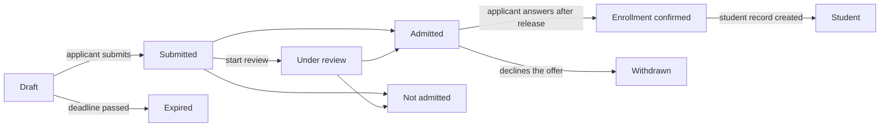

# 16. Admissions

Menu: **Admissions > Admission cycles**, **Applications**, **Settings > Admissions**

Admissions are managed separately from terms. An applicant creates an account with a personal email and applies with it; after admission, the same account stays in use once the student record exists (as a student, as an alumnus and for a readmission application).

An applicant can **Withdraw application** at any time until the student record is created (an admitted applicant answers the offer with **Decline**). Before the decision is released, the applicant does not see whether they were admitted; the application shows as **Under review**.

| Permission | What it allows |
|---|---|
| `Manage admission cycles and admission settings` | Create and edit admission cycles, Settings > Admissions |
| `View applications` | See applications, applicant details and submitted documents |
| `Review and decide applications` | Start review, admit/reject, release decisions, record an offer response for the applicant |
| `Create student records for admitted applicants` | Create student records for applicants who confirmed enrollment |

Application permissions can also be assigned with an org unit or program scope (for example, a department assistant who may only view the applications of that department). The Admissions Officer role template contains all four permissions; the Registrar template contains viewing and creating student records.

## The applicant's side

1. On the sign-in screen the applicant opens **See open admissions** (address `/admissions`), sees the cycles taking applications and creates an account with **Create an account to apply** (address `/accounts/signup/`). They enter their name (in Latin letters), personal email and a password.
2. They must verify the email through the link sent to them before they can apply.
3. In the portal under **Admissions** they choose the cycle and program and start the application. They enter personal details, their previous school and a personal statement, upload documents and **Submit application**. On submission the application receives an application number (`CYCLECODE-00001`) and a confirmation email is sent. The application cannot be changed after submission.
4. When the decision is released, the applicant receives an email and sees the decision in the portal. Admitted applicants choose **Accept the offer** or **Decline**.
5. Once the student record is created, the portal shows the student number and the same account now has student access.

People who already have a student record (current students, alumni) sign in with their existing account and apply on the same screen. In that case the name and birth date are the values kept by the registrar and cannot be changed in the application.

If an alumnus who has a student record but no account (for example alumni migrated by CSV) creates a new account, there will be two people. When such a case comes up, send the existing person an [account invitation](14-merge-and-invitations.md#account-invitations) so they apply with that account; if they already applied, combine the two with [Merge duplicate people](14-merge-and-invitations.md).

## Admission cycles

| Field | Description |
|---|---|
| Code | First part of the application number, e.g. `2027-SPRING` |
| Name, Description | Per language. Shown on the public admissions page |
| Opens, Closes | Leave the closing time empty for **Rolling (no deadline)** |
| Published | Must be on for applicants to see the cycle. Keep it off while preparing |
| Release decisions immediately | When on, the applicant is told as soon as an admit/reject decision is saved (suited to rolling admission). When off, decisions are released together with **Release decisions** |
| Days to accept an offer | How long admitted applicants have after the release to answer the offer. After the deadline the applicant can no longer answer; a staff member can record the response for them with a reason |
| Programs offered, Capacity | Programs that can be applied to. Capacity is for reference and does not block admitting more applicants |
| Documents | Chosen from the code data list **Application document type**. An application without the required documents cannot be submitted. Files may be PDF, JPEG or PNG (maximum size under Settings > Admissions) |

The Korean university profile seeds document types (certificate of graduation or expected graduation, transcript, copy of ID card or passport, language test score) and admission types (new admission, transfer admission, readmission, special admission for international students). They can be added or renamed on the code data screen.

## Reviewing and deciding applications

**Admissions > Applications** lists submitted applications only (drafts are visible to the applicant alone). The list is ordered by submission time; the **Status** filter shows only the applications waiting for a decision (Submitted, Under review). Search by application number or applicant name, and filter by cycle.

1. Open the application and check the application content, applicant details, earlier student records (readmission applicants) and submitted documents. Click a document's name to download it.
2. If needed, mark it as under review with **Start review**.
3. Click **Admit** or **Reject** (a decision note is required for a rejection). The decision can be changed until it is released.
4. **Release decision**: from the button on the application screen (one application), from the application list by ticking several and running **Release decisions** from the action list (bulk), or with **Release decisions** in the row menu of the admission cycle list (also at the top of the cycle screen) (every unreleased decision in that cycle). On release the applicant receives an email and the decision can no longer be changed.

Every step (start review, decision, release, offer response, creating the student record) is recorded in the activity log.

## Creating student records

Student records for applicants who confirmed enrollment are created before the term starts.

- One application: **Create student record** on the application screen, choosing the admission term.
- Several: tick the confirmed applications in the list and run **Create student record** from the action list. The next screen asks for the admission term. Applications that are not confirmed, already have a student record or are outside your scope are skipped.
- A whole cycle: an IT operator runs `uv run manage.py admission_matriculate` ([command reference](../operations/commands.md#admission_matriculate)).

The student number is newly assigned with the student number pattern in **Settings > Student records**, the admission date is the first day of the admission term, and the admission type is the one from the application. For a readmission the earlier student record stays as it is and a new one is added ([chapter 12](12-people-and-student-records.md)). Student records can be created even when the admissions officer has no permission to manage student records (the permission to create student records for admitted applicants is enough; the data change record keeps the name of the staff member who did it).

## Settings > Admissions

| Field | Description |
|---|---|
| Applicants can create an account | When off, the account creation screen is closed. For universities that do not take online applications |
| Expire untouched drafts after (days) | Draft applications not changed within this period become **Expired** every night. Drafts in closed cycles expire regardless of the period |
| Largest document (MB) | Default 10 |

[Administrator manual contents](README.md)
