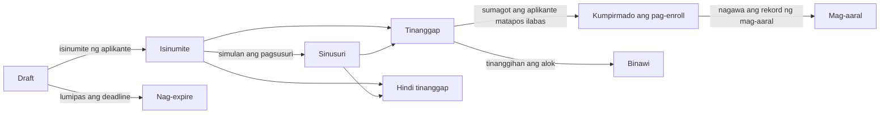

# 16. Admisyon

Menu: **Admisyon > Mga siklo ng admisyon**, **Mga aplikasyon**, **Mga setting > Admisyon**

Hiwalay na pinamamahalaan ang admisyon sa mga termino. Gumagawa ang aplikante ng account gamit ang personal na email at doon nag-a-apply; pagkatapos matanggap, patuloy na ginagamit ang parehong account kapag umiiral na ang rekord ng mag-aaral (bilang mag-aaral, bilang alumnus at para sa aplikasyon sa muling pagtanggap).

Maaaring **Bawiin ang aplikasyon** ng aplikante anumang oras hanggang sa magawa ang rekord ng mag-aaral (ang natanggap na aplikante ay sumasagot sa alok gamit ang **Tanggihan**). Bago ilabas ang desisyon, hindi nakikita ng aplikante kung natanggap siya; ipinapakita ang aplikasyon bilang **Sinusuri**.

| Pahintulot | Ano ang pinapayagan nito |
|---|---|
| `Pamahalaan ang mga siklo at setting ng admisyon` | Gumawa at mag-edit ng mga siklo ng admisyon, Mga setting > Admisyon |
| `Tingnan ang mga aplikasyon` | Tingnan ang mga aplikasyon, detalye ng aplikante at mga isinumiteng dokumento |
| `Suriin at pagpasyahan ang mga aplikasyon` | Simulan ang pagsusuri, tanggapin/tanggihan, ilabas ang mga desisyon, itala ang sagot sa alok para sa aplikante |
| `Gumawa ng mga rekord ng mag-aaral para sa mga natanggap na aplikante` | Gumawa ng mga rekord ng mag-aaral para sa mga aplikanteng nagkumpirma ng pag-enroll |

Maaari ring italaga ang mga pahintulot sa aplikasyon na may saklaw na yunit ng organisasyon o programa (halimbawa, isang katuwang ng departamento na makatitingin lamang ng mga aplikasyon ng departamentong iyon). Nasa template ng tungkuling Admissions Officer ang lahat ng apat na pahintulot; nasa template na Registrar ang pagtingin at ang paggawa ng mga rekord ng mag-aaral.

## Ang panig ng aplikante

1. Sa screen ng pag-sign in, binubuksan ng aplikante ang **Tingnan ang mga bukas na admisyon** (address `/admissions`), nakikita ang mga siklong tumatanggap ng aplikasyon at gumagawa ng account gamit ang **Gumawa ng account para mag-apply** (address `/accounts/signup/`). Inilalagay niya ang kanyang pangalan (sa letrang Latin), personal na email at password.
2. Kailangan niyang i-verify ang email sa pamamagitan ng link na ipinadala sa kanya bago siya makapag-apply.
3. Sa portal sa ilalim ng **Admisyon**, pinipili niya ang siklo at programa at sinisimulan ang aplikasyon. Inilalagay niya ang personal na detalye, ang dati niyang paaralan at isang personal statement, nag-a-upload ng mga dokumento at pinipindot ang **Isumite ang aplikasyon**. Sa pagsusumite, tumatanggap ang aplikasyon ng numero ng aplikasyon (`CYCLECODE-00001`) at nagpapadala ng email ng kumpirmasyon. Hindi na mababago ang aplikasyon matapos isumite.
4. Kapag inilabas ang desisyon, tumatanggap ang aplikante ng email at nakikita ang desisyon sa portal. Pumipili ang mga natanggap na aplikante ng **Tanggapin ang alok** o **Tanggihan**.
5. Kapag nagawa na ang rekord ng mag-aaral, ipinapakita ng portal ang student number at may access na bilang mag-aaral ang parehong account.

Ang mga taong may rekord na ng mag-aaral (kasalukuyang mag-aaral, alumni) ay nagsa-sign in gamit ang kanilang kasalukuyang account at nag-a-apply sa parehong screen. Sa ganitong kaso, ang pangalan at petsa ng kapanganakan ay ang mga value na iniingatan ng registrar at hindi mababago sa aplikasyon.

Kung ang isang alumnus na may rekord ng mag-aaral pero walang account (halimbawa mga alumni na inilipat sa pamamagitan ng CSV) ay gumawa ng bagong account, magkakaroon ng dalawang tao. Kapag may ganitong kaso, padalhan ang kasalukuyang tao ng [imbitasyon sa account](14-merge-and-invitations.md#mga-imbitasyon-sa-account) para mag-apply siya gamit ang account na iyon; kung nakapag-apply na siya, pagsamahin ang dalawa gamit ang [Pagsasanib ng mga duplicate na tao](14-merge-and-invitations.md).

## Mga siklo ng admisyon

| Field | Paglalarawan |
|---|---|
| Code | Unang bahagi ng numero ng aplikasyon, hal. `2027-SPRING` |
| Pangalan, Paglalarawan | Bawat wika. Ipinapakita sa pampublikong pahina ng admisyon |
| Magbubukas, Magsasara | Iwanang blangko ang oras ng pagsasara para sa **Rolling (walang deadline)** |
| Nakalathala | Dapat naka-on para makita ng mga aplikante ang siklo. Panatilihing naka-off habang naghahanda |
| Agad na ilabas ang mga desisyon | Kapag naka-on, sinasabihan agad ang aplikante sa sandaling ma-save ang desisyong tanggapin/tanggihan (angkop sa rolling admission). Kapag naka-off, sabay-sabay na inilalabas ang mga desisyon gamit ang **Ilabas ang mga desisyon** |
| Mga araw para tanggapin ang alok | Gaano katagal ang mga natanggap na aplikante matapos ang paglabas para sagutin ang alok. Pagkalipas ng deadline, hindi na makasasagot ang aplikante; maaaring itala ng isang kawani ang sagot para sa kanya na may dahilan |
| Mga iniaalok na programa, Kapasidad | Mga programang maaaring pag-applyan. Para sa sanggunian ang kapasidad at hindi nito hinaharangan ang pagtanggap ng mas maraming aplikante |
| Mga dokumento | Pinipili mula sa listahan ng code na **Uri ng dokumento ng aplikasyon**. Hindi maisusumite ang aplikasyong walang mga kinakailangang dokumento. Maaaring PDF, JPEG o PNG ang mga file (pinakamalaking laki sa ilalim ng Mga setting > Admisyon) |

Nagse-seed ang profile ng unibersidad sa Korea ng mga uri ng dokumento (Diploma o sertipiko ng inaasahang pagtatapos, Transcript of Records, Kopya ng ID o pasaporte, Iskor sa pagsusulit sa wika) at mga uri ng admisyon (Admisyon ng freshman, Admisyon ng transferee, Muling pagtanggap, Admisyon ng dayuhang mag-aaral). Maaari silang dagdagan o palitan ng pangalan sa screen ng mga code.

## Pagsusuri at pagpapasya sa mga aplikasyon

Inililista ng **Admisyon > Mga aplikasyon** ang mga isinumiteng aplikasyon lamang (ang mga draft ay nakikita lamang ng aplikante). Nakaayos ang listahan ayon sa oras ng pagsumite; ipinapakita lamang ng filter na **Katayuan** ang mga aplikasyong naghihintay ng desisyon (Naisumite, Sinusuri). Maghanap ayon sa numero ng aplikasyon o pangalan ng aplikante, at mag-filter ayon sa siklo.

1. Buksan ang aplikasyon at suriin ang nilalaman nito, ang detalye ng aplikante, ang mga naunang rekord ng mag-aaral (mga aplikante sa muling pagtanggap) at ang mga isinumiteng dokumento. I-click ang pangalan ng dokumento para i-download ito.
2. Kung kailangan, markahan itong sinusuri gamit ang **Simulan ang pagsusuri**.
3. I-click ang **Tanggapin** o **Tanggihan** (kailangan ng tala ng desisyon kapag tinanggihan). Maaaring baguhin ang desisyon hanggang sa mailabas ito.
4. **Ilabas ang desisyon**: mula sa button sa screen ng aplikasyon (isang aplikasyon), mula sa listahan ng aplikasyon sa paglalagay ng tsek sa ilan at pagpapatakbo ng **Ilabas ang mga desisyon** mula sa listahan ng aksiyon (maramihan), o gamit ang **Ilabas ang mga desisyon** sa menu ng row ng listahan ng siklo ng admisyon (nasa itaas din ng screen ng siklo) (lahat ng hindi pa nailalabas na desisyon sa siklong iyon). Sa paglabas, tumatanggap ng email ang aplikante at hindi na mababago ang desisyon.

Itinatala sa log ng aktibidad ang bawat hakbang (pagsisimula ng pagsusuri, desisyon, paglabas, sagot sa alok, paggawa ng rekord ng mag-aaral).

## Paggawa ng mga rekord ng mag-aaral

Ginagawa ang mga rekord ng mag-aaral para sa mga aplikanteng nagkumpirma ng pag-enroll bago magsimula ang termino.

- Isang aplikasyon: **Gumawa ng rekord ng mag-aaral** sa screen ng aplikasyon, at piliin ang termino ng admisyon.
- Ilan: lagyan ng tsek ang mga kumpirmadong aplikasyon sa listahan at patakbuhin ang **Gumawa ng rekord ng mag-aaral** mula sa listahan ng aksiyon. Hihingin ng susunod na screen ang termino ng admisyon. Nilalaktawan ang mga aplikasyong hindi pa kumpirmado, may rekord ng mag-aaral na, o nasa labas ng iyong saklaw.
- Isang buong siklo: pinapatakbo ng IT operator ang `uv run manage.py admission_matriculate` ([sanggunian ng mga command](../operations/commands.md#admission_matriculate)).

Bagong itinatalaga ang student number ayon sa pattern ng student number sa **Mga setting > Mga rekord ng mag-aaral**, ang petsa ng admisyon ay ang unang araw ng termino ng admisyon, at ang uri ng admisyon ay ang nasa aplikasyon. Sa muling pagtanggap, nananatili ang naunang rekord ng mag-aaral at nagdaragdag ng bago ([kabanata 12](12-people-and-student-records.md)). Maaaring gumawa ng mga rekord ng mag-aaral kahit walang pahintulot ang admissions officer na pamahalaan ang mga rekord ng mag-aaral (sapat na ang pahintulot na gumawa ng mga rekord ng mag-aaral para sa mga natanggap na aplikante; itinatago ng rekord ng pagbabago ng datos ang pangalan ng kawaning gumawa nito).

## Mga setting > Admisyon

| Field | Paglalarawan |
|---|---|
| Maaaring gumawa ng account ang mga aplikante | Kapag naka-off, sarado ang screen ng paggawa ng account. Para sa mga unibersidad na hindi tumatanggap ng online na aplikasyon |
| Mag-expire ang mga draft na hindi ginagalaw pagkatapos ng (araw) | Ang mga draft na aplikasyong hindi binago sa loob ng panahong ito ay nagiging **Nag-expire** gabi-gabi. Nag-e-expire ang mga draft sa mga saradong siklo anuman ang panahon |
| Pinakamalaking dokumento (MB) | Default 10 |

[Nilalaman ng manwal ng administrator](README.md)
