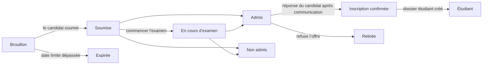

# 16. Admissions

Menu : **Admissions > Campagnes d’admission**, **Candidatures**, **Paramètres > Admissions**

Les admissions sont gérées indépendamment des semestres. Le candidat crée un compte avec un e-mail personnel et candidate avec ce compte ; après l’admission, le même compte reste utilisé une fois le dossier étudiant créé (en tant qu’étudiant, ancien étudiant, et pour une candidature de réadmission).

Le candidat peut utiliser **Retirer la candidature** à tout moment jusqu’à la création du dossier étudiant (un candidat admis répond à l’offre avec **Refuser**). Tant que la décision n’est pas communiquée, le candidat ne voit pas s’il a été admis ; la candidature apparaît comme **En cours d’examen**.

| Autorisation | Ce qu’elle permet |
|---|---|
| `Gérer les campagnes d’admission et les paramètres d’admission` | Créer et modifier les campagnes d’admission, Paramètres > Admissions |
| `Consulter les candidatures` | Voir les candidatures, les informations des candidats et les pièces déposées |
| `Examiner les candidatures et statuer` | Commencer l’examen, admettre/refuser, communiquer les décisions, enregistrer la réponse à l’offre pour le candidat |
| `Créer les dossiers étudiants des candidats admis` | Créer les dossiers étudiants des candidats ayant confirmé leur inscription |

Les autorisations relatives aux candidatures peuvent aussi être attribuées avec un périmètre d’unité organisationnelle ou de formation (par exemple, un assistant de département qui ne peut consulter que les candidatures de ce département). Le modèle de rôle Chargé des admissions contient les quatre autorisations ; le modèle Scolarité contient la consultation et la création des dossiers étudiants.

## Côté candidat

1. Sur l’écran de connexion, le candidat ouvre **Voir les admissions ouvertes** (adresse `/admissions`), consulte les campagnes ouvertes aux candidatures et crée un compte avec **Créer un compte pour candidater** (adresse `/accounts/signup/`). Il saisit son nom (en caractères latins), son e-mail personnel et un mot de passe.
2. Il doit vérifier son e-mail au moyen du lien qui lui est envoyé avant de pouvoir candidater.
3. Dans le portail, sous **Admissions**, il choisit la campagne et la formation et commence la candidature. Il saisit ses informations personnelles, son établissement précédent et une lettre de motivation, dépose les pièces et clique sur **Soumettre la candidature**. À la soumission, la candidature reçoit un numéro de candidature (`CYCLECODE-00001`) et un e-mail de confirmation est envoyé. La candidature ne peut plus être modifiée après la soumission.
4. Lorsque la décision est communiquée, le candidat reçoit un e-mail et voit la décision dans le portail. Les candidats admis choisissent **Accepter l’offre** ou **Refuser**.
5. Une fois le dossier étudiant créé, le portail affiche le numéro d’étudiant et le même compte dispose désormais de l’accès étudiant.

Les personnes qui possèdent déjà un dossier étudiant (étudiants actuels, anciens étudiants) se connectent avec leur compte existant et candidatent sur le même écran. Dans ce cas, le nom et la date de naissance sont ceux conservés par la scolarité et ne peuvent pas être modifiés dans la candidature.

Si un ancien étudiant qui possède un dossier étudiant mais pas de compte (par exemple un ancien étudiant migré par CSV) crée un nouveau compte, il y aura deux personnes. Dans ce cas, envoyez à la personne existante une [invitation de compte](14-merge-and-invitations.md#invitations-à-créer-un-compte) pour qu’elle candidate avec ce compte ; si elle a déjà candidaté, réunissez les deux avec la [fusion des doublons de personnes](14-merge-and-invitations.md).

## Campagnes d’admission

| Champ | Description |
|---|---|
| Code | Première partie du numéro de candidature, par ex. `2027-SPRING` |
| Nom, description | Par langue. Affichés sur la page publique des admissions |
| Ouverture, clôture | Laissez la date de clôture vide pour **Continue (sans date limite)** |
| Publiée | Doit être activé pour que les candidats voient la campagne. Laissez-le désactivé pendant la préparation |
| Communiquer les décisions immédiatement | Lorsque cette option est activée, le candidat est informé dès qu’une décision d’admission ou de refus est enregistrée (adapté aux admissions continues). Lorsqu’elle est désactivée, les décisions sont communiquées ensemble avec **Communiquer les décisions** |
| Délai d’acceptation de l’offre (jours) | Délai dont disposent les candidats admis après la communication pour répondre à l’offre. Passé ce délai, le candidat ne peut plus répondre ; un membre du personnel peut enregistrer la réponse à sa place avec un motif |
| Formations proposées, capacité | Formations ouvertes aux candidatures. La capacité est indicative et n’empêche pas d’admettre davantage de candidats |
| Pièces | Choisies dans la liste de données codées **Pièce justificative de candidature**. Une candidature sans les pièces obligatoires ne peut pas être soumise. Les fichiers peuvent être au format PDF, JPEG ou PNG (taille maximale sous Paramètres > Admissions) |

Le profil université coréenne fournit des types de pièces (attestation de diplôme ou de diplôme à venir, relevé de notes, copie de la carte d’identité ou du passeport, résultat de test de langue) et des types d’admission (admission en première année, admission par transfert, réadmission, admission spéciale des étudiants internationaux). Ils peuvent être ajoutés ou renommés sur l’écran des données codées.

## Examen des candidatures et décisions

**Admissions > Candidatures** ne liste que les candidatures soumises (les brouillons ne sont visibles que par le candidat). La liste est triée par date de soumission ; le filtre **Statut** n’affiche que les candidatures en attente de décision (Soumise, En cours d’examen). Recherchez par numéro de candidature ou nom du candidat, et filtrez par campagne.

1. Ouvrez la candidature et vérifiez son contenu, les informations du candidat, les dossiers étudiants antérieurs (candidats à la réadmission) et les pièces déposées. Cliquez sur le nom d’une pièce pour la télécharger.
2. Si nécessaire, marquez-la comme en cours d’examen avec **Commencer l’examen**.
3. Cliquez sur **Admettre** ou **Refuser** (une note de décision est obligatoire en cas de refus). La décision peut être modifiée tant qu’elle n’a pas été communiquée.
4. **Communiquer la décision** : depuis le bouton de l’écran de la candidature (une candidature), depuis la liste des candidatures en en cochant plusieurs et en lançant **Communiquer les décisions** depuis la liste des actions (en masse), ou avec **Communiquer les décisions** dans le menu de ligne de la liste des campagnes d’admission (également en haut de l’écran de la campagne) (toutes les décisions non communiquées de cette campagne). À la communication, le candidat reçoit un e-mail et la décision ne peut plus être modifiée.

Chaque étape (début de l’examen, décision, communication, réponse à l’offre, création du dossier étudiant) est enregistrée dans le journal d’activité.

## Création des dossiers étudiants

Les dossiers étudiants des candidats ayant confirmé leur inscription sont créés avant le début du semestre.

- Une candidature : **Créer le dossier étudiant** sur l’écran de la candidature, en choisissant le semestre d’admission.
- Plusieurs : cochez les candidatures confirmées dans la liste et lancez **Créer le dossier étudiant** depuis la liste des actions. L’écran suivant demande le semestre d’admission. Les candidatures non confirmées, qui ont déjà un dossier étudiant ou qui sont hors de votre périmètre sont ignorées.
- Une campagne entière : un exploitant informatique exécute `uv run manage.py admission_matriculate` ([référence des commandes](../operations/commands.md#admission_matriculate)).

Le numéro d’étudiant est attribué selon le format de numéro d’étudiant défini dans **Paramètres > Dossiers étudiants**, la date d’admission est le premier jour du semestre d’admission et le type d’admission est celui de la candidature. Pour une réadmission, le dossier étudiant antérieur reste inchangé et un nouveau dossier est ajouté ([chapitre 12](12-people-and-student-records.md)). Les dossiers étudiants peuvent être créés même si le chargé des admissions n’a pas l’autorisation de gérer les dossiers étudiants (l’autorisation de créer les dossiers étudiants des candidats admis suffit ; l’enregistrement de modification de données conserve le nom du membre du personnel qui l’a fait).

## Paramètres > Admissions

| Champ | Description |
|---|---|
| Les candidats peuvent créer un compte | Lorsque cette option est désactivée, l’écran de création de compte est fermé. Pour les universités qui n’acceptent pas les candidatures en ligne |
| Faire expirer les brouillons inactifs après (jours) | Les brouillons de candidature non modifiés pendant cette période passent à l’état **Expirée** chaque nuit. Les brouillons des campagnes clôturées expirent quelle que soit la période |
| Taille maximale d’une pièce (Mo) | 10 par défaut |

[Sommaire du manuel d’administration](README.md)
