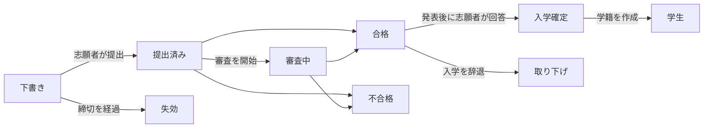

# 16. 入試

メニュー: **入試 > 入試回**、**出願**、**設定 > 入試**

入試は学期とは別に管理します。志願者は個人のメールアドレスでアカウントを作成して出願し、合格して学籍が作成された後も同じアカウントを使い続けます(学生として、卒業生として、また再入学の出願にも)。

志願者は学籍が作成されるまでいつでも **出願を取り下げ** ができます(合格した志願者は **辞退** で入学の意思に回答します)。合否が発表されるまで、志願者には合否が分からず、出願は **審査中** と表示されます。

| 権限 | できること |
|---|---|
| `入試回と入試設定の管理` | 入試回の作成・編集、設定 > 入試 |
| `出願の閲覧` | 出願、志願者の詳細、提出書類の閲覧 |
| `出願の審査・合否判定` | 審査開始、合格/不合格、合否の発表、志願者に代わる入学意思の記録 |
| `合格者の学籍作成` | 入学を確定した志願者の学籍の作成 |

出願に関する権限は、組織単位またはプログラムの範囲を付けて割り当てることもできます(例: その学科の出願だけを閲覧できる学科助手)。入試担当のロールテンプレートには 4 つの権限がすべて含まれ、学籍担当のテンプレートには閲覧と学籍作成が含まれます。

## 志願者側の流れ

1. 志願者はログイン画面から **受付中の入試を見る**(アドレス `/admissions`)を開き、出願を受け付けている入試回を確認して **アカウントを作成して出願**(アドレス `/accounts/signup/`)でアカウントを作成します。氏名(ラテン文字)、個人のメールアドレス、パスワードを入力します。
2. 出願する前に、送られてきたリンクからメールアドレスを確認する必要があります。
3. ポータルの **入試** で入試回とプログラムを選び、出願を始めます。個人情報、出身校、志望理由を入力し、書類をアップロードして **出願を提出** します。提出時に出願には出願番号(`CYCLECODE-00001`)が付与され、確認メールが送信されます。提出後は出願内容を変更できません。
4. 合否が発表されると、志願者にメールが届き、ポータルで結果を確認できます。合格者は **入学する** または **辞退** を選びます。
5. 学籍が作成されると、ポータルに学籍番号が表示され、同じアカウントに学生としての利用権限が付与されます。

すでに学籍を持つ人(在学生、卒業生)は、既存のアカウントでログインして同じ画面から出願します。その場合、氏名と生年月日は教務課が管理している値となり、出願の中では変更できません。

学籍はあるもののアカウントを持たない卒業生(例: CSV で移行した卒業生)が新しいアカウントを作成すると、人物が 2 人になってしまいます。このようなケースでは、既存の人物に [アカウント招待](14-merge-and-invitations.md#アカウント招待) を送ってそのアカウントで出願してもらいます。すでに出願している場合は、[重複人物の統合](14-merge-and-invitations.md) で 2 人を 1 人にまとめます。

## 入試回

| 項目 | 説明 |
|---|---|
| コード | 出願番号の先頭部分。例: `2027-SPRING` |
| 名称、説明 | 言語ごとに入力します。公開の入試ページに表示されます |
| 受付開始、受付終了 | **随時受付(締切なし)** の場合は終了日時を空にします |
| 公開 | 志願者に入試回を表示するにはオンにする必要があります。準備中はオフのままにします |
| 合否を即時に発表 | オンにすると、合格/不合格の判定を保存した時点で志願者に通知されます(随時受付に適しています)。オフの場合、判定は **合否を一括発表** でまとめて発表します |
| 入学意思確認の期限(日) | 合格者が発表後に入学の意思を回答できる期間。期限を過ぎると志願者は回答できなくなりますが、職員が理由を付けて代わりに回答を記録できます |
| 募集プログラム、募集人員 | 出願できるプログラム。募集人員は参考値で、それを超える合格を妨げません |
| 提出書類 | コードの一覧 **出願書類** から選びます。必須書類がそろっていない出願は提出できません。ファイルは PDF、JPEG、PNG のいずれか(最大サイズは 設定 > 入試 で指定) |

韓国の大学プロファイルでは、書類の種類(卒業証明書または卒業見込証明書、成績証明書、身分証明書またはパスポートの写し、語学試験の成績)と入学区分(新入学、編入学、再入学、外国人特別選抜)があらかじめ登録されます。これらはコード管理画面で追加や名称変更ができます。

## 出願の審査と合否判定

**入試 > 出願** には提出済みの出願だけが一覧表示されます(下書きは志願者本人にしか見えません)。一覧は提出日時順に並び、**状態** フィルターでは判定待ちの出願(提出済み、審査中)だけを表示できます。出願番号または志願者名で検索し、入試回で絞り込めます。

1. 出願を開き、出願内容、志願者の詳細、過去の学籍(再入学の志願者)、提出書類を確認します。書類名をクリックするとダウンロードできます。
2. 必要に応じて **審査を開始** で審査中にします。
3. **合格** または **不合格** をクリックします(不合格には判定メモが必要です)。判定は発表されるまで変更できます。
4. **合否を発表**: 出願画面のボタンから(1 件)、出願一覧で複数にチェックを入れ、操作リストから **合否を一括発表** を実行して(一括)、または入試回一覧の行メニューの **合否を一括発表**(入試回画面の上部にもあります)で(その入試回の未発表の判定すべて)行います。発表すると志願者にメールが届き、判定は変更できなくなります。

すべての手順(審査開始、判定、発表、入学意思の回答、学籍の作成)は業務ログに記録されます。

## 学籍の作成

入学を確定した志願者の学籍は、学期が始まる前に作成します。

- 1 件: 出願画面で **学籍を作成** を押し、入学学期を選びます。
- 複数: 一覧で入学確定済みの出願にチェックを入れ、操作リストから **学籍を作成** を実行します。次の画面で入学学期を指定します。入学確定でない出願、すでに学籍がある出願、権限範囲外の出願はスキップされます。
- 入試回全体: IT 運用者が `uv run manage.py admission_matriculate` を実行します([コマンドリファレンス](../operations/commands.md#admission_matriculate))。

学籍番号は **設定 > 学籍** の学籍番号の形式で新たに付与され、入学日は入学学期の初日、入学区分は出願時のものになります。再入学の場合、以前の学籍はそのまま残り、新しい学籍が追加されます([第 12 章](12-people-and-student-records.md))。入試担当者に学籍を管理する権限がなくても学籍は作成できます(合格者の学籍を作成する権限があれば十分で、データ変更履歴には作成した職員の名前が残ります)。

## 設定 > 入試

| 項目 | 説明 |
|---|---|
| 志願者のアカウント作成を許可 | オフにするとアカウント作成画面が閉じます。オンライン出願を受け付けない大学向けです |
| 未更新の下書きを失効させるまでの日数 | この期間内に変更されなかった下書きの出願は、毎晩 **失効** になります。受付を終了した入試回の下書きは期間にかかわらず失効します |
| 書類の最大サイズ(MB) | 既定は 10 |

[管理者マニュアル目次](README.md)
