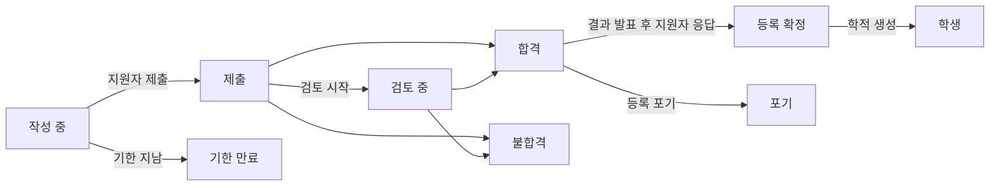

# 16. 입학 지원

메뉴: **입학 > 모집 회차**, **지원서**, **설정 > 입학**

입학 지원은 학기와 따로 관리한다. 지원자는 개인 이메일로 계정을 만들어 지원하고, 합격 후 학적이 생겨도 같은 계정을 계속 쓴다(학생, 졸업생, 재입학 지원 모두).

지원자는 학적이 만들어지기 전까지 언제든 **지원 포기**를 할 수 있다(합격 통지에는 **등록하지 않겠습니다**로 응답). 결과 발표 전에는 합격/불합격이 지원자에게 보이지 않고 **검토 중**으로 표시된다.

| 권한 | 할 수 있는 일 |
|---|---|
| `모집 회차와 입학 설정 관리` | 모집 회차 만들기와 수정, 설정 > 입학 |
| `지원서 조회` | 지원서와 지원자 정보, 제출 서류 보기 |
| `지원서 검토와 합격 결정` | 검토 시작, 합격/불합격, 결과 발표, 등록 의사 대리 입력 |
| `합격자 학적 생성` | 등록 확정 지원자의 학적 생성 |

지원서 권한도 조직 단위, 프로그램 범위로 할당할 수 있다(예: 학과 조교에게 그 학과 지원서 조회만). 입학 담당 역할 템플릿에는 위 네 권한이, 학적 담당에는 조회와 학적 생성이 들어 있다.

## 지원자 쪽 흐름

1. 지원자가 로그인 화면의 **모집 안내 보기**(주소 `/admissions`)에서 접수 중인 모집을 보고 **계정 만들고 지원하기**(주소 `/accounts/signup/`)로 계정을 만든다. 이름(로마자), 개인 이메일, 비밀번호를 입력한다.
2. 메일로 받은 링크로 이메일을 확인해야 지원할 수 있다.
3. 포털 **입학 지원**에서 회차와 프로그램을 골라 작성을 시작한다. 인적 사항, 출신 학교, 자기소개서를 입력하고 서류를 올린 뒤 **제출**한다. 제출하면 수험 번호(`회차코드-00001`)가 붙고 접수 확인 메일이 간다. 제출 후에는 고칠 수 없다.
4. 결과가 발표되면 메일을 받고 포털에서 결과를 확인한다. 합격자는 **등록하겠습니다** 또는 **등록하지 않겠습니다**를 고른다.
5. 학적이 만들어지면 포털에 학번이 표시되고, 같은 계정이 학생 권한으로 바뀐다.

이미 학적이 있는 사람(재학생, 졸업생)은 기존 계정으로 로그인해 같은 화면에서 지원한다. 이 경우 이름과 생년월일은 학적 담당이 관리하는 값이 그대로 쓰이고 지원서에서 고칠 수 없다.

계정 없이 학적만 있는 졸업생(CSV로 이관한 졸업생 등)이 새로 계정을 만들면 인물이 둘이 된다. 문의가 오면 기존 인물에게 [계정 초대](14-merge-and-invitations.md#계정-초대)를 보내 그 계정으로 지원하게 하고, 이미 지원했다면 [중복 인물 병합](14-merge-and-invitations.md)으로 합친다.

## 모집 회차

| 항목 | 설명 |
|---|---|
| 코드 | 수험 번호 앞부분. 예: `2027-SPRING` |
| 이름, 안내 | 언어별. 모집 안내 화면에 보인다 |
| 접수 시작, 접수 마감 | 마감을 비우면 **상시 접수** |
| 공개 | 켜야 지원자에게 보인다. 준비 중에는 꺼 둔다 |
| 결정 즉시 발표 | 켜면 합격/불합격을 저장하는 즉시 지원자에게 알린다(상시 접수에 적합). 끄면 **결과 발표**로 한꺼번에 알린다 |
| 합격 응답 기한(일) | 발표 후 합격자가 등록 의사를 밝힐 기간. 기한이 지나면 지원자는 응답할 수 없고, 담당자가 사유를 적어 대리 입력할 수 있다 |
| 모집 프로그램, 모집 인원 | 지원할 수 있는 프로그램. 모집 인원은 참고용이며 합격 처리를 막지 않는다 |
| 제출 서류 | 코드 데이터 **지원 제출 서류** 목록에서 고른다. 필수 서류를 올리지 않으면 제출되지 않는다. 파일은 PDF, JPEG, PNG(최대 크기는 설정 > 입학) |

한국 대학 프로파일은 서류 종류(졸업(예정)증명서, 성적증명서, 신분증 또는 여권 사본, 어학 성적)와 입학 구분(신입학, 편입학, 재입학, 외국인 특별전형)을 넣어 둔다. 코드 데이터 화면에서 추가하거나 이름을 바꿀 수 있다.

## 지원서 검토와 결정

**입학 > 지원서**에는 제출된 지원서만 나온다(작성 중인 지원서는 지원자만 본다). 목록은 제출 시각 순이고, **상태** 필터로 결정을 기다리는 지원서(제출, 검토 중)만 볼 수 있다. 회차, 수험 번호, 지원자 이름으로도 찾는다.

1. 지원서를 열어 지원 내용, 지원자 정보, 이전 학적(재입학 지원자), 제출 서류를 확인한다. 서류는 이름을 누르면 내려받는다.
2. 필요하면 **검토 시작**으로 검토 중 표시를 한다.
3. **합격** 또는 **불합격**(의견 필수)을 누른다. 발표 전에는 결정을 바꿀 수 있다.
4. **결과 발표**: 지원서 화면의 버튼(한 건), 지원서 목록에서 여러 건을 체크하고 작업 목록의 **결과 발표**를 실행(일괄), 또는 모집 회차 목록의 행 오른쪽 작업 메뉴의 **결과 발표**(그 회차의 발표 전 결정 모두, 회차 화면 위쪽에도 있다)로 한다. 발표하면 지원자에게 메일이 가고, 결정은 더 이상 바꿀 수 없다.

모든 단계(검토 시작, 결정, 발표, 등록 의사, 학적 생성)는 업무 감사 기록에 남는다.

## 학적 생성

등록 확정 지원자는 학기 시작 전에 학적을 만든다.

- 한 건: 지원서 화면의 **학적 생성**에서 입학 학기를 고른다.
- 여러 건: 지원서 목록에서 등록 확정 지원서를 체크하고 작업 목록의 **학적 생성**을 실행한다. 다음 화면에서 입학 학기를 고른다. 등록 확정이 아니거나 이미 학적이 있거나 권한 범위 밖인 지원서는 건너뛴다.
- 회차 전체: IT 운영자가 `uv run manage.py admission_matriculate`([명령 레퍼런스](../operations/commands.md#admission_matriculate)).

학번은 **설정 > 학적**의 학번 형식으로 새로 부여되고, 입학일은 입학 학기 첫날, 입학 구분은 지원서의 값이다. 재입학이면 이전 학적은 그대로 남고 새 학적이 추가된다([12장](12-people-and-student-records.md)). 입학 담당자가 학적 관리 권한이 없어도 학적 생성은 된다(학적 생성 권한으로 충분하며, 데이터 변경 기록에는 처리한 담당자가 남는다).

## 설정 > 입학

| 항목 | 설명 |
|---|---|
| 지원자 계정 만들기 허용 | 끄면 계정 만들기 화면이 닫힌다. 온라인 접수를 하지 않는 대학용 |
| 작성 중 지원서 만료(일) | 이 기간 동안 고치지 않은 작성 중 지원서는 매일 밤 **기한 만료**가 된다. 마감된 회차의 작성 중 지원서는 기간과 관계없이 만료된다 |
| 서류 최대 크기(MB) | 기본 10 |

[관리자 매뉴얼 목차](README.md)
