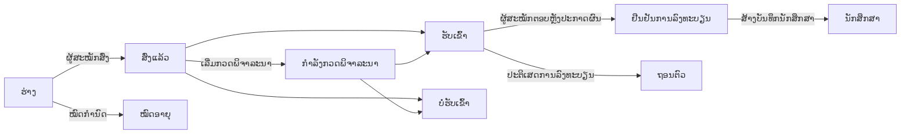

# 16. ການຮັບເຂົ້າຮຽນ

ເມນູ: **ການຮັບເຂົ້າຮຽນ > ຮອບການຮັບເຂົ້າຮຽນ**, **ໃບສະໝັກ**, **ການຕັ້ງຄ່າ > ການຮັບເຂົ້າຮຽນ**

ການຮັບເຂົ້າຮຽນຖືກຄຸ້ມຄອງແຍກຕ່າງຫາກຈາກພາກຮຽນ. ຜູ້ສະໝັກສ້າງບັນຊີດ້ວຍອີເມວສ່ວນຕົວເພື່ອສະໝັກ ແລະ ຫຼັງຈາກຖືກຮັບເຂົ້າ ແລະ ມີບັນທຶກນັກສຶກສາແລ້ວ ກໍຍັງໃຊ້ບັນຊີເດີມຕໍ່ໄປ (ທັງໃນຖານະນັກສຶກສາ, ຜູ້ຈົບການສຶກສາ ແລະ ການສະໝັກເຂົ້າຮຽນຄືນ).

ຜູ້ສະໝັກສາມາດ **ຖອນໃບສະໝັກ** ໄດ້ທຸກເວລາກ່ອນທີ່ບັນທຶກນັກສຶກສາຈະຖືກສ້າງ (ສຳລັບການແຈ້ງຮັບເຂົ້າ ຕອບດ້ວຍ **ປະຕິເສດ**). ກ່ອນການປະກາດຜົນ ຜົນຮັບເຂົ້າ/ບໍ່ຮັບເຂົ້າຈະບໍ່ສະແດງໃຫ້ຜູ້ສະໝັກເຫັນ ແຕ່ຈະສະແດງເປັນ **ກຳລັງກວດພິຈາລະນາ**.

| ສິດ | ສິ່ງທີ່ເຮັດໄດ້ |
|---|---|
| `ຄຸ້ມຄອງຮອບການຮັບເຂົ້າຮຽນ ແລະ ການຕັ້ງຄ່າການຮັບເຂົ້າຮຽນ` | ສ້າງ ແລະ ແກ້ໄຂຮອບການຮັບເຂົ້າຮຽນ, ການຕັ້ງຄ່າ > ການຮັບເຂົ້າຮຽນ |
| `ເບິ່ງໃບສະໝັກ` | ເບິ່ງໃບສະໝັກ, ຂໍ້ມູນຜູ້ສະໝັກ ແລະ ເອກະສານທີ່ສົ່ງ |
| `ກວດພິຈາລະນາ ແລະ ຕັດສິນໃບສະໝັກ` | ເລີ່ມກວດພິຈາລະນາ, ຮັບເຂົ້າ/ບໍ່ຮັບເຂົ້າ, ປະກາດຜົນ, ບັນທຶກຄຳຕອບແທນຜູ້ສະໝັກ |
| `ສ້າງບັນທຶກນັກສຶກສາໃຫ້ຜູ້ສະໝັກທີ່ຖືກຮັບເຂົ້າ` | ສ້າງບັນທຶກນັກສຶກສາໃຫ້ຜູ້ສະໝັກທີ່ຢືນຢັນການລົງທະບຽນແລ້ວ |

ສິດກ່ຽວກັບໃບສະໝັກກໍສາມາດມອບໝາຍຕາມຂອບເຂດໜ່ວຍງານ ຫຼື ຫຼັກສູດໄດ້ (ຕົວຢ່າງ: ໃຫ້ຜູ້ຊ່ວຍພາກວິຊາເບິ່ງໄດ້ສະເພາະໃບສະໝັກຂອງພາກວິຊານັ້ນ). ແມ່ແບບບົດບາດພະນັກງານຮັບເຂົ້າຮຽນມີສິດທັງສີ່ຂ້າງເທິງ ສ່ວນພະນັກງານທະບຽນມີສິດເບິ່ງ ແລະ ສ້າງບັນທຶກນັກສຶກສາ.

## ຂັ້ນຕອນຝ່າຍຜູ້ສະໝັກ

1. ຜູ້ສະໝັກເບິ່ງຮອບທີ່ກຳລັງເປີດຮັບສະໝັກຢູ່ທີ່ **ເບິ່ງການຮັບເຂົ້າຮຽນທີ່ເປີດຢູ່** (ທີ່ຢູ່ `/admissions`) ໃນໜ້າເຂົ້າສູ່ລະບົບ ແລະ ສ້າງບັນຊີດ້ວຍ **ສ້າງບັນຊີເພື່ອສະໝັກ** (ທີ່ຢູ່ `/accounts/signup/`). ປ້ອນຊື່ (ຕົວອັກສອນລາຕິນ), ອີເມວສ່ວນຕົວ ແລະ ລະຫັດຜ່ານ.
2. ຕ້ອງຢືນຢັນອີເມວຜ່ານລິ້ງທີ່ໄດ້ຮັບທາງອີເມວກ່ອນ ຈຶ່ງຈະສະໝັກໄດ້.
3. ໃນພອດທໍ **ການຮັບເຂົ້າຮຽນ** ເລືອກຮອບ ແລະ ຫຼັກສູດ ແລ້ວເລີ່ມຂຽນໃບສະໝັກ. ປ້ອນຂໍ້ມູນສ່ວນຕົວ, ໂຮງຮຽນເດີມ, ບົດແນະນຳຕົນເອງ, ອັບໂຫຼດເອກະສານ ແລ້ວກົດ **ສົ່ງໃບສະໝັກ**. ເມື່ອສົ່ງແລ້ວ ຈະໄດ້ຮັບເລກທີໃບສະໝັກ (`ລະຫັດຮອບ-00001`) ແລະ ມີອີເມວຢືນຢັນການຮັບໃບສະໝັກສົ່ງໄປ. ຫຼັງຈາກສົ່ງແລ້ວ ບໍ່ສາມາດແກ້ໄຂໄດ້.
4. ເມື່ອປະກາດຜົນ ຜູ້ສະໝັກຈະໄດ້ຮັບອີເມວ ແລະ ກວດເບິ່ງຜົນໃນພອດທໍ. ຜູ້ທີ່ຖືກຮັບເຂົ້າເລືອກ **ຮັບການສະເໜີ** ຫຼື **ປະຕິເສດ**.
5. ເມື່ອບັນທຶກນັກສຶກສາຖືກສ້າງແລ້ວ ລະຫັດນັກສຶກສາຈະສະແດງໃນພອດທໍ ແລະ ບັນຊີເດີມຈະປ່ຽນເປັນສິດຂອງນັກສຶກສາ.

ຜູ້ທີ່ມີບັນທຶກນັກສຶກສາຢູ່ແລ້ວ (ນັກສຶກສາປັດຈຸບັນ, ຜູ້ຈົບການສຶກສາ) ເຂົ້າສູ່ລະບົບດ້ວຍບັນຊີເດີມ ແລະ ສະໝັກຈາກໜ້າຈໍດຽວກັນ. ໃນກໍລະນີນີ້ ຊື່ ແລະ ວັນເດືອນປີເກີດຈະໃຊ້ຄ່າທີ່ພະນັກງານທະບຽນຄຸ້ມຄອງຢູ່ ແລະ ບໍ່ສາມາດແກ້ໄຂໃນໃບສະໝັກໄດ້.

ຖ້າຜູ້ຈົບການສຶກສາທີ່ມີແຕ່ບັນທຶກນັກສຶກສາແຕ່ບໍ່ມີບັນຊີ (ເຊັ່ນ ຜູ້ຈົບການສຶກສາທີ່ໂອນມາຈາກ CSV) ສ້າງບັນຊີໃໝ່ ຈະເກີດບຸກຄົນຊ້ຳສອງຄົນ. ເມື່ອມີການສອບຖາມ ໃຫ້ສົ່ງ[ຄຳເຊີນສ້າງບັນຊີ](14-merge-and-invitations.md#ການເຊີນສ້າງບັນຊີ)ໄປຫາບຸກຄົນເດີມ ເພື່ອໃຫ້ສະໝັກດ້ວຍບັນຊີນັ້ນ ແລະ ຖ້າໄດ້ສະໝັກໄປແລ້ວ ໃຫ້ລວມດ້ວຍ[ການລວມບຸກຄົນຊ້ຳ](14-merge-and-invitations.md).

## ຮອບການຮັບເຂົ້າຮຽນ

| ລາຍການ | ຄຳອະທິບາຍ |
|---|---|
| ລະຫັດ | ສ່ວນໜ້າຂອງເລກທີໃບສະໝັກ. ຕົວຢ່າງ: `2027-SPRING` |
| ຊື່, ຄຳອະທິບາຍ | ແຍກຕາມພາສາ. ສະແດງໃນໜ້າຂໍ້ມູນການຮັບເຂົ້າຮຽນ |
| ເປີດຮັບ, ປິດຮັບ | ຖ້າປ່ອຍວ່າງວັນປິດຮັບ ຈະເປັນ **ຮັບຕະຫຼອດ (ບໍ່ມີກຳນົດ)** |
| ເຜີຍແຜ່ | ຕ້ອງເປີດ ຜູ້ສະໝັກຈຶ່ງເຫັນ. ໃນຂະນະກຽມການ ໃຫ້ປິດໄວ້ |
| ປະກາດຜົນທັນທີ | ຖ້າເປີດ ຈະແຈ້ງຜູ້ສະໝັກທັນທີທີ່ບັນທຶກຜົນຮັບເຂົ້າ/ບໍ່ຮັບເຂົ້າ (ເໝາະກັບການຮັບຕະຫຼອດ). ຖ້າປິດ ຈະແຈ້ງພ້ອມກັນດ້ວຍ **ປະກາດຜົນ** |
| ຈຳນວນວັນສຳລັບຮັບການສະເໜີ | ໄລຍະເວລາຫຼັງປະກາດຜົນທີ່ຜູ້ຖືກຮັບເຂົ້າຕ້ອງແຈ້ງຄວາມປະສົງລົງທະບຽນ. ເມື່ອໝົດກຳນົດ ຜູ້ສະໝັກຈະຕອບບໍ່ໄດ້ ແຕ່ພະນັກງານສາມາດບັນທຶກແທນໂດຍລະບຸເຫດຜົນ |
| ຫຼັກສູດທີ່ເປີດຮັບ, ຈຳນວນຮັບ | ຫຼັກສູດທີ່ສະໝັກໄດ້. ຈຳນວນຮັບເປັນພຽງຂໍ້ມູນອ້າງອີງ ບໍ່ໄດ້ຂັດຂວາງການຕັດສິນຮັບເຂົ້າ |
| ເອກະສານ | ເລືອກຈາກລາຍການ **ເອກະສານປະກອບການສະໝັກ** ໃນຂໍ້ມູນລະຫັດ. ຖ້າບໍ່ອັບໂຫຼດເອກະສານທີ່ຈຳເປັນ ຈະສົ່ງໃບສະໝັກບໍ່ໄດ້. ໄຟລ໌ເປັນ PDF, JPEG, PNG (ຂະໜາດສູງສຸດຢູ່ທີ່ ການຕັ້ງຄ່າ > ການຮັບເຂົ້າຮຽນ) |

ໂປຣໄຟລ໌ມະຫາວິທະຍາໄລເກົາຫຼີຈະໃສ່ປະເພດເອກະສານ (ໃບຢັ້ງຢືນການຈົບ (ຫຼືຄາດວ່າຈະຈົບ), ໃບຄະແນນ, ສຳເນົາບັດປະຈຳຕົວ ຫຼື ໜັງສືຜ່ານແດນ, ຜົນສອບພາສາ) ແລະ ປະເພດການຮັບເຂົ້າ (ເຂົ້າໃໝ່, ໂອນຍ້າຍ, ເຂົ້າຮຽນຄືນ, ການຄັດເລືອກພິເສດສຳລັບຊາວຕ່າງປະເທດ) ໄວ້ໃຫ້. ສາມາດເພີ່ມ ຫຼື ປ່ຽນຊື່ໄດ້ໃນໜ້າຂໍ້ມູນລະຫັດ.

## ການກວດພິຈາລະນາ ແລະ ຕັດສິນໃບສະໝັກ

**ການຮັບເຂົ້າຮຽນ > ໃບສະໝັກ** ສະແດງສະເພາະໃບສະໝັກທີ່ສົ່ງແລ້ວ (ໃບສະໝັກທີ່ເປັນຮ່າງ ມີແຕ່ຜູ້ສະໝັກເຫັນ). ລາຍຊື່ຮຽງຕາມເວລາສົ່ງ, ໃຊ້ຕົວກອງ **ສະຖານະ** ເພື່ອເບິ່ງສະເພາະໃບສະໝັກທີ່ລໍຖ້າການຕັດສິນ (ສົ່ງແລ້ວ, ກຳລັງພິຈາລະນາ). ຊອກຫາດ້ວຍເລກໃບສະໝັກ ຫຼື ຊື່ຜູ້ສະໝັກ ແລະ ກອງຕາມຮອບໄດ້.

1. ເປີດໃບສະໝັກເພື່ອກວດເບິ່ງເນື້ອໃນການສະໝັກ, ຂໍ້ມູນຜູ້ສະໝັກ, ບັນທຶກນັກສຶກສາກ່ອນໜ້າ (ສຳລັບຜູ້ສະໝັກເຂົ້າຮຽນຄືນ) ແລະ ເອກະສານທີ່ສົ່ງ. ກົດທີ່ຊື່ເອກະສານເພື່ອດາວໂຫຼດ.
2. ຖ້າຈຳເປັນ ກົດ **ເລີ່ມກວດພິຈາລະນາ** ເພື່ອໝາຍວ່າກຳລັງກວດພິຈາລະນາ.
3. ກົດ **ຮັບເຂົ້າ** ຫຼື **ບໍ່ຮັບເຂົ້າ** (ຕ້ອງໃສ່ຄຳເຫັນ). ກ່ອນປະກາດຜົນ ສາມາດປ່ຽນຜົນການຕັດສິນໄດ້.
4. **ປະກາດຜົນ**: ເຮັດໄດ້ຈາກປຸ່ມໃນໜ້າໃບສະໝັກ (ໜຶ່ງລາຍການ), ໝາຍເລືອກຫຼາຍລາຍການໃນລາຍຊື່ໃບສະໝັກ ແລ້ວເລືອກ **ປະກາດຜົນ** ໃນລາຍການຄຳສັ່ງ (ພ້ອມກັນ) ຫຼື **ປະກາດຜົນ** ໃນເມນູແຖວຂອງລາຍຊື່ຮອບການຮັບເຂົ້າຮຽນ (ມີຢູ່ເທິງໜ້າຮອບນຳ) (ທຸກຜົນການຕັດສິນທີ່ຍັງບໍ່ປະກາດຂອງຮອບນັ້ນ). ເມື່ອປະກາດແລ້ວ ຈະມີອີເມວສົ່ງໄປຫາຜູ້ສະໝັກ ແລະ ບໍ່ສາມາດປ່ຽນຜົນການຕັດສິນໄດ້ອີກ.

ທຸກຂັ້ນຕອນ (ເລີ່ມກວດພິຈາລະນາ, ຕັດສິນ, ປະກາດຜົນ, ຄຳຕອບການລົງທະບຽນ, ສ້າງບັນທຶກນັກສຶກສາ) ຖືກບັນທຶກໄວ້ໃນບັນທຶກການກວດສອບກິດຈະກຳ.

## ການສ້າງບັນທຶກນັກສຶກສາ

ສ້າງບັນທຶກນັກສຶກສາໃຫ້ຜູ້ສະໝັກທີ່ຢືນຢັນການລົງທະບຽນແລ້ວ ກ່ອນພາກຮຽນເລີ່ມ.

- ໜຶ່ງລາຍການ: ກົດ **ສ້າງບັນທຶກນັກສຶກສາ** ໃນໜ້າໃບສະໝັກ ແລ້ວເລືອກພາກຮຽນທີ່ເຂົ້າຮຽນ.
- ຫຼາຍລາຍການ: ໝາຍເລືອກໃບສະໝັກທີ່ຢືນຢັນການລົງທະບຽນແລ້ວໃນລາຍຊື່ ແລ້ວເລືອກ **ສ້າງບັນທຶກນັກສຶກສາ** ໃນລາຍການຄຳສັ່ງ. ໜ້າຕໍ່ໄປຈະໃຫ້ເລືອກພາກຮຽນທີ່ເຂົ້າຮຽນ. ໃບສະໝັກທີ່ຍັງບໍ່ຢືນຢັນ, ມີບັນທຶກນັກສຶກສາແລ້ວ ຫຼື ຢູ່ນອກຂອບເຂດສິດຈະຖືກຂ້າມ.
- ທັງຮອບ: ຜູ້ດູແລລະບົບ IT ແລ່ນ `uv run manage.py admission_matriculate` ([ເອກະສານອ້າງອີງຄຳສັ່ງ](../operations/commands.md#admission_matriculate)).

ລະຫັດນັກສຶກສາຈະຖືກກຳນົດໃໝ່ຕາມຮູບແບບລະຫັດນັກສຶກສາໃນ **ການຕັ້ງຄ່າ > ບັນທຶກນັກສຶກສາ**, ວັນທີເຂົ້າຮຽນຄືມື້ທຳອິດຂອງພາກຮຽນທີ່ເຂົ້າຮຽນ ແລະ ປະເພດການຮັບເຂົ້າຄືຄ່າຈາກໃບສະໝັກ. ຖ້າເປັນການເຂົ້າຮຽນຄືນ ບັນທຶກນັກສຶກສາເດີມຍັງຄົງຢູ່ ແລະ ຈະເພີ່ມບັນທຶກນັກສຶກສາໃໝ່ ([ບົດທີ 12](12-people-and-student-records.md)). ເຖິງວ່າພະນັກງານຮັບເຂົ້າຮຽນບໍ່ມີສິດຄຸ້ມຄອງບັນທຶກນັກສຶກສາ ກໍຍັງສ້າງບັນທຶກນັກສຶກສາໄດ້ (ສິດສ້າງບັນທຶກນັກສຶກສາພຽງພໍແລ້ວ ແລະ ບັນທຶກການປ່ຽນແປງຂໍ້ມູນຈະບັນທຶກພະນັກງານທີ່ດຳເນີນການ).

## ການຕັ້ງຄ່າ > ການຮັບເຂົ້າຮຽນ

| ລາຍການ | ຄຳອະທິບາຍ |
|---|---|
| ຜູ້ສະໝັກສາມາດສ້າງບັນຊີໄດ້ | ຖ້າປິດ ໜ້າສ້າງບັນຊີຈະຖືກປິດ. ສຳລັບມະຫາວິທະຍາໄລທີ່ບໍ່ຮັບສະໝັກອອນລາຍ |
| ໃບສະໝັກຮ່າງທີ່ບໍ່ມີການແກ້ໄຂໝົດອາຍຸຫຼັງ (ວັນ) | ໃບສະໝັກຮ່າງທີ່ບໍ່ໄດ້ແກ້ໄຂພາຍໃນໄລຍະນີ້ ຈະກາຍເປັນ **ໝົດອາຍຸ** ທຸກຄືນ. ໃບສະໝັກຮ່າງຂອງຮອບທີ່ປິດຮັບແລ້ວ ຈະໝົດອາຍຸໂດຍບໍ່ຂຶ້ນກັບໄລຍະເວລານີ້ |
| ຂະໜາດເອກະສານສູງສຸດ (MB) | ຄ່າເລີ່ມຕົ້ນ 10 |

[ສາລະບານຄູ່ມືຜູ້ບໍລິຫານ](README.md)
