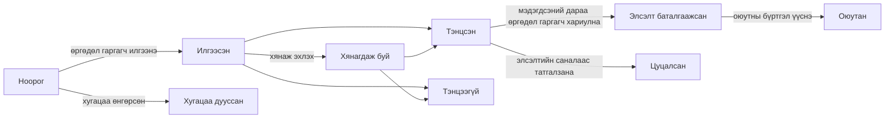

# 16. Элсэлт

Цэс: **Элсэлт > Элсэлтийн үеүүд**, **Өргөдлүүд**, **Тохиргоо > Элсэлт**

Элсэлтийг улирлаас тусад нь удирдана. Өргөдөл гаргагч хувийн и-мэйлээр бүртгэл үүсгэж, түүгээрээ өргөдөл гаргана. Элссэний дараа оюутны бүртгэл үүссэн ч ижил бүртгэлээ үргэлжлүүлэн ашиглана (оюутан, төгсөгч байхдаа болон дахин элсэх өргөдөл гаргахдаа).

Өргөдөл гаргагч оюутны бүртгэл үүсэх хүртэл хүссэн үедээ **Өргөдлөө цуцлах** боломжтой (тэнцсэн өргөдөл гаргагч элсэлтийн саналд **Татгалзах**-аар хариулна). Шийдвэр мэдэгдэхээс өмнө өргөдөл гаргагч тэнцсэн эсэхээ харахгүй бөгөөд өргөдөл **Хянагдаж буй** гэж харагдана.

| Эрх | Зөвшөөрөх зүйл |
|---|---|
| `Элсэлтийн үе, элсэлтийн тохиргоог удирдах` | Элсэлтийн үе үүсгэх, засах, Тохиргоо > Элсэлт |
| `Өргөдөл харах` | Өргөдөл, өргөдөл гаргагчийн мэдээлэл, илгээсэн баримт бичгийг харах |
| `Өргөдөл хянах, шийдвэрлэх` | Хянаж эхлэх, тэнцүүлэх/татгалзах, шийдвэр мэдэгдэх, өргөдөл гаргагчийн өмнөөс саналын хариуг бүртгэх |
| `Тэнцсэн өргөдөл гаргагчид оюутны бүртгэл үүсгэх` | Элсэлтээ баталгаажуулсан өргөдөл гаргагчид оюутны бүртгэл үүсгэх |

Өргөдлийн эрхийг бүтцийн нэгж эсвэл хөтөлбөрийн хамрах хүрээтэйгээр ч олгож болно (жишээ нь зөвхөн тухайн тэнхимийн өргөдлийг харах тэнхимийн туслах ажилтан). Элсэлт хариуцсан ажилтан үүргийн загварт дөрвөн эрх бүгд, Оюутны бүртгэл хариуцсан ажилтан загварт харах болон оюутны бүртгэл үүсгэх эрх багтана.

## Өргөдөл гаргагчийн тал

1. Өргөдөл гаргагч нэвтрэх дэлгэц дээр **Нээлттэй элсэлтийг харах**-ыг (хаяг `/admissions`) нээж, өргөдөл хүлээн авч буй үеүүдийг харан **Өргөдөл гаргахын тулд бүртгэл үүсгэх**-ээр (хаяг `/accounts/signup/`) бүртгэл үүсгэнэ. Нэр (латин үсгээр), хувийн и-мэйл, нууц үгээ оруулна.
2. Өргөдөл гаргахаасаа өмнө илгээсэн холбоосоор и-мэйлээ баталгаажуулах ёстой.
3. Порталын **Элсэлт** хэсэгт үе болон хөтөлбөрөө сонгож өргөдөл бөглөж эхэлнэ. Хувийн мэдээлэл, өмнөх сургууль, өөрийн танилцуулгаа оруулж, баримт бичгээ хавсаргаад **Өргөдөл илгээх**-ийг дарна. Илгээх үед өргөдөлд өргөдлийн дугаар (`CYCLECODE-00001`) олгогдож, баталгаажуулах и-мэйл илгээгдэнэ. Илгээсний дараа өргөдлийг өөрчлөх боломжгүй.
4. Шийдвэр мэдэгдэхэд өргөдөл гаргагч и-мэйл хүлээн авч, шийдвэрийг порталаас харна. Тэнцсэн өргөдөл гаргагч **Саналыг хүлээн авах** эсвэл **Татгалзах**-ыг сонгоно.
5. Оюутны бүртгэл үүссэний дараа порталд оюутны код харагдаж, ижил бүртгэл оюутны эрхтэй болно.

Аль хэдийн оюутны бүртгэлтэй хүмүүс (одоо суралцаж буй оюутан, төгсөгч) одоо байгаа бүртгэлээрээ нэвтэрч, ижил дэлгэцээс өргөдөл гаргана. Энэ тохиолдолд нэр, төрсөн огноо нь сургалтын албаны хадгалсан утга байх бөгөөд өргөдөлд өөрчлөх боломжгүй.

Оюутны бүртгэлтэй боловч хэрэглэгчийн бүртгэлгүй төгсөгч (жишээ нь CSV-ээр шилжүүлсэн төгсөгчид) шинэ бүртгэл үүсгэвэл хоёр хувь хүн үүснэ. Ийм тохиолдол гарвал одоо байгаа хувь хүнд [бүртгэлийн урилга](14-merge-and-invitations.md#бүртгэлийн-урилга) илгээж, тэр бүртгэлээр өргөдөл гаргуулна. Хэрэв аль хэдийн өргөдөл гаргасан бол [Давхардсан хувь хүнийг нэгтгэх](14-merge-and-invitations.md)-ээр хоёрыг нэгтгэнэ.

## Элсэлтийн үеүүд

| Талбар | Тайлбар |
|---|---|
| Код | Өргөдлийн дугаарын эхний хэсэг, жишээ нь `2027-SPRING` |
| Нэр, Тайлбар | Хэл тус бүрээр. Нийтийн элсэлтийн хуудсанд харагдана |
| Нээгдэх, Хаагдах | **Тасралтгүй (эцсийн хугацаагүй)** бол хаагдах цагийг хоосон үлдээнэ |
| Нийтэлсэн | Өргөдөл гаргагчид үеийг харахын тулд идэвхтэй байх ёстой. Бэлтгэж байх хугацаанд унтраалттай байлгана |
| Шийдвэрийг нэн даруй мэдэгдэх | Идэвхтэй бол тэнцүүлэх/татгалзах шийдвэр хадгалагдмагц өргөдөл гаргагчид мэдэгдэнэ (тасралтгүй элсэлтэд тохиромжтой). Унтраалттай бол шийдвэрүүдийг **Шийдвэрүүдийг мэдэгдэх**-ээр нэг дор мэдэгдэнэ |
| Элсэлтийн саналыг хүлээн авах хугацаа (хоног) | Тэнцсэн өргөдөл гаргагч мэдэгдсэний дараа элсэлтийн саналд хариулах хугацаа. Хугацаа өнгөрсний дараа өргөдөл гаргагч хариулах боломжгүй; ажилтан шалтгаан бичиж түүний өмнөөс хариуг бүртгэж болно |
| Элсүүлэх хөтөлбөрүүд, Суудлын тоо | Өргөдөл гаргаж болох хөтөлбөрүүд. Суудлын тоо нь лавлах зориулалттай бөгөөд илүү өргөдөл гаргагчийг тэнцүүлэхийг хориглохгүй |
| Баримт бичиг | **Өргөдлийн баримт бичгийн төрөл** кодын жагсаалтаас сонгоно. Шаардлагатай баримт бичиггүй өргөдлийг илгээх боломжгүй. Файл нь PDF, JPEG эсвэл PNG байж болно (дээд хэмжээг Тохиргоо > Элсэлт-д тохируулна) |

Солонгосын их сургуулийн профайл баримт бичгийн төрлүүд (Диплом эсвэл төгсөх тухай тодорхойлолт, Дүнгийн хуудас, Иргэний үнэмлэх эсвэл паспортын хуулбар, Хэлний шалгалтын дүн) болон элсэлтийн төрлүүдийг (Шинэ элсэлт, Шилжин элсэлт, Дахин элсэх, Гадаад оюутны элсэлт) анхдагчаар оруулна. Тэдгээрийг кодын жагсаалтын дэлгэцээс нэмэх, нэрийг нь өөрчлөх боломжтой.

## Өргөдлийг хянах, шийдвэрлэх

**Элсэлт > Өргөдлүүд** нь зөвхөн илгээсэн өргөдлүүдийг жагсаана (ноорог зөвхөн өргөдөл гаргагчид харагдана). Жагсаалтыг илгээсэн цагаар эрэмбэлнэ; **Төлөв** шүүлтүүр нь зөвхөн шийдвэр хүлээж буй өргөдлүүдийг (Илгээсэн, Хянагдаж буй) харуулна. Өргөдлийн дугаар эсвэл өргөдөл гаргагчийн нэрээр хайж, элсэлтийн үеэр шүүнэ.

1. Өргөдлийг нээж өргөдлийн агуулга, өргөдөл гаргагчийн мэдээлэл, өмнөх оюутны бүртгэл (дахин элсэх өргөдөл гаргагч) болон илгээсэн баримт бичгийг шалгана. Баримт бичгийг татахын тулд нэр дээр нь дарна.
2. Шаардлагатай бол **Хянаж эхлэх**-ээр хянагдаж буй гэж тэмдэглэнэ.
3. **Тэнцүүлэх** эсвэл **Татгалзах**-ыг дарна (татгалзахад шийдвэрийн тайлбар заавал). Шийдвэрийг мэдэгдэх хүртэл өөрчилж болно.
4. **Шийдвэр мэдэгдэх**: өргөдлийн дэлгэц дээрх товчоор (нэг өргөдөл), өргөдлийн жагсаалтаас хэд хэдийг тэмдэглээд үйлдлийн жагсаалтаас **Шийдвэрүүдийг мэдэгдэх**-ийг ажиллуулж (бөөнөөр), эсвэл элсэлтийн үеийн жагсаалтын мөрийн цэс дэх **Шийдвэрүүдийг мэдэгдэх**-ээр (элсэлтийн үеийн дэлгэцийн дээд хэсэгт ч бий) (тухайн үеийн мэдэгдээгүй бүх шийдвэр). Мэдэгдэх үед өргөдөл гаргагч и-мэйл хүлээн авах бөгөөд шийдвэрийг цаашид өөрчлөх боломжгүй.

Алхам бүр (хянаж эхлэх, шийдвэр, мэдэгдэл, саналын хариу, оюутны бүртгэл үүсгэх) үйлдлийн бүртгэлд тэмдэглэгдэнэ.

## Оюутны бүртгэл үүсгэх

Элсэлтээ баталгаажуулсан өргөдөл гаргагчдын оюутны бүртгэлийг улирал эхлэхээс өмнө үүсгэнэ.

- Нэг өргөдөл: өргөдлийн дэлгэц дээрх **Оюутны бүртгэл үүсгэх**-ээр элсэх улирлыг сонгоно.
- Хэд хэдэн: жагсаалтаас баталгаажсан өргөдлүүдийг тэмдэглээд үйлдлийн жагсаалтаас **Оюутны бүртгэл үүсгэх**-ийг ажиллуулна. Дараагийн дэлгэц элсэх улирлыг асууна. Баталгаажаагүй, аль хэдийн оюутны бүртгэлтэй эсвэл таны хамрах хүрээнээс гадуурх өргөдлийг алгасна.
- Бүтэн үе: IT ажилтан `uv run manage.py admission_matriculate`-ийг ажиллуулна ([командын лавлах](../operations/commands.md#admission_matriculate)).

Оюутны кодыг **Тохиргоо > Оюутны бүртгэл** дэх оюутны кодын загвараар шинээр олгоно; элссэн огноо нь элсэх улирлын эхний өдөр, элсэлтийн төрөл нь өргөдөл дээрх төрөл байна. Дахин элсэх тохиолдолд өмнөх оюутны бүртгэл хэвээр үлдэж, шинэ бүртгэл нэмэгдэнэ ([12-р бүлэг](12-people-and-student-records.md)). Элсэлт хариуцсан ажилтанд оюутны бүртгэл удирдах эрх байхгүй ч оюутны бүртгэл үүсгэж болно (тэнцсэн өргөдөл гаргагчид оюутны бүртгэл үүсгэх эрх хангалттай; өгөгдлийн өөрчлөлтийн бүртгэлд үүнийг хийсэн ажилтны нэр хадгалагдана).

## Тохиргоо > Элсэлт

| Талбар | Тайлбар |
|---|---|
| Өргөдөл гаргагч бүртгэл үүсгэж болно | Унтраалттай бол бүртгэл үүсгэх дэлгэц хаагдана. Онлайнаар өргөдөл хүлээн авдаггүй их сургуулиудад зориулагдсан |
| Хөндөгдөөгүй ноорогийг хүчингүй болгох хугацаа (хоног) | Энэ хугацаанд өөрчлөгдөөгүй ноорог өргөдлүүд шөнө бүр **Хугацаа дууссан** болно. Хаагдсан үеийн ноорогууд хугацаанаас үл хамааран хүчингүй болно |
| Баримтын дээд хэмжээ (MB) | Анхдагч утга 10 |

[Админы гарын авлагын агуулга](README.md)
