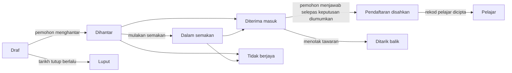

# 16. Kemasukan

Menu: **Kemasukan > Pengambilan**, **Permohonan**, **Tetapan > Kemasukan**

Kemasukan diuruskan secara berasingan daripada semester. Pemohon mencipta akaun dengan e-mel peribadi dan memohon menggunakannya; selepas diterima masuk, akaun yang sama terus digunakan setelah rekod pelajar wujud (sebagai pelajar, sebagai alumni dan untuk permohonan kemasukan semula).

Pemohon boleh **Tarik balik permohonan** pada bila-bila masa sehingga rekod pelajar dicipta (pemohon yang diterima masuk menjawab tawaran dengan **Tolak**). Sebelum keputusan diumumkan, pemohon tidak melihat sama ada mereka diterima masuk; permohonan dipaparkan sebagai **Dalam semakan**.

| Kebenaran | Apa yang dibenarkan |
|---|---|
| `Urus pengambilan dan tetapan kemasukan` | Mencipta dan menyunting pengambilan, Tetapan > Kemasukan |
| `Lihat permohonan` | Melihat permohonan, butiran pemohon dan dokumen yang dihantar |
| `Semak dan putuskan permohonan` | Memulakan semakan, terima masuk/tolak, mengumumkan keputusan, merekodkan jawapan tawaran bagi pihak pemohon |
| `Cipta rekod pelajar bagi pemohon yang diterima masuk` | Mencipta rekod pelajar bagi pemohon yang telah mengesahkan pendaftaran |

Kebenaran permohonan juga boleh ditetapkan dengan skop unit organisasi atau program (contohnya, pembantu jabatan yang hanya boleh melihat permohonan bagi jabatan tersebut). Templat peranan Pegawai Kemasukan mengandungi keempat-empat kebenaran; templat Pegawai Pendaftar mengandungi kebenaran melihat dan mencipta rekod pelajar.

## Bahagian pemohon

1. Pada skrin log masuk, pemohon membuka **Lihat pengambilan yang dibuka** (alamat `/admissions`), melihat pengambilan yang sedang menerima permohonan dan mencipta akaun dengan **Cipta akaun untuk memohon** (alamat `/accounts/signup/`). Mereka memasukkan nama (dalam huruf Rumi), e-mel peribadi dan kata laluan.
2. Mereka mesti mengesahkan e-mel melalui pautan yang dihantar kepada mereka sebelum boleh memohon.
3. Dalam portal di bawah **Kemasukan**, mereka memilih pengambilan dan program lalu memulakan permohonan. Mereka memasukkan butiran peribadi, sekolah terdahulu dan pernyataan peribadi, memuat naik dokumen dan menekan **Hantar permohonan**. Semasa penghantaran, permohonan menerima nombor permohonan (`CYCLECODE-00001`) dan e-mel pengesahan dihantar. Permohonan tidak boleh diubah selepas dihantar.
4. Apabila keputusan diumumkan, pemohon menerima e-mel dan melihat keputusan dalam portal. Pemohon yang diterima masuk memilih **Terima tawaran** atau **Tolak**.
5. Setelah rekod pelajar dicipta, portal memaparkan nombor matrik dan akaun yang sama kini mempunyai akses pelajar.

Individu yang sudah mempunyai rekod pelajar (pelajar semasa, alumni) log masuk dengan akaun sedia ada mereka dan memohon pada skrin yang sama. Dalam kes itu, nama dan tarikh lahir ialah nilai yang disimpan oleh Pejabat Pendaftar dan tidak boleh diubah dalam permohonan.

Jika alumni yang mempunyai rekod pelajar tetapi tiada akaun (contohnya alumni yang dipindahkan melalui CSV) mencipta akaun baharu, akan wujud dua individu. Apabila kes sebegini berlaku, hantarkan [jemputan akaun](14-merge-and-invitations.md#jemputan-akaun) kepada individu sedia ada supaya mereka memohon dengan akaun tersebut; jika mereka sudah memohon, gabungkan kedua-duanya dengan [Gabung individu pendua](14-merge-and-invitations.md).

## Pengambilan

| Medan | Keterangan |
|---|---|
| Kod | Bahagian pertama nombor permohonan, cth. `2027-SPRING` |
| Nama, Keterangan | Mengikut bahasa. Dipaparkan pada halaman kemasukan awam |
| Dibuka, Ditutup | Biarkan masa tutup kosong untuk **Berterusan (tiada tarikh tutup)** |
| Diterbitkan | Mesti hidup supaya pemohon dapat melihat pengambilan. Biarkan mati semasa membuat persediaan |
| Umumkan keputusan serta-merta | Apabila hidup, pemohon dimaklumkan sebaik sahaja keputusan terima masuk/tolak disimpan (sesuai untuk kemasukan berterusan). Apabila mati, keputusan diumumkan serentak dengan **Umumkan keputusan** |
| Hari untuk menerima tawaran | Tempoh yang diberikan kepada pemohon yang diterima masuk selepas keputusan diumumkan untuk menjawab tawaran. Selepas tarikh akhir, pemohon tidak lagi boleh menjawab; kakitangan boleh merekodkan jawapan bagi pihak mereka dengan menyatakan sebab |
| Program ditawarkan, Kapasiti | Program yang boleh dipohon. Kapasiti adalah untuk rujukan dan tidak menghalang penerimaan masuk pemohon tambahan |
| Dokumen | Dipilih daripada senarai data kod **Jenis dokumen permohonan**. Permohonan tanpa dokumen yang diwajibkan tidak boleh dihantar. Fail boleh dalam format PDF, JPEG atau PNG (saiz maksimum di bawah Tetapan > Kemasukan) |

Profil universiti Korea menyemai jenis dokumen (sijil tamat atau jangkaan tamat pengajian, transkrip, salinan kad pengenalan atau pasport, skor ujian bahasa) dan jenis kemasukan (kemasukan baharu, kemasukan pindahan, kemasukan semula, kemasukan khas untuk pelajar antarabangsa). Ia boleh ditambah atau dinamakan semula pada skrin data kod.

## Menyemak dan memutuskan permohonan

**Kemasukan > Permohonan** menyenaraikan permohonan yang telah dihantar sahaja (draf hanya boleh dilihat oleh pemohon). Senarai disusun mengikut masa penghantaran; penapis **Status** memaparkan hanya permohonan yang menunggu keputusan (Dihantar, Dalam semakan). Cari mengikut nombor permohonan atau nama pemohon, dan tapis mengikut pengambilan.

1. Buka permohonan dan semak kandungan permohonan, butiran pemohon, rekod pelajar terdahulu (pemohon kemasukan semula) dan dokumen yang dihantar. Klik nama dokumen untuk memuat turunnya.
2. Jika perlu, tandakannya sebagai dalam semakan dengan **Mulakan semakan**.
3. Klik **Terima masuk** atau **Tolak** (catatan keputusan diwajibkan bagi penolakan). Keputusan boleh diubah sehingga ia diumumkan.
4. **Umumkan keputusan**: daripada butang pada skrin permohonan (satu permohonan), daripada senarai permohonan dengan menandakan beberapa permohonan dan menjalankan **Umumkan keputusan** daripada senarai tindakan (pukal), atau dengan **Umumkan keputusan** dalam menu baris senarai pengambilan (juga di bahagian atas skrin pengambilan) (setiap keputusan yang belum diumumkan dalam pengambilan itu). Semasa pengumuman, pemohon menerima e-mel dan keputusan tidak lagi boleh diubah.

Setiap langkah (mulakan semakan, keputusan, pengumuman, jawapan tawaran, penciptaan rekod pelajar) direkodkan dalam log aktiviti.

## Mencipta rekod pelajar

Rekod pelajar bagi pemohon yang telah mengesahkan pendaftaran dicipta sebelum semester bermula.

- Satu permohonan: **Cipta rekod pelajar** pada skrin permohonan, dengan memilih semester kemasukan.
- Beberapa permohonan: tandakan permohonan yang telah disahkan dalam senarai dan jalankan **Cipta rekod pelajar** daripada senarai tindakan. Skrin seterusnya meminta semester kemasukan. Permohonan yang belum disahkan, sudah mempunyai rekod pelajar atau berada di luar skop anda akan dilangkau.
- Seluruh pengambilan: pengendali IT menjalankan `uv run manage.py admission_matriculate` ([rujukan arahan](../operations/commands.md#admission_matriculate)).

Nombor matrik diberikan secara baharu mengikut corak nombor matrik dalam **Tetapan > Rekod pelajar**, tarikh kemasukan ialah hari pertama semester kemasukan, dan jenis kemasukan ialah jenis daripada permohonan. Bagi kemasukan semula, rekod pelajar terdahulu kekal seperti sedia ada dan rekod baharu ditambah ([bab 12](12-people-and-student-records.md)). Rekod pelajar boleh dicipta walaupun pegawai kemasukan tiada kebenaran untuk mengurus rekod pelajar (kebenaran mencipta rekod pelajar bagi pemohon yang diterima masuk sudah memadai; rekod perubahan data menyimpan nama kakitangan yang melakukannya).

## Tetapan > Kemasukan

| Medan | Keterangan |
|---|---|
| Pemohon boleh mencipta akaun | Apabila mati, skrin penciptaan akaun ditutup. Untuk universiti yang tidak menerima permohonan dalam talian |
| Luputkan draf yang tidak disentuh selepas (hari) | Draf permohonan yang tidak diubah dalam tempoh ini menjadi **Luput** setiap malam. Draf dalam pengambilan yang telah ditutup luput tanpa mengira tempoh |
| Saiz dokumen maksimum (MB) | Lalai 10 |

[Kandungan manual pentadbir](README.md)
