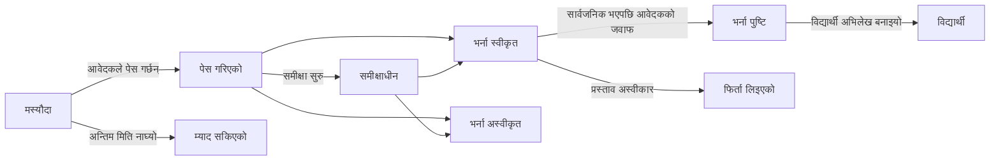

# 16. भर्ना

मेनु: **भर्ना > भर्ना चरणहरू**, **आवेदनहरू**, **सेटिङ > भर्ना**

भर्ना सेमेस्टरभन्दा अलग व्यवस्थापन गरिन्छ। आवेदकले व्यक्तिगत इमेलले खाता बनाएर त्यसैबाट आवेदन दिन्छन्; भर्नापछि विद्यार्थी अभिलेख बनेपछि पनि त्यही खाता प्रयोगमा रहन्छ (विद्यार्थी, पूर्वविद्यार्थी र पुनर्भर्ना आवेदनका लागि)।

विद्यार्थी अभिलेख नबनेसम्म आवेदकले जुनसुकै बेला **आवेदन फिर्ता लिनुहोस्** गर्न सक्छन् (भर्ना स्वीकृत आवेदकले प्रस्तावको जवाफ **अस्वीकार गर्नुहोस्** बाट दिन्छन्)। निर्णय सार्वजनिक नहुँदासम्म आवेदकले आफू भर्ना भए कि भएनन् देख्दैनन्; आवेदन **समीक्षाधीन** का रूपमा देखिन्छ।

| अनुमति | के गर्न दिन्छ |
|---|---|
| `भर्ना चरण र भर्ना सेटिङ व्यवस्थापन गर्ने` | भर्ना चरण बनाउने र सम्पादन गर्ने, सेटिङ > भर्ना |
| `आवेदन हेर्ने` | आवेदन, आवेदकको विवरण र पेस गरिएका कागजात हेर्ने |
| `आवेदनको समीक्षा र निर्णय गर्ने` | समीक्षा सुरु गर्ने, भर्ना स्वीकृत/अस्वीकार गर्ने, निर्णय सार्वजनिक गर्ने, आवेदकको तर्फबाट प्रस्तावको जवाफ अभिलेख गर्ने |
| `भर्ना स्वीकृत आवेदकका विद्यार्थी अभिलेख बनाउने` | भर्ना पुष्टि गरेका आवेदकका विद्यार्थी अभिलेख बनाउने |

आवेदनसम्बन्धी अनुमतिहरू संगठन एकाइ वा कार्यक्रमको दायरासहित पनि तोक्न सकिन्छ (उदाहरणका लागि, आफ्नो विभागका आवेदन मात्र हेर्न पाउने विभागीय सहायक)। भर्ना अधिकृत भूमिका टेम्प्लेटमा चारवटै अनुमति हुन्छन्; रजिस्ट्रार टेम्प्लेटमा हेर्ने र विद्यार्थी अभिलेख बनाउने अनुमति हुन्छन्।

## आवेदकको पक्ष

1. आवेदकले साइन इन स्क्रिनमा **खुला भर्ना हेर्नुहोस्** (ठेगाना `/admissions`) खोलेर आवेदन लिइरहेका चरणहरू हेर्छन् र **आवेदन दिन खाता बनाउनुहोस्** (ठेगाना `/accounts/signup/`) बाट खाता बनाउँछन्। उनीहरूले आफ्नो नाम (ल्याटिन अक्षरमा), व्यक्तिगत इमेल र पासवर्ड प्रविष्ट गर्छन्।
2. आवेदन दिनुअघि उनीहरूले पठाइएको लिङ्कबाट इमेल प्रमाणित गर्नुपर्छ।
3. पोर्टलको **भर्ना** मा चरण र कार्यक्रम छानेर आवेदन सुरु गर्छन्। व्यक्तिगत विवरण, अघिल्लो विद्यालय र व्यक्तिगत विवरणपत्र प्रविष्ट गरी कागजात अपलोड गर्छन् र **आवेदन पेस गर्नुहोस्** थिच्छन्। पेस गर्दा आवेदनले आवेदन नम्बर (`CYCLECODE-00001`) पाउँछ र पुष्टि इमेल पठाइन्छ। पेस गरेपछि आवेदन परिवर्तन गर्न सकिँदैन।
4. निर्णय सार्वजनिक हुँदा आवेदकले इमेल पाउँछन् र पोर्टलमा निर्णय देख्छन्। भर्ना स्वीकृत आवेदकले **प्रस्ताव स्वीकार गर्नुहोस्** वा **अस्वीकार गर्नुहोस्** छान्छन्।
5. विद्यार्थी अभिलेख बनेपछि पोर्टलमा विद्यार्थी नम्बर देखिन्छ र त्यही खातामा अब विद्यार्थीको पहुँच हुन्छ।

पहिले नै विद्यार्थी अभिलेख भएका व्यक्ति (हालका विद्यार्थी, पूर्वविद्यार्थी) आफ्नो भइरहेको खाताले साइन इन गरी त्यही स्क्रिनमा आवेदन दिन्छन्। यस अवस्थामा नाम र जन्म मिति रजिस्ट्रारले राखेका मानहरू हुन् र आवेदनमा परिवर्तन गर्न सकिँदैन।

विद्यार्थी अभिलेख भएका तर खाता नभएका पूर्वविद्यार्थी (उदाहरणका लागि CSV बाट सारिएका पूर्वविद्यार्थी) ले नयाँ खाता बनाएमा दुईजना व्यक्ति बन्छन्। यस्तो अवस्था आएमा भइरहेको व्यक्तिलाई [खाता निमन्त्रणा](14-merge-and-invitations.md#खाता-निमन्त्रणा) पठाउनुहोस् ताकि उनी त्यही खाताबाट आवेदन दिऊन्; पहिले नै आवेदन दिइसकेका छन् भने [दोहोरो व्यक्ति गाभ्ने](14-merge-and-invitations.md) बाट दुवैलाई एक गर्नुहोस्।

## भर्ना चरणहरू

| फिल्ड | विवरण |
|---|---|
| कोड | आवेदन नम्बरको पहिलो भाग, जस्तै `2027-SPRING` |
| नाम, विवरण | भाषाअनुसार। सार्वजनिक भर्ना पृष्ठमा देखिन्छ |
| खुल्ने, बन्द हुने | **निरन्तर (अन्तिम मिति छैन)** का लागि बन्द हुने समय खाली छोड्नुहोस् |
| प्रकाशित | आवेदकले चरण देख्न यो सक्रिय हुनुपर्छ। तयारी गर्दा बन्द राख्नुहोस् |
| निर्णय तुरुन्तै सार्वजनिक गर्नुहोस् | सक्रिय हुँदा भर्ना स्वीकृत/अस्वीकार निर्णय सुरक्षित हुनेबित्तिकै आवेदकलाई जानकारी दिइन्छ (निरन्तर भर्नाका लागि उपयुक्त)। बन्द हुँदा निर्णयहरू **निर्णयहरू सार्वजनिक गर्नुहोस्** बाट एकसाथ सार्वजनिक गरिन्छन् |
| प्रस्ताव स्वीकार गर्ने दिन | सार्वजनिक भएपछि भर्ना स्वीकृत आवेदकले प्रस्तावको जवाफ दिन पाउने अवधि। अन्तिम मितिपछि आवेदकले जवाफ दिन सक्दैनन्; कर्मचारीले कारणसहित उनको तर्फबाट जवाफ अभिलेख गर्न सक्छन् |
| उपलब्ध कार्यक्रमहरू, क्षमता | आवेदन दिन सकिने कार्यक्रमहरू। क्षमता सन्दर्भका लागि मात्र हो र बढी आवेदकलाई भर्ना स्वीकृत गर्न रोक्दैन |
| कागजातहरू | कोड डेटा सूची **आवेदन कागजातको प्रकार** बाट छानिन्छ। आवश्यक कागजात नभएको आवेदन पेस गर्न सकिँदैन। फाइलहरू PDF, JPEG वा PNG हुन सक्छन् (अधिकतम आकार सेटिङ > भर्ना मा) |

कोरियाली विश्वविद्यालय प्रोफाइलले कागजातका प्रकार (उत्तीर्ण प्रमाणपत्र वा उत्तीर्ण हुने सम्भावित प्रमाणपत्र, ट्रान्सक्रिप्ट, परिचयपत्र वा राहदानीको प्रतिलिपि, भाषा परीक्षाको अङ्क) र भर्नाका प्रकार (नयाँ भर्ना, स्थानान्तरण भर्ना, पुनर्भर्ना, अन्तर्राष्ट्रिय विद्यार्थी भर्ना) सिड गर्छ। कोड डेटा स्क्रिनमा यिनलाई थप्न वा पुनः नामकरण गर्न सकिन्छ।

## आवेदनको समीक्षा र निर्णय

**भर्ना > आवेदनहरू** ले पेस गरिएका आवेदन मात्र देखाउँछ (मस्यौदा आवेदक आफैँले मात्र देख्छन्)। सूची पेस गरिएको समयअनुसार क्रमबद्ध हुन्छ; **स्थिति** फिल्टरले निर्णय पर्खिरहेका आवेदन (पेस गरिएको, समीक्षाधीन) मात्र देखाउँछ। आवेदन नम्बर वा आवेदकको नामले खोज्नुहोस्, र चरणअनुसार फिल्टर गर्नुहोस्।

1. आवेदन खोलेर आवेदनको विषयवस्तु, आवेदकको विवरण, अघिल्ला विद्यार्थी अभिलेख (पुनर्भर्ना आवेदक) र पेस गरिएका कागजात जाँच गर्नुहोस्। कागजात डाउनलोड गर्न त्यसको नाममा क्लिक गर्नुहोस्।
2. आवश्यक भए **समीक्षा सुरु गर्नुहोस्** बाट समीक्षाधीन चिन्ह लगाउनुहोस्।
3. **भर्ना स्वीकृत** वा **अस्वीकार** क्लिक गर्नुहोस् (अस्वीकारका लागि निर्णय टिप्पणी आवश्यक)। सार्वजनिक नहुँदासम्म निर्णय परिवर्तन गर्न सकिन्छ।
4. **निर्णय सार्वजनिक गर्नुहोस्**: आवेदन स्क्रिनको बटनबाट (एउटा आवेदन), आवेदन सूचीमा धेरैमा चिनो लगाएर कार्य सूचीबाट **निर्णयहरू सार्वजनिक गर्नुहोस्** चलाएर (थोक), वा भर्ना चरण सूचीको पङ्क्ति मेनुको **निर्णयहरू सार्वजनिक गर्नुहोस्** बाट (चरण स्क्रिनको माथि पनि छ) (त्यस चरणका सार्वजनिक नभएका सबै निर्णय)। सार्वजनिक हुँदा आवेदकले इमेल पाउँछन् र निर्णय फेरि परिवर्तन गर्न सकिँदैन।

हरेक चरण (समीक्षा सुरु, निर्णय, सार्वजनिक, प्रस्तावको जवाफ, विद्यार्थी अभिलेख बनाउने) गतिविधि लगमा अभिलेख हुन्छ।

## विद्यार्थी अभिलेख बनाउने

भर्ना पुष्टि गरेका आवेदकका विद्यार्थी अभिलेख सेमेस्टर सुरु हुनुअघि बनाइन्छ।

- एउटा आवेदन: आवेदन स्क्रिनमा **विद्यार्थी अभिलेख बनाउनुहोस्**, भर्ना सेमेस्टर छानेर।
- धेरै: सूचीमा पुष्टि भएका आवेदनमा चिनो लगाएर कार्य सूचीबाट **विद्यार्थी अभिलेख बनाउनुहोस्** चलाउनुहोस्। अर्को स्क्रिनले भर्ना सेमेस्टर सोध्छ। पुष्टि नभएका, पहिले नै विद्यार्थी अभिलेख भएका वा तपाईंको दायराबाहिरका आवेदनहरू छोडिन्छन्।
- पूरै चरण: IT सञ्चालकले `uv run manage.py admission_matriculate` चलाउँछन् ([कमान्ड सन्दर्भ](../operations/commands.md#admission_matriculate))।

विद्यार्थी नम्बर **सेटिङ > विद्यार्थी अभिलेख** को विद्यार्थी नम्बरको ढाँचाअनुसार नयाँ दिइन्छ, भर्ना मिति भर्ना सेमेस्टरको पहिलो दिन हुन्छ, र भर्नाको प्रकार आवेदनकै हुन्छ। पुनर्भर्नामा अघिल्लो विद्यार्थी अभिलेख जस्ताको तस्तै रहन्छ र नयाँ थपिन्छ ([अध्याय 12](12-people-and-student-records.md))। भर्ना अधिकृतसँग विद्यार्थी अभिलेख व्यवस्थापन गर्ने अनुमति नभए पनि विद्यार्थी अभिलेख बनाउन सकिन्छ (भर्ना स्वीकृत आवेदकका विद्यार्थी अभिलेख बनाउने अनुमति पर्याप्त छ; डेटा परिवर्तन अभिलेखमा यो काम गर्ने कर्मचारीको नाम रहन्छ)।

## सेटिङ > भर्ना

| फिल्ड | विवरण |
|---|---|
| आवेदकले खाता बनाउन सक्छन् | बन्द हुँदा खाता बनाउने स्क्रिन बन्द हुन्छ। अनलाइन आवेदन नलिने विश्वविद्यालयका लागि |
| नछोइएका मस्यौदा यति दिनपछि म्याद सकिन्छ | यस अवधिभित्र परिवर्तन नगरिएका मस्यौदा आवेदन हरेक रात **म्याद सकिएको** हुन्छन्। बन्द भएका चरणका मस्यौदाको म्याद अवधि जे भए पनि सकिन्छ |
| सबैभन्दा ठूलो कागजात (MB) | पूर्वनिर्धारित 10 |

[प्रशासक पुस्तिकाको विषयसूची](README.md)
