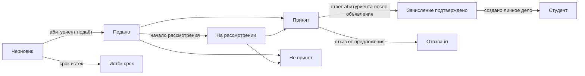

# 16. Приём

Меню: **Приём > Приёмные кампании**, **Заявления**, **Настройки > Приём**

Приём ведётся отдельно от семестров. Абитуриент создаёт учётную запись с личной эл. почтой и подаёт заявление через неё; после зачисления, когда создано личное дело студента, используется та же учётная запись (как студентом, так и выпускником, а также для заявления на восстановление).

Абитуриент может нажать **Отозвать заявление** в любой момент до создания личного дела студента (принятый абитуриент отвечает на предложение кнопкой **Отказаться**). До объявления решения абитуриент не видит, принят ли он; заявление отображается как **На рассмотрении**.

| Разрешение | Что позволяет |
|---|---|
| `Управлять приёмными кампаниями и настройками приёма` | Создание и редактирование приёмных кампаний, Настройки > Приём |
| `Просматривать заявления` | Просмотр заявлений, сведений об абитуриенте и поданных документов |
| `Рассматривать заявления и принимать решения` | Начало рассмотрения, решение о приёме или отказе, объявление решений, запись ответа на предложение за абитуриента |
| `Создавать личные дела для принятых абитуриентов` | Создание личных дел студентов для абитуриентов, подтвердивших зачисление |

Разрешения на работу с заявлениями можно назначать и с областью действия «подразделение» или «программа» (например, методист кафедры, которому разрешено просматривать только заявления на эту кафедру). Шаблон роли «Сотрудник приёмной комиссии» содержит все четыре разрешения; шаблон «Сотрудник учебного отдела (Registrar)» — просмотр и создание личных дел студентов.

## Со стороны абитуриента

1. На экране входа абитуриент открывает **Открытые приёмные кампании** (адрес `/admissions`), видит кампании, в которых идёт приём заявлений, и создаёт учётную запись кнопкой **Создать учётную запись для подачи заявления** (адрес `/accounts/signup/`). Он вводит имя (латинскими буквами), личную эл. почту и пароль.
2. Прежде чем подать заявление, он должен подтвердить эл. почту по присланной ссылке.
3. На портале в разделе **Приём** он выбирает кампанию и программу и начинает заявление. Он вводит личные данные, сведения о предыдущем учебном заведении и мотивационное письмо, загружает документы и нажимает **Подать заявление**. При подаче заявлению присваивается номер (`CYCLECODE-00001`) и отправляется письмо с подтверждением. После подачи заявление изменить нельзя.
4. Когда решение объявлено, абитуриент получает письмо и видит решение на портале. Принятые абитуриенты выбирают **Принять предложение** или **Отказаться**.
5. После создания личного дела студента портал показывает студенческий номер, и та же учётная запись получает доступ студента.

Те, у кого уже есть личное дело студента (обучающиеся студенты, выпускники), входят под своей учётной записью и подают заявление на том же экране. В этом случае ФИО и дата рождения берутся из данных учебного отдела и в заявлении не изменяются.

Если выпускник, у которого есть личное дело студента, но нет учётной записи (например, выпускники, перенесённые из CSV), создаст новую учётную запись, появятся два лица. В таком случае отправьте существующему лицу [приглашение в учётную запись](14-merge-and-invitations.md#приглашения-создать-учётную-запись), чтобы оно подало заявление через эту учётную запись; если заявление уже подано, объедините двух лиц с помощью [объединения дубликатов лиц](14-merge-and-invitations.md).

## Приёмные кампании

| Поле | Описание |
|---|---|
| Код | Первая часть номера заявления, например `2027-SPRING` |
| Название, Описание | Для каждого языка. Показываются на общедоступной странице приёма |
| Начало приёма, Окончание приёма | Оставьте время окончания пустым для режима **Непрерывный приём (без срока)** |
| Опубликована | Должно быть включено, чтобы абитуриенты видели кампанию. На время подготовки оставляйте выключенным |
| Объявлять решения сразу | Если включено, абитуриент узнаёт о решении о приёме или отказе сразу после его сохранения (подходит для непрерывного приёма). Если выключено, решения объявляются вместе кнопкой **Объявить решения** |
| Дней на принятие предложения | Сколько времени после объявления есть у принятых абитуриентов, чтобы ответить на предложение. После этого срока абитуриент ответить уже не может; сотрудник может записать ответ за него, указав причину |
| Предлагаемые программы, Число мест | Программы, на которые можно подать заявление. Число мест носит справочный характер и не мешает принять больше абитуриентов |
| Документы | Выбираются из справочника **Документ для заявления**. Заявление без обязательных документов подать нельзя. Допустимы файлы PDF, JPEG или PNG (максимальный размер задаётся в Настройки > Приём) |

Профиль корейского университета заполняет виды документов (документ об образовании или справка о предстоящем окончании, академическая справка, копия удостоверения личности или паспорта, результат языкового теста) и виды поступления (поступление на первый курс, поступление в порядке перевода, восстановление, приём иностранных граждан). Их можно добавлять и переименовывать на экране справочников.

## Рассмотрение заявлений и принятие решений

В разделе **Приём > Заявления** перечислены только поданные заявления (черновики видит только сам абитуриент). Список упорядочен по времени подачи; фильтр **Статус** показывает только заявления, ожидающие решения (Подано, На рассмотрении). Ищите по номеру заявления или имени абитуриента и фильтруйте по кампании.

1. Откройте заявление и проверьте его содержание, сведения об абитуриенте, прежние личные дела студента (у абитуриентов на восстановление) и поданные документы. Щёлкните название документа, чтобы скачать его.
2. При необходимости отметьте заявление как рассматриваемое кнопкой **Начать рассмотрение**.
3. Нажмите **Принять** или **Отказать** (при отказе обязателен комментарий к решению). Решение можно менять, пока оно не объявлено.
4. **Объявить решение**: кнопкой на экране заявления (одно заявление), из списка заявлений, отметив несколько и выполнив **Объявить решения** из списка действий (массово), или пунктом **Объявить решения** в меню строки списка приёмных кампаний (также в верхней части экрана кампании) (все необъявленные решения этой кампании). При объявлении абитуриент получает письмо, и решение больше нельзя изменить.

Каждый шаг (начало рассмотрения, решение, объявление, ответ на предложение, создание личного дела студента) записывается в журнал действий.

## Создание личных дел студентов

Личные дела студентов для абитуриентов, подтвердивших зачисление, создаются до начала семестра.

- Одно заявление: **Создать личное дело** на экране заявления с выбором семестра поступления.
- Несколько: отметьте в списке подтверждённые заявления и выполните **Создать личное дело** из списка действий. На следующем экране запрашивается семестр поступления. Неподтверждённые заявления, заявления с уже созданным личным делом студента и заявления вне вашей области доступа пропускаются.
- Вся кампания: ИТ-оператор выполняет `uv run manage.py admission_matriculate` ([справочник команд](../operations/commands.md#admission_matriculate)).

Студенческий номер присваивается заново по шаблону студенческого номера в разделе **Настройки > Личные дела студентов**, датой поступления становится первый день семестра поступления, а видом поступления — вид, указанный в заявлении. При восстановлении прежнее личное дело студента остаётся без изменений, а добавляется новое ([глава 12](12-people-and-student-records.md)). Личные дела студентов можно создавать, даже если у сотрудника приёмной комиссии нет разрешения на управление личными делами (достаточно разрешения на создание личных дел для принятых абитуриентов; в истории изменений данных сохраняется имя сотрудника, выполнившего действие).

## Настройки > Приём

| Поле | Описание |
|---|---|
| Абитуриенты могут создавать учётную запись | Если выключено, экран создания учётной записи закрыт. Для вузов, которые не принимают заявления онлайн |
| Аннулировать неизменяемые черновики через (дней) | Черновики заявлений, не изменявшиеся в течение этого срока, каждую ночь переходят в статус **Истёк срок**. Черновики в закрытых кампаниях аннулируются независимо от срока |
| Максимальный размер документа (МБ) | По умолчанию 10 |

[Содержание руководства администратора](README.md)
