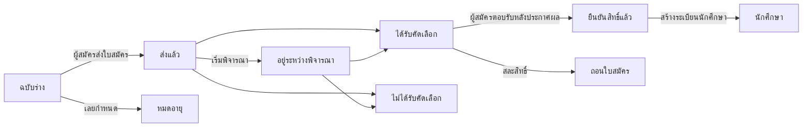

# 16. การรับสมัคร

เมนู: **การรับสมัคร > รอบรับสมัคร**, **ใบสมัคร**, **การตั้งค่า > การรับสมัคร**

การรับสมัครจัดการแยกจากภาคการศึกษา ผู้สมัครสร้างบัญชีด้วยอีเมลส่วนตัวแล้วใช้บัญชีนั้นสมัคร หลังได้รับเข้าศึกษาและมีระเบียนนักศึกษาแล้ว ก็ยังใช้บัญชีเดิมต่อไป (ในฐานะนักศึกษา ศิษย์เก่า และสำหรับการสมัครคืนสภาพนักศึกษา)

ผู้สมัครสามารถ **ถอนใบสมัคร** ได้ทุกเมื่อจนกว่าจะมีการสร้างระเบียนนักศึกษา (ผู้สมัครที่ได้รับคัดเลือกตอบการแจ้งผลด้วย **สละสิทธิ์**) ก่อนประกาศผล ผู้สมัครจะไม่เห็นว่าได้รับคัดเลือกหรือไม่ ใบสมัครจะแสดงสถานะเป็น **อยู่ระหว่างพิจารณา**

| สิทธิ์ | สิ่งที่ทำได้ |
|---|---|
| `จัดการรอบรับสมัครและการตั้งค่าการรับสมัคร` | สร้างและแก้ไขรอบรับสมัคร, การตั้งค่า > การรับสมัคร |
| `ดูใบสมัคร` | ดูใบสมัคร ข้อมูลผู้สมัคร และเอกสารที่ส่ง |
| `พิจารณาและตัดสินใบสมัคร` | เริ่มพิจารณา รับเข้าศึกษา/ไม่รับเข้าศึกษา ประกาศผล บันทึกการตอบรับแทนผู้สมัคร |
| `สร้างระเบียนนักศึกษาให้ผู้ได้รับคัดเลือก` | สร้างระเบียนนักศึกษาให้ผู้สมัครที่ยืนยันสิทธิ์แล้ว |

สิทธิ์เกี่ยวกับใบสมัครสามารถกำหนดพร้อมขอบเขตเป็นหน่วยงานหรือหลักสูตรได้ด้วย (เช่น เจ้าหน้าที่ภาควิชาที่ดูได้เฉพาะใบสมัครของภาควิชาตนเอง) แม่แบบบทบาทเจ้าหน้าที่รับสมัครมีสิทธิ์ทั้งสี่รายการ ส่วนแม่แบบเจ้าหน้าที่ทะเบียนมีสิทธิ์ดูใบสมัครและสร้างระเบียนนักศึกษา

## ฝั่งผู้สมัคร

1. ที่หน้าจอเข้าสู่ระบบ ผู้สมัครเปิด **ดูรอบที่เปิดรับสมัคร** (ที่อยู่ `/admissions`) เพื่อดูรอบที่กำลังรับสมัคร แล้วสร้างบัญชีด้วย **สร้างบัญชีเพื่อสมัคร** (ที่อยู่ `/accounts/signup/`) โดยกรอกชื่อ (เป็นอักษรละติน) อีเมลส่วนตัว และรหัสผ่าน
2. ผู้สมัครต้องยืนยันอีเมลผ่านลิงก์ที่ส่งไปให้ก่อนจึงจะสมัครได้
3. ในพอร์ทัลที่ **การรับสมัคร** ผู้สมัครเลือกรอบรับสมัครและหลักสูตรแล้วเริ่มกรอกใบสมัคร โดยกรอกข้อมูลส่วนตัว สถานศึกษาเดิม และเรียงความแนะนำตนเอง อัปโหลดเอกสาร แล้วกด **ส่งใบสมัคร** เมื่อส่งแล้ว ใบสมัครจะได้รับเลขที่ใบสมัคร (`CYCLECODE-00001`) และระบบจะส่งอีเมลยืนยัน ใบสมัครไม่สามารถแก้ไขได้หลังจากส่งแล้ว
4. เมื่อประกาศผล ผู้สมัครจะได้รับอีเมลและเห็นผลการพิจารณาในพอร์ทัล ผู้ที่ได้รับคัดเลือกเลือก **ยืนยันสิทธิ์** หรือ **สละสิทธิ์**
5. เมื่อสร้างระเบียนนักศึกษาแล้ว พอร์ทัลจะแสดงรหัสนักศึกษา และบัญชีเดิมจะมีสิทธิ์เข้าถึงในฐานะนักศึกษา

ผู้ที่มีระเบียนนักศึกษาอยู่แล้ว (นักศึกษาปัจจุบัน ศิษย์เก่า) เข้าสู่ระบบด้วยบัญชีเดิมและสมัครที่หน้าจอเดียวกัน ในกรณีนี้ ชื่อและวันเกิดจะเป็นค่าที่สำนักทะเบียนจัดเก็บไว้และไม่สามารถแก้ไขในใบสมัครได้

หากศิษย์เก่าที่มีระเบียนนักศึกษาแต่ไม่มีบัญชี (เช่น ศิษย์เก่าที่นำเข้าด้วย CSV) สร้างบัญชีใหม่ จะเกิดบุคคลซ้ำสองราย เมื่อพบกรณีเช่นนี้ ให้ส่ง[คำเชิญเข้าใช้บัญชี](14-merge-and-invitations.md#การเชิญให้สร้างบัญชี)ไปยังบุคคลเดิมเพื่อให้สมัครด้วยบัญชีนั้น หากสมัครไปแล้ว ให้รวมทั้งสองรายด้วย[การรวมบุคคลที่ซ้ำกัน](14-merge-and-invitations.md)

## รอบรับสมัคร

| ช่อง | คำอธิบาย |
|---|---|
| รหัส | ส่วนแรกของเลขที่ใบสมัคร เช่น `2027-SPRING` |
| ชื่อ, คำอธิบาย | แยกตามภาษา แสดงในหน้าการรับสมัครสาธารณะ |
| เปิดรับ, ปิดรับ | เว้นเวลาปิดรับว่างไว้สำหรับ **รับต่อเนื่อง (ไม่มีกำหนดปิด)** |
| เผยแพร่แล้ว | ต้องเปิดไว้ผู้สมัครจึงจะเห็นรอบรับสมัคร ปิดไว้ระหว่างเตรียมการ |
| ประกาศผลทันที | เมื่อเปิด ผู้สมัครจะได้รับแจ้งทันทีที่บันทึกผลรับเข้าศึกษา/ไม่รับเข้าศึกษา (เหมาะกับการรับสมัครแบบต่อเนื่อง) เมื่อปิด ผลจะประกาศพร้อมกันด้วย **ประกาศผลทั้งหมด** |
| จำนวนวันสำหรับยืนยันสิทธิ์ | ระยะเวลาที่ผู้ได้รับคัดเลือกมีสำหรับตอบรับหลังประกาศผล เมื่อพ้นกำหนด ผู้สมัครจะตอบรับไม่ได้อีก เจ้าหน้าที่สามารถบันทึกการตอบรับแทนพร้อมระบุเหตุผลได้ |
| หลักสูตรที่เปิดรับ, จำนวนรับ | หลักสูตรที่สมัครได้ จำนวนรับใช้เพื่ออ้างอิงเท่านั้น และไม่ได้ป้องกันการรับเกินจำนวน |
| เอกสาร | เลือกจากรายการข้อมูลรหัส **ประเภทเอกสารประกอบการสมัคร** ใบสมัครที่ไม่มีเอกสารที่จำเป็นจะส่งไม่ได้ ไฟล์อาจเป็น PDF, JPEG หรือ PNG (ขนาดสูงสุดกำหนดที่ การตั้งค่า > การรับสมัคร) |

โปรไฟล์มหาวิทยาลัยเกาหลีสร้างประเภทเอกสาร (สำเนาปริญญาบัตรหรือหนังสือรับรองว่าจะสำเร็จการศึกษา ใบแสดงผลการเรียน สำเนาบัตรประจำตัวประชาชนหรือหนังสือเดินทาง ผลสอบวัดระดับภาษา) และประเภทการรับเข้าศึกษา (รับเข้าศึกษาใหม่ รับโอนเข้าศึกษา คืนสภาพนักศึกษา รับนักศึกษาต่างชาติ) ไว้ให้ สามารถเพิ่มหรือเปลี่ยนชื่อได้ที่หน้าจอข้อมูลรหัส

## การพิจารณาและตัดสินใบสมัคร

**การรับสมัคร > ใบสมัคร** แสดงเฉพาะใบสมัครที่ส่งแล้ว (ฉบับร่างมองเห็นได้เฉพาะผู้สมัคร) รายการเรียงตามเวลาที่ส่ง ตัวกรอง **สถานะ** ใช้แสดงเฉพาะใบสมัครที่รอการตัดสิน (ส่งแล้ว, อยู่ระหว่างพิจารณา) ค้นหาด้วยเลขที่ใบสมัครหรือชื่อผู้สมัคร และกรองตามรอบรับสมัครได้

1. เปิดใบสมัครแล้วตรวจสอบเนื้อหาใบสมัคร ข้อมูลผู้สมัคร ระเบียนนักศึกษาเดิม (ผู้สมัครคืนสภาพนักศึกษา) และเอกสารที่ส่ง คลิกชื่อเอกสารเพื่อดาวน์โหลด
2. หากจำเป็น ให้ทำเครื่องหมายว่าอยู่ระหว่างพิจารณาด้วย **เริ่มพิจารณา**
3. คลิก **รับเข้าศึกษา** หรือ **ไม่รับเข้าศึกษา** (กรณีไม่รับเข้าศึกษาต้องระบุหมายเหตุการพิจารณา) ผลการพิจารณาแก้ไขได้จนกว่าจะประกาศผล
4. **ประกาศผล**: จากปุ่มในหน้าจอใบสมัคร (ใบสมัครเดียว) จากรายการใบสมัครโดยทำเครื่องหมายหลายรายการแล้วเรียกใช้ **ประกาศผลทั้งหมด** จากรายการการดำเนินการ (ครั้งละหลายรายการ) หรือด้วย **ประกาศผลทั้งหมด** ในเมนูแถวของรายการรอบรับสมัคร (มีที่ด้านบนของหน้าจอรอบรับสมัครด้วย) (ผลทั้งหมดที่ยังไม่ประกาศในรอบนั้น) เมื่อประกาศผล ผู้สมัครจะได้รับอีเมล และผลการพิจารณาจะแก้ไขไม่ได้อีก

ทุกขั้นตอน (เริ่มพิจารณา การตัดสิน การประกาศผล การตอบรับ การสร้างระเบียนนักศึกษา) จะถูกบันทึกในบันทึกการดำเนินงาน

## การสร้างระเบียนนักศึกษา

ระเบียนนักศึกษาของผู้สมัครที่ยืนยันสิทธิ์แล้วจะสร้างก่อนเริ่มภาคการศึกษา

- ใบสมัครเดียว: **สร้างระเบียนนักศึกษา** ในหน้าจอใบสมัคร โดยเลือกภาคการศึกษาที่เข้าศึกษา
- หลายใบสมัคร: ทำเครื่องหมายใบสมัครที่ยืนยันสิทธิ์แล้วในรายการ แล้วเรียกใช้ **สร้างระเบียนนักศึกษา** จากรายการการดำเนินการ หน้าจอถัดไปจะให้เลือกภาคการศึกษาที่เข้าศึกษา ระบบจะข้ามใบสมัครที่ยังไม่ยืนยัน มีระเบียนนักศึกษาแล้ว หรืออยู่นอกขอบเขตสิทธิ์ของท่าน
- ทั้งรอบรับสมัคร: ผู้ปฏิบัติงานฝ่ายไอทีรัน `uv run manage.py admission_matriculate` ([คู่มือคำสั่ง](../operations/commands.md#admission_matriculate))

รหัสนักศึกษาจะออกใหม่ตามรูปแบบรหัสนักศึกษาใน **การตั้งค่า > ระเบียนนักศึกษา** วันที่เข้าศึกษาคือวันแรกของภาคการศึกษาที่เข้าศึกษา และประเภทการรับเข้าศึกษาเป็นไปตามใบสมัคร สำหรับการคืนสภาพนักศึกษา ระเบียนนักศึกษาเดิมจะคงไว้ตามเดิมและมีการเพิ่มระเบียนใหม่ ([บทที่ 12](12-people-and-student-records.md)) ระเบียนนักศึกษาสามารถสร้างได้แม้เจ้าหน้าที่รับสมัครจะไม่มีสิทธิ์จัดการระเบียนนักศึกษา (สิทธิ์สร้างระเบียนนักศึกษาให้ผู้ได้รับคัดเลือกก็เพียงพอ บันทึกการเปลี่ยนแปลงข้อมูลจะเก็บชื่อเจ้าหน้าที่ผู้ดำเนินการไว้)

## การตั้งค่า > การรับสมัคร

| ช่อง | คำอธิบาย |
|---|---|
| ผู้สมัครสร้างบัญชีได้ | เมื่อปิด หน้าจอสร้างบัญชีจะปิดไป สำหรับมหาวิทยาลัยที่ไม่รับสมัครออนไลน์ |
| ฉบับร่างที่ไม่มีการแก้ไขหมดอายุหลัง (วัน) | ใบสมัครฉบับร่างที่ไม่มีการเปลี่ยนแปลงภายในระยะเวลานี้จะเปลี่ยนเป็น **หมดอายุ** ทุกคืน ฉบับร่างในรอบรับสมัครที่ปิดแล้วจะหมดอายุโดยไม่ขึ้นกับระยะเวลานี้ |
| ขนาดเอกสารสูงสุด (MB) | ค่าเริ่มต้น 10 |

[สารบัญคู่มือผู้ดูแลระบบ](README.md)
