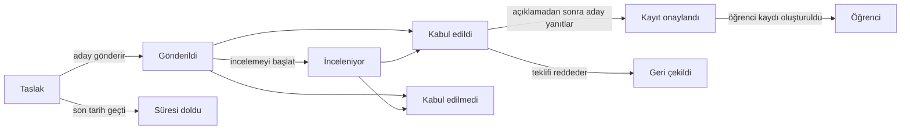

# 16. Öğrenci kabul

Menü: **Öğrenci kabul > Başvuru dönemleri**, **Başvurular**, **Ayarlar > Öğrenci kabul**

Öğrenci kabul, akademik dönemlerden ayrı yönetilir. Aday kişisel e-postasıyla bir hesap oluşturur ve bu hesapla başvurur; kabulden sonra öğrenci kaydı oluşturulduğunda da aynı hesap kullanılmaya devam eder (öğrenci olarak, mezun olarak ve yeniden kayıt başvurusu için).

Aday, öğrenci kaydı oluşturulana kadar istediği zaman **Başvuruyu geri çek** işlemini yapabilir (kabul edilen aday teklifi **Reddet** ile yanıtlar). Karar açıklanmadan önce aday kabul edilip edilmediğini görmez; başvuru **İnceleniyor** olarak görünür.

| Yetki | Neye izin verir |
|---|---|
| `Başvuru dönemlerini ve öğrenci kabul ayarlarını yönetme` | Başvuru dönemi oluşturma ve düzenleme, Ayarlar > Öğrenci kabul |
| `Başvuruları görüntüleme` | Başvuruları, aday bilgilerini ve gönderilen evrakları görme |
| `Başvuruları inceleme ve karara bağlama` | İncelemeyi başlatma, kabul/ret, kararları açıklama, aday adına teklif yanıtı kaydetme |
| `Kabul edilen adaylar için öğrenci kaydı oluşturma` | Kaydını onaylayan adaylar için öğrenci kaydı oluşturma |

Başvuru yetkileri bir birim veya program kapsamıyla da atanabilir (örneğin yalnızca kendi bölümünün başvurularını görebilen bir bölüm sekreteri). Öğrenci Kabul Sorumlusu rol şablonu dört yetkinin tamamını içerir; Öğrenci İşleri şablonu görüntüleme ve öğrenci kaydı oluşturma yetkilerini içerir.

## Adayın tarafı

1. Aday oturum açma ekranında **Açık başvuruları görün** bağlantısını açar (adres `/admissions`), başvuru alan dönemleri görür ve **Başvurmak için hesap oluşturun** ile bir hesap oluşturur (adres `/accounts/signup/`). Adını (Latin harfleriyle), kişisel e-postasını ve bir parola girer.
2. Başvurabilmek için kendisine gönderilen bağlantıyla e-postasını doğrulaması gerekir.
3. Portalda **Öğrenci kabul** altında başvuru dönemini ve programı seçerek başvuruya başlar. Kişisel bilgilerini, önceki okulunu ve niyet mektubunu girer, evrakları yükler ve **Başvuruyu gönder** düğmesine basar. Gönderildiğinde başvuruya bir başvuru numarası (`DÖNEMKODU-00001`) verilir ve onay e-postası gönderilir. Başvuru gönderildikten sonra değiştirilemez.
4. Karar açıklandığında aday bir e-posta alır ve kararı portalda görür. Kabul edilen adaylar **Teklifi kabul et** veya **Reddet** seçeneğini seçer.
5. Öğrenci kaydı oluşturulduğunda portal öğrenci numarasını gösterir ve aynı hesap artık öğrenci erişimine sahip olur.

Zaten öğrenci kaydı olan kişiler (kayıtlı öğrenciler, mezunlar) mevcut hesaplarıyla oturum açar ve aynı ekrandan başvurur. Bu durumda ad ve doğum tarihi öğrenci işlerinin tuttuğu değerlerdir ve başvuruda değiştirilemez.

Öğrenci kaydı olan ancak hesabı olmayan bir mezun (örneğin CSV ile aktarılmış mezunlar) yeni bir hesap oluşturursa iki ayrı kişi oluşur. Böyle bir durumla karşılaşıldığında mevcut kişiye bir [hesap daveti](14-merge-and-invitations.md#hesap-davetleri) gönderin ki o hesapla başvursun; zaten başvurmuşsa ikisini [Mükerrer kişileri birleştir](14-merge-and-invitations.md) ile birleştirin.

## Başvuru dönemleri

| Alan | Açıklama |
|---|---|
| Kod | Başvuru numarasının ilk kısmı, örn. `2027-SPRING` |
| Ad, Açıklama | Dil başına. Herkese açık öğrenci kabul sayfasında gösterilir |
| Açılış, Kapanış | **Sürekli (son tarih yok)** için kapanış zamanını boş bırakın |
| Yayımlandı | Adayların dönemi görebilmesi için açık olmalıdır. Hazırlık sırasında kapalı tutun |
| Kararları hemen açıkla | Açıkken kabul/ret kararı kaydedilir kaydedilmez adaya bildirilir (sürekli başvuruya uygundur). Kapalıyken kararlar **Kararları açıkla** ile toplu olarak açıklanır |
| Kabul teklifini yanıtlama süresi (gün) | Kabul edilen adayların açıklamadan sonra teklifi yanıtlamak için sahip olduğu süre. Süre dolduktan sonra aday artık yanıt veremez; bir personel gerekçe girerek yanıtı aday adına kaydedebilir |
| Sunulan programlar, Kontenjan | Başvurulabilecek programlar. Kontenjan bilgi amaçlıdır ve daha fazla aday kabul edilmesini engellemez |
| Evraklar | **Başvuru evrakı türü** kod listesinden seçilir. Zorunlu evrakları eksik olan bir başvuru gönderilemez. Dosyalar PDF, JPEG veya PNG olabilir (en büyük boyut Ayarlar > Öğrenci kabul altında) |

Kore üniversite profili evrak türlerini (mezuniyet veya mezuniyet öncesi belgesi, transkript, kimlik kartı veya pasaport kopyası, dil sınavı sonucu) ve kabul türlerini (yeni kayıt, yatay geçiş, yeniden kayıt, uluslararası öğrenciler için özel kabul) hazır olarak yükler. Bunlar kod verileri ekranında eklenebilir veya yeniden adlandırılabilir.

## Başvuruları inceleme ve karara bağlama

**Öğrenci kabul > Başvurular** yalnızca gönderilmiş başvuruları listeler (taslakları yalnızca aday görür). Liste gönderilme zamanına göre sıralanır; **Durum** süzgeci yalnızca karar bekleyen başvuruları (Gönderildi, İnceleniyor) gösterir. Başvuru numarası veya aday adıyla arayın, başvuru dönemine göre süzün.

1. Başvuruyu açın; başvuru içeriğini, aday bilgilerini, önceki öğrenci kayıtlarını (yeniden kayıt adayları) ve gönderilen evrakları kontrol edin. Bir evrakı indirmek için adına tıklayın.
2. Gerekirse **İncelemeyi başlat** ile incelemede olarak işaretleyin.
3. **Kabul et** veya **Reddet** düğmesine tıklayın (ret için karar notu zorunludur). Karar açıklanana kadar değiştirilebilir.
4. **Kararı açıkla**: başvuru ekranındaki düğmeyle (tek başvuru), başvuru listesinde birden fazlasını işaretleyip işlem listesinden **Kararları açıkla** çalıştırarak (toplu) veya başvuru dönemi listesinin satır menüsündeki **Kararları açıkla** ile (başvuru dönemi ekranının üst kısmında da bulunur) (o dönemdeki açıklanmamış tüm kararlar). Açıklandığında aday bir e-posta alır ve karar artık değiştirilemez.

Her adım (incelemeyi başlatma, karar, açıklama, teklif yanıtı, öğrenci kaydı oluşturma) işlem günlüğüne kaydedilir.

## Öğrenci kaydı oluşturma

Kaydını onaylayan adayların öğrenci kayıtları dönem başlamadan önce oluşturulur.

- Tek başvuru: başvuru ekranında giriş dönemini seçerek **Öğrenci kaydı oluştur**.
- Birden fazla: listede onaylanmış başvuruları işaretleyin ve işlem listesinden **Öğrenci kaydı oluştur** çalıştırın. Sonraki ekran giriş dönemini sorar. Onaylanmamış, zaten öğrenci kaydı olan veya yetki alanınız dışındaki başvurular atlanır.
- Bütün bir başvuru dönemi: BT operatörü `uv run manage.py admission_matriculate` komutunu çalıştırır ([komut başvurusu](../operations/commands.md#admission_matriculate)).

Öğrenci numarası **Ayarlar > Öğrenci kayıtları** altındaki öğrenci numarası kalıbıyla yeni olarak verilir, giriş tarihi giriş döneminin ilk günüdür ve kabul türü başvurudaki türdür. Yeniden kayıtta önceki öğrenci kaydı olduğu gibi kalır ve yeni bir kayıt eklenir ([bölüm 12](12-people-and-student-records.md)). Öğrenci kabul sorumlusunun öğrenci kayıtlarını yönetme yetkisi olmasa bile öğrenci kaydı oluşturulabilir (kabul edilen adaylar için öğrenci kaydı oluşturma yetkisi yeterlidir; veri değişikliği kaydı işlemi yapan personelin adını tutar).

## Ayarlar > Öğrenci kabul

| Alan | Açıklama |
|---|---|
| Adaylar hesap oluşturabilir | Kapalıyken hesap oluşturma ekranı kapanır. Çevrim içi başvuru almayan üniversiteler için |
| Dokunulmayan taslakların süresi dolsun (gün sonra) | Bu süre içinde değiştirilmeyen taslak başvurular her gece **Süresi doldu** durumuna geçer. Kapanmış dönemlerdeki taslakların süresi bu süreden bağımsız olarak dolar |
| En büyük evrak boyutu (MB) | Varsayılan 10 |

[Yönetici kılavuzu içindekiler](README.md)
