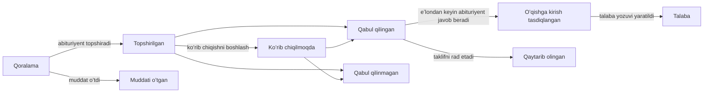

# 16. Qabul

Menyu: **Qabul > Qabul mavsumlari**, **Arizalar**, **Sozlamalar > Qabul**

Qabul semestrlardan alohida boshqariladi. Abituriyent shaxsiy e-pochta bilan hisob yaratadi va u orqali ariza beradi; qabul qilingandan keyin, talaba yozuvi yaratilgach ham ayni shu hisobdan foydalanishda davom etadi (talaba sifatida, bitiruvchi sifatida va oʻqishga qayta tiklash arizasi uchun).

Abituriyent talaba yozuvi yaratilgunga qadar istalgan vaqtda **Arizani qaytarib olish** mumkin (qabul qilingan abituriyent taklifga **Rad etish** bilan javob beradi). Qaror eʼlon qilinmaguncha abituriyent qabul qilingan-qilinmaganini koʻrmaydi; ariza **Koʻrib chiqilmoqda** holatida koʻrsatiladi.

| Ruxsat | Nimaga imkon beradi |
|---|---|
| `Qabul mavsumlari va qabul sozlamalarini boshqarish` | Qabul mavsumlarini yaratish va tahrirlash, Sozlamalar > Qabul |
| `Arizalarni koʻrish` | Arizalar, abituriyent maʼlumotlari va topshirilgan hujjatlarni koʻrish |
| `Arizalarni koʻrib chiqish va qaror qabul qilish` | Koʻrib chiqishni boshlash, qabul qilish/rad etish, qarorlarni eʼlon qilish, abituriyent nomidan taklifga javobni qayd etish |
| `Qabul qilingan abituriyentlar uchun talaba yozuvlarini yaratish` | Oʻqishga kirishni tasdiqlagan abituriyentlar uchun talaba yozuvlarini yaratish |

Arizalar bilan bogʻliq ruxsatlarni tashkiliy birlik yoki dastur qamrovi bilan ham tayinlash mumkin (masalan, faqat oʻz kafedrasi arizalarini koʻra oladigan kafedra yordamchisi). Qabul komissiyasi xodimi rol shabloni barcha toʻrt ruxsatni oʻz ichiga oladi; Registrator shablonida koʻrish va talaba yozuvlarini yaratish ruxsatlari bor.

## Abituriyent tomoni

1. Abituriyent kirish ekranida **Ochiq qabul mavsumlarini koʻrish** sahifasini ochadi (manzil `/admissions`), ariza qabul qilayotgan mavsumlarni koʻradi va **Ariza berish uchun hisob yarating** orqali hisob yaratadi (manzil `/accounts/signup/`). U ismini (lotin harflarida), shaxsiy e-pochtasini va parolni kiritadi.
2. Ariza berishdan oldin unga yuborilgan havola orqali e-pochtasini tasdiqlashi kerak.
3. Portaldagi **Qabul** boʻlimida mavsum va dasturni tanlab, arizani boshlaydi. Shaxsiy maʼlumotlar, oldingi oʻquv yurti va motivatsion xatni kiritadi, hujjatlarni yuklaydi va **Arizani topshirish** tugmasini bosadi. Topshirilganda arizaga ariza raqami (`CYCLECODE-00001`) beriladi va tasdiqlash xati yuboriladi. Topshirilgandan keyin arizani oʻzgartirib boʻlmaydi.
4. Qaror eʼlon qilinganda abituriyent e-pochta xatini oladi va qarorni portalda koʻradi. Qabul qilingan abituriyentlar **Taklifni qabul qilish** yoki **Rad etish** ni tanlaydi.
5. Talaba yozuvi yaratilgach, portalda talaba raqami koʻrsatiladi va ayni shu hisob endi talaba huquqlariga ega boʻladi.

Talaba yozuviga allaqachon ega boʻlgan shaxslar (amaldagi talabalar, bitiruvchilar) mavjud hisobi bilan kirib, xuddi shu ekranda ariza beradi. Bu holda ism va tugʻilgan sana oʻquv boʻlimi saqlayotgan qiymatlar boʻlib, arizada ularni oʻzgartirib boʻlmaydi.

Agar talaba yozuvi bor, lekin hisobi yoʻq bitiruvchi (masalan, CSV orqali koʻchirilgan bitiruvchilar) yangi hisob yaratsa, ikkita shaxs paydo boʻladi. Bunday holat yuzaga kelganda mavjud shaxsga [hisobga taklif](14-merge-and-invitations.md#hisobga-taklif-qilish) yuboring, toki u shu hisob bilan ariza bersin; agar u allaqachon ariza bergan boʻlsa, ikkalasini [Takroriy shaxslarni birlashtirish](14-merge-and-invitations.md) orqali birlashtiring.

## Qabul mavsumlari

| Maydon | Tavsif |
|---|---|
| Kod | Ariza raqamining birinchi qismi, masalan `2027-SPRING` |
| Nomi, Tavsif | Har bir til uchun. Ommaviy qabul sahifasida koʻrsatiladi |
| Ochilishi, Yopilishi | **Uzluksiz (muddatsiz)** qabul uchun yopilish vaqtini boʻsh qoldiring |
| Eʼlon qilingan | Abituriyentlar mavsumni koʻrishi uchun yoqilgan boʻlishi kerak. Tayyorgarlik paytida oʻchiq holda saqlang |
| Qarorlarni darhol eʼlon qilish | Yoqilganda qabul qilish/rad etish qarori saqlanishi bilanoq abituriyentga xabar beriladi (uzluksiz qabulga mos). Oʻchiq boʻlsa, qarorlar **Qarorlarni eʼlon qilish** orqali birgalikda eʼlon qilinadi |
| Taklifni qabul qilish muddati (kun) | Qabul qilingan abituriyentlarning eʼlondan keyin taklifga javob berish muddati. Muddat oʻtgach abituriyent javob bera olmaydi; xodim sabab koʻrsatib, uning nomidan javobni qayd etishi mumkin |
| Taklif etiladigan dasturlar, Oʻrinlar soni | Ariza berish mumkin boʻlgan dasturlar. Oʻrinlar soni maʼlumot uchun boʻlib, undan ortiq abituriyentni qabul qilishga toʻsqinlik qilmaydi |
| Hujjatlar | **Ariza hujjati turi** kodlar roʻyxatidan tanlanadi. Majburiy hujjatlarsiz arizani topshirib boʻlmaydi. Fayllar PDF, JPEG yoki PNG boʻlishi mumkin (eng katta hajm Sozlamalar > Qabul boʻlimida belgilanadi) |

Koreya universiteti profili hujjat turlarini (diplom yoki bitirish arafasidagi maʼlumotnoma, akademik maʼlumotnoma, shaxsiy guvohnoma yoki pasport nusxasi, til sinovi natijasi) va qabul turlarini (birinchi kursga qabul, oʻqishni koʻchirish orqali qabul, oʻqishga qayta tiklash, xorijiy talabalar qabuli) yaratadi. Ularni kodlar ekranida qoʻshish yoki qayta nomlash mumkin.

## Arizalarni koʻrib chiqish va qaror qabul qilish

**Qabul > Arizalar** faqat topshirilgan arizalarni koʻrsatadi (qoralamalarni faqat abituriyentning oʻzi koʻradi). Roʻyxat topshirilgan vaqti boʻyicha tartiblangan; **Holat** filtri faqat qaror kutayotgan arizalarni (Topshirilgan, Koʻrib chiqilmoqda) koʻrsatadi. Ariza raqami yoki abituriyent ismi boʻyicha qidiring va mavsum boʻyicha filtrlang.

1. Arizani ochib, ariza mazmuni, abituriyent maʼlumotlari, oldingi talaba yozuvlari (oʻqishga qayta tiklash uchun ariza berganlar) va topshirilgan hujjatlarni tekshiring. Hujjatni yuklab olish uchun uning nomini bosing.
2. Kerak boʻlsa, **Koʻrib chiqishni boshlash** orqali uni koʻrib chiqilmoqda deb belgilang.
3. **Qabul qilish** yoki **Rad etish** tugmasini bosing (rad etishda qaror izohi majburiy). Qaror eʼlon qilinmaguncha uni oʻzgartirish mumkin.
4. **Qarorni eʼlon qilish**: ariza ekranidagi tugma orqali (bitta ariza), arizalar roʻyxatida bir nechtasini belgilab, amallar roʻyxatidan **Qarorlarni eʼlon qilish** ni bajarib (ommaviy) yoki qabul mavsumlari roʻyxatidagi qator menyusidagi **Qarorlarni eʼlon qilish** orqali (mavsum ekranining yuqorisida ham bor) (shu mavsumdagi eʼlon qilinmagan barcha qarorlar). Eʼlon qilinganda abituriyent e-pochta xatini oladi va qarorni endi oʻzgartirib boʻlmaydi.

Har bir qadam (koʻrib chiqishni boshlash, qaror, eʼlon qilish, taklifga javob, talaba yozuvini yaratish) faoliyat jurnalida qayd etiladi.

## Talaba yozuvlarini yaratish

Oʻqishga kirishni tasdiqlagan abituriyentlar uchun talaba yozuvlari semestr boshlanishidan oldin yaratiladi.

- Bitta ariza: ariza ekranida qabul semestrini tanlab, **Talaba yozuvini yaratish**.
- Bir nechta: roʻyxatda tasdiqlangan arizalarni belgilab, amallar roʻyxatidan **Talaba yozuvini yaratish** ni bajaring. Keyingi ekran qabul semestrini soʻraydi. Tasdiqlanmagan, allaqachon talaba yozuvi bor yoki sizning vakolat doirangizdan tashqaridagi arizalar oʻtkazib yuboriladi.
- Butun mavsum: IT operatori `uv run manage.py admission_matriculate` buyrugʻini ishga tushiradi ([buyruqlar maʼlumotnomasi](../operations/commands.md#admission_matriculate)).

Talaba raqami **Sozlamalar > Talaba yozuvlari** boʻlimidagi talaba raqami shabloniga koʻra yangidan beriladi, qabul sanasi qabul semestrining birinchi kuni boʻladi, qabul turi esa arizadagi turdir. Oʻqishga qayta tiklashda oldingi talaba yozuvi oʻz holicha qoladi va yangisi qoʻshiladi ([12-bob](12-people-and-student-records.md)). Qabul komissiyasi xodimida talaba yozuvlarini boshqarish ruxsati boʻlmasa ham talaba yozuvlarini yaratish mumkin (qabul qilingan abituriyentlar uchun talaba yozuvlarini yaratish ruxsati yetarli; maʼlumot oʻzgarishi yozuvida buni bajargan xodimning ismi saqlanadi).

## Sozlamalar > Qabul

| Maydon | Tavsif |
|---|---|
| Abituriyentlar hisob yarata oladi | Oʻchiq boʻlsa, hisob yaratish ekrani yopiladi. Onlayn ariza qabul qilmaydigan universitetlar uchun |
| Tegilmagan qoralamalar muddati (kun) | Shu muddat ichida oʻzgartirilmagan ariza qoralamalari har kecha **Muddati oʻtgan** holatiga oʻtadi. Yopilgan mavsumlardagi qoralamalar muddatdan qatʼi nazar muddati oʻtgan deb belgilanadi |
| Hujjatning eng katta hajmi (MB) | Standart qiymat 10 |

[Administrator qoʻllanmasi mundarijasi](README.md)
