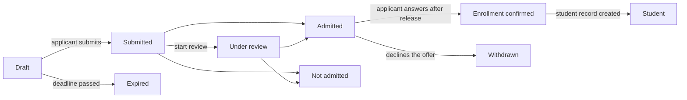

# 16. Tuyển sinh

Menu: **Tuyển sinh > Đợt tuyển sinh**, **Hồ sơ xét tuyển**, **Cài đặt > Tuyển sinh**

Tuyển sinh được quản lý tách biệt với học kỳ. Thí sinh tạo tài khoản bằng email cá nhân và nộp hồ sơ bằng tài khoản đó; sau khi trúng tuyển và hồ sơ sinh viên được tạo, vẫn tiếp tục dùng chính tài khoản này (khi là sinh viên, khi là cựu sinh viên và khi nộp hồ sơ xét tuyển lại).

Thí sinh có thể **Rút hồ sơ** bất cứ lúc nào cho đến khi hồ sơ sinh viên được tạo (thí sinh trúng tuyển trả lời thông báo trúng tuyển bằng **Từ chối**). Trước khi kết quả được công bố, thí sinh không thấy mình có trúng tuyển hay không; hồ sơ hiển thị là **Đang xét duyệt**.

| Quyền | Cho phép |
|---|---|
| `Quản lý đợt tuyển sinh và cài đặt tuyển sinh` | Tạo và sửa đợt tuyển sinh, Cài đặt > Tuyển sinh |
| `Xem hồ sơ xét tuyển` | Xem hồ sơ xét tuyển, thông tin thí sinh và tài liệu đã nộp |
| `Xét duyệt và quyết định hồ sơ xét tuyển` | Bắt đầu xét duyệt, quyết định trúng tuyển/không trúng tuyển, công bố kết quả, ghi nhận phản hồi nhập học thay cho thí sinh |
| `Tạo hồ sơ sinh viên cho thí sinh trúng tuyển` | Tạo hồ sơ sinh viên cho thí sinh đã xác nhận nhập học |

Các quyền liên quan đến hồ sơ xét tuyển cũng có thể được gán với phạm vi đơn vị tổ chức hoặc chương trình đào tạo (ví dụ giáo vụ khoa chỉ được xem hồ sơ xét tuyển của khoa mình). Mẫu vai trò Cán bộ tuyển sinh có đủ cả bốn quyền; mẫu Cán bộ quản lý sinh viên có quyền xem và quyền tạo hồ sơ sinh viên.

## Phía thí sinh

1. Trên màn hình đăng nhập, thí sinh mở **Xem các đợt tuyển sinh đang mở** (địa chỉ `/admissions`), xem các đợt đang nhận hồ sơ và tạo tài khoản bằng **Tạo tài khoản để nộp hồ sơ** (địa chỉ `/accounts/signup/`). Thí sinh nhập họ tên (bằng chữ Latinh), email cá nhân và mật khẩu.
2. Thí sinh phải xác minh email qua liên kết được gửi đến trước khi có thể nộp hồ sơ.
3. Trên cổng thông tin, trong **Tuyển sinh**, thí sinh chọn đợt tuyển sinh và chương trình đào tạo rồi bắt đầu hồ sơ. Thí sinh nhập thông tin cá nhân, trường đã học trước đó và bài tự giới thiệu, tải tài liệu lên và **Nộp hồ sơ**. Khi nộp, hồ sơ được cấp số hồ sơ (`CYCLECODE-00001`) và email xác nhận được gửi đi. Không thể thay đổi hồ sơ sau khi nộp.
4. Khi kết quả được công bố, thí sinh nhận email và xem kết quả trên cổng thông tin. Thí sinh trúng tuyển chọn **Xác nhận nhập học** hoặc **Từ chối**.
5. Khi hồ sơ sinh viên được tạo, cổng thông tin hiển thị mã số sinh viên và cùng tài khoản đó giờ có quyền truy cập của sinh viên.

Những người đã có hồ sơ sinh viên (sinh viên đang học, cựu sinh viên) đăng nhập bằng tài khoản hiện có và nộp hồ sơ trên cùng màn hình. Khi đó họ tên và ngày sinh là các giá trị do phòng đào tạo lưu giữ và không thể thay đổi trong hồ sơ xét tuyển.

Nếu một cựu sinh viên có hồ sơ sinh viên nhưng chưa có tài khoản (ví dụ cựu sinh viên được chuyển dữ liệu bằng CSV) tạo tài khoản mới, hệ thống sẽ có hai cá nhân. Khi gặp trường hợp này, hãy gửi [lời mời tạo tài khoản](14-merge-and-invitations.md#lời-mời-tạo-tài-khoản) cho cá nhân hiện có để họ nộp hồ sơ bằng tài khoản đó; nếu họ đã nộp hồ sơ, hãy gộp hai cá nhân bằng [Gộp cá nhân trùng lặp](14-merge-and-invitations.md).

## Đợt tuyển sinh

| Trường | Mô tả |
|---|---|
| Mã | Phần đầu của số hồ sơ, ví dụ `2027-SPRING` |
| Tên, Mô tả | Theo từng ngôn ngữ. Hiển thị trên trang tuyển sinh công khai |
| Mở, Đóng | Để trống thời điểm đóng để chọn **Liên tục (không có hạn chót)** |
| Đã công bố | Phải bật thì thí sinh mới thấy đợt tuyển sinh. Để tắt trong khi đang chuẩn bị |
| Công bố kết quả ngay | Khi bật, thí sinh được thông báo ngay khi quyết định trúng tuyển/không trúng tuyển được lưu (phù hợp với tuyển sinh liên tục). Khi tắt, kết quả được công bố đồng loạt bằng **Công bố kết quả** |
| Số ngày để xác nhận nhập học | Thời gian thí sinh trúng tuyển có để trả lời sau khi kết quả được công bố. Sau hạn này thí sinh không thể trả lời nữa; cán bộ có thể ghi nhận phản hồi thay cho thí sinh kèm lý do |
| Chương trình tuyển sinh, Chỉ tiêu | Các chương trình đào tạo có thể đăng ký. Chỉ tiêu chỉ để tham khảo và không ngăn việc cho thêm thí sinh trúng tuyển |
| Tài liệu | Chọn từ danh mục mã **Loại tài liệu hồ sơ xét tuyển**. Hồ sơ thiếu tài liệu bắt buộc thì không thể nộp. Tệp có thể là PDF, JPEG hoặc PNG (dung lượng tối đa đặt trong Cài đặt > Tuyển sinh) |

Hồ sơ mẫu trường đại học Hàn Quốc khởi tạo sẵn các loại tài liệu (giấy chứng nhận tốt nghiệp hoặc dự kiến tốt nghiệp, bảng điểm, bản sao chứng minh nhân dân hoặc hộ chiếu, điểm thi ngoại ngữ) và các loại hình tuyển sinh (tuyển sinh mới, tuyển sinh chuyển tiếp, tuyển sinh lại, tuyển sinh đặc biệt cho sinh viên quốc tế). Có thể thêm hoặc đổi tên các mục này trên màn hình danh mục mã.

## Xét duyệt và quyết định hồ sơ

**Tuyển sinh > Hồ sơ xét tuyển** chỉ liệt kê các hồ sơ đã nộp (bản nháp chỉ thí sinh nhìn thấy). Danh sách được sắp xếp theo thời điểm nộp; bộ lọc **Trạng thái** chỉ hiển thị các hồ sơ đang chờ quyết định (Đã nộp, Đang xét duyệt). Tìm theo mã hồ sơ hoặc tên thí sinh, và lọc theo đợt tuyển sinh.

1. Mở hồ sơ và kiểm tra nội dung hồ sơ, thông tin thí sinh, các hồ sơ sinh viên trước đây (thí sinh xét tuyển lại) và tài liệu đã nộp. Nhấn vào tên tài liệu để tải xuống.
2. Nếu cần, đánh dấu hồ sơ đang được xét duyệt bằng **Bắt đầu xét duyệt**.
3. Nhấn **Trúng tuyển** hoặc **Không trúng tuyển** (bắt buộc ghi chú quyết định khi không trúng tuyển). Có thể thay đổi quyết định cho đến khi kết quả được công bố.
4. **Công bố kết quả**: bằng nút trên màn hình hồ sơ (một hồ sơ), từ danh sách hồ sơ bằng cách đánh dấu nhiều hồ sơ rồi chạy **Công bố kết quả** trong danh sách thao tác (hàng loạt), hoặc bằng **Công bố kết quả** trong menu dòng của danh sách đợt tuyển sinh (cũng có ở đầu màn hình đợt tuyển sinh) (mọi quyết định chưa công bố của đợt đó). Khi công bố, thí sinh nhận email và không thể thay đổi quyết định nữa.

Mọi bước (bắt đầu xét duyệt, quyết định, công bố, phản hồi nhập học, tạo hồ sơ sinh viên) đều được ghi vào nhật ký hoạt động.

## Tạo hồ sơ sinh viên

Hồ sơ sinh viên cho thí sinh đã xác nhận nhập học được tạo trước khi học kỳ bắt đầu.

- Một hồ sơ: **Tạo hồ sơ sinh viên** trên màn hình hồ sơ xét tuyển, chọn học kỳ nhập học.
- Nhiều hồ sơ: đánh dấu các hồ sơ đã xác nhận trong danh sách và chạy **Tạo hồ sơ sinh viên** từ danh sách thao tác. Màn hình tiếp theo hỏi học kỳ nhập học. Các hồ sơ chưa xác nhận nhập học, đã có hồ sơ sinh viên hoặc nằm ngoài phạm vi của bạn sẽ được bỏ qua.
- Cả một đợt: cán bộ vận hành CNTT chạy `uv run manage.py admission_matriculate` ([tham khảo lệnh](../operations/commands.md#admission_matriculate)).

Mã số sinh viên được cấp mới theo mẫu mã số sinh viên trong **Cài đặt > Hồ sơ sinh viên**, ngày nhập học là ngày đầu tiên của học kỳ nhập học, và loại hình tuyển sinh lấy từ hồ sơ xét tuyển. Với trường hợp xét tuyển lại, hồ sơ sinh viên trước đây được giữ nguyên và một hồ sơ mới được thêm vào ([chương 12](12-people-and-student-records.md)). Hồ sơ sinh viên có thể được tạo ngay cả khi cán bộ tuyển sinh không có quyền quản lý hồ sơ sinh viên (chỉ cần quyền tạo hồ sơ sinh viên cho thí sinh trúng tuyển; bản ghi thay đổi dữ liệu lưu tên cán bộ đã thực hiện).

## Cài đặt > Tuyển sinh

| Trường | Mô tả |
|---|---|
| Thí sinh có thể tạo tài khoản | Khi tắt, màn hình tạo tài khoản bị đóng. Dành cho các trường không nhận hồ sơ trực tuyến |
| Hủy bản nháp không được chỉnh sửa sau (ngày) | Các hồ sơ nháp không được thay đổi trong khoảng thời gian này sẽ chuyển thành **Hết hạn** mỗi đêm. Bản nháp trong các đợt đã đóng sẽ hết hạn bất kể khoảng thời gian |
| Dung lượng tài liệu tối đa (MB) | Mặc định 10 |

[Mục lục hướng dẫn quản trị](README.md)
