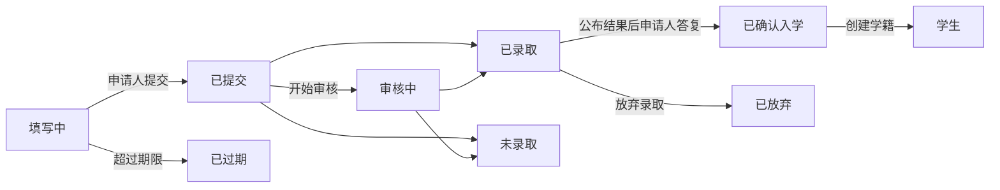

# 16. 招生

菜单：**招生 > 招生批次**、**申请**、**设置 > 招生**

招生与学期分开管理。申请人用个人邮箱创建账户后申请，录取并生成学籍后仍继续使用同一账户（学生、校友、重新入学申请均如此）。

在学籍创建之前，申请人随时可以**放弃申请**（对录取通知则以**放弃**答复）。公布结果之前，申请人看不到录取/不录取的结果，只显示为**审核中**。

| 权限 | 可以做的事 |
|---|---|
| `管理招生批次和招生设置` | 创建和修改招生批次，设置 > 招生 |
| `查看申请` | 查看申请、申请人信息和提交材料 |
| `审核申请并作出录取决定` | 开始审核、录取/不录取、公布结果、代为登记答复 |
| `为录取者创建学籍` | 为已确认入学的申请人创建学籍 |

申请相关权限也可以按组织单位、专业项目范围分配（例如只允许院系助理查看本院系的申请）。招生管理员角色模板包含上述四项权限，学籍管理员包含查看和创建学籍两项。

## 申请人一侧的流程

1. 申请人在登录页的**查看招生信息**（地址 `/admissions`）中查看正在受理的招生，通过**创建账户并申请**（地址 `/accounts/signup/`）创建账户。输入姓名（罗马字）、个人邮箱和密码。
2. 必须通过邮件中的链接验证邮箱后才能申请。
3. 在门户的**入学申请**中选择批次和专业后开始填写。输入个人信息、毕业学校、个人陈述，上传材料后**提交申请**。提交后会分配报名号（`批次代码-00001`）并发送受理确认邮件。提交后不能修改。
4. 结果公布后收到邮件，并在门户中查看结果。被录取者选择**接受录取**或**放弃**。
5. 学籍创建后，门户中会显示学号，同一账户转为学生权限。

已有学籍的人（在读学生、校友）用原有账户登录，在同一界面申请。此时姓名和出生日期直接使用学籍管理员维护的值，申请中不能修改。

只有学籍而没有账户的校友（例如通过 CSV 迁入的校友）如果新建账户，就会产生两个人员。收到咨询时，先向原有人员发送[账户邀请](14-merge-and-invitations.md#账户邀请)，让其用该账户申请；如果已经申请，则用[合并重复人员](14-merge-and-invitations.md)合并。

## 招生批次

| 项目 | 说明 |
|---|---|
| 代码 | 报名号的前半部分。例：`2027-SPRING` |
| 名称、说明 | 按语言填写。显示在招生信息页面 |
| 开始受理、截止受理 | 截止留空即为**常年受理** |
| 已公开 | 开启后申请人才能看到。准备阶段保持关闭 |
| 决定后立即公布 | 开启后，录取/不录取一经保存即通知申请人（适合常年受理）。关闭时通过**公布结果**统一通知 |
| 录取答复期限（天） | 公布后被录取者确认入学意向的期限。超过期限后申请人无法答复，管理员可填写原因代为登记 |
| 招生专业、招生人数 | 可申请的专业。招生人数仅供参考，不会阻止录取处理 |
| 提交材料 | 从代码数据**申请材料类型**列表中选择。未上传必需材料则无法提交。文件格式为 PDF、JPEG、PNG（最大大小见设置 > 招生） |

韩国大学配置文件预置了材料种类（毕业（预计毕业）证明、成绩证明、身份证或护照复印件、语言成绩）和入学类别（新生入学、插班入学、重新入学、外国人特别招生）。可以在代码数据界面添加或改名。

## 申请审核与决定

**招生 > 申请**中只显示已提交的申请（填写中的申请只有申请人自己可见）。列表按提交时间排序，可用**状态**筛选只查看等待决定的申请（已提交、审核中）。也可按批次筛选，按申请编号或申请人姓名搜索。

1. 打开申请，查看申请内容、申请人信息、以往学籍（重新入学申请人）和提交材料。点击材料名称即可下载。
2. 需要时用**开始审核**标记为审核中。
3. 点击**录取**或**不录取**（必须填写意见）。公布之前可以更改决定。
4. **公布结果**：可在申请界面的按钮（单件）、在申请列表中勾选多件后从操作列表执行**公布结果**（批量），或在招生批次列表行菜单中的**公布结果**（批次界面上方也有）（该批次所有尚未公布的决定）中操作。公布后会向申请人发送邮件，决定不能再更改。

所有步骤（开始审核、决定、公布、入学答复、创建学籍）都会记入业务审计记录。

## 创建学籍

已确认入学的申请人在学期开始前创建学籍。

- 单件：在申请界面的**创建学籍**中选择入学学期。
- 多件：在申请列表中勾选已确认入学的申请，从操作列表执行**创建学籍**，在下一个界面选择入学学期。未确认入学、已有学籍或不在权限范围内的申请将被跳过。
- 整个批次：由 IT 运维人员执行 `uv run manage.py admission_matriculate`（[命令参考](../operations/commands.md#admission_matriculate)）。

学号按**设置 > 学籍**中的学号格式重新分配，入学日期为入学学期第一天，入学类别取申请中的值。重新入学时，以往学籍保持不变，另外新增一条学籍（[第 12 章](12-people-and-student-records.md)）。招生管理员即使没有学籍管理权限也能创建学籍（有创建学籍权限即可，数据变更记录中会记录经办人）。

## 设置 > 招生

| 项目 | 说明 |
|---|---|
| 允许申请人创建账户 | 关闭后创建账户界面关闭。适用于不受理网上申请的大学 |
| 草稿过期天数 | 在此期间内未修改的填写中申请，每晚自动变为**已过期**。已截止批次中的填写中申请无论天数都会过期 |
| 材料最大大小（MB） | 默认 10 |

[管理员手册目录](README.md)
