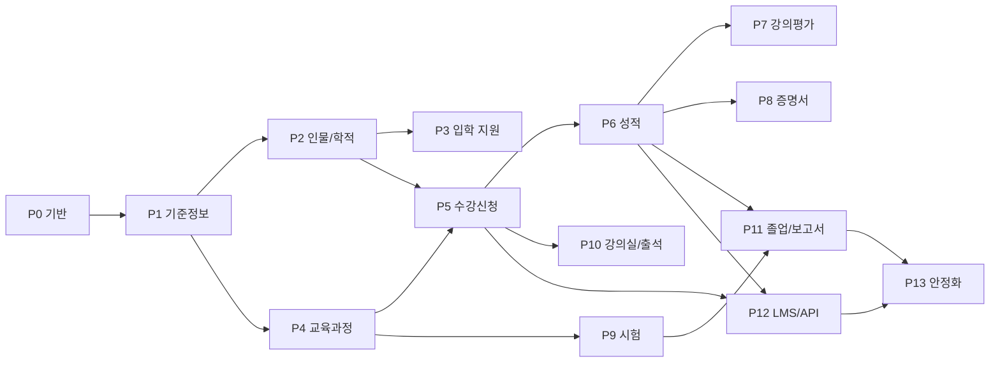

# Ninefruits Laravel → Django 이식 실행 계획

- 작성일: 2026-10-23 (개정 1)
- 원본: [humble92/ninefruits-laravel](https://github.com/humble92/ninefruits-laravel) `v1.0.0` (로컬 `/Users/daniel/personal/ninefruits-laravel`). Laravel 13, PHP 8.5, Filament 5, Livewire 4, PostgreSQL 18. Phase 0~13 완료.
- 대상 저장소: `ninefruits-django` (`main`은 이 계획으로 새로 시작. 이전 프로토타입은 `legacy-playground` 브랜치에 보존)
- 관련 문서: 원본의 [porting/porting-plan.md](https://github.com/humble92/ninefruits-laravel/blob/main/porting/porting-plan.md), 설계 결정 [0001~0017](https://github.com/humble92/ninefruits-laravel/tree/main/porting/decisions), Phase 결과 보고 0~13. 이 문서에서 "원본 N절", "원본 ADR 000N"은 그 문서들을 가리킨다.

---

## 1. 확정된 전제

| 항목 | 결정 |
|---|---|
| 목표 | 원본 Laravel 시스템의 모든 기능을 빠짐없이 Django로 옮긴다. 학사 기능뿐 아니라 보안(2단계 인증, SSO, RLS, 개인정보 암호화), 감사 3층과 해시 체인, 보안 로그, 다국어(화면, DB 데이터, 매뉴얼 4개 언어), LMS 연동 기반, 운영 명령 42개, 시더 3종, 부하 테스트까지 포함한다 |
| 제품 성격, 배포 형태, 범위 | 원본과 같다. 여러 대학에 설치하는 범용 학사 행정 시스템, 대학별 독립 설치(멀티테넌트 아님). 등록금/장학금, 기숙사, 교재 등 원본 4.2절의 제외 범위도 같다 |
| 데이터 이관 | 하지 않는다. 원본 Laravel 설치본의 데이터를 옮기는 것은 범위 밖이다. 다만 DB 스키마(테이블, 컬럼, 제약, SQL 함수, 트리거, RLS 정책, 뷰)는 원본과 **동일하게** 유지하므로, 필요하면 나중에 `pg_dump`/`pg_restore`로 옮길 수 있는 상태를 유지한다 |
| 런타임 | Python 3.14 (3.14.9), Django 6.1.x (6.1.2, 2026-10-06). 2027년 4월 Django 6.2 LTS가 나오면 Phase 13 전에 올린다. Python 3.15는 Django 6.1.3(2026-11-03 예정)이 공식 지원하므로 그 뒤 올린다 |
| DB | PostgreSQL 18. 원본의 `database/sql/`(함수, 트리거, RLS 정책, 뷰, 역할 스크립트)를 그대로 가져와 Django 마이그레이션에서 적용한다 |
| 화면 | 서버 렌더링 중심. 관리 화면은 `django.contrib.admin` + django-unfold, 포털은 Django 템플릿 + HTMX + Alpine.js + Tailwind CSS 4. SPA 없음 (2026-10-23 결정) |
| API | Django REST framework. 용도는 LMS 연동, 외부 시스템(BI, IdP, 증명서 진위 확인 등) 연동, 포털 HTMX가 쓰기 어려운 비동기 조회. 화면을 API 위에 올리지 않는다 |
| 큐, 배치, 스케줄 | Celery + Redis, django-celery-beat(스케줄), Flower(모니터). Django 6 내장 Tasks 프레임워크는 쓰지 않는다 (2026-10-23 결정) |
| 패키지 관리 | uv (`pyproject.toml`, `uv.lock`). 모든 Python 실행은 `uv run` |
| 다국어 | 언어 수 제한 없음, 기본 언어 영어. 시작 언어는 원본과 같은 4개(en, ko, zh-hans, lo). 관리자·운영 매뉴얼도 4개 언어 |
| 테스트 | pytest + pytest-django. 테스트 파일은 `tests/` 아래 `test_*.py`만. 테스트가 아닌 파일 이름에 `test`를 쓰지 않는다 |
| 개발 환경 | Docker Compose(앱, PostgreSQL 18, Redis 8, Mailpit, Gotenberg 8). 원본 Sail 구성을 Python 이미지로 바꾼다. 로컬 호스트에서는 uv만 쓴다 |
| 원본 프로토타입(`legacy-playground`) | 참고하지 않는다. 모델과 구조가 원본 Laravel 설계와 맞지 않는다 |

버전 확인 결과 (2026-10-23)

| 구분 | 확인 내용 |
|---|---|
| Python | 3.15.1 (2026-10-21), 3.14.9 (2026-10-21, bugfix), 3.13 security-only |
| Django | 6.1.2 (2026-10-06, 보안 릴리스). 6.1은 Python 3.12~3.14, 6.1.3부터 3.15 지원. 6.2 LTS는 2027-04 예정, 그 뒤 2028부터 연 1회 릴리스로 바뀜 |
| Django 6.x 기능 | Tasks 프레임워크(6.0), `CompositePrimaryKey`(5.2), `GeneratedField`(5.0), psycopg 3 연결 풀(5.1), 템플릿 partial(6.0), CSP 설정(6.0) |

나머지 패키지(django-allauth, django-unfold, DRF, Celery, psycopg 등)는 Phase 0에서 설치하면서 최신 안정 버전을 확인하고 `uv.lock`으로 고정한다.

---

## 2. 기본 원칙

1. **Django 관례와 최신 기능을 최대한 쓴다.**
   - 앱(app) 단위로 도메인을 나누고, 모델·마이그레이션·관리 화면·명령·테스트가 앱 안에 함께 있다.
   - 검증은 `Form`/`ModelForm`(화면)과 DRF `Serializer`(API), 권한은 커스텀 인증 백엔드 + QuerySet 스코프, 업무 로직은 앱의 `actions` 모듈, 부수 효과는 도메인 이벤트 디스패처 → Celery 작업.
   - `django.contrib.postgres`(`DateRangeField`, `ExclusionConstraint`, `GinIndex`, `TrigramExtension`, `BtreeGistExtension`), `GeneratedField`, `UniqueConstraint(condition=)`, `CheckConstraint`, `CompositePrimaryKey`, `JSONField`를 쓴다. Django ORM이 표현하지 못하는 것(복합 외래 키, 트리거, RLS, 뷰, 스키마)은 `RunSQL`로 원본 SQL 파일을 적용한다.
   - `USE_TZ = True`, 시각은 `timestamptz`, 기관 시간대는 설정값.
   - 설정값은 `django-environ`으로 `.env`에서만 읽고 코드 안에서 `os.environ`을 직접 읽지 않는다.
2. **원본의 설계 결정(ADR 0001~0017)을 기본값으로 삼는다.** 데이터 모델, 상태 전이, 직무 분리 규칙, 익명성 규칙, 잠금 전략은 바꾸지 않는다. Django 생태계 때문에 바꿔야 하는 것은 이 문서 5절과 새 ADR(`porting/decisions/`)에 적는다.
3. **DB가 진실의 원천이다.** 스키마와 SQL 자산(함수 30개, 트리거 3세트, RLS 정책 13개 파일, reporting 뷰 8개, 역할 스크립트)은 원본과 동일하게 유지한다. 테스트로 두 저장소의 스키마 덤프를 비교해 차이가 없음을 확인한다(Phase 13).
4. **보안 기본값**: 문자열 연결 SQL 금지(CI 정적 검사), 개인정보 암호화, 최소 권한 DB 역할, 모든 학적·성적 변경 감사, RLS 2중 방어.
5. **명명 일관성**: 원본 [명명 규칙과 용어집](https://github.com/humble92/ninefruits-laravel/blob/main/docs/development/naming.md)의 DB·라우트·권한·번역 규칙을 그대로 쓰고, PHP 절(4절)만 Python/Django 절로 바꾼다(`docs/development/naming.md`로 이식).

---

## 3. 원본 분석 요약 (이식 대상 인벤토리)

| 구분 | 수량 | 비고 |
|---|---|---|
| Eloquent 모델 | 93 | 16개 컨텍스트. `app/Models/{Context}/` |
| 업무 Action | 84 | `app/Domain/{Context}/Actions/` |
| 수강신청 규칙 클래스 | 10 | `CreditLimit`, `DuplicateCourse`, `Eligibility`, `Hold`, `RepeatCourse`, `Requisites`, `SectionOpen`, `StudentStatus`, `TimeConflict`, `Window` |
| Policy | 39 | 모델별 권한 판단 |
| 권한 카탈로그 | 64 | `Permission` enum, `{resource}.{action}` |
| 역할 템플릿 | 6 + persona 5 | System Administrator, Registrar, Academic Affairs, Certificate Officer, Department Assistant, Admissions Officer / applicant, student, alumni, instructor, advisor |
| 설정 그룹 | 10 | Security, Authentication, Institution, StudentRecord, Admission, Grading, Evaluation, Certificate, Graduation + 설정 마이그레이션 14개 |
| Filament Resource / Page | 55 / 12 | 관리 화면. Page 12개 중 9개가 설정 화면, 나머지 Reports, SettingsPage, ViewTimetables |
| Filament Importer | 11 | 조직 단위, 프로그램, 건물, 강의실, 코드값, 학생, 교원, 교과목, 수강 제한 등 |
| Livewire 포털 컴포넌트 | 21 | Dashboard, SecuritySettings, MyRecords, MyProfile, Advisees, CourseCatalog, Registration, SectionDetail, SyllabusEditor, MyTeaching, GradeEntry, SectionAttendance, MyAttendance, MyGrades, Evaluations, MyCertificates, MyGraduation, MyAssessments, SectionEvaluation, Applications, ApplicationDetail |
| HTTP 컨트롤러 | 15 | 파일 다운로드(사진, 증빙, 증명서, 성적표, 출석부, 명단 CSV, 보고서 CSV), 공개 페이지(입학 회차, 진위 확인), SSO, 초대, 이메일 2단계 코드, 언어 변경 |
| 미들웨어 | 5 | `AssignRequestContext`, `SetLocale`, `SetDatabaseSessionContext`, `EnforceMfaPolicy`, `EnsureUserIsActive` |
| Artisan 명령 | 42 | 모두 운영 매뉴얼 `commands.md`에 문서화(테스트로 강제) |
| 스케줄 작업 | 6 | `admission:expire-drafts` 03:10, `registration:release-reserved-seats` 5분, `waitlist:promote` 매시, `lms:reconcile` 02:30, `audit:seal` 03:30, 심장박동 1분 |
| 큐 작업 / 이벤트 / 알림 | 6 / 4 / 10 | Jobs: ReencryptPiiRecords, PromoteWaitlist, CloseTermRecords, FinishTermClose, SyncSection, SyncEnrollment. Events: SectionPublished, EnrollmentConfirmed, EnrollmentDropped, GradesFinalized. Notifications 10종(메일) |
| 마이그레이션 | 49 + 설정 14 | 스키마, 감사, RLS 활성화, reporting 뷰, LMS, 감사 해시 체인 |
| SQL 파일 | 29 | `functions/` 9, `triggers/` 3, `policies/` 13, `views/` 1, `roles/` 2, `benchmarks/` 2 |
| PostgreSQL 함수 | 30 | `util.*` 24, `audit.*` 6 |
| reporting 뷰 | 8 | students, headcount, term_records, course_grades, section_enrollments, section_meetings, status_changes, degree_audits |
| 표준 보고서 | 7 | students, headcount, term_records, graduation_candidates, status_changes, section_enrollments, not_registered (+ CSV) |
| 시더 | 필수 7, 프로파일 2, 데모 15 | Essential: Country, Language, LookupType, OrgUnitType, RoleTemplate, StatusChangeType. Profiles: KoreanUniversity, YustLegacy. Demo: 영역별 15개, `--size=small/medium/large`, `--seed`, `--student-accounts` |
| 팩토리 | 11개 컨텍스트 | 테스트와 데모 공용 |
| 번역 | 23 그룹 × 4 언어, 약 2,070 키 + JSON 70 | `lang/{en,ko,zh_CN,lo}/*.php`, `lang/*.json` |
| 문서 | 관리자 매뉴얼 28장 + 운영 매뉴얼 9편 + 색인, 4개 언어 | `docs/manual/{ko,en,zh_CN,lo}/`. 개발 문서 4편, LMS 연동 가이드, README 4개 언어, 스크린샷 4개 언어 |
| 테스트 | 73 파일, 464 테스트(단언 2,464) | Feature, Database(RLS, 트리거, 동시성), Unit, PHPStan 규칙, 부하 테스트 k6 1개 |
| PDF 서식 | 3 | 증명서, 출석부, 샘플 (Blade) |
| CI | 2 job | 품질(Pint, Larastan, 명명 검사, 번역 누락, composer audit), 테스트(PostgreSQL 18, Redis 8, Gotenberg 8) |

원본의 레거시(YUSTIC) 분석, 이식하지 않은 결함, 기능 매핑은 원본 3절과 9절에 있으며 이 계획에서 반복하지 않는다. 이번 이식의 출발점은 YUSTIC이 아니라 Laravel 구현이다.

---

## 4. 범위

### 4.1 포함

원본 4.1절의 13개 영역 전부, 그리고 Phase 13의 산출물(감사 해시 체인, 운영 명령, 보안 수정 H1·H3·H4·H5·M1·M6·M7·M8·L1·L2·L4·L5, 부하 테스트, 배포 체크리스트, 라오어). 구체적으로:

1. 기반: 공용 로그인, 2단계 인증(TOTP, 복구 코드, 이메일 코드), 정책 강제(권장/역할 강제/전체 강제, 유예 기간, 기기 기억), SSO(OIDC), 학번 로그인, 초대, 계정 잠금, 비활성 계정 세션 종료, 권한 카탈로그·역할·범위 할당·persona, 감사 3층 + 해시 체인, 보안 로그, RLS, 개인정보 암호화·마스킹·열람 기록·키 교체, 다국어, 설정 그룹 10개, PDF
2. 기준정보: 코드 데이터, ISO 국가·언어, 조직 단위(유효기간, 개편 승계), 프로그램, 건물·강의실, 학년도·학기·학기 세션·업무 기간·교시, 교과 구분, 성적 척도, CSV 가져오기 기반
3. 인물과 학적: 인물·계정 분리, 학적(입학별), 학번 생성, 학적 변동 신청·승인, 지도교수, 보호자, 교원, 복수전공·부전공 신청, 인물 병합, 초대, 포털 내 정보
4. 입학: 모집 회차, 지원서·서류, 수험 번호, 심사·결정·발표, 등록 확정, 학생 전환, 재입학, 초안 만료
5. 교육과정·개설: 교과목·버전(배제 제약), 선수·대체과목, 졸업 요건 세트(교육과정 연도), 개설강좌, 담당 교원, 대상 조건, 좌석 그룹, 강의 시간·강의실·충돌 검사, 시간표, 강의계획서, 이전 학기 복사
6. 수강신청: 규칙 세트·규칙 엔진 10종, hold/override, 학점 상한 정책, 장바구니, 시차 오픈, 좌석 할당·전환, 대기자 자동 승격, 관리자 수강 조정, 시도 기록, 동시성 안전(행 잠금)
7. 성적: 입력 그리드, 임시 저장·제출·확정·반려, 정정 요청·승인(직무 분리), 평가 방식 변경 요청, 절대·상대평가(등급 비율 상한), 평점·재수강 정책, 성적표 PDF, 학기 마감 배치(학업 상태, 학사경고, 성적우수), 확정 성적 DB 트리거 보호, 성적 조회 제한(hold, 강의평가 미완료)
8. 강의평가: 양식·문항, 학기별 설정, 익명 응답(완료와 응답 분리, 감사 제외), 최소 응답 기준, 결과 공개, 독려 알림
9. 증명서: 종류·언어별 서식, 발급 대장, 원자적 발급번호, 확인 코드·QR·공개 진위 확인 페이지, PDF 보관·체크섬, 취소, 재생성
10. 어학·종합시험: 종류·영역·판정, 회차·접수·정원, 결과 입력·CSV·공개·잠금, 정정 승인, 외부 성적·증빙, 졸업 요건 연계
11. 교수 강의실·출석: 담당 강좌, 수강생 명단(사진, CSV), 수업 회차 생성, 출석 입력, 출석부 PDF, 학생 출석 조회
12. 졸업·보고서: 요건 판정 서비스, 점검 스냅샷, 요건 면제(2인), 졸업 처리·학위번호, 표준 보고서 7종·CSV, reporting 뷰 8개(다국어, RLS)
13. LMS 연동 기반: 플랫폼·강좌 연결·사용자 연결·동기화 기록, `LmsConnector` 인터페이스·`NullConnector`, 이벤트 기반 동기화, 야간 대조, 점수 초안 불러오기, 연동 가이드
14. 운영: 명령 42개, 스케줄 6개, `system:health-check`, 감사 봉인·검증·정리, 고아 파일 정리, 설치·데모 명령, 시더 3종, 팩토리, 데모 계정 12개
15. 품질: 테스트 464개 상당(동등 범위), 정적 검사, 명명 검사, 번역 누락 검사, 명령 문서화 검사, CI, 부하 테스트와 기준(화면 p95 < 800ms, 등록 p95 < 1.5s, 실패 < 1%)
16. 문서: 관리자 매뉴얼 28장, 운영 매뉴얼 9편, LMS 연동 가이드, 개발 문서(명명, 리뷰 체크리스트, 언어 추가 가이드), README, 4개 언어

### 4.2 제외

원본 4.2절과 같다. 추가로 이번 이식에서 제외하는 것:

- 원본 Laravel 설치본으로부터의 데이터 이관 도구(스키마가 같으므로 표준 PostgreSQL 도구로 가능)
- 원본 Phase 13 보고서 5.2절의 후속 과제(H2 CSV 가져오기 범위 검사, M2~M5, M9, L3, L6~L9)는 **동일 수준으로 이식**하되 해결은 하지 않는다. 해결은 이식 완료 후 별도 과제로 한다. 단, Django 쪽 구현이 자연스럽게 해결하는 것(예: 세션 수명 설정, IP 단위 로그인 제한은 django-allauth 기본 기능)은 받아들인다

---

## 5. 목표 아키텍처

### 5.1 기술 스택과 Laravel 대응

| 구분 | Laravel 원본 | Django 선택 | 메모 |
|---|---|---|---|
| 런타임 | PHP 8.5, Laravel 13 | Python 3.14, Django 6.1 | 1절 |
| 웹 서버 | php-fpm (Nginx) | gunicorn (sync 워커) + Nginx. ASGI는 필요 없음(요청은 DB 바운드, 비동기 I/O 없음) | 부하 테스트로 워커 수 결정 |
| DB 드라이버 | pdo_pgsql | psycopg 3 (`psycopg[binary,pool]`), Django 내장 연결 풀 `OPTIONS={"pool": {...}}` | RLS 세션 변수 초기화와 풀 반환을 함께 다룬다(7.4절) |
| 관리 화면 | Filament 5 | `django.contrib.admin` + **django-unfold**(테마, 탭, 필터, 액션, 대시보드) + django-import-export | Filament Resource → `ModelAdmin`, RelationManager → `TabularInline`/`StackedInline` 또는 unfold 탭, Page → 커스텀 admin view |
| 포털 | Livewire 4 | Django 템플릿 + **HTMX 2** + **Alpine.js 3** + Tailwind CSS 4. 템플릿 partial(Django 6.0)로 HTMX 조각 응답 | Livewire 컴포넌트 1개 → CBV 1~3개 + 템플릿 1개 + partial |
| 자산 빌드 | Vite + Tailwind | Vite + Tailwind 4 + **django-vite** (매니페스트 연결) | `npm run build`, 개발 시 HMR |
| 인증 | Fortify (로그인, 등록, 이메일 인증, 비밀번호 재설정, 2FA TOTP·복구 코드, 비밀번호 확인) + 자체 이메일 코드·기기 기억·SSO | **django-allauth** (`account`, `mfa`, `socialaccount` OIDC 제공자) + 자체 확장(이메일 코드 2단계, 정책 강제 미들웨어, 학번 로그인, 초대) | ADR 0001 재검토. 6절 |
| 비밀번호 해시 | Argon2id | `Argon2PasswordHasher` 기본 (`argon2-cffi`) | 원본과 같은 알고리즘 |
| 권한 | spatie/laravel-permission(역할·권한 저장만) + `role_assignments` + Policy + `Gate::before` | 자체 `security` 앱: `Permission` enum(`StrEnum`), `Role`, `RoleAssignment` 모델, 커스텀 인증 백엔드 `has_perm`, `AuthorizationService`, QuerySet `visible_to(user)`, 모델별 `policies.py` | Django 내장 `auth.Permission`/`Group`은 쓰지 않는다(범위·기간 표현 불가). 7절 |
| 감사(업무) | spatie/laravel-activitylog | 자체 `audit` 앱 `ActivityLog` 모델(`audit.activity_log`, 추가만), `AuditLogger.record()` | 요청 컨텍스트는 `contextvars` 기반 미들웨어로 전파, Celery 헤더로 작업에 전달 |
| 감사(데이터) | PostgreSQL 트리거 | 원본 SQL 그대로 (`audit.record_change`, `util.enable_audit`, 해시 체인) | 변경 없음 |
| 다국어(UI) | `lang/{locale}/{group}.php`, 의미 기반 키 | Django gettext (`.po`/`.mo`, `LOCALE_PATHS`), **msgid는 영어 원문** | 의미 키 → 영어 원문 전환. 6.1절 |
| 다국어(DB) | spatie/laravel-translatable + `util.i18n` | 자체 `TranslatableJSONField` + `util.i18n` 함수 재사용 | 6.2절 |
| 설정 | spatie/laravel-settings + 설정 마이그레이션 | 자체 `settings` 앱: 그룹별 dataclass(pydantic로 검증) + `settings_values` 테이블(jsonb) + 데이터 마이그레이션, 관리 화면 폼 | django-constance는 그룹·타입·감사 요구를 못 채운다 |
| 기능 토글 | Laravel Pennant (설치만, 미사용) | 도입하지 않음 | 원본 코드에서 `Feature::` 사용 0건 |
| 파일 | spatie/laravel-medialibrary, 비공개 디스크 | 자체 `media` 앱(`Media` 모델: 소유 객체 GenericFK, 컬렉션, 경로, MIME, 크기, SHA-256, 사용자 속성 jsonb) + `django-storages`(S3 호환) + 비공개 `FileSystemStorage` | 다운로드는 권한 확인 뷰로만. `media:prune-orphans` 유지 |
| PDF | Gotenberg 8 (HTTP) | Gotenberg 8 그대로, `httpx` 클라이언트, Django 템플릿으로 HTML 생성 | ADR 0004 유지. CJK·라오어 글꼴 포함 |
| 큐 | Redis + Horizon | **Celery 5** + Redis(브로커, 결과), Flower | `Bus::batch` → `chord`/`group`, `ShouldBeUnique`·`WithoutOverlapping` → Redis 잠금(`cache.lock`) 데코레이터, `afterCommit` → `transaction.on_commit` |
| 스케줄 | Laravel Scheduler (`routes/console.php`) | django-celery-beat (DB 스케줄) + `onOneServer` 대체: Redis 잠금 | 스케줄은 코드(`celery.py` `beat_schedule`)에 선언하고 DB 스케줄러로 적재 |
| 알림 | Notifications(메일) | Django 이메일(`EmailMultiAlternatives`, 템플릿) + Celery 발송 + `notifications` 테이블(DB 알림, 원본 `create_notifications_table`) | Mailpit 개발용 |
| 캐시·세션 | Redis | **django-redis** 캐시 백엔드, 세션 `cache` 또는 `cached_db` | 수강신청 피크 대비 짧은 TTL 캐시 |
| 요청 제한 | `RateLimiter`, `throttle:` | django-allauth 내장 rate limit(로그인), **django-ratelimit**(공개 페이지, 2단계 코드, SSO), DRF throttling(API) | 7.1절 |
| 검증 | Form Request | Django `Form`/`ModelForm`, DRF `Serializer` | |
| 업무 로직 | Action 클래스 | `actions.py` 모듈의 클래스(`__call__` 또는 `handle`), 트랜잭션 `transaction.atomic` | 84개 1:1 이식 |
| 이벤트 | Event/Listener | 자체 경량 디스패처(`core.events`): dataclass 이벤트, 동기 리스너, Celery 리스너(`on_commit`) | Django signals는 모델 생명주기(예: 학기 생성 시 전체 세션 생성)에만 쓴다 |
| 큐 작업 | Job | Celery task(`@shared_task(bind=True, acks_late=True)`), 재시도 정책 | |
| 명령 | Artisan + Laravel Prompts | `manage.py` 명령(`BaseCommand`), **rich**(표, 진행률) + **questionary**(확인) | 13.2절. `AuditedCommand` 기반 클래스 유지 |
| 가져오기·내보내기 | Filament Import/Export (큐) | **django-import-export**(admin 통합, 미리보기, 오류 보고) + 큰 파일은 Celery 백그라운드 가져오기(`django-import-export` 4.x 비동기 옵션 또는 자체 작업) | 11개 Importer 이식, `failed_import_rows` 유지 |
| 범위 조회 | `scopeVisibleTo` | `QuerySet.visible_to(user)` (커스텀 Manager) | 모든 관리 화면 `get_queryset`과 포털 조회가 거친다 |
| 엄격 모드 | Eloquent strict (지연 로딩 예외) | **django-seal**(지연 로딩 시 예외) 개발·테스트 기본 적용 + `assertNumQueries` + django-debug-toolbar | |
| 정적 분석 | Pint, Larastan 레벨 6, raw SQL 규칙 | **ruff**(format, lint), **mypy** strict + **django-stubs** + **djangorestframework-stubs**, 자체 AST 검사(`tools/checks/raw_sql.py`: f-string·`%`·`.format`·`+`로 만든 SQL이 `cursor.execute`/`RawSQL`/`.raw()`/`.extra()`에 들어가면 실패), **bandit** | |
| 보안 감사 | `composer audit` | **pip-audit** (`uv export` 결과 대상) | |
| 테스트 | Pest 5 | pytest, pytest-django, pytest-xdist, factory_boy + Faker(다국어 로케일), **pytest-celery** 또는 `CELERY_TASK_ALWAYS_EAGER` | 15절 |
| 부하 테스트 | k6 | **Locust**(Python) + 원본 k6 시나리오를 이식. 결과 보고 형식은 원본 운영 매뉴얼 `load-testing.md`와 같다 | |
| 스크린샷 | `tools/screenshots.py`(Gotenberg) | 그대로 가져와 **Playwright**로 교체 | |
| 상태 점검 | `system:health-check` | 같은 명령 + 선택적으로 **django-health-check** 엔드포인트 | |
| 로깅 | Monolog, Laravel Context | Python `logging` + **structlog**(JSON, 요청 ID·사용자·행위자 바인딩) | |
| 보안 헤더 | 자체 미들웨어 | Django 6 내장 `SECURE_CSP`, `SecurityMiddleware`, `django-permissions-policy` | |

### 5.2 디렉토리 구조

```text
ninefruits-django/
  pyproject.toml, uv.lock, .python-version
  manage.py
  compose.yaml, docker/              # app(Dockerfile), pgsql 초기화 스크립트
  config/
    settings/base.py, local.py, test.py, production.py
    urls.py, asgi.py, wsgi.py, celery.py
  ninefruits/                        # Django 앱 패키지
    core/          # 요청 컨텍스트(contextvars), DB 세션 컨텍스트, SqlFile, 이벤트 디스패처, 날짜·시간대, TargetCriteria, 기반 클래스(AuditedCommand, BaseAction)
    i18n/          # TranslatableJSONField, 로케일 미들웨어, 번역 누락·내보내기·가져오기 명령
    settings/      # 설정 그룹 10개, 저장소, 데이터 마이그레이션, 관리 화면
    security/      # User, UserIdentity, Permission, Role, RoleAssignment, 인증 백엔드, AuthorizationService, PersonaResolver, MFA 정책, 이메일 코드, 기기 기억, 계정 잠금, SSO(OIDC), 초대, 보안 이벤트
    audit/         # ActivityLog, RecordChange(비관리 모델), SecurityEvent, AuditLogger, 봉인·검증·정리 명령
    pii/           # EncryptedPiiField, HMAC 검색 인덱스, 키 교체 작업·명령
    media/         # Media 모델, 비공개 저장소, 다운로드 뷰, 고아 정리
    pdf/           # PdfRenderer 인터페이스, Gotenberg 구현, 레이아웃 템플릿
    institution/   # Country, Language, LookupType, LookupValue, 기관 설정
    organization/  # OrgUnitType, OrgUnit, OrgUnitSuccession, Program
    facility/      # Building, Room
    term/          # AcademicYear, TermType, Term, TermSession, TermWindow, TimeSlot, TermResolver
    person/        # Person, Guardian, Instructor, StudentRecord, StudentRecordProgram, StudentStatusChange(+Type), AdvisorAssignment, AccountInvitation, AdditionalProgramRequest, 학번 생성
    admission/     # AdmissionCycle(+Program, +DocumentType), Application, 수험 번호
    curriculum/    # Course, CourseVersion, CourseCategory, CourseRequisite, CourseEquivalency, CurriculumRequirementSet, CurriculumRequirement
    offering/      # Section, SectionInstructor, SectionMeeting, SectionSeatGroup, Syllabus, 충돌 검사, 복사
    registration/  # Enrollment, WaitlistEntry, RegistrationHold/Override, RuleSet/Rule, CreditLimitPolicy, CartItem, RegistrationAttempt, 규칙 엔진 10종, SeatAllocator
    grading/       # GradeScale(+Item), GradeChangeRequest, EvaluationMethodRequest, TermRecord, 평점 계산, 학기 마감 배치, 성적표
    evaluation/    # EvaluationForm/Question, TermEvaluation, EvaluationCompletion/Response/Answer, 집계
    certificate/   # CertificateType/Template/Issue, 렌더러, 진위 확인
    assessment/    # AssessmentType/Component/Session/Registration/Result/ComponentScore/ResultCorrection
    attendance/    # ClassMeeting, AttendanceRecord, AttendanceSummary, 출석부
    graduation/    # DegreeAudit, DegreeRequirementWaiver, DegreeAudit 서비스, GraduateStudents
    reporting/     # ReportCatalog, reporting 뷰 비관리 모델, CSV
    lms/           # LmsPlatform/CourseLink/UserLink/SyncLog, LmsConnector, NullConnector, 이벤트 리스너, 작업, 대조
    importing/     # CSV 가져오기 기반(django-import-export 리소스 11개, 검증, 오류 행)
    setup/         # setup:install, setup:demo, 프로파일, 데모 옵션
    adminpanel/    # unfold 설정, 대시보드, 메뉴·권한 연결, 공통 admin mixin(visible_to, 감사)
    portal/        # 포털 뷰·템플릿(역할별 하위 패키지: applicant, student, instructor, advisor, alumni), 레이아웃, HTMX partial
    api/           # DRF 라우터, 인증, 스키마(drf-spectacular), 버전 v1
  db/
    sql/           # 원본 database/sql/ 그대로: functions/, triggers/, policies/, views/, roles/, benchmarks/
  locale/          # en/, ko/, zh_Hans/, lo/  (django.po, djangojs.po)
  templates/       # 전역 레이아웃, 인증 화면(allauth 오버라이드), 이메일, PDF
  static/          # 빌드 결과(수집 전)
  frontend/        # Vite 소스(Tailwind, Alpine, HTMX 확장)
  tests/           # pytest. 앱별 하위 디렉토리, conftest.py, factories/, load/(Locust)
  tools/
    checks/        # raw SQL 검사, 명명 검사, 명령 문서화 검사
    screenshots.py
    convert_translations.py   # 원본 lang/*.php → .po 일회성 변환
  docs/
    manual/{ko,en,zh_Hans,lo}/admin/ (28장), operations/ (9편)
    development/   # naming.md, review-checklist.md, adding-a-language.md(+ko)
    lms-integration-guide.md, screenshots/
  porting/
    porting-plan.md (이 문서), decisions/ (Django ADR), phase-N-report.md
  README.md, README.en.md, README.zh_Hans.md, README.lo.md, LICENSE
  .github/workflows/ci.yml
```

앱 내부 구조(모든 도메인 앱 공통)

```text
ninefruits/registration/
  __init__.py, apps.py
  models/            # 모델 (파일 분할), querysets.py (visible_to 등)
  enums.py           # TextChoices / StrEnum
  actions/           # 업무 로직 (화면·명령·API가 호출)
  services/          # 규칙 엔진, 계산기, 리졸버
  rules/             # (수강신청) 규칙 10종
  events.py          # 도메인 이벤트 dataclass
  listeners.py       # 이벤트 → 작업
  tasks.py           # Celery
  policies.py        # 객체 권한 판단 (원본 Policy)
  notifications.py   # 메일
  admin/             # ModelAdmin (unfold), 액션, 인라인, 가져오기 리소스
  views/             # 포털 뷰 (portal 앱에서 라우팅) 또는 파일 다운로드 뷰
  api/               # DRF serializers, viewsets (필요한 앱만)
  management/commands/
  migrations/
  templates/registration/
```

업무 로직은 `actions/`에 두고 admin, 포털 뷰, API, 명령은 Action을 호출만 한다. 원본과 같은 원칙이다.

### 5.3 PostgreSQL 스키마, 역할, Django 연결

원본 ADR 0002를 그대로 따른다: 스키마 `public`, `audit`, `reporting`, `util`; 역할 `app_migrator`(소유자), `app_runtime`(RLS 적용, DDL 불가), `app_reporting`(읽기).

Django에서의 처리

| 항목 | 방법 |
|---|---|
| 연결 2개 | `DATABASES["default"]` = `app_runtime`, `DATABASES["migrator"]` = `app_migrator`. 두 연결은 같은 DB를 가리킨다 |
| 마이그레이션 | `migrate`, `showmigrations`, `sqlmigrate`를 감싼 자체 명령(`core.management.commands.migrate`)이 `--database`가 없으면 `migrator`를 쓴다. `DATABASE_ROUTERS`는 쓰지 않는다(읽기·쓰기는 항상 default) |
| 테스트 DB | pytest-django의 `django_db_setup`을 재정의한다: `migrator` 연결로 테스트 DB 생성·마이그레이션·`prepare_database.sql` 적용, 테스트 본문은 `default`(`app_runtime`)로 실행. 트랜잭션 테스트와 다중 프로세스 동시성 테스트는 `transaction=True` |
| 스키마 접두 테이블 | Django는 `db_table`에 스키마를 공식 지원하지 않는다. `audit.*`, `reporting.*` 테이블·뷰는 `managed = False` 모델에 `db_table = 'audit"."activity_log'`(인용부호 분리 기법)로 매핑한다. 생성은 모두 `RunSQL`. Phase 0에서 이 기법의 동작(쿼리, 인덱스 이름, 마이그레이션 autodetector 무시)을 테스트로 고정한다 |
| SQL 파일 적용 | `core.db.SqlFile.apply(path)` 헬퍼 → `migrations.RunSQL`. 역방향은 원본과 같이 `DROP ... IF EXISTS` 또는 `RunSQL.noop` |
| 기본 권한 | 첫 마이그레이션 `0001_database_schemas`에서 `ALTER DEFAULT PRIVILEGES`(원본 `0000_00_00_000000`) |
| 복합 외래 키, CHECK 결합, 부분 unique | `UniqueConstraint(condition=)`, `CheckConstraint`, `ExclusionConstraint`로 표현 가능한 것은 ORM, 복합 FK(`term_windows` 세션=같은 학기)는 `RunSQL` |
| 생성 열 | `GeneratedField(expression=Func(...daterange...), output_field=DateRangeField(), db_persist=True)` |
| 복합 기본 키 | `evaluation_answers`(response, question)는 `CompositePrimaryKey` |
| 날짜 형식 | 원본 ADR 0006의 PostgreSQL 오프셋 문제는 Django `USE_TZ=True` + psycopg 3이 aware datetime을 그대로 보내므로 발생하지 않는다. 테스트로 확인한다 |
| 연결 풀 | `OPTIONS={"pool": {"min_size": 2, "max_size": 20}}`. 풀에서 꺼낸 연결에 이전 요청의 `app.user_id`가 남지 않도록 요청 종료·작업 종료 시 `RESET`(원본 미들웨어와 같음). 또한 `connection_created`가 아닌 **요청 시작 시 명시적 설정**을 유지한다(실패 시 닫힘) |

### 5.4 Docker Compose

| 서비스 | 이미지 | 메모 |
|---|---|---|
| `app` | `python:3.14-slim` 기반 자체 Dockerfile(uv 설치, 비루트) | `uv run gunicorn`, 개발은 `runserver` |
| `worker`, `beat`, `flower` | 같은 이미지 | Celery |
| `pgsql` | `postgres:18-alpine` | 원본 `docker/pgsql/20-create-app-roles.sh`와 `db/sql/roles/` 마운트 |
| `redis` | `redis:8-alpine` | |
| `mailpit` | `axllent/mailpit:v1` | |
| `gotenberg` | `gotenberg/gotenberg:8` | |
| `vite` | `node:22-alpine` | 개발용 HMR (선택) |

---

## 6. 다국어

### 6.1 UI 문자열: gettext로 전환

원본은 의미 기반 키(`registration.errors.credit_limit_exceeded`)와 PHP 배열 파일을 썼다. Django의 표준은 gettext이며, msgid는 영어 원문이다. Django 관례를 따르되 원본의 장점(누락 검사, 번역가 왕복, 4개 언어 동시 추가)을 유지한다.

- `gettext_lazy`/``/``, JavaScript는 `djangojs` 도메인(Alpine 안의 문자열은 최소화하고 서버에서 렌더링).
- msgid는 영어 원문. 같은 영어가 문맥에 따라 다르게 번역될 때는 `pgettext("registration", "Open")`로 문맥을 준다. 원본의 그룹명(`registration`, `grading` 등)을 `pgettext` 문맥으로 쓴다.
- 언어 코드는 Django 표기: `en`, `ko`, `zh-hans`, `lo`. `LOCALE_PATHS`의 디렉토리는 `locale/zh_Hans/`. 문서 디렉토리도 `docs/manual/zh_Hans/`로 맞춘다(원본 `zh_CN`).
- 번역 자산 이식: `tools/convert_translations.py`가 원본 `lang/en/*.php`의 값(영어 원문)을 msgid로, `ko`·`zh_CN`·`lo`의 같은 키 값을 msgstr로 하여 `.po`를 **한 번** 만든다. 이후는 `makemessages`로 관리한다. 변환 결과는 Phase별로 그 Phase의 화면이 쓰는 문자열만 커밋한다(죽은 번역 방지).
- 누락 검사: `i18n_missing --strict` 명령이 `makemessages --dry-run` 결과와 `.po`의 비어 있는 `msgstr`·`fuzzy` 항목을 세어 하나라도 있으면 종료 코드 2. CI에서 실행.
- 번역가 왕복: `i18n_export`(언어별 `.po` → xlsx/CSV), `i18n_import`(역방향, `compilemessages` 포함). 선택적으로 django-rosetta를 개발 환경에서 켠다.
- Django 자체 문구(admin, allauth, unfold)의 `lo` 번역이 없으면 `locale/lo/LC_MESSAGES/django.po`에 덮어쓰기 항목을 둔다(원본 Filament `lo` 누락과 같은 문제).
- 날짜·숫자: Django `L10N`(항상 켜짐), `formats` 모듈로 로케일별 형식, `Babel`로 숫자·통화. 정렬은 PostgreSQL ICU collation(`ko-x-icu`, `zh-Hans-x-icu`).

### 6.2 DB 데이터: jsonb와 `util.i18n` 재사용

- 번역 가능한 명칭은 원본과 같은 단일 `jsonb` 컬럼. 키는 Django 언어 코드(`{"en": ..., "ko": ..., "zh-hans": ..., "lo": ...}`). 원본 `util.i18n(value, locale, fallback)`는 `zh-hans` → `zh` 기본형 처리를 이미 하므로(`-`/`_` 앞부분) 그대로 쓴다. Phase 0 테스트로 확인하고, 필요하면 함수 한 줄을 고친다.
- `i18n.fields.TranslatableJSONField`: `JSONField` 하위 클래스 + 디스크립터. 모델 속성 `title`은 현재 언어 값(대체 언어 → 첫 값 순), `title_translations`는 원본 dict. `CHECK (jsonb_typeof(col) = 'object')`와 기본 언어 값 필수 검증(`Model.clean`).
- 관리 화면: unfold 탭 또는 자체 위젯으로 지원 언어마다 입력 칸. 포털·admin 목록 정렬·검색은 `util.i18n()`과 `util.i18n_search_text()` 식(`Func` 표현식)으로 한다.
- reporting 뷰는 원본 그대로 `SET app.locale`을 읽는다.

---

## 7. 인증과 권한

### 7.1 로그인 수단 (원본 7.1절, ADR 0007)

django-allauth를 기반으로 하고 부족한 것은 확장한다. Phase 0에서 PoC 후 ADR 0001(Django)로 확정한다. 비교 대상은 django-otp + django-two-factor-auth + mozilla-django-oidc 조합이다.

| 요구 | allauth 기본 | 확장 |
|---|---|---|
| 이메일 + 비밀번호, 이메일 인증, 비밀번호 재설정, 비밀번호 확인(재인증) | `allauth.account` | 템플릿을 포털 레이아웃으로 교체 |
| 자가 가입은 지원자만, 설정으로 끄기 | `ACCOUNT_ADAPTER.is_open_for_signup` | `AdmissionSettings.applicant_registration_enabled`를 읽는다. 가입 시 `RegisterApplicant` Action으로 인물+계정 생성 |
| TOTP + 복구 코드 | `allauth.mfa` | |
| 이메일 일회용 코드(독립 방식, 기관 설정으로 허용) | 없음(allauth의 login-by-code는 1차 인증) | `security.mfa.EmailCodeAuthenticator`: allauth MFA 인증기 타입 추가 또는 2단계 단계 뷰 교체. 6자리, 해시 저장, 10분, 1회, 5회 오류 폐기, 1분 1회·1시간 5회 발송 제한 |
| 기기 기억 | `allauth.mfa` trust("Trust this browser") | 기간을 `SecuritySettings.mfa_remember_device_days`로, 재등록·관리자 초기화 시 무효화(서명에 등록 정보 포함) |
| 정책 강제(권장/역할/전체, 유예) | 없음 | `EnforceMfaPolicyMiddleware` (원본과 같음) |
| 관리자 2단계 초기화(사유, 감사) | 없음 | `ResetMfa` Action + admin 액션 + `security_reset_mfa` 명령 |
| 학번 로그인 | 없음 | 커스텀 인증 백엔드 `StudentNumberBackend` + `util.user_id_for_student_number()` 재사용. `AuthenticationSettings.student_number_login` 값 3가지 |
| SSO (OIDC) | `allauth.socialaccount` `openid_connect` 제공자(다중 설정) | 설정을 DB(`AuthenticationSettings.sso_providers`)에서 읽는 `SocialAccountAdapter`, `user_identities` 테이블로 연결 저장, 자동 연결 규칙(`auto_link`), 졸업 후 비밀번호 로그인 허용 설정 |
| 초대 | 없음 | 원본 `InvitePerson`/`AcceptInvitation`(토큰 SHA-256) 이식 |
| 계정 잠금(계정 + IP), 로그인 실패 메시지 동일 | allauth rate limit(`ACCOUNT_RATE_LIMITS`) | `AccountLockout` 서비스로 임계값·시간을 설정값에서 읽고 보안 이벤트 기록 |
| 비밀번호 변경 시 다른 세션 종료, 이메일 변경 시 인증 초기화·세션 삭제 | 일부(`update_session_auth_hash`) | 원본 Phase 13 H4·M7 그대로 |
| 비활성 계정 세션 종료 | 없음 | `EnsureUserIsActiveMiddleware` |
| 보안 이벤트 | allauth signals(`user_logged_in`, `user_login_failed`, `mfa` 신호) | `RecordAuthenticationEvents` 리스너 → `audit.security_events` |

사용자 모델: `security.User`(`AbstractBaseUser` + `PermissionsMixin` 미사용, 자체 `has_perm`). 컬럼은 원본 `users` 테이블과 같다(`person_id` unique nullable, `email`, `name` nullable, `locale`, `is_active`, `last_login_at`, 2단계 관련 컬럼은 allauth `mfa_authenticator` 테이블로 대체되므로 **이 부분은 스키마가 원본과 달라진다**. ADR에 기록).

### 7.2 권한 (원본 7.2절, ADR 0005)

- `security.enums.Permission(StrEnum)` 64개. `security_sync_permissions` 명령이 `permissions` 테이블과 맞춘다.
- `Role`(`display_name` jsonb, `persona`, `is_system`), `role_permissions`, `RoleAssignment`(사용자, 역할, 범위 종류·ID, 유효기간, 사유, 할당자). 수정 대신 종료 후 재할당.
- 인증 백엔드 `security.backends.CatalogPermissionBackend.has_perm(user, perm, obj=None)`: 카탈로그 권한 이름이면 `AuthorizationService`가 답한다(전역 또는 범위 할당, persona). `obj`가 있으면 모델 `policies.py`의 함수로 위임. Django admin의 `has_view_permission` 등은 `adminpanel` 공통 mixin이 카탈로그 권한으로 번역한다(`app.view_model` 형태의 내장 코드명은 쓰지 않는다).
- `AuthorizationService.scope_for(user, permission)` → `PermissionScope`(전체 여부, 조직 단위 ID들(하위 포함), 프로그램 ID들, 본인 포함). 요청당 한 번 계산(요청 컨텍스트에 캐시), Celery 작업에서는 작업당 한 번.
- QuerySet `visible_to(user)`: 모든 모델에 Manager로 제공. admin `get_queryset`, 포털 뷰, API ViewSet의 `get_queryset`이 반드시 거친다. 테스트는 역할별로 애플리케이션 스코프 결과와 RLS 결과가 같은지 비교한다(원본 `StudentRecordAccessTest`).
- 직무 분리(자기 할당 금지, 요청자≠승인자, 자기 비활성화 금지, 더 높은 권한 계정 수정 금지, 행위자가 갖지 않은 권한 포함 역할 할당 금지)는 `policies.py`와 Action에서 차단한다.
- persona 판정(`PersonaResolver`): 지원자, 학생, 졸업생, 교원, 지도교수를 데이터로 판정. 포털 메뉴와 persona 권한의 근거.

### 7.3 2단계 인증 정책

원본 7.3절과 ADR 0001의 규칙을 그대로 둔다(기본 권장, 강제 수준, 유예, 기기 기억, 이메일 코드 독립 방식, 등록한 방식만 제시, 관리자 초기화 사유·감사). 포털 `/portal/security`에서만 등록하고 admin은 링크한다. 미인증으로 `/admin`에 오면 공용 `/accounts/login/`으로 간다(admin 자체 로그인 화면 비활성화, `admin.site.login`을 allauth 로그인으로 리다이렉트).

### 7.4 행 단위 보안

원본 7.4절, ADR 0003·0007·0015의 정책 SQL을 그대로 적용한다.

- `SetDatabaseSessionContextMiddleware`: 요청 시작에 `SELECT set_config('app.user_id', %s, false)`, `app.person_id`, `app.actor`, `app.request_id`, `app.locale`, `app.fallback_locale`; 응답 후와 예외 시 `RESET`(원본 `DatabaseSessionContext::reset`). psycopg 풀 반환 전에 반드시 초기화되도록 미들웨어와 `request_finished`에서 두 번 보장한다.
- Celery 작업·명령: `with DatabaseSessionContext.as_system("lms:reconcile")` 컨텍스트 매니저. 작업 베이스 클래스가 시작·종료를 보장.
- 테스트: 로그인 사용자로 요청하는 테스트 클라이언트(`client.force_login`)가 미들웨어를 거치므로 RLS가 적용된다. Action을 직접 호출하는 테스트는 `as_user(user)` 픽스처로 DB 컨텍스트를 설정한다(원본 Phase 13 3절의 Livewire 훅과 같은 목적).
- 정책 안의 함수 호출은 `(SELECT util.fn())` 규칙 유지. RLS 재귀 회피용 `SECURITY DEFINER` 함수(`util.taught_student_record_ids`)도 그대로.

---

## 8. 감사와 로그

원본 8절, ADR 0002, Phase 13 4절을 그대로 구현한다.

| 층 | 구현 |
|---|---|
| 업무 감사 | `audit.ActivityLog`(`audit.activity_log`, 비관리 모델, INSERT만). `AuditLogger.record(subject, event, reason, properties)`가 요청 컨텍스트(사용자, 행위자, 요청 ID, IP, UA)를 자동으로 붙인다. 민감 컬럼 마스킹 |
| 데이터 감사 | 원본 트리거(`util.enable_audit('table', ARRAY[비밀 컬럼])`)를 각 테이블 마이그레이션에서 호출. 행 해시(`audit.set_row_hash`) 포함 |
| 보안 로그 | `audit.SecurityEvent`(`audit.security_events`). allauth 신호, 권한 변경, 개인정보 표시 해제, 대량 내보내기, `audit.pruned`, `email.changed`, `password.changed` |
| 무결성 | `audit_seal`(03:30), `audit_verify_chain`(종료 코드 2), `audit_prune --before --table`(봉인된 행만, `app.audit_maintenance` 트랜잭션 변수, 보안 이벤트) |
| 보호 | `audit.prevent_modification` 트리거 유지, `app_runtime`은 INSERT만 |
| 화면 | admin: 활동 기록 Resource, 데이터 변경 기록 Resource, 보안 이벤트 Resource(모두 읽기 전용), 학적 상세 "변경 이력" 탭, 성적 변경 이력 |
| 애플리케이션 로그 | structlog JSON, 요청 ID·사용자 ID·행위자 바인딩, Celery 작업 ID 바인딩. 민감 값은 로그 프로세서가 마스킹 |

성적·학적 규칙(사유 필수, 확정 성적은 정정 승인으로만, DB 트리거 `util.guard_finalized_grade`)은 변경 없음.

---

## 9. 구성 요소 매핑 (Laravel → Django)

Phase마다 아래 대응표를 적용한다.

| Laravel 구성 요소 | Django 대응 | 규칙 |
|---|---|---|
| Model + Factory | `models.py` + `factory_boy` Factory(`tests/factories/`와 `setup` 데모 공용) | 모델마다 Factory 하나, 의미 있는 trait(`graduated`, `finalized`, `retake`) |
| `HasTranslatableAttributes` | `TranslatableJSONField` | 6.2절 |
| `HasEncryptedPii` + `EncryptedPii` cast | `pii.fields.EncryptedPiiField`(AES-256-GCM, `cryptography`, 키 ID 접두) + `PiiHashField`(HMAC-SHA256 블라인드 인덱스) | 모델 `__repr__`·serializer·admin에서 제외(원본 H1) |
| `HasEffectivePeriod` | `core.models.EffectivePeriodMixin` + `EffectiveQuerySet.effective_on(date)` | 생성 열 `effective_period` |
| Action | `actions/*.py` 클래스. `transaction.atomic`, 이벤트 발행, 감사 기록 | admin·뷰·API·명령은 호출만 |
| Policy | `policies.py` 함수 + 인증 백엔드 `has_perm(obj)` | |
| `scopeVisibleTo` | `QuerySet.visible_to(user)` | |
| Form Request | `forms.py` (`ModelForm`), DRF Serializer | |
| Event / Listener | `events.py` dataclass + `core.events.dispatch()`; 리스너는 `listeners.py`, 큐 리스너는 `transaction.on_commit`에서 Celery 작업 enqueue | |
| Job | `tasks.py` Celery task. 멱등, `acks_late`, 재시도 `autoretry_for` | 고유 작업은 Redis 잠금 |
| `Bus::batch` | Celery `group` + `chord`, 진행률은 `TaskBatch` 모델(원본 `job_batches` 테이블 대응) | 학기 마감, 증명서 일괄 |
| Notification | `notifications.py`(이메일 템플릿 `templates/email/`) + DB 알림 모델 | Celery로 발송 |
| Settings 클래스 | `settings/groups/*.py` dataclass + 저장소. 설정 마이그레이션은 데이터 마이그레이션(`RunPython`) | 관리 화면: unfold 커스텀 페이지 |
| Filament Resource | `admin/*.py` `ModelAdmin`(unfold `ModelAdmin`), `list_display`, `list_filter`, 검색은 `util.i18n_search_text`, `get_queryset=visible_to`, 액션은 Action 호출 | 55개 |
| Filament RelationManager | `InlineModelAdmin` 또는 unfold 탭 + 별도 changelist 링크 | |
| Filament Page(설정) | admin 커스텀 뷰(`admin.site.register_view` 대신 `get_urls`) + `Form` | 9개 설정 화면 + Reports + Timetables |
| Filament Importer | django-import-export `ModelResource` + 행 검증 + `failed_import_rows` 기록 + Celery 백그라운드 | 11개 |
| Livewire 컴포넌트 | 포털 CBV(`TemplateView`/`FormView`) + HTMX partial 뷰. 상태는 서버(세션·DB), 클라이언트 상호작용은 Alpine | 21개 |
| Blade 레이아웃·컴포넌트 | Django 템플릿 상속 + ``(6.0) + 템플릿 태그(`locale_switcher`, `timetable`, `mfa_reminder`) | |
| HTTP 컨트롤러(다운로드) | `View` + `FileResponse`(권한 확인 후, `X-Content-Type-Options`, 파일명 정리) | 15개 |
| 미들웨어 | Django 미들웨어 5개 동일 이름 | 순서: RequestContext → Locale → Session → Auth → DatabaseSessionContext → EnsureActive → EnforceMfa |
| 라우트 `throttle:` | django-ratelimit 데코레이터 / allauth rate limits / DRF throttle | |
| Artisan 명령 | `management/commands/{context}_{action}.py`. 이름은 `{context}:{action}`을 `{context}_{action}`으로(Django 명령 이름에 `:` 불가) | 42개. 13.2절 |
| `routes/console.php` 스케줄 | `config/celery.py` `beat_schedule` + Redis 잠금 | 6개 |
| Seeder (Essential/Profiles/Demo) | `setup/seeders/{essential,profiles,demo}/*.py` 일반 Python 클래스(`run()` 멱등). Django fixture(JSON)는 쓰지 않는다(멱등·관리자 수정 보존 불가) | `setup_install`, `setup_demo` |
| Pest 테스트 | pytest 모듈. `Database/` → `tests/db/`, `Feature/` → `tests/{app}/`, `Unit/` → `tests/unit/` | 15절 |
| PHPStan 규칙 | `tools/checks/raw_sql.py` + pytest로 규칙 자체 테스트 | |
| `naming:check` | `naming_check` 명령: 마이그레이션 파일명·테이블·컬럼 규칙 | |
| k6 스크립트 | `tests/load/registration.py` (Locust) | |
| `lang/*.php` | `locale/*/LC_MESSAGES/django.po` | 6.1절 |
| `docs/manual/*` | 동일 구조. 명령·경로·화면 이름을 Django 기준으로 바꾼다 | 13.3절 |

---

## 10. 도메인 설계

원본 10절(10.1 인물·계정·학적, 10.2 학기 유연화, 10.3 수강·성적 통합 테이블, 10.4 유효기간, 10.5 파일 저장, 10.6 수강신청 규칙, 10.7 피크 대비, 10.8 시험 일반화, 10.9 강의실·출석)과 ADR 0006~0017을 **변경 없이** 채택한다. 테이블, 컬럼, 상태, 제약이 같다. Django에서 주의할 구현 요점만 적는다.

| 주제 | Django 구현 요점 |
|---|---|
| 좌석 확보(ADR 0010) | `Section.objects.select_for_update().get(pk=...)` 트랜잭션 안에서 좌석 계산·카운터 증가·`Enrollment` 생성. 규칙 검사는 잠금 밖. 부분 unique 위반(`IntegrityError`)은 "이미 신청"으로 변환. 동시성 테스트는 `multiprocessing`으로 프로세스 16개(원본 `ConcurrentRegistrationTest`) |
| 학번·발급번호·수험 번호 일련번호 | `INSERT ... ON CONFLICT DO UPDATE ... RETURNING`을 `RawSQL` 상수 문자열 + 바인딩으로. 또는 `QuerySet.bulk_create(update_conflicts=True)` + 재조회 대신 단일 SQL 유지 |
| 규칙 엔진 | `RegistrationRuleEngine.evaluate(student_record, section, rule_set) -> RuleResults`. 규칙 클래스 10종은 `rules/` 모듈, 카탈로그 동기화 시더 |
| `TermResolver` | `term.services.TermResolver` 동일 질문 API. `TargetCriteria`는 `core.targeting` dataclass + `JSONField`, `TargetSubject` Protocol |
| 평점 계산(ADR 0011) | `Decimal`과 설정(`gpa_decimals`, `gpa_rounding`: `ROUND_HALF_UP` 등)으로 계산. 척도 항목 평점을 수강 행에 복사 |
| 학기 마감 배치 | `close_term` chord: 학생 단위 `CloseTermRecordsTask` 그룹 → `FinishTermCloseTask`. 진행률·실패 재시도·완료 알림 |
| 강의평가 익명성(ADR 0012) | `EvaluationResponse.id = UUIDField(default=uuid4)`, 순번·시각 컬럼 없음, `created_at` 없음(`TimeStampedModel` 미사용), 감사 트리거 미적용, 시스템 컨텍스트로 저장 |
| 증명서(ADR 0013) | `CertificateRenderer.PLACEHOLDERS` 한 곳, 발급과 동시에 PDF 생성·`Media` 저장·SHA-256, 취소는 상태만, 공개 진위 확인 뷰는 ratelimit 30/분 |
| 시험(ADR 0014) | 판정 결과 `is_passed` 저장. 회차 FK `on_delete=PROTECT`. 공개 후 잠금과 정정 승인 |
| 출석(ADR 0015) | `generate_class_meetings` 멱등. `AttendanceSummary` 서비스 한 곳 |
| 졸업(ADR 0016) | `DegreeAudit.evaluate()` → 요건별 결과 jsonb 스냅샷. 졸업 처리는 저장된 최신 점검이 충족일 때만. 면제 요청자≠승인자 |
| LMS(ADR 0017) | `LmsConnector` `Protocol`, `ConnectorRegistry`, `NullConnector`. 인증 정보 `EncryptedJSONField`. 이벤트 → `on_commit` → Celery `SyncSectionTask`/`SyncEnrollmentTask`. `lms_reconcile` 매일 |
| 파일(10.5) | `Media` 모델 + 비공개 저장소. 다운로드 URL은 모두 권한 확인 뷰. 썸네일은 Pillow로 생성해 같은 컬렉션에 |
| 개인정보(11.2) | 신분증·여권번호 암호화 + HMAC. `PII_ENCRYPTION_KEY`, `PII_PREVIOUS_KEYS`, `PII_HASH_KEY`. `pii_generate_key`, `pii_reencrypt`(Celery, `iterator(chunk_size)`) |

---

## 11. 보안

- SQL: ORM과 바인딩만. `RawSQL`/`cursor.execute`는 상수 문자열 + 파라미터. `.extra()` 금지. CI 정적 검사.
- 정렬·필터 컬럼명은 허용 목록(`ReportCatalog`와 admin `ordering`).
- CSRF(Django 기본, HTMX는 `hx-headers`로 토큰), CSP(`SECURE_CSP`, nonce), `SECURE_*` 헤더, 세션 쿠키 `Secure`/`HttpOnly`/`SameSite=Lax`.
- 업로드: MIME 검사(`python-magic`), 크기 제한(설정 `max_document_size_mb`, CSV 5MB), 파일명 정리, 비공개 저장.
- CSV 수식 주입 방지(`ReportCatalog.cell`, 명단 CSV).
- 의존성: `pip-audit`, Dependabot(uv 지원), `npm audit`.
- 개인정보: 암호화·마스킹·표시 해제 권한(`people.view_sensitive`)과 열람 기록, 대량 내보내기 감사, 알림 메일 민감 정보 최소화.
- 데모 데이터: `.test` 도메인, 가상 신분증 형식, 운영 환경(`DJANGO_ENV=production`) 데모 거부.

---

## 12. LMS 연동과 API

- Phase 12에서 원본 12절과 ADR 0017의 기반을 그대로 이식한다(`lms_*` 테이블, 커넥터, null 구현, 이벤트, 대조, 점수 초안).
- DRF는 여기서 처음 외부에 노출된다. `api/v1/`:
  - 인증: 세션(포털 HTMX 보조 조회) + 토큰(연동용, `rest_framework.authtoken` 대신 **knox** 또는 DRF 기본 토큰 중 Phase 12에서 결정, 토큰 발급·회수는 감사)
  - 권한: 카탈로그 권한을 `BasePermission`으로 감싼 `HasCatalogPermission("lms.manage")`
  - 스키마: drf-spectacular(OpenAPI 3), `/api/schema/`, Swagger UI는 관리자 권한자만
  - 엔드포인트(최소): LMS 플랫폼이 호출하는 콜백(동기화 결과, 점수 전달), reporting 뷰 읽기(`app_reporting` 역할과 같은 범위), 증명서 진위 확인 JSON, 상태 점검
  - throttle: 익명·사용자·연동 토큰별 `DEFAULT_THROTTLE_RATES`
- `docs/lms-integration-guide.md`는 원본을 옮기고 Python 커넥터 구현 절차(클래스, 등록, 설정, 테스트 더블)로 바꾼다.

---

## 13. 배치, 운영 명령, 매뉴얼, 시드 데이터

### 13.1 Celery 작업과 스케줄

| 작업 | 구현 |
|---|---|
| 학기 마감 | chord(학생별 작업) → 마무리 작업. 진행률 모델, 실패 재시도, 완료 알림 |
| 대기자 승격 | 취소 이벤트 → `on_commit` → 작업. 강좌별 Redis 잠금으로 동시 승격 방지 |
| 알림 발송 | 작업 단위 메일 발송, 실패 재시도 |
| CSV 가져오기 | 큰 파일은 작업으로, 결과는 `imports`/`failed_import_rows` |
| 증명서 일괄, 성적표 | chord |
| LMS 동기화·대조 | 작업 + beat |
| PII 재암호화 | 청크 작업 |
| 감사 봉인·검증, 고아 파일 | beat + 명령 |

beat 스케줄(원본과 같은 시각): `admission_expire_drafts` 03:10, `registration_release_reserved_seats` 5분, `waitlist_promote` 매시, `lms_reconcile` 02:30, `audit_seal` 03:30, `system_heartbeat` 1분(캐시 키 갱신, `system_health_check`가 확인). 모든 beat 작업은 `single_instance` 데코레이터(Redis 잠금)로 중복 실행을 막는다.

### 13.2 관리 명령

원본 42개를 같은 이름 체계로 옮긴다(`:` → `_`). 공통 규칙은 원본 13.2절과 같다: `AuditedCommand` 기반 클래스(DB 시스템 컨텍스트, `--actor`, 옵션·결과 감사 기록), `--dry-run`, `--force`, `--reason` 필수(해당 명령), 종료 코드 0/1/2, 매뉴얼 `commands.md`에 `### \`name\`` 항목 필수(테스트).

| Phase | 명령 (Django 이름) |
|---|---|
| 0 | `security_create_administrator`, `security_sync_permissions`, `pii_generate_key`, `pii_reencrypt`, `i18n_missing`, `i18n_export`, `i18n_import`, `naming_check`, `pdf_sample`, `migrate`(마이그레이터 연결 래퍼) |
| 1 | `setup_install`, `setup_demo`, `reference_import`, `term_inspect` |
| 2 | `security_reset_mfa`, `security_unlock_user`, `people_find_duplicates` |
| 3 | `admission_matriculate`, `admission_expire_drafts` |
| 4 | `section_copy`, `schedule_check_conflicts` |
| 5 | `registration_preflight`, `registration_simulate`, `waitlist_promote`, `registration_release_reserved_seats` |
| 6 | `term_close`, `grades_recalculate`, `grades_remind_missing` |
| 7 | `evaluation_remind`, `evaluation_publish_results` |
| 8 | `certificate_verify`, `certificate_render` |
| 9 | `assessment_import_results`, `assessment_publish_results` |
| 10 | `attendance_generate_sessions` |
| 11 | `degree_audit_run` |
| 12 | `lms_sync`, `lms_reconcile` |
| 13 | `system_health_check`, `audit_seal`, `audit_verify_chain`, `audit_prune`, `media_prune_orphans` |

Django 내장 명령 중 운영 매뉴얼에 적을 것: `migrate`(래퍼), `collectstatic`, `compilemessages`, `createsuperuser`는 **비활성화**(최초 관리자는 `security_create_administrator`로만).

### 13.3 매뉴얼

원본 `docs/manual/{ko,en,zh_CN,lo}/`의 관리자 28장, 운영 9편, 색인을 같은 장 구성으로 옮긴다. 한국어가 원본이고 Phase마다 해당 장을 먼저 한국어로 고친 뒤 3개 언어를 맞춘다(원본은 Phase 13에 몰아서 번역했으나 이번에는 Phase마다 4개 언어를 함께 갱신한다. 번역 대상 문장이 이미 있으므로 비용이 낮다).

바꿔야 하는 내용: 명령 이름(`sail artisan x:y` → `uv run manage.py x_y`, Docker는 `docker compose exec app uv run manage.py ...`), 화면 이름(unfold admin 용어), 경로(`/admin`, `/portal`, `/accounts/login/`), 큐 모니터(Horizon → Flower), 설치 절차(uv, `collectstatic`, `compilemessages`), 배포 체크리스트(php.ini 항목 → gunicorn·Python 설정), 스크린샷(데모 데이터로 재촬영).

자동 점검: 등록된 앱 명령이 모두 `commands.md`에 있는지(4개 언어 모두), 매뉴얼의 상대 링크가 깨지지 않는지, 언어 간 파일 목록이 같은지 테스트.

### 13.4 시드 데이터와 팩토리

원본 13.4절과 같다. 필수(멱등, 관리자 수정 보존, `is_system`), 프로파일(`korean-university`, `yust-legacy`), 데모(팩토리만, `--size=small|medium|large`, `--seed`, `--student-accounts`, 운영 거부, 데모 계정 12개). `setup_demo --size=large`는 원본에서 65분 걸렸으므로 처음부터 `bulk_create`로 만든다(원본 Phase 13의 남은 일).

### 13.5 Phase 공통 완료 기준

1. 해당 Phase의 관리 명령과 테스트
2. 운영 매뉴얼 명령 레퍼런스 갱신, 관리자 매뉴얼 해당 장(4개 언어)
3. 필수 시더 갱신과 멱등성 테스트, 팩토리, 데모 시더
4. `setup_install`과 `setup_demo --size=small`이 빈 DB에서 성공
5. 번역 `i18n_missing --strict` 통과(en, ko, zh-hans, lo)
6. 스키마 동등성: 해당 Phase 테이블의 `pg_dump --schema-only` 정규화 비교가 원본과 일치(7.1절 사용자 테이블 예외는 ADR에 기록)
7. 원본 같은 영역의 테스트가 모두 대응 테스트를 가진다(테스트 대응표 `porting/test-mapping.md` 갱신)
8. Phase 결과 보고 `porting/phase-{n}-report.md`

---

## 14. 단계별 실행 계획

Phase 번호와 범위를 원본과 같게 두어 두 저장소의 ADR·보고서를 나란히 참조할 수 있게 한다. 규모는 상대값(S, M, L). 원본은 설계가 끝난 상태의 이식이므로 원본보다 작다.

### Phase 0. 기반 구축 (L)

- 저장소 골격: `pyproject.toml`(uv, Python 3.14), `config/settings/*`, Docker Compose, Dockerfile, `.env.example`, pre-commit(ruff, mypy), CI 2 job
- DB: 스키마·역할 SQL 적용, 연결 2개, `migrate` 래퍼, pytest DB 셋업(마이그레이터로 생성, 런타임으로 실행), `audit.*` 비관리 모델 기법 검증, 연결 풀과 세션 변수 초기화 테스트
- 미들웨어 5개, 요청 컨텍스트(contextvars), structlog
- 인증 PoC와 ADR 0001(Django): allauth(+MFA, OIDC) vs django-otp 조합. 결정 후 로그인, 비밀번호 재설정, 이메일 인증, TOTP·복구 코드, 이메일 코드, 기기 기억, 정책 강제, 보안 이벤트
- 권한: `Permission` enum, Role, RoleAssignment, 인증 백엔드, `AuthorizationService`, `PersonaResolver`, admin 공통 mixin, 역할·사용자·할당 관리 화면
- 감사 3층 + 해시 체인(원본 Phase 13 산출물을 처음부터), 활동·변경·보안 이벤트 조회 화면
- RLS PoC(원본 ADR 0003 벤치마크 SQL 재실행), 시스템 컨텍스트
- PII 암호화 필드, HMAC, 마스킹, 표시 해제 열람 기록, 키 교체
- 다국어: gettext 구성, `TranslatableJSONField`, `util.i18n` 검증, 번역 변환 스크립트, 누락 검사·내보내기·가져오기 명령, 로케일 전환
- 설정 앱: Security, Authentication, Institution 그룹 + 관리 화면
- PDF: Gotenberg 클라이언트, 레이아웃, `pdf_sample`(한·중·영·라오 혼합)
- 포털 골격: 레이아웃, 대시보드, 보안 설정 화면, HTMX·Alpine·Tailwind 빌드(django-vite)
- 도구: raw SQL 검사, `naming_check`, 명령 문서화 검사
- 명령 10개, 운영 매뉴얼(설치, 명령, 보안 키 초안), 관리자 매뉴얼 1~4장

완료 기준: 2단계 정책 변경 즉시 반영, 역할·할당 변경만으로 메뉴와 데이터 범위 변경, 트리거 감사가 외부 변경 기록, RLS가 다른 사용자 조회를 DB에서 차단, 해시 체인 검증 통과, CI 통과.

### Phase 1. 기준정보 (M)

코드 데이터, ISO 국가·언어, 조직 단위(유효기간, 승계, 순환 방지 트리거), 프로그램, 건물·강의실, 학년도·학기·세션(전체 세션 자동 생성)·업무 기간·교시, 교과 구분, 성적 척도, `TermResolver`, `TargetCriteria`, CSV 가져오기 기반(django-import-export + 작업) + Importer 6개, 범위 할당의 조직·프로그램 선택, `setup_install`·`setup_demo` 골격, 시더 3종 구조, 필수 시더(국가, 언어, 코드 유형, 조직 유형, 역할 템플릿), 프로파일 시더 2개, 명령 4개, 매뉴얼 5~11장.

완료 기준: 원본과 같음(화면과 CSV만으로 초기 세팅, `TermResolver` 업무별 정답).

### Phase 2. 인물과 학적 (L)

인물·보호자·교원·학적·학적 프로그램·학적 변동(유형 시더)·지도교수·초대·병합·학번 생성기, 학생·교원 Importer, `user_identities`·SSO(OIDC)·학번 로그인·인증 설정 화면, 사진(Media), RLS 정책(people, student_records 등), 학생 목록·상세·변경 이력 탭, 포털 내 정보·학적 선택·지도 학생·졸업생 포털, 명령 3개, 매뉴얼 12~15장.

### Phase 3. 입학 지원 (M)

지원자 가입(이메일 인증), 회차·프로그램·서류 유형, 지원서·증빙(Media)·수험 번호, 상태 전이, 결정·발표 분리, 등록 확정, `MatriculateApplicant`, 초안 만료 beat, 공개 회차 목록 페이지, 알림 2종, RLS, 입학 설정, 명령 2개, 매뉴얼 16장.

### Phase 4. 교육과정과 개설강좌 (L)

교과목·버전(배제 제약)·선수·대체·요건 세트, 교과목 Importer, 개설강좌·담당 교원·대상 조건·좌석 그룹·강의 시간·강의실·충돌 검사(DB 함수·트리거), 시간표(학생·교수·강의실, 모바일), 강의계획서, 복사, 복수전공·부전공 신청·승인, 명령 2개, 매뉴얼 17~19장.

### Phase 5. 수강신청 (L)

규칙 세트·규칙 10종·엔진·카탈로그 시더, hold/override(+Importer), 학점 상한 정책, 장바구니, 시차 오픈, 좌석 할당·전환 beat, 대기자·승격 작업·알림, 학생 신청·변경·취소·철회(HTMX), 관리자 조정, 시도 기록, 동시성 테스트(프로세스 16개), RLS, 명령 4개, 매뉴얼 20장.

완료 기준: 레거시 샘플 규칙을 설정만으로 재현, 동시 요청에서 정원 초과 없음, 승격 시 규칙 재검증.

### Phase 6. 성적 (L)

성적 입력 그리드(HTMX 폼, 임시 저장·제출), 확정·반려, 정정 요청·승인(직무 분리), 평가 방식 요청, 상대평가 비율 상한, 평점·재수강 정책, 성적표 PDF, 학기 마감 chord, 학업 상태·경고·우수, 확정 성적 트리거, 성적 조회 제한(hold, 강의평가), 성적 설정, 알림 4종, 명령 3개, 매뉴얼 21장.

### Phase 7. 강의평가 (M)

양식·문항, 학기별 설정, 익명 응답, 집계·최소 기준, 공개, 교수 결과 화면, 독려 알림, 명령 2개, 매뉴얼 22장.

### Phase 8. 증명서 (M)

종류·서식(4개 언어 시더), 발급 대장, 원자적 번호, PDF 보관·체크섬, 확인 코드·QR·공개 진위 확인(ratelimit), 취소, 재생성, 학생 포털 조회·다운로드, 명령 2개, 매뉴얼 23장.

### Phase 9. 어학·종합시험 (S~M)

종류·영역·판정, 회차·접수·정원, 결과 입력·CSV·공개·잠금, 정정 승인, 외부 성적·증빙, 졸업 요건 연계, 포털 접수·조회, 명령 2개, 매뉴얼 24장.

### Phase 10. 교수 강의실과 출석 (S~M)

담당 강좌, 명단(사진, CSV), 수업 회차 생성(멱등), 출석 입력(HTMX), 출석부 PDF, 학생 출석 조회, 교원용 RLS 정책과 `SECURITY DEFINER` 함수, 명령 1개, 매뉴얼 25장.

### Phase 11. 졸업과 보고서 (M)

요건 판정, 점검 스냅샷, 면제(2인), 졸업 처리·학위번호, reporting 뷰 8개(비관리 모델), 표준 보고서 7종·CSV(수식 주입 방지), 보고서 화면, 졸업 설정, 명령 1개, 매뉴얼 26~27장.

### Phase 12. LMS 연동 기반과 API (S~M)

`lms_*` 테이블, 커넥터·null 구현, 이벤트·작업·대조·점수 초안, 관리 화면 3개, DRF v1(인증 토큰, 권한, 스키마, 엔드포인트, throttle), 연동 가이드, 명령 2개, 매뉴얼 28장.

### Phase 13. 안정화와 배포 (M)

- 부하 테스트: `setup_demo --size=large --student-accounts`, Locust 시나리오(로그인 → 수강신청 화면 → 검색 → 등록 → 취소), 개발 환경과 스테이징(gunicorn 워커 16+) 측정, 기준(화면 p95 < 800ms, 등록 p95 < 1.5s, 실패 < 1%) 확인, 쿼리·인덱스 튜닝, 워커 수·연결 풀 크기 결정
- 보안 점검: 원본 Phase 13 5.1절 수정 사항이 모두 반영되었는지 테스트(`HardeningTest` 대응), 5.2절 후속 과제 목록을 Django 기준으로 다시 작성
- 스키마 동등성 전체 검증(`pg_dump` 비교), 두 시스템에 같은 데모 시드를 넣고 보고서 7종 CSV 비교
- Django 6.2 LTS 업그레이드(2027-04 이후면), Python 3.15 검토
- 명령·매뉴얼 최종 정리, 4개 언어 매뉴얼·README·스크린샷(Playwright), 언어 추가 가이드
- 설치 리허설(외부 참여자), 백업·복구 훈련, 배포 체크리스트(gunicorn, 환경 변수, `SECURE_*`, `collectstatic`, `compilemessages`, beat 단일 실행)
- `v1.0.0` 태그

### 의존 관계

원본과 같다. Phase 3은 Phase 4와 병렬, Phase 7~10은 Phase 6 이후 병렬 가능.



---

## 15. 테스트 전략

- 도구: pytest, pytest-django(`--reuse-db`, `-p no:cacheprovider` CI), pytest-xdist(동시성 테스트는 제외 마커), factory_boy, Faker(`en_US`, `ko_KR`, `zh_CN` 로케일 혼합), `CELERY_TASK_ALWAYS_EAGER=True`(큐 흐름 자체 테스트는 실제 워커 대신 `apply`), `django-seal`로 지연 로딩 금지, `respx`로 Gotenberg·OIDC·LMS HTTP 가짜 응답.
- 종류(원본 15절 대응)
  - 단위: 규칙 10종, 평점 계산, 학번 생성기, `TermResolver`, `TargetCriteria`, `util.i18n`(DB), PII 필드
  - 기능: 역할·범위별 접근(애플리케이션 스코프 = RLS 결과 비교), 주요 흐름(지원 → 전환 → 수강신청 → 성적 확정 → 증명서), admin 화면(unfold ModelAdmin 응답, 액션), 포털 뷰(HTMX partial 포함)
  - DB: RLS(다른 사용자 0건, 컨텍스트 없음 0건), 감사 트리거, 확정 성적 차단, 배제 제약, 부분 unique, 해시 체인, 연결 풀 컨텍스트 초기화
  - 동시성: 정원 초과 방지(프로세스 16개), 대기자 승격 경합, 일련번호 경합
  - 다국어: 누락 검사, 대체 언어, `Accept-Language: lo`
  - 인증: 로그인 수단별, 2단계 방식별, 정책 강제, 기기 기억 무효화, 잠금, 실패 메시지 동일
  - 시더: 필수 시더 2회 실행 멱등, 데모 `small` 성공과 계정 12개, 운영 거부
  - 명령: `--dry-run` 무변경, 종료 코드, 매뉴얼 문서화
  - 도구: raw SQL 검사기 자체 테스트, 명명 검사
  - 스키마 동등성(Phase 13)
- 테스트 대응표 `porting/test-mapping.md`: 원본 73개 테스트 파일 → Django 테스트 모듈. Phase 완료 기준 7.
- 커버리지는 지표로만 보고 기준선은 두지 않는다. 대응표가 기준이다.

---

## 16. CI

`.github/workflows/ci.yml`

| Job | 단계 |
|---|---|
| 품질 | `uv sync --frozen`, `ruff format --check`, `ruff check`, `mypy`, `bandit -q -r ninefruits`, `pip-audit`, `uv run manage.py naming_check`, `uv run manage.py i18n_missing --strict`, `uv run tools/checks/raw_sql.py`, `npm ci && npm run build` |
| 테스트 | 서비스 `postgres:18-alpine`, `redis:8-alpine`, `gotenberg/gotenberg:8`. 역할 생성 SQL 실행 → `pytest -n auto -m "not concurrency"` → `pytest -m concurrency` |
| 문서 | 매뉴얼 링크·언어 간 파일 목록·명령 문서화 테스트(테스트 job에 포함) |

---

## 17. 위험 요소

| 위험 | 대응 |
|---|---|
| allauth가 이메일 코드 2단계·정책 강제·기기 기억 요구를 깔끔히 수용하지 못함 | Phase 0 PoC로 두 조합 비교, ADR로 확정. 최악의 경우 2단계 단계만 자체 뷰로 구현 |
| Django admin이 Filament 수준의 상호작용(관계 관리자, 위저드, 인라인 액션)에 못 미침 | unfold 탭·액션·커스텀 뷰로 보완. 복잡한 화면(성적 입력, 수강 조정, 좌석 그룹)은 admin 밖 전용 뷰로 만들고 admin 메뉴에서 링크 |
| HTMX로 Livewire의 상태 유지 UX(장바구니, 그리드) 재현 비용 | 서버 상태(세션·DB) + partial 응답, 복잡 상호작용만 Alpine. Phase 5·6에서 패턴 확립 후 재사용 |
| 스키마 접두 테이블(`audit.*`) 매핑 기법이 Django 업그레이드에서 깨짐 | 비관리 모델 + 테스트 고정. 대안은 `search_path` 조정 |
| 연결 풀과 RLS 세션 변수 잔존 | 요청·작업 종료 시 `RESET` 2중 보장, 테스트로 고정, 풀 비활성화 옵션 유지 |
| gettext 전환으로 번역 의미 손실 | 변환 스크립트가 원본 키를 `#. key:` 주석으로 남겨 추적 가능. `pgettext` 문맥 |
| 사용자 테이블 스키마 차이(2단계 컬럼) | ADR에 기록, 데이터 이관 시 변환 규칙 문서화 |
| 성능(PHP 워커 대비 Python 워커 처리량) | 부하 테스트로 워커 수·풀 크기 결정, 짧은 TTL 캐시, 잔여 좌석 경량 조회. 필요 시 gunicorn gthread 또는 앱 서버 수평 확장 |
| 범위 누락 | 3절 인벤토리와 테스트 대응표를 Phase마다 대조 |

---

## 18. 진행 중 확인이 필요한 사항

Phase 시작 전에 결정한다. 괄호는 결정 전 기본 가정.

1. 인증 스택 (django-allauth + 확장). Phase 0 PoC 후 ADR.
2. 언어 코드 표기 (Django 표기 `zh-hans`, 디렉토리 `zh_Hans`). jsonb 키와 문서 디렉토리까지 통일.
3. UI 문자열 방식 (gettext, 영어 msgid). 의미 키 유지 요구가 있으면 Phase 0에서 재검토.
4. 사용자 테이블의 2단계 인증 컬럼 (allauth 테이블 사용, 원본과 차이 허용).
5. API 토큰 방식 (knox). Phase 12.
6. Python 3.15 전환 시점 (Django 6.1.3 이후, Phase 13 전).
7. Django 6.2 LTS 전환 (2027-04 릴리스 시 Phase 13에서).
8. 부하 테스트 목표 수치 (원본과 같음: 화면 p95 < 800ms, 등록 p95 < 1.5s, 실패 < 1%, 초당 20건 이상).
9. 매뉴얼 번역 시점 (Phase마다 4개 언어 동시).
10. 원본 Phase 13 5.2절 후속 과제의 처리 (이식 후 별도 과제).
11. 개발 인력 규모와 일정.
